<div align="center">

# Sammy J's Plugins

**Toys I've made for sound designers.**

### ⬇️ Get them all

[](https://github.com/samueljustice/plugins/releases/latest/download/SammyJ-Plugins-macOS-Installer.pkg)
[](https://github.com/samueljustice/plugins/releases/latest/download/SammyJ-Plugins-Windows-Installer.exe)

<sub>One installer with the newest version of every plug-in: the apps, the VST3s and (on macOS) the AUs. It removes older copies first, so nothing shows up twice in your host.<br>
Want just one? Each plug-in's own download is below, or browse all <a href="https://github.com/samueljustice/plugins/releases">releases</a>.</sub>


[](https://juce.com)


<br>

| [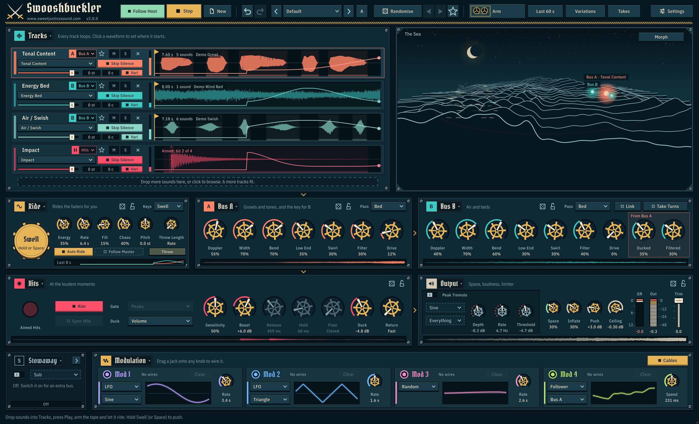](#-swooshbuckler) | [](#-subbertone) |
|:---:|:---:|
| **[Swooshbuckler](#-swooshbuckler)**<br>The whoosh-making rig | **[Subbertone](#-subbertone)**<br>Sub, harmonics and mastering for bass |
| [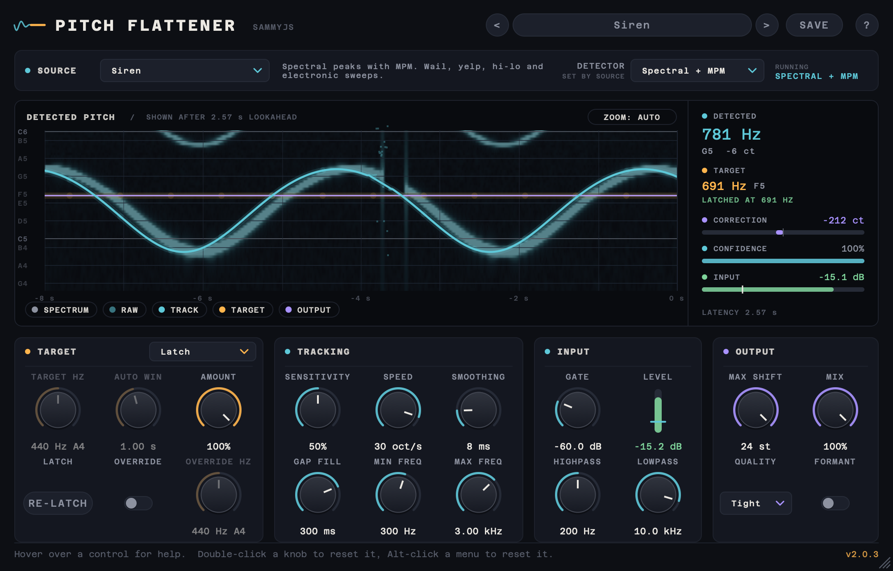](#-pitch-flattener) | [](#-reversinator) |
| **[Pitch Flattener](#-pitch-flattener)**<br>Doppler, sirens and vibrato, flattened | **[Reversinator](#-reversinator)**<br>Backwards Machine, reborn in real time |

[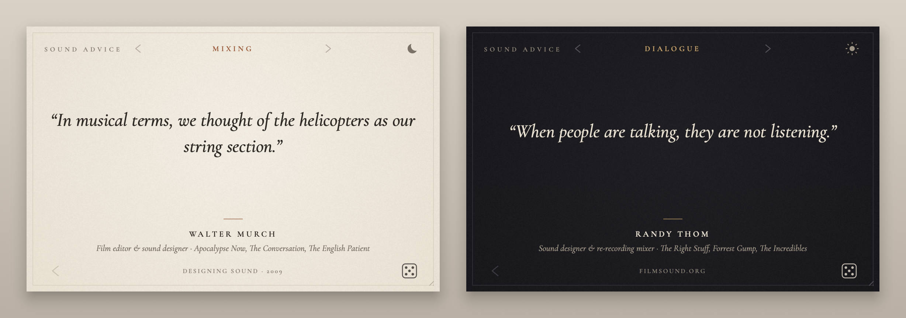](#-sound-advice)<br>
**[Sound Advice](#-sound-advice)**<br>Hard-won advice from the great creative minds behind film, TV and game sound

</div>

---

## ⚔️ Swooshbuckler

> *Ten sounds go in. A tape full of whooshes comes out.*

<p align="center">
  
</p>

Drop in up to ten sounds (cloth, air, engines, creatures, metal) and Swooshbuckler works out what each one is and sends it to Bus A, Bus B or the Hits. Then it rides every fader by itself, so the layers swell, fly past as Doppler passes and fall away. Hold **Swell** (the space bar, a MIDI note or a click on the sea) to push it all harder. Arm the tape and it records every whoosh into one file and skips the silence. Missed one? **LAST 60s** grabs the last minute anyway.

- 🎚️ **Auto ride** across up to ten looping tracks, each fader on its own path, shaped by Energy, Rate, Fill, Chaos and Pitch
- 🧠 **Smart loading** finds the separate sounds in each file, skips the gaps and guesses what each one is from the audio and the file name
- 🌀 **Two Doppler buses** with Width, Bend, Low End, Swirl, an envelope filter and Drive. Bus A can duck and darken Bus B, or they **Take Turns**
- 🧬 **Spectral morph pad** blends A into B (Blend, Glide or vocoder-style Cross), and can wander along a Lorenz loop, a rose or a figure eight
- 💥 **Hit gate** fires your impacts at the biggest swells, and **Sync Hits** stacks their transients into one huge hit
- 🔌 **Four drag-a-cable modulators** (LFO, Random, Follower, Macro), plus **7 factory presets** and a RANDOMISE button

<details>
<summary>More screenshots</summary>
<br>
<p align="center">
  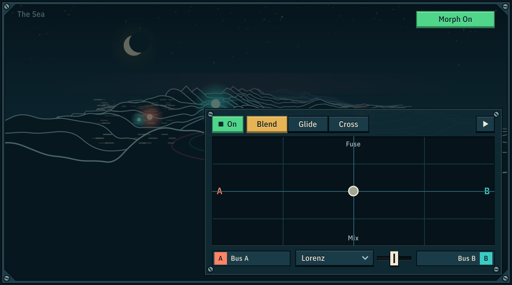
  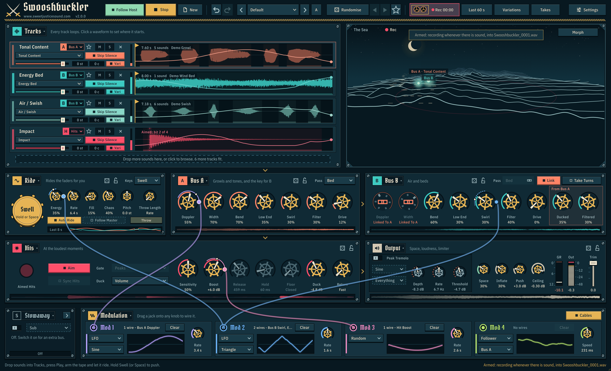
</p>
<p align="center">
  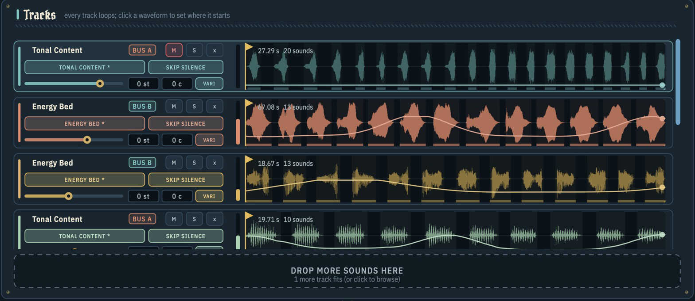
</p>
</details>

**App** (macOS, Windows) · **VST3** · **AU** &nbsp;&nbsp;
[](https://github.com/samueljustice/plugins/releases/tag/swooshbuckler-v1.0.2) &nbsp;
[Read the manual →](swooshbuckler/README.md)

---

## 🔊 Subbertone

> *A clean octave down, a bass that survives a phone speaker, or a talking growl. Your call.*

<p align="center">
  
</p>

Subbertone follows the pitch of your bass, engine or drone and adds a clean sub one octave below. That's only the start: build its harmonics bar by bar, from pure sub reinforcement, to the trick that makes a bass audible on speakers that can't play a sub, to a growling, talking octave-down monster. Saturation, a resonant filter and a mastering stage finish it off, with about 2 ms of latency that your host compensates for.

- 🧲 **Phase Align** lines the new harmonics up with your bass's own, so they add up instead of cancelling. Notes thin out far less, repeat hits land at the same level, and it adds no latency
- 🎹 **16-bar harmonic editor** with a live meter on every bar: H1 is the sub, H2 to H16 its harmonics. Draw them, pick a pattern, or switch the **sub off** and keep only the harmonics for small speakers
- 🔥 **Six saturation types** (Tape, Valve, Console, Transformer, Rectifier, Wavefolder) into a **resonant, envelope-swept filter** that makes the bass talk
- 🧱 **Master stage**: Inflate with a Curve control, then a look-ahead brickwall limiter with a ceiling and a gain-reduction meter
- 🎯 **Steady tracking**: octave jumps are confirmed before the sub follows, dropouts are held, Glide tames wandering engines, and a Lo Cut keeps a very low sub from eating your headroom
- 🚗 **32 factory presets** in five groups, including engines from inline-4 to V12, V-twin and 2-stroke

<details>
<summary>More screenshots</summary>
<br>
<p align="center">
  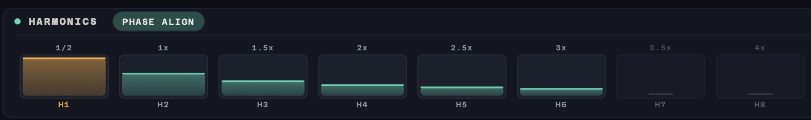
</p>
<p align="center">
  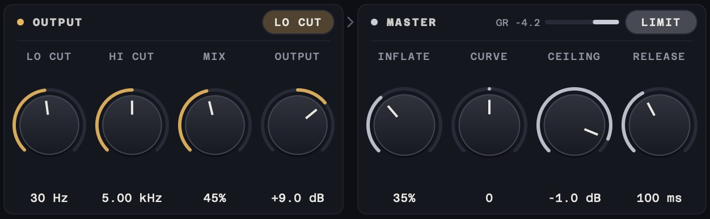
</p>
<p align="center">
  
  
</p>
</details>

**VST3** (macOS, Windows) · **AU** (macOS) &nbsp;&nbsp;
[](https://github.com/samueljustice/plugins/releases/tag/subbertone-v1.3.1) &nbsp;
[Read the manual →](subbertone/README.md)

---

## 🚨 Pitch Flattener

> *The siren keeps wailing. The pitch doesn't.*

<p align="center">
  
</p>

Pitch Flattener takes the pitch movement out of a sound and keeps its energy and character: the Doppler sweep from a pass-by, the wail from a siren, the vibrato from a voice. Or lock a warbling tone to one note. Pick a Source Type and it loads a pitch detector built for that kind of sound, looks about 2.6 seconds ahead, and lines the correction up with the audio sample-accurately. Made for offline rendering: the Soundminer DSP rack, a DAW bounce or AudioSuite-style processing.

- 🎯 **Eight Source Types** (Vocal, Instrument, Siren, Whistle, Engine / Doppler, Drone, Noisy Field, Custom), each with its own tuned detector
- 🔭 **Lookahead tracking** fixes octave errors, bridges gaps and smooths with zero lag, so the very first syllable or rev is already flat
- 🎚️ **Latch, Fixed or Auto**: hold each sound at the pitch it starts on, flatten everything to one note (type `A4`), or take out only the vibrato and keep the melody
- 📈 **Live pitch display**: eight seconds of detection, track, target and corrected output over a spectrogram
- 📏 **Measured, not guessed**: the test suite flattens a siren wail to within 2 cents and an engine pass-by to within 1 cent
- 💾 **Amount** for half-flattened results, **Formant** for natural-sounding voices, and presets you can save

<details>
<summary>More screenshots</summary>
<br>
<p align="center">
  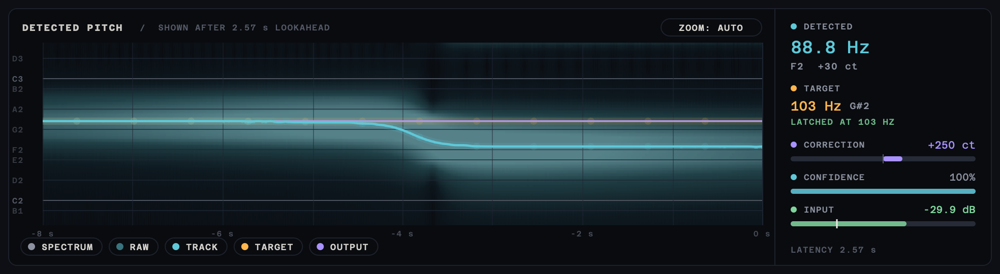
  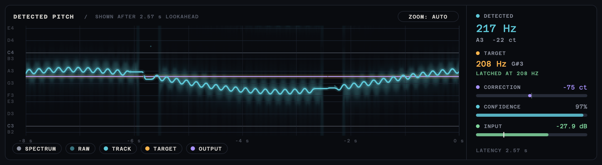
</p>
</details>

**VST3** (macOS, Windows) · **AU** (macOS) &nbsp;&nbsp;
[](https://github.com/samueljustice/plugins/releases/tag/pitchflattener-v2.0.3) &nbsp;
[Read the manual →](pitchflattener/README.md)

---

## ⏪ Reversinator

> *.sdrawkcab emit lear ni tI*

<p align="center">
  
</p>

A real-time reverser that faithfully recreates Backwards Machine's three effects, **Reverse Playback**, **Forward Backwards** and **Reverse Repeat**, rebuilt from a study of the original's signal flow. It lives in a new resizable interface with a live display of each read head sweeping backwards through your audio, and it fixes the original's glitches, so every change is click-free.

- 🎯 **Checked against the real thing**: nulls against the original's own renders at 0.999+ correlation
- ⏪ **Three classic effects**, with the original's sweeps, windows, vibrato and gain staging
- 👀 **Live snippet display** that draws every read head as it sweeps backwards through your input
- 🤫 **Click-free everywhere**: TIME sweeps, mode switches, the big REVERSER button and host bypass all crossfade, at any buffer size
- ⏳ **Hourglass TIME** from 0.5 to 4 s, plus feedback that builds cascades of echoes, alternating direction
- 🔍 **Resizable from 75% to 200%**, mono or stereo, any sample rate, zero latency

<details>
<summary>More screenshots</summary>
<br>
<p align="center">
  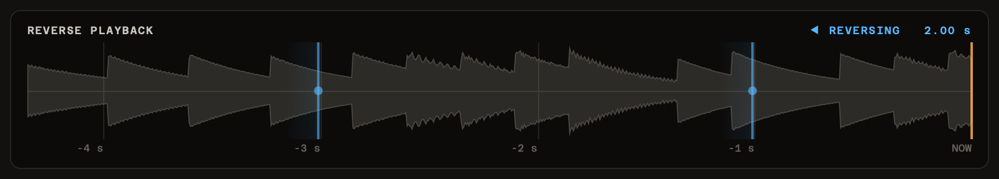
  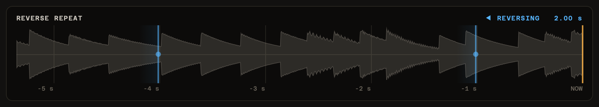
</p>
</details>

**VST3** (macOS, Windows) · **AU** (macOS) &nbsp;&nbsp;
[](https://github.com/samueljustice/plugins/releases/tag/reversinator-v2.0.3) &nbsp;
[Read the manual →](reversinator/README.md)

---

## 🎲 Sound Advice

> *Stuck? Roll the die and ask one of the greats.*

<p align="center">
  
</p>

A small, quiet page of hard-won advice from the creative people behind great film, TV, game and trailer sound: re-recording mixers, sound designers, supervising editors, game audio directors and more, plus a legendary Disney Imagineer on leading creative work. Pick what you're working on (mixing, creatures, dialogue, silence, running a creative team...) and roll the die. It deals you a field note on a real technique or decision, or a quote in their own words, tied to the production it came from.

- 📚 **712 entries from 145 people**, each name linked to their credits
- 🔗 **Every entry traced to its source**: click through to the original interview, article or SoundWorks Collection video
- 🛠️ **Concrete, not fortune-cookie**: mostly field notes on real sources, recording methods and mix decisions
- 🗂️ **17 categories**, from Mixing and Field Recording to Horror & Tension, Silence & Restraint and Creativity & Teams. Each is a shuffled deck, so nothing repeats until you've seen the lot
- 🌗 **Paper by day, ink by night**, with keyboard shortcuts and right-click to copy
- 🔇 **Audio passes straight through**, so it can sit on a mix bus, or run as an app on a second screen

**App** (macOS, Windows) · **VST3** · **AU** &nbsp;&nbsp;
[](https://github.com/samueljustice/plugins/releases/tag/soundadvice-v1.0.7) &nbsp;
[Read the manual →](soundadvice/README.md)

---

## 🛠️ For developers

<details>
<summary><b>Building from source</b></summary>
<br>

Every project builds with CMake and expects its dependencies in `SDK/` at the root of this repository (not committed):

| Dependency | Used by |
|---|---|
| [JUCE](https://github.com/juce-framework/JUCE) 8.0.8, at `SDK/JUCE` | Swooshbuckler, Sound Advice, Subbertone, Pitch Flattener, Reversinator, Stretch Armstrong |
| [RubberBand](https://breakfastquay.com/rubberband/) 4.0.0, at `SDK/rubberband-4.0.0` | Pitch Flattener, Stretch Armstrong |
| Beat-and-Tempo-Tracking, at `SDK/Beat-and-Tempo-Tracking`, and [py-ptsl](https://pypi.org/project/py-ptsl/) | PTSL Beat Tool |

Then, from a project's folder:

```bash
cmake -B build -DCMAKE_BUILD_TYPE=Release
cmake --build build --config Release
```

See each project's README for its own options.

</details>

<details>
<summary><b>Making a release</b></summary>
<br>

Each project has a GitHub Actions workflow in `.github/workflows/` that builds, signs and notarises it for macOS (and builds it for Windows where supported), then publishes a release. Push a tag named after the project to start one, for example:

```bash
git tag swooshbuckler-v1.0.0
git push origin swooshbuckler-v1.0.0
```

The tag prefixes are `swooshbuckler-v`, `soundadvice-v`, `subbertone-v`, `pitchflattener-v`, `reversinator-v`, `stretcharmstrong-v` and `ptsl-beattool-v`.

When a plug-in's release finishes, `build-release_bundle.yml` rebuilds the combined **Sammy J's Plugins** installer for macOS and Windows from every plug-in's newest release, and publishes it as the repository's Latest release (tagged `bundle-v<date>.<run>`), which the download buttons at the top link to, and deletes the installer releases it replaces. It doesn't rebuild the plug-ins; it repackages what their releases published. The plug-ins it includes are listed in [`bundle/plugins.txt`](bundle/plugins.txt). Run it by hand from the Actions tab to rebuild it now.

</details>

**License:** each project and dependency has its own license; see the LICENSE file in each folder.

---

<div align="center">

### 👋 Made by Samuel Justice

Creative Sound Supervisor at **[Sweet Justice](https://www.sweetjusticesound.com)**

<sub>Found a bug or have an idea? <a href="https://github.com/samueljustice/plugins/issues">Open an issue</a>.</sub>

</div>
