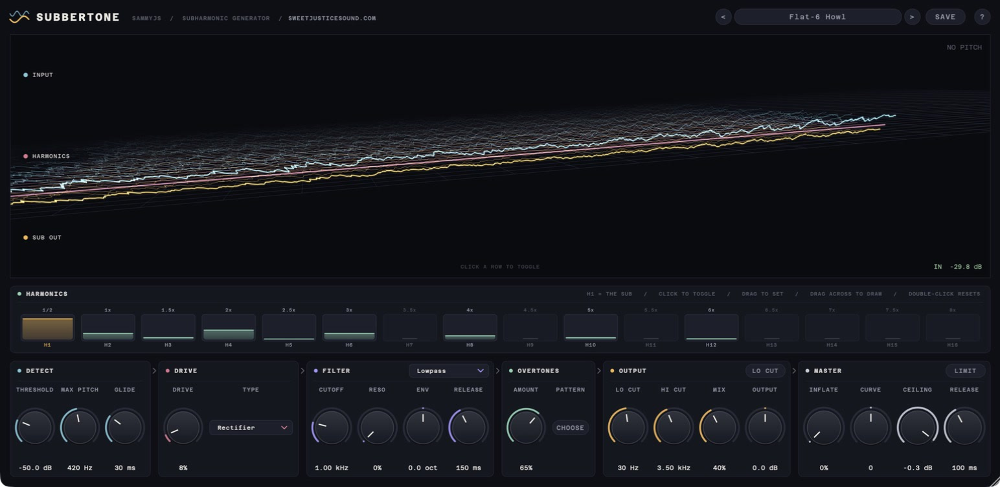
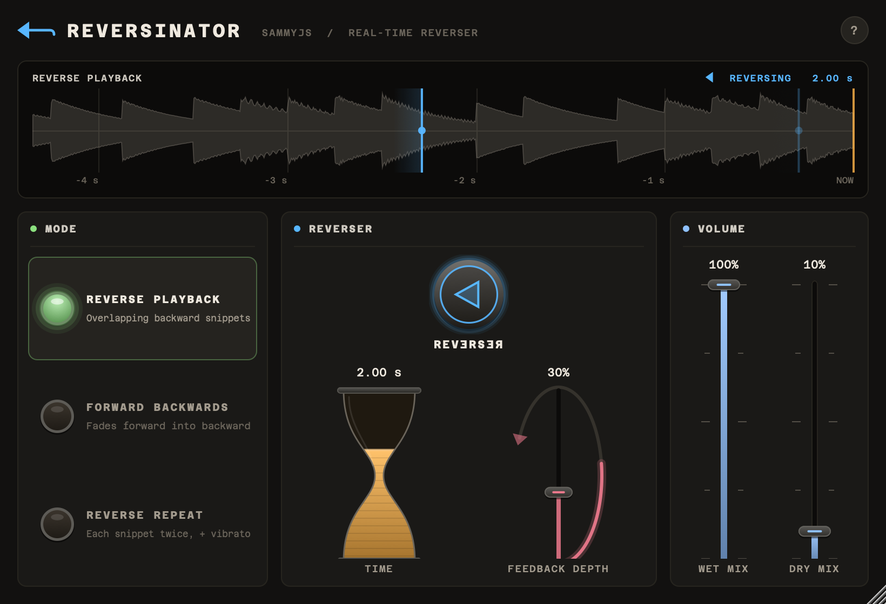
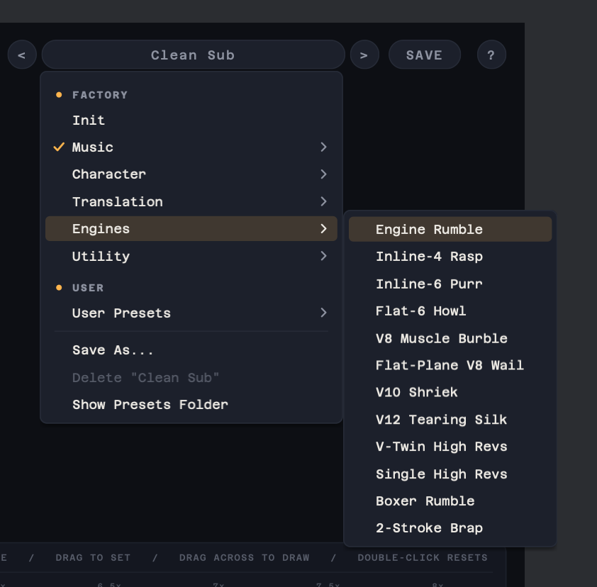
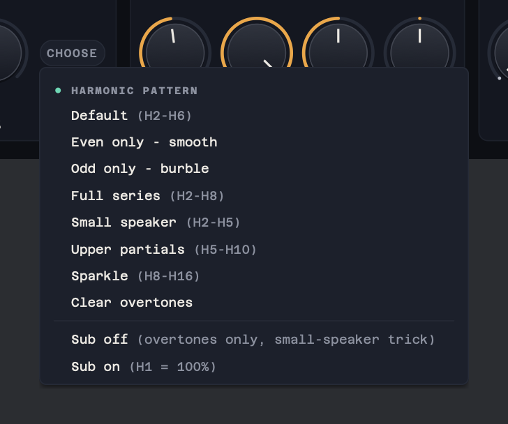

<div align="center">

# Samuel Justice Audio Plugins

**Toys I've made for sound designers.**

[](https://github.com/samueljustice/plugins/releases)
[](https://github.com/samueljustice/plugins/releases)
[](https://github.com/samueljustice/plugins/releases)


[](https://juce.com)


<br>

| [](#-swooshbuckler) | [](#-subbertone) |
|:---:|:---:|
| **[Swooshbuckler](#-swooshbuckler)**<br>The whoosh-making rig | **[Subbertone](#-subbertone)**<br>Subharmonic generator |
| [](#-pitch-flattener) | [](#-reversinator) |
| **[Pitch Flattener](#-pitch-flattener)**<br>Doppler, sirens and vibrato, flattened | **[Reversinator](#-reversinator)**<br>Real-time reverser |

[](#-sound-advice)<br>
**[Sound Advice](#-sound-advice)**<br>Advice from the great sound designers and mixers

</div>

---

## ⚔️ Swooshbuckler

> *Ten sounds go in. A tape full of whooshes comes out.*

<p align="center">
  
</p>

Drop in up to ten sounds and Swooshbuckler rides the faders across them for you, making Doppler passes, swells, hits and tails, while a tape records every one and skips the silence. Hold **Swell** (or the space bar) to push it harder, then pull the best takes off the tape.

- 🎚️ **Auto ride** across up to ten tracks: energy, rate, fill, chaos, pitch
- 🌀 **Two effect buses** with Doppler, swirl, bend and drive, and a spectral morph between them
- 💥 **Hit gate** that punches in at the loudest moments
- 🔌 **Modulators** you drag onto any knob by the jack
- 📼 **Always recording**: grab the last 60 seconds whenever something good happens

**App** (macOS, Windows) · **VST3** · **AU** &nbsp;&nbsp;
[](https://github.com/samueljustice/plugins/releases/tag/swooshbuckler-v1.0.0) &nbsp;
[Read the manual →](swooshbuckler/README.md)

---

## 🔊 Subbertone

> *A clean octave down, or a growl. Your call.*

<p align="center">
  
</p>

Subbertone tracks the pitch of your bass, engine or drone and adds a sub one octave below. Use it for pure sub reinforcement, for bass that still reads on a phone speaker, or for a growling octave-down monster.

- 🎹 **16-bar harmonic editor** with pattern presets
- 🔥 **Six saturation types** and a resonant, envelope-swept filter
- 🧱 **Mastering stage**: Inflate and a brickwall limiter
- 🚗 **32 factory presets**, engines included

<details>
<summary>More screenshots</summary>
<br>
<p align="center">
  
  
</p>
</details>

**VST3** · **AU** &nbsp;&nbsp;
[](https://github.com/samueljustice/plugins/releases/tag/subbertone-v1.2.0) &nbsp;
[Read the manual →](subbertone/README.md)

---

## 🚨 Pitch Flattener

> *The siren keeps wailing. The pitch doesn't.*

<p align="center">
  
</p>

Pitch Flattener removes pitch movement: the Doppler sweep from a pass-by, the wail from a siren, the vibrato from a voice. Pick a Source Type and it uses a pitch detector built for that sound, looks ahead to track the pitch, and flattens it sample-accurately. Made for offline-rendering hosts such as the Soundminer DSP rack.

**VST3** · **AU** &nbsp;&nbsp;
[](https://github.com/samueljustice/plugins/releases/tag/pitchflattener-v2.0.1) &nbsp;
[Read the manual →](pitchflattener/README.md)

---

## ⏪ Reversinator

> *.sdrawkcab emit lear ni tI*

<p align="center">
  
</p>

A real-time reverser: a faithful, modernised recreation of Backwards Machine's three effects, **Reverse Playback**, **Forward Backwards** and **Reverse Repeat**, with a live display of the read heads sweeping backwards through your audio.

**VST3** · **AU** &nbsp;&nbsp;
[](https://github.com/samueljustice/plugins/releases/tag/reversinator-v2.0.0) &nbsp;
[Read the manual →](reversinator/README.md)

---

## 🎲 Sound Advice

> *Stuck? Roll the die and ask one of the greats.*

<p align="center">
  
</p>

A small, quiet page of advice from the great film, TV and game sound designers and mixers. Pick what you're working on (mixing, trailers, creatures, dialogue, silence, running a creative team...) and roll the die: it deals you a quote or a technique from one of them, with a link to where it came from.

- 📚 **792 entries from 141 people**, every one traced to an interview, article or SoundWorks Collection video
- 🗂️ **17 categories**, from Mixing and Dialogue to Horror & Tension and Creativity & Teams
- 🌗 **Paper by day, ink by night**
- 🔇 **Audio passes straight through**, so it can sit on a mix bus or on a second screen as an app

**App** (macOS, Windows) · **VST3** · **AU** &nbsp;&nbsp;
[](https://github.com/samueljustice/plugins/releases/tag/soundadvice-v1.0.2) &nbsp;
[Read the manual →](soundadvice/README.md)

---

## 🛠️ For developers

<details>
<summary><b>Building from source</b></summary>
<br>

Every project builds with CMake and expects its dependencies in `SDK/` at the root of this repository (not committed):

| Dependency | Used by |
|---|---|
| [JUCE](https://github.com/juce-framework/JUCE) 8.0.8, at `SDK/JUCE` | Swooshbuckler, Sound Advice, Subbertone, Pitch Flattener, Reversinator, Stretch Armstrong |
| [RubberBand](https://breakfastquay.com/rubberband/) 4.0.0, at `SDK/rubberband-4.0.0` | Pitch Flattener, Stretch Armstrong |
| Beat-and-Tempo-Tracking, at `SDK/Beat-and-Tempo-Tracking`, and [py-ptsl](https://pypi.org/project/py-ptsl/) | PTSL Beat Tool |

Then, from a project's folder:

```bash
cmake -B build -DCMAKE_BUILD_TYPE=Release
cmake --build build --config Release
```

See each project's README for its own options.

</details>

<details>
<summary><b>Making a release</b></summary>
<br>

Each project has a GitHub Actions workflow in `.github/workflows/` that builds, signs and notarises it for macOS (and builds it for Windows where supported), then publishes a release. Push a tag named after the project to start one, for example:

```bash
git tag swooshbuckler-v1.0.0
git push origin swooshbuckler-v1.0.0
```

The tag prefixes are `swooshbuckler-v`, `soundadvice-v`, `subbertone-v`, `pitchflattener-v`, `reversinator-v`, `stretcharmstrong-v` and `ptsl-beattool-v`.

</details>

**License:** each project and dependency has its own license; see the LICENSE file in each folder.

---

<div align="center">

### 👋 Made by Samuel Justice

Creative Sound Supervisor at **[Sweet Justice](https://www.sweetjusticesound.com)**

<sub>Found a bug or have an idea? <a href="https://github.com/samueljustice/plugins/issues">Open an issue</a>.</sub>

</div>
