<div align="center">

# Sammy J's Plugins

**Toys and utilities I've made for sound designers.**


[](https://juce.com)


<!-- get-them-all:start (written by .github/workflows/build-release_bundle.yml; edits here are replaced) -->
### Get them all

[](https://github.com/samueljustice/plugins/releases/download/bundle-v2026.11.14.150/SammyJ-Plugins-2026-11-14-1503-macOS.dmg)
[](https://github.com/samueljustice/plugins/releases/download/bundle-v2026.11.14.150/SammyJ-Plugins-2026-11-14-1503-Windows-Installer.exe)

<sub>One installer with the newest version of every plug-in: Swooshbuckler 2.1.0 · Sound Advice 1.0.13 · Subbertone 1.3.2 · Pitch Flattener 2.4.0 · Reversinator 2.0.4 · Roarschach 1.2.0.<br>
Apps, VST3, AU and signed AAX for Pro Tools. It replaces older copies, and comes with an uninstaller (macOS: on the disk image; Windows: Settings &gt; Apps).<br>
Built 14 Nov 2026, 15:03 UTC. Older versions are on the <a href="https://github.com/samueljustice/plugins/releases">releases</a> page.</sub>
<!-- get-them-all:end -->

<sub>If these get some use in your work and you'd like to chip in, you can <a href="https://www.paypal.com/donate/?business=sam%40samueljustice.net&no_recurring=1&item_name=Sammy+J%27s+Plugins">toss a coin in the jar</a> on PayPal. Every bit goes towards more of them.</sub>

<br>

| [Roarschach](#roarschach) | [Swooshbuckler](#swooshbuckler) | [Tonal Recall](#tonal-recall) |
|:---:|:---:|:---:|
| [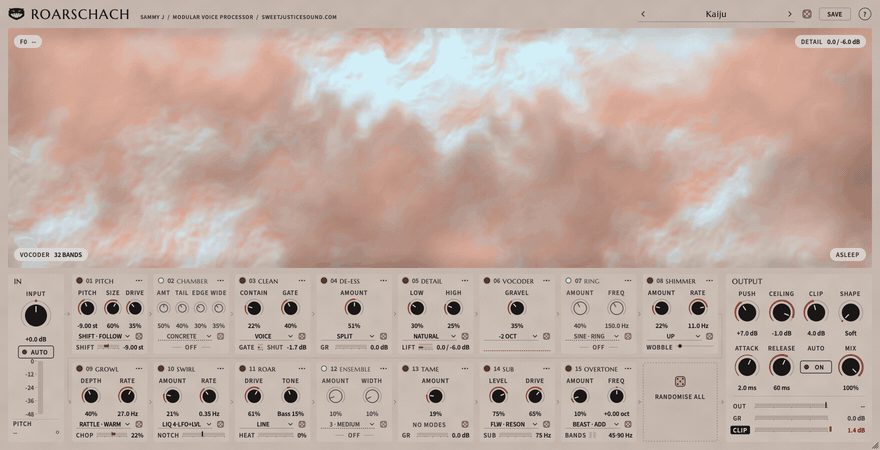](#roarschach) | [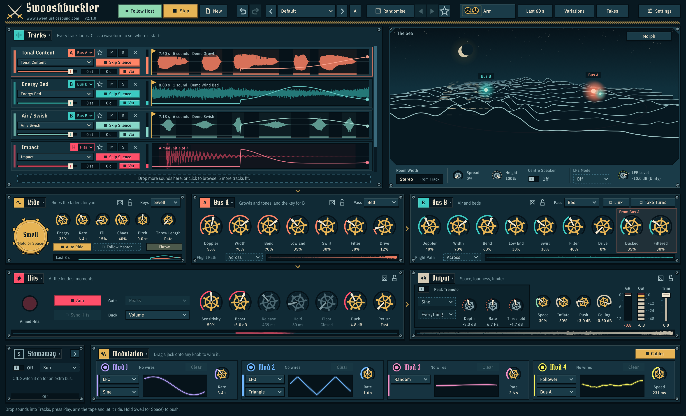](#swooshbuckler) | [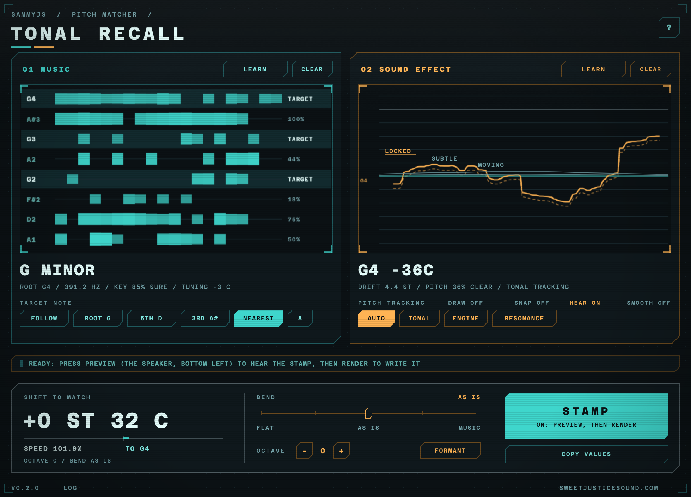](#tonal-recall) |
| <sub>A modular voice processor for exploration and fun</sub> | <sub>Generates whooshes from up to ten sounds</sub> | <sub>Pitch-matches sound effects to music in Pro Tools AudioSuite</sub> |

| [Pitch Flattener](#pitch-flattener) | [Reversinator](#reversinator) | [Sound Advice](#sound-advice) | [Subbertone](#subbertone) |
|:---:|:---:|:---:|:---:|
| [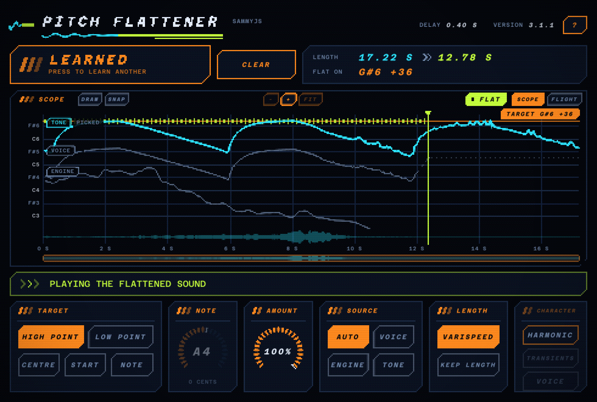](#pitch-flattener) | [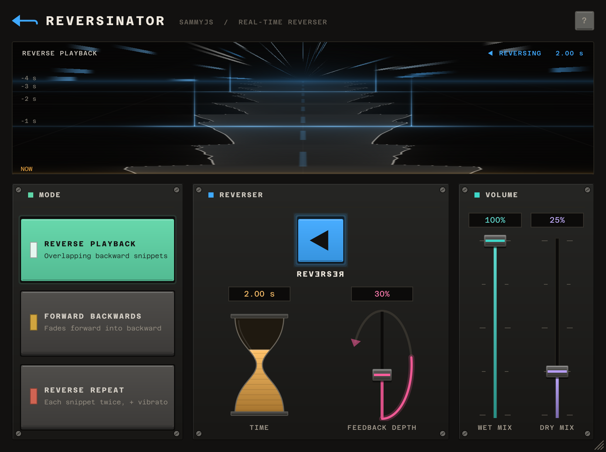](#reversinator) | [](#sound-advice) | [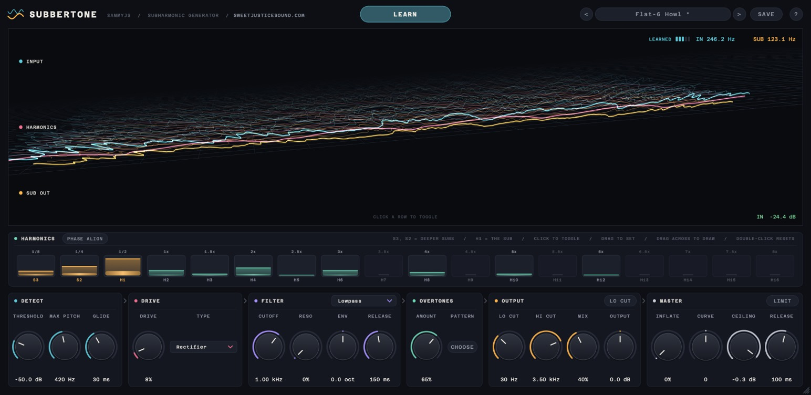](#subbertone) |
| <sub>Learns a sound and plays it back with its pitch flat</sub> | <sub>Real-time reverse effects</sub> | <sub>Advice from sound professionals</sub> | <sub>Sub and harmonics for bass<br></sub> |

</div>

## Roarschach

<p align="center">
  
</p>

A voice processor for making creature and machine voices, or just a bigger voice. It has fifteen modules (pitch and throat size, a small speaker in a room, a vocoder, a ring modulator, growl, tube saturation, a tracked sub and others) and you can drag them into any order. Each module has a die that randomises it within sensible ranges, and there are 51 presets to start from.

The picture above the chain is an ink blot that forms out of cloud and moves with the voice. It does nothing to the sound.

<details>
<summary>More screenshots</summary>
<br>
<p align="center">
   
</p>
<p align="center">
  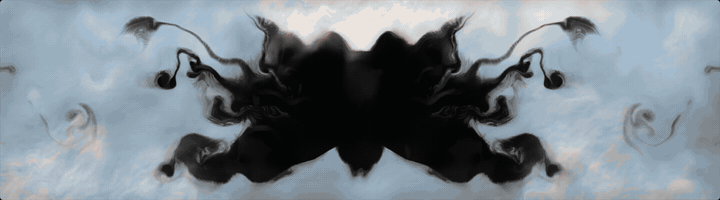
</p>
<p align="center">
  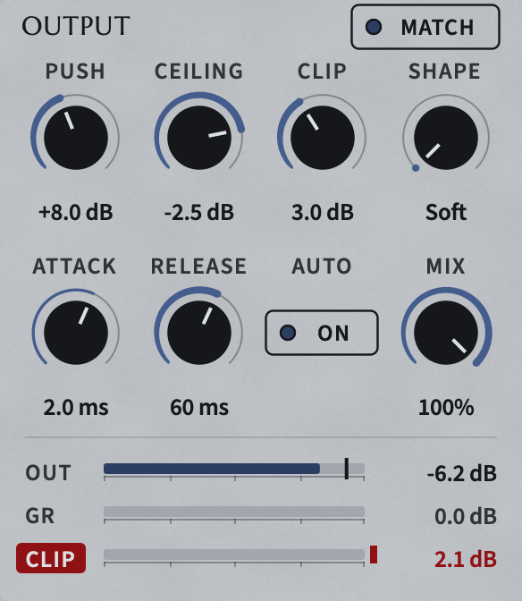 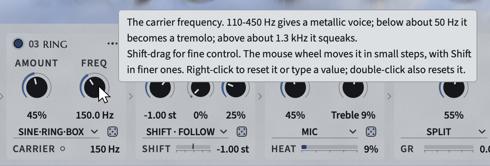
</p>
</details>

**VST3** (macOS, Windows) · **AU** (macOS) · **AAX**<br>
[Get it in the installer](https://github.com/samueljustice/plugins/releases/latest) · [Read the manual →](roarschach/README.md)

## Swooshbuckler

<p align="center">
  
</p>

A whoosh maker. Drop in up to ten sounds and it sorts them onto two Doppler buses and a hits layer, then moves every fader by itself so the layers swell, pass and fall away. Hold Swell (or the space bar, or a MIDI note) to push it harder. A tape records every whoosh into one file and leaves out the silence, and Last 60 s saves the last minute if you weren't recording.

There is more in it: a spectral morph between the two buses, a third bus called Stowaway, modulators you patch with cables, and batch rendering of variations. The manual covers all of it. It runs as an app as well as a plug-in.

<details>
<summary>More screenshots</summary>
<br>
<p align="center">
  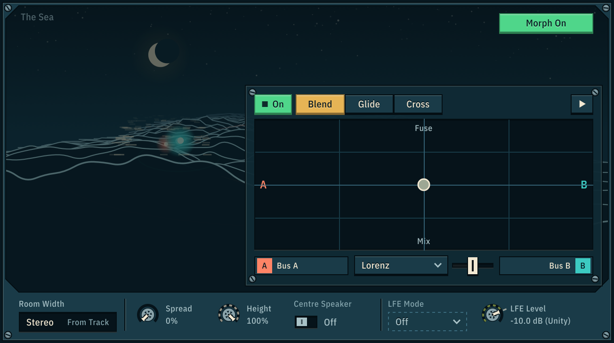
  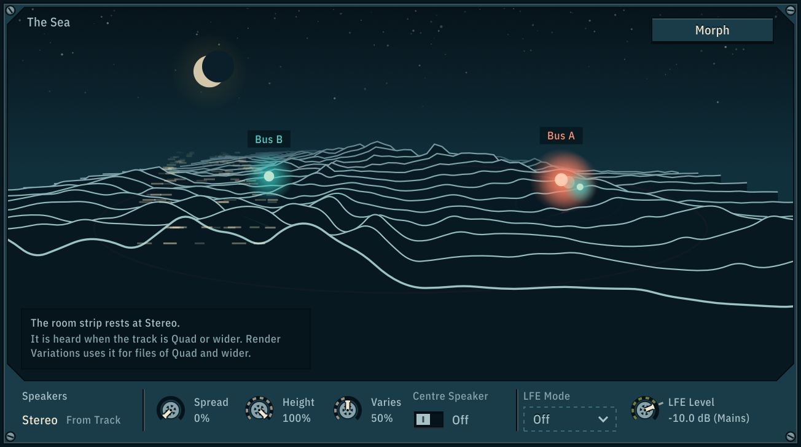
</p>
<p align="center">
  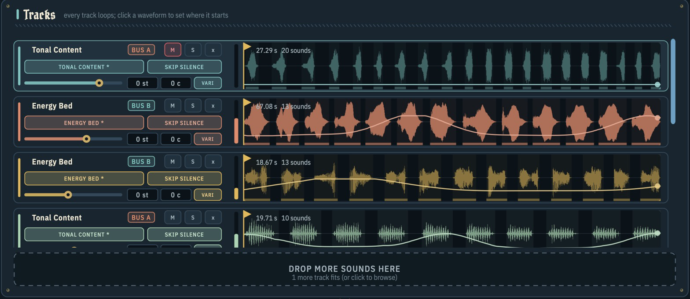
</p>
</details>

**App** (macOS, Windows) · **VST3** · **AU** · **AAX**<br>
[Get it in the installer](https://github.com/samueljustice/plugins/releases/latest) · [Read the manual →](swooshbuckler/README.md)

## Tonal Recall

<p align="center">
  
</p>

Pitch-matches a sound effect to the music under it. It's for trailer work, where stings, hits and tails should land on one of the music's notes. You play it the music, then the effect, and it works out a shift, shows it as a curve you can edit, and stamps it onto the clip when you render. The clip keeps its length and its hits stay where they were.

It is an offline tool for Pro Tools AudioSuite, not a live effect. The VST3 and AU versions work the same way in other hosts.

<details>
<summary>More screenshots</summary>
<br>
<p align="center">
  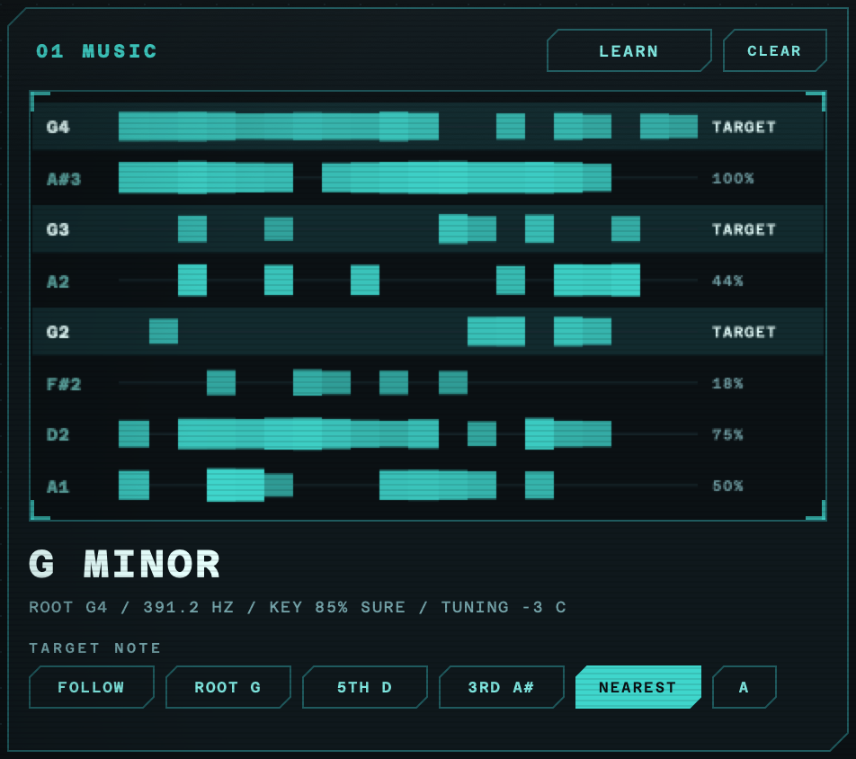 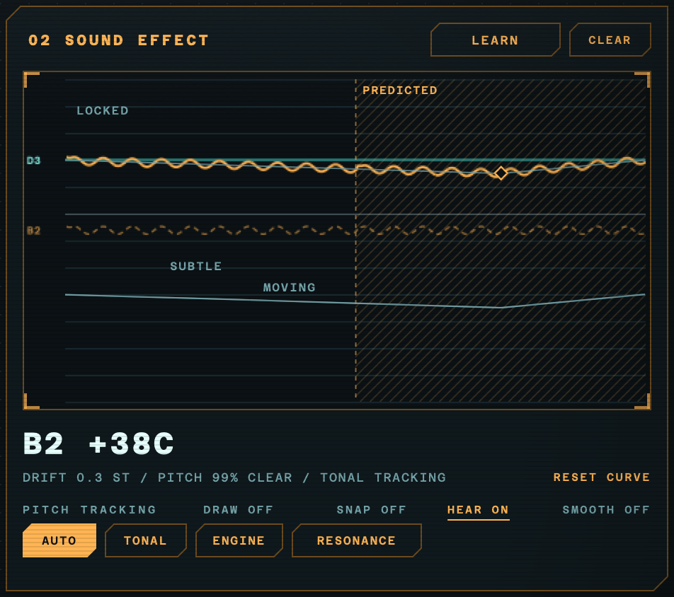
</p>
<p align="center">
  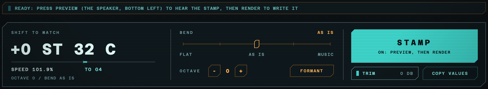
</p>
<p align="center">
  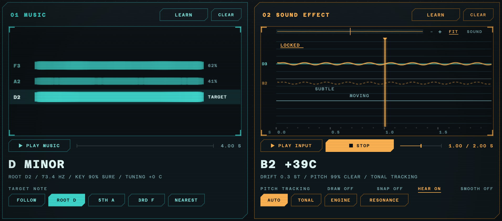
</p>
</details>

**AAX AudioSuite** (macOS, Windows) · **VST3** and **AU** for offline use in other hosts<br>
[Get it in the installer](https://github.com/samueljustice/plugins/releases/latest) · [Read the manual →](tonalrecall/README.md)

## Pitch Flattener

<p align="center">
  
</p>

Takes the pitch movement out of a sound: the sweep of a pass-by, a siren's wail, an engine's climb, vibrato. Press Learn and play the sound once. It reads the pitch of the whole sound and makes a flat version by speeding the playback up and slowing it down from moment to moment, so the pitch stays put however fast it bends, and the length changes. Play the same sound again and you hear the flat version, from wherever you start.

It can hold the sound at the top of its pitch, the bottom, the middle, where it starts, or a note you type. It is made for a rack or a DAW (learn, then play or render), and adds a fixed delay of 0.4 seconds that the host makes up for. In its tests a 7-semitone pass-by and a siren wailing over 15 semitones both come out with no measurable movement.

<details>
<summary>More screenshots</summary>
<br>
<p align="center">
  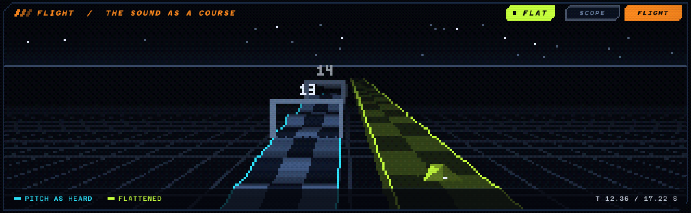
</p>
<p align="center">
  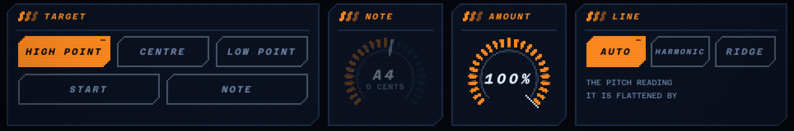
</p>
</details>

**VST3** (macOS, Windows) · **AU** (macOS) · **AAX**<br>
[Get it in the installer](https://github.com/samueljustice/plugins/releases/latest) · [Read the manual →](pitchflattener/README.md)

## Reversinator

<p align="center">
  
</p>

A real-time reverser. It recreates the three effects of Backwards Machine (Reverse Playback, Forward Backwards and Reverse Repeat), rebuilt from a study of the original's signal flow and checked against the original's own renders, which it matches at better than 0.999 correlation. What's different is a resizable window, a display that shows the read heads sweeping back along a road into the past, and no clicks when you change a setting.

<details>
<summary>More screenshots</summary>
<br>
<p align="center">
  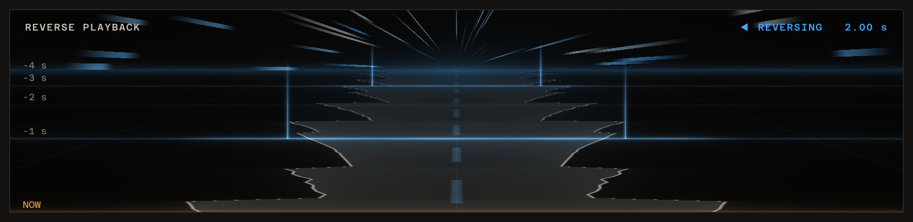
  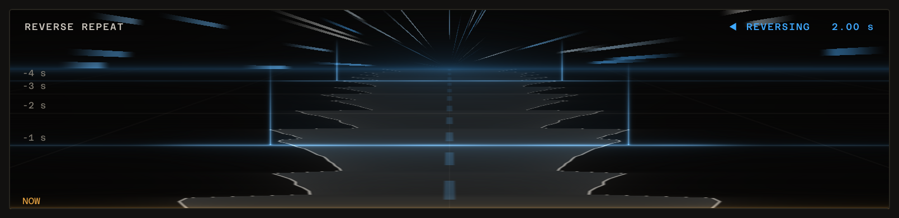
</p>
</details>

**VST3** (macOS, Windows) · **AU** (macOS) · **AAX**<br>
[Get it in the installer](https://github.com/samueljustice/plugins/releases/latest) · [Read the manual →](reversinator/README.md)

## Sound Advice

<p align="center">
  
</p>

Not an effect: a page of advice. Pick what you're working on (mixing, creatures, dialogue, silence, running a team) and roll the die, and it shows you something a working sound person said or did about it, with the production it came from and a link to the source. There are 839 entries from 147 people: mixers, sound designers, editors, game audio directors, and a Disney Imagineer on leading creative work.

Audio passes straight through it, so it can sit on a mix bus, or run as an app on another screen.

**App** (macOS, Windows) · **VST3** · **AU** · **AAX**<br>
[Get it in the installer](https://github.com/samueljustice/plugins/releases/latest) · [Read the manual →](soundadvice/README.md)

## Work in progress


This one works, but I'm still changing it, so expect differences between releases.

### Subbertone

<p align="center">
  
</p>

Follows the pitch of a bass, engine or drone and adds a sub an octave below. You can then draw in its harmonics, up to the sixteenth, which takes it from plain sub reinforcement to a bass you can hear on small speakers, or to a growl. Phase Align lines the added harmonics up with the ones already in the sound, so they add instead of cancelling. After that come saturation, a resonant filter and a limiter. It has about 2 ms of latency, which it reports to the host.

<details>
<summary>More screenshots</summary>
<br>
<p align="center">
  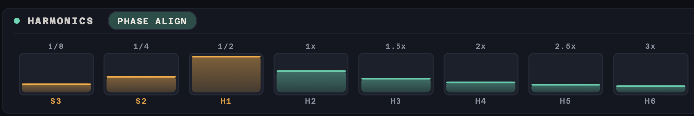
</p>
<p align="center">
  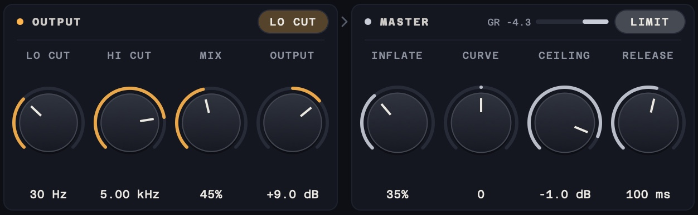
</p>
<p align="center">
  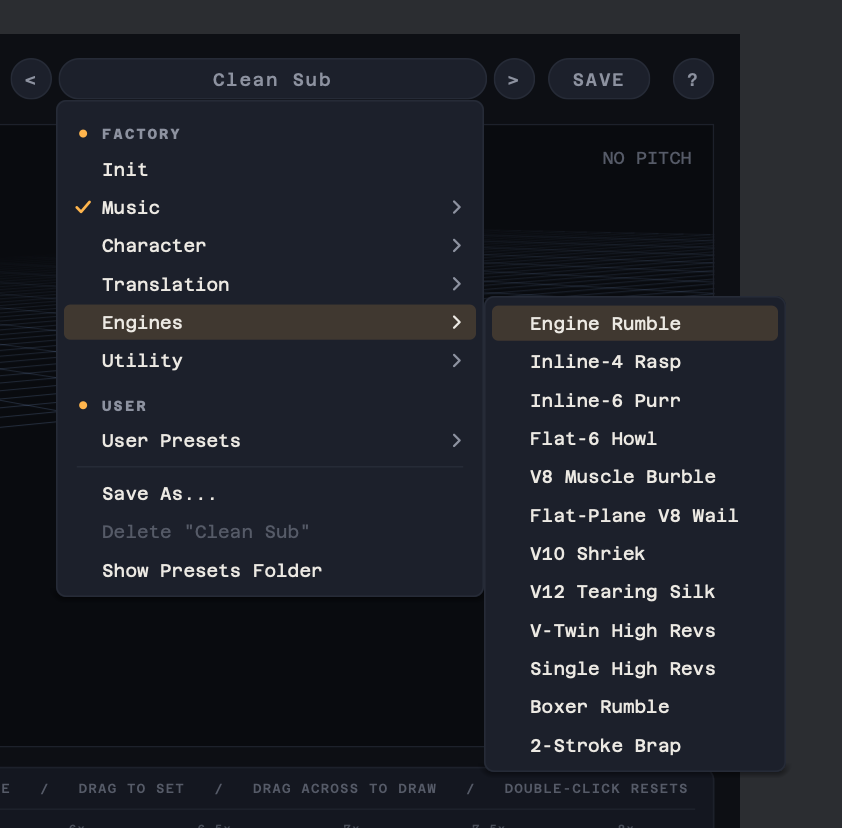
  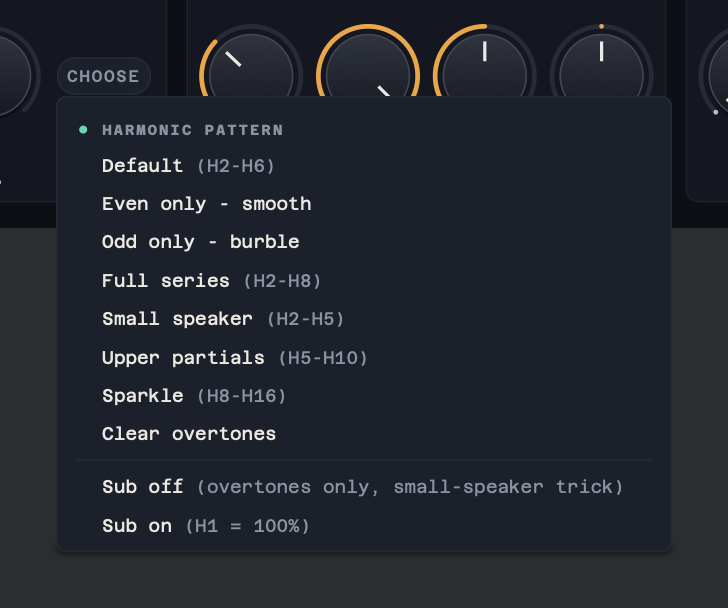
</p>
</details>

**VST3** (macOS, Windows) · **AU** (macOS) · **AAX**<br>
[Get it in the installer](https://github.com/samueljustice/plugins/releases/latest) · [Read the manual →](subbertone/README.md)

## For developers

<details>
<summary><b>Building from source</b></summary>
<br>

Every project builds with CMake and expects its dependencies in `SDK/` at the root of this repository (not committed):

| Dependency | Used by |
|---|---|
| [JUCE](https://github.com/juce-framework/JUCE) 8.0.8, at `SDK/JUCE` | Swooshbuckler, Sound Advice, Subbertone, Pitch Flattener, Reversinator, Roarschach, Tonal Recall, Stretch Armstrong |
| [RubberBand](https://breakfastquay.com/rubberband/) 4.0.0, at `SDK/rubberband-4.0.0` | Tonal Recall, Stretch Armstrong |
| Beat-and-Tempo-Tracking, at `SDK/Beat-and-Tempo-Tracking`, and [py-ptsl](https://pypi.org/project/py-ptsl/) | PTSL Beat Tool |

Then, from a project's folder:

```bash
cmake -B build -DCMAKE_BUILD_TYPE=Release
cmake --build build --config Release
```

See each project's README for its own options.

**AAX:** add `-DSAMMYJ_AAX=ON` to build the AAX format too (macOS and Windows), and `-DAAX_SDK_PATH=<folder>` to use Avid's AAX SDK instead of the one bundled with JUCE (see [`cmake/AAX.cmake`](cmake/AAX.cmake)). The SDK isn't in this repository: it's Avid's. The release workflows fetch it from a private repository and upload each plug-in's AAX as a build artifact. That build is unsigned: Pro Tools needs it signed with PACE's wraptool, which needs the iLok, so signing is done by hand on the machine the iLok is plugged into. After each release, the **AAX signing** workflow waits at two stages: *Sign on the Mac* (plug the iLok into the Mac and run `sign-aax`; Notarise AAX then publishes `<Name>-<version>-macOS-AAX.zip`) and *Sign on the PC* (move the iLok to the PC and run `sign-aax` there; publishes `<Name>-<version>-Windows-AAX.zip`). Each stage waits 30 minutes; re-run the workflow with the tag to sign later. When both stages are done, the Sammy J's Plugins installer rebuilds with the signed AAX, so it always carries every plug-in's AAX; the per-plug-in pages all link to that installer. `sign-aax` signs every release waiting at its stage, so one iLok swap covers releases made together. `bundle/install-aax-signer.sh` installs it on the Mac, with a Sign AAX app to click (keep it in the Dock), and `bundle/install-aax-signer-windows.ps1` on the PC, with a Sign AAX shortcut to click (on the Desktop and in the Start menu; pin it to the taskbar), each with a prompt that asks when signing is waiting. On the PC, `sign-aax` runs `bundle/sign-aax-windows.ps1`, which signs with a code-signing certificate instead of a Developer ID and uploads the zip straight to the release (there's no notarisation on Windows). The *Sign on the PC* stage only runs while the repository variable `AAX_WINDOWS_SIGNING` is `true`.

</details>

<details>
<summary><b>Making a release</b></summary>
<br>

Each project has a GitHub Actions workflow in `.github/workflows/` that builds, signs and notarises it for macOS (and builds it for Windows where supported), then publishes a release. Push a tag named after the project to start one, for example:

```bash
git tag swooshbuckler-v1.0.0
git push origin swooshbuckler-v1.0.0
```

The tag prefixes are `swooshbuckler-v`, `soundadvice-v`, `subbertone-v`, `pitchflattener-v`, `reversinator-v`, `roarschach-v`, `tonalrecall-v`, `stretcharmstrong-v` and `ptsl-beattool-v`.

**Every update, before tagging:**

1. Bump the version (each project's CMakeLists, and where its workflow says so, its installer script).
2. Say what's new in the plug-in's own docs: its `CHANGELOG.md`, the version history in its `README.md`, or its `RELEASE_NOTES.md` (which becomes the release text, so head it with the new version). Update its README's tour and screenshots for anything that looks or works differently.
3. Update the plug-in's section on this page. This README is also the website, [samueljustice.github.io/plugins](https://samueljustice.github.io/plugins/), which the Pages workflow republishes whenever it changes.
4. Run `bundle/check-release-docs.sh <id> <version>`. The Release docs workflow runs it again on the tag and fails (GitHub emails) if a step was missed.
5. Push the tag, one tag per push (GitHub ignores pushes of more than three tags). Every update must be its own tagged release: installed copies find new versions by their plug-in's own tag (`<prefix>X.Y.Z`), not by the combined installer.
6. Sign the AAX when the AAX signing run asks (iLok in the Mac, **Sign AAX**, then the PC); the combined installer then rebuilds.

When a plug-in's release finishes, `build-release_bundle.yml` rebuilds the combined **Sammy J's Plugins** installer for macOS and Windows from every plug-in's newest release, and publishes it as the repository's Latest release (tagged `bundle-v<date>.<run>`, with the build's date and time in the file names, like `SammyJ-Plugins-2026-11-08-1253-macOS-Installer.pkg`). It then points the **Get them all** buttons at the top of this README at those files and says when they were built (it rewrites the block between the `get-them-all` markers and commits it), and deletes the installer releases it replaces. It doesn't rebuild the plug-ins; it repackages what their releases published. The plug-ins it includes are listed in [`bundle/plugins.txt`](bundle/plugins.txt). Every plug-in's own download link, here and in its README, points to this installer, so those never need editing. On macOS the download is a disk image holding the installer and **Uninstall Sammy J's Plugins**, an app that removes everything again and, if asked, the settings and presets listed in [`bundle/userdata.txt`](bundle/userdata.txt); on Windows the installer's own uninstaller does the same. Run it by hand from the Actions tab to rebuild it now.

</details>

**License:** each project and dependency has its own license; see the LICENSE file in each folder.

---

<div align="center">

### Made by Samuel Justice

Creative Sound Supervisor at **[Sweet Justice](https://www.sweetjusticesound.com)**

I taught myself C++ during the development of SOMA, but my knowledge only goes so far. These plug-ins are experiments: ideas that have been sitting in my head for a while, built with what I know and with help from Claude.

<sub>Found a bug or have an idea? <a href="https://github.com/samueljustice/plugins/issues">Open an issue</a>.</sub>

</div>
