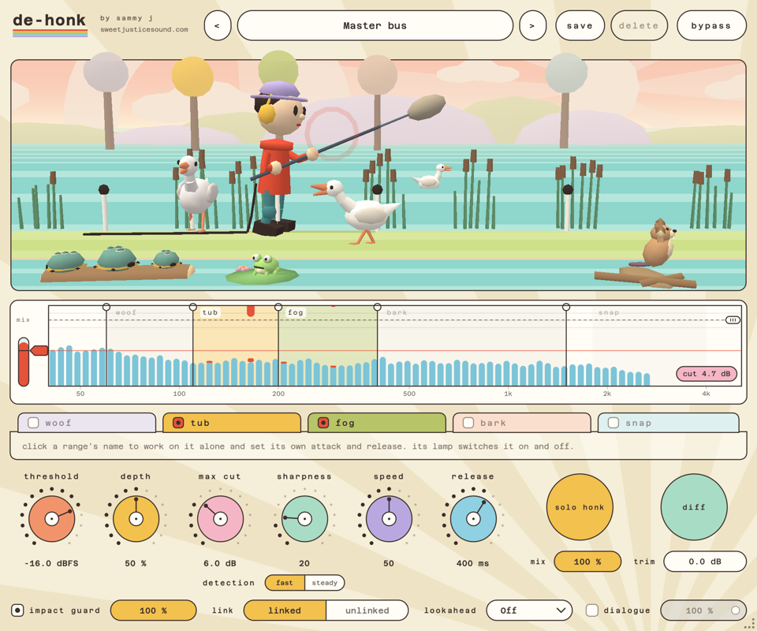
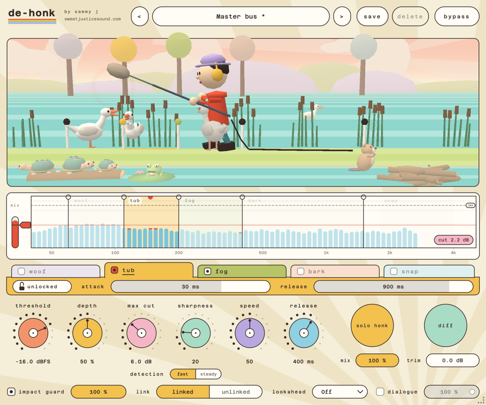
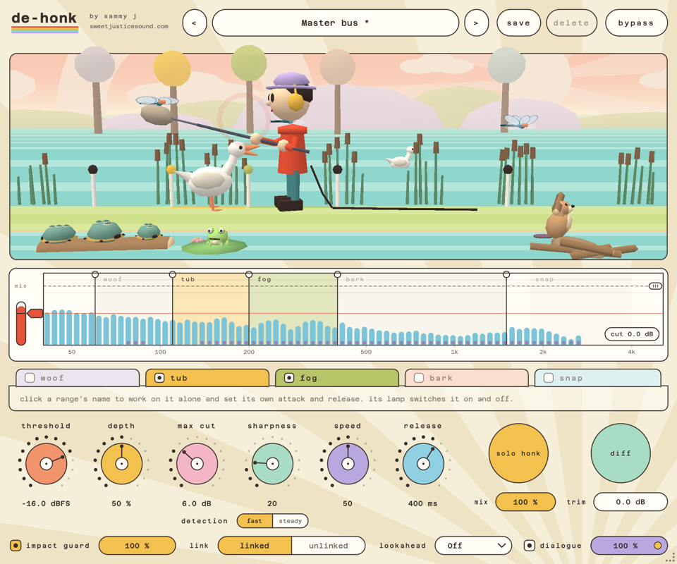

# De-Honk

A plug-in by **Samuel Justice** that takes the honk out of the low mids of a finished mix.

In a trailer mix, many of the sounds and much of the music have each been through a bass enhancer, a saturator or another harmonic generator. Each one adds harmonics above the bass so it reads on small speakers. Summed across the mix, those harmonics pile up between roughly 120 and 500 Hz as a nasal, boxy build-up. De-Honk listens for that build-up as the mix plays and takes it down with narrow cuts that come and go with it. The bass and the body of the mix are left alone.

It goes on the master bus, before the limiter. It works in mono, stereo and surround up to 7.1.4, and with Lookahead off it adds no latency. It comes as VST3, AU and AAX plug-ins and as a standalone app, for macOS and Windows. Hosts list it as **SammyJs De-Honk**.

**This is an early test build (0.0.2).** It is for a few people to try on real mixes and report back. Controls, presets and the sound may change before the first full release, and sessions saved with it may not open the same way in a later version.

## Getting the test build

The test build is on its own release page, not in the Sammy J's Plugins installer. Samuel sends the link to the people testing it. There is one installer for each system:

- **macOS** (`DeHonk-0.0.2-macOS-Installer.pkg`): the VST3, AU and AAX plug-ins and the app. Choose Customize to pick. Signed and notarised; universal (Apple silicon and Intel), macOS 11 or later.
- **Windows** (`DeHonk-0.0.2-Windows-Installer.exe`): the VST3 and AAX plug-ins and the app. 64-bit Windows 10 or later. The installer is not code-signed, so Windows may warn before running it: choose More info, then Run anyway.

The AAX for Pro Tools is signed by hand after the release is made. Until it is, the installers on the release page have no AAX in them; download them again once it is there.

**If you tried 0.0.1.** The plug-in's files are now called `SammyJs De-Honk`, like Samuel's other plug-ins, and the installers remove the old `De-Honk` files so a host never sees two copies. To the host it is still the same plug-in, so a session saved with 0.0.1 should open with this one and find it in its slot. If a host does not, tell Samuel which host. Link comes back as Linked if it was at 50% or more, Unlinked if less.

## How it works

De-Honk splits what it watches into four ranges, each with its own kind of build-up, and has a fifth, Snap, for clicks. It measures the mix in narrow bands, about a semitone apart, compares each band with its neighbours, and cuts a band that stands out. A cut goes in and lets go as the build-up comes and goes, so a passage without honk passes through untouched. It acts only while the mix is louder than the Threshold.

Bass enhancers add their harmonics above a low fundamental. De-Honk protects a fundamental it can hear below a band, so a note's own pitch is kept while the harmonics piled on top of it are reduced.

There are two ways of deciding what stands out, set by **Detection**:

- **Fast** looks at each band as it is now and cuts a build-up as soon as it shows.
- **Steady** looks at each band's level averaged over about a second, and only cuts a peak that is narrow: a lift that is broad across the spectrum is left alone. It is steadier, and kinder to dense, noisy textures such as rumbles and thick ambiences. On real mixes it cuts about half as much. The price is time: it is slower to catch a new build-up, typically by one to three seconds, and in a dense mix it may leave a mild one alone.

Neither is the right answer for every mix. The cuts themselves, how fast they go in and how slowly they let go, are the same at both.

## The band view

The picture under the pond is the exact reading: the sound coming in as blue bars, what is being taken out in red, and the ranges as coloured stretches. The number at the right is the deepest cut at the moment.

Three things in it are set by dragging them. The pointer changes over anything that can be dragged, the handle lights up, and a label shows its value. A handle moves from where it is by as far as you drag it; hold Shift (or Cmd) to move it a tenth as far. A double-click puts it back to its default.

- **The edges between ranges:** the vertical lines with a round handle at the top. Drag left or right.
- **Threshold:** the grip on the level bar at the left, and its line across the bands. Drag up or down. The level bar shows the level of the whole mix, which is what the Threshold is compared with. The bar, the grip and the line turn red while the mix is over it and De-Honk is acting.
- **Max Cut:** the dashed line across the top, with a grip at its right-hand end. Drag up or down.

With the dialogue sidechain on, a small dot under a bar marks a band that is being left to the dialogue.

## Controls

**Threshold** (-60 to 0 dBFS, default -16). De-Honk acts only while the mix is louder than this. It is fully off below it and fully on 6 dB above. At the bottom of the range, Always, it acts at any level. Set it with the knob or by dragging it in the band view.

**Depth** (0 to 100%, default 50%). How much of the detected excess is removed. No cut goes deeper than Max Cut. At 0 nothing is cut.

**Max Cut** (3 to 12 dB, default 6 dB). The deepest any one cut may go, whatever Depth is set to. Two cuts side by side never add up to more. Set it with the knob or by dragging the dashed line in the band view.

**Sharpness** (Broad to Narrow, default 20). How wide a build-up has to be to count. Broad responds to a whole bump; Narrow responds only to single ringing resonances. The cuts themselves are narrow either way.

**Speed** (Slow to Fast, default 50). How quickly a cut goes in once a build-up has been found. Release sets how it lets go.

**Release** (50 ms to 1.5 s, default 400 ms). How slowly a cut lets go once its build-up has gone. Longer holds each cut steadier; shorter follows the mix more closely. It is for cuts that have settled on a clear build-up: a light cut that comes and goes, or one whose build-up has moved to the next note, lets go quickly whatever is set here. Under the Threshold every cut closes straight away.

**Detection** (Fast or Steady, default Fast). The two-part switch under the knobs. See [How it works](#how-it-works).

### The ranges

The five tabs on the shelf under the band view are the ranges, each in its own colour: the colour of its stretch of the band view and of its tree in the pond.

- **Woof:** the low end barking on every hit, about 60 to 110 Hz. Off at first.
- **Tub:** tubby weight just above the bass, about 110 to 200 Hz. This is where added bass harmonics pile up first. On at first.
- **Fog:** low mids clouding over when music and effects stack up, about 200 to 400 Hz. On at first.
- **Bark:** hard, shouty midrange, about 400 Hz to 1.5 kHz. Off at first.
- **Snap:** sharp clicks and pops around 2.5 kHz. It takes the edge off a pop that the rest of the sound does not share, and leaves drum hits and steady sounds alone. It works at any level, whatever the Threshold. Off at first.

The edges between them can be moved in the band view, each within its own stretch (the lowest from 45 to 80 Hz, then 90 to 150 Hz, 160 to 280 Hz, 300 to 600 Hz, and the top one from 800 Hz to 2.2 kHz).

A tab does two things. **Its lamp** (the square at its left) switches the range on or off; the dot in the lamp turns red while the range is cutting. **A click on its name** selects the range, to work on it alone: in the pond only that range's creatures move and the rest hold still, the band view fades the other ranges, and the range's own controls appear in the drawer under the shelf. Click the name again, or the empty shelf, to go back to all of them. Selecting a range changes nothing in the sound.

**A range's own attack and release.** Each of Woof, Tub, Fog and Bark has a lock in its drawer. Locked (the default), the range goes in and lets go as Speed and Release say; its two bars are greyed and show what those come to. Unlocked, the bars are the range's own: attack from 2 to 100 ms (default 14 ms) and release from 50 ms to 1.5 s (default 400 ms). This is for a range that pumps or wobbles when the others do not. Snap works on single clicks and has no attack or release to set.

### The bottom row

**Impact Guard** (0 to 100%, default 100%). Keeps the cuts out of big hits. When something lands across the whole spectrum at once (an explosion, a slam, a hit), no new cut is made while it sounds, and a cut that is already open is eased off as far as the hit drowns out what it was there for, by up to the amount on the bar. The cuts come back as the hit dies away. The square lamp before its name is its switch: it turns the guard off and on again at the amount it had. The lamp fills with yellow while the guard is up.

**Link** (default Linked). Linked: every channel shares one detection, so the image does not move. Grouped: the front pair, the centre, the surrounds and the heights each share within their group; it is offered in surround only. Unlinked: each channel is cut on its own.

**Lookahead** (Off, 5, 10 or 20 ms; default Off). Delays the audio so each cut is in place when a transient arrives. It adds the chosen latency, which is reported to the host. Off adds none.

**Dialogue** (off at first; the bar from 0 to 100%, default 100%). Tells De-Honk what the dialogue is, so it leaves it alone. See below.

### Beside the knobs

**Solo Honk** and **Diff**: see [Listening](#listening).

**Mix** (0 to 100%, default 100%). The balance between the untreated signal (0%) and the treated signal (100%).

**Trim** (-12 to +12 dB, default 0). Output level, after the mix.

### The top row

**Presets.** The arrows step through the presets, and the name opens the list. A * after the name means the settings have changed since the preset was loaded or saved. Save stores the current settings as a user preset under the name you type (it says so if the name cannot be used or the preset could not be written); user presets can be deleted, factory presets cannot. The factory presets are Master bus (the defaults), Master bus, dialogue keyed (the same with Dialogue on), After a bass enhancer, Printed stem, Narrow resonances only, Heavy, and Master bus, steady (the defaults with Detection at Steady).

**Bypass.** Passes the signal through untreated, with the same latency and without a click.

**The name.** A click on "de-honk" opens the About page: the version, links to Samuel's site and email, and a button that checks for a newer version. The address beside the name opens the site.

**Help.** Rest the pointer on a control for about a second and a note about it opens beside it. It closes when the pointer moves on or anything is clicked.

## The dialogue sidechain

De-Honk cannot tell a voice's own low mids from build-up around it. Given the dialogue stem, it can: a band the dialogue accounts for is not cut, so the voice is not thinned, while build-up well above the dialogue in the same band is still cut. With Snap on, a click that is the dialogue's (a hard consonant) is left alone as well. The Dialogue bar sets how far: at 100% a band that is all dialogue is left entirely alone.

**Routing.** The plug-in has a second input, a sidechain called **Dialogue**. Send the dialogue stem to it, then switch Dialogue on with its square lamp.

- **Pro Tools:** this is the key input. Send the dialogue stem (a send from the dialogue bus or track is fine) to a spare bus, and choose that bus in the key input menu at the top of De-Honk's window. Pro Tools gives a plug-in a mono key, so a stereo stem arrives summed or as one side; either works. Choose the key input while the transport is stopped: the output can drop out for a moment as the key connects or disconnects.
- **Logic:** choose the dialogue stem's bus or track in the Side Chain menu at the top of the plug-in window.
- **Other hosts (VST3):** De-Honk offers a sidechain input, mono or stereo. Turn the host's sidechain on for the plug-in and send the dialogue stem to it, as for a compressor's key.
- **The standalone app** has no sidechain.

The stem can arrive at any level. De-Honk looks for it in the mix and works out how loud the dialogue is there, so a stem sent quiet, or a stereo stem summed hot into a mono key, is taken at the level the dialogue really has. That takes the first half second or so of dialogue after the plug-in is loaded; until then the stem is taken at the level it arrives at. In surround with Link at Grouped or Unlinked, only the channels the dialogue is in are left alone.

The stem should be in time with the mix. A few milliseconds either way make no difference, and up to about 20 ms costs a little of the protection; beyond that the stem is no longer found in the mix. A send taken after plug-ins with latency on the dialogue, or a stem printed with an offset, can put it out of time.

**The lamp.** The round lamp at the end of the Dialogue bar is lit while the stem is arriving, whether Dialogue is on or not, so the routing can be checked first. It turns red when the stem is not doing its job: it cannot be found in the mix (the wrong stem, or far out of time), or it accounts for nearly everything in the mix (the mix itself is on the key), in which case De-Honk is being held off everywhere.

## Listening

Two buttons beside the knobs let you hear what De-Honk is doing. One works at a time, and the band view says which one you are hearing. Neither is saved with the session.

**Solo Honk** plays only what is being removed. If it sounds only ugly, the settings are right. If you hear wanted bass or body in it, lower Depth or switch off the lowest range.

**Diff** plays the untreated signal, latency-matched and level-matched, so you can compare. Hold it to listen, or click it to keep it on and click again to return. It fades over to the untreated signal and back, so it does not click. The host's bypass is not touched. The level match follows the treated and untreated levels over about the last second and a half, all the time, so where nothing is cut the two match. From one moment to the next they can differ by a few tenths of a dB.

## The pond

The picture at the top shows what De-Honk is doing, slowly enough to glance at while mixing. When the mix is quiet it settles down.

- **Geese** are the cuts. One lands where a cut has been open for a moment and stays a few seconds at least. They arrive one at a time, at most two to a range. The sound recordist picks one goose at a time, turns and walks or runs to it, and holds the microphone over it; now and then he swings the boom at it.
- **The trees** stand at the edges of the ranges, each in the colour of the range to its right and straight above that edge's handle in the band view. They move when an edge is dragged.
- **The weather** turns only when De-Honk is kept hard at work: cuts near Max Cut in several places for a while bring cloud and then rain, and it clears when things ease.
- **The jumping fish** is Snap taking out a click.
- **The beaver's dam** grows while the low mids stay clogged and noisy, and shrinks as they clear.
- **The turtles** pull into their shells while Impact Guard is holding back for a hit. With Impact Guard off they sleep.
- **The frog** tenses as a cut nears Max Cut and leaps off its lily pad when one reaches it.
- **Dragonflies** come out while the dialogue sidechain is being listened to.
- **The reeds** are scenery: they stand in clumps, sway while the pond is busy and come to rest when it is still.
- **The recordist** sits down with a flask in Bypass, listens closely in Solo Honk, and looks from side to side in Diff.

With a range selected, only that range's geese come, go and move, and the recordist minds only them. Everyone else stays where they are, faded back, until the range is let go. For Snap he points the microphone at the shallows and only the fish reacts.

The creatures can be clicked; the pointer becomes a hand over them. A turtle topples off the log into the water and climbs back, the beaver waves or slaps its tail, the frog jumps off its pad, a goose tumbles away and waddles back, the recordist tips his hat or waves as soon as his hands are free, the dragonflies scatter, and the goose out on the water tips up. None of it changes the sound.

## Surround

De-Honk accepts the same layout in and out, from mono to 7.1.4. With Link at Linked every channel gets the same cuts, so nothing moves in the image. Grouped keeps the front pair, the centre, the surrounds and the heights each together. The LFE channel is passed through untouched.

## New versions

A full release of De-Honk looks for a newer full release when its window opens, at most once a day, and says so with Download, Later and Skip this version; it says nothing if it cannot reach the release page. A test build like this one does not look by itself: to see whether there is a newer test build, open the About page and press Check for updates.

## Reporting back

Tell Samuel what you used it on, what it did well and where it got in the way: a cut you could hear working, wanted bass or body going missing, a hit that lost its weight, dialogue going thin with and without the sidechain, whether you preferred Fast or Steady, a host or layout where it misbehaved. A short bounce with De-Honk on and off helps more than a description. Include the host and its version, the sample rate and the layout.

## Credits

De-Honk is by Samuel Justice.
