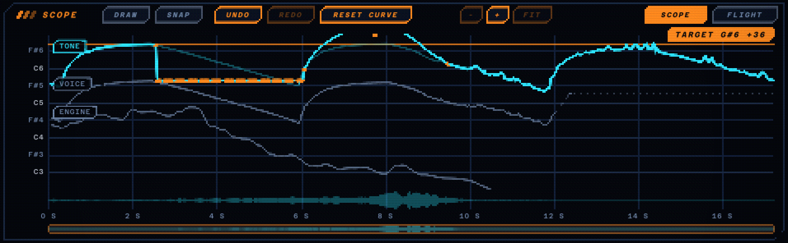
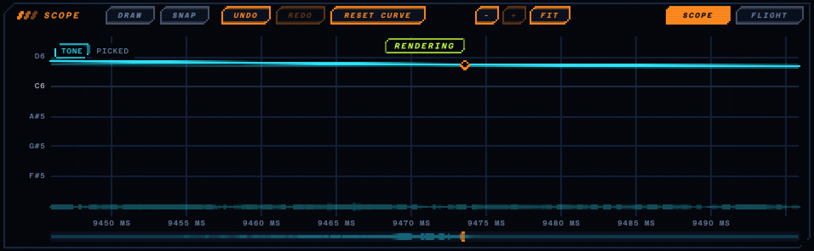
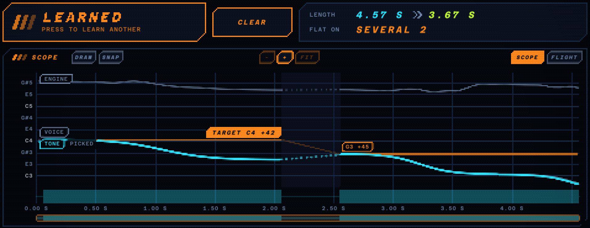
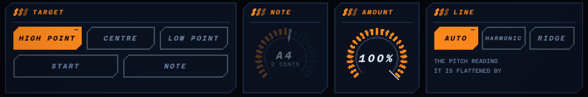
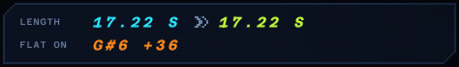

# SammyJs Pitch Flattener


A plug-in by **Samuel Justice** that learns one sound and plays it back with its pitch flattened. Play it the sound once: it reads the pitch of the whole sound and renders a flat version by speeding the playback up and slowing it down from moment to moment, the way a tape would. It can then stretch the result back to the sound's own timing, so the length stays as it was. Play the sound again, from the start or from any point in it, and the flat version plays in its place. Use it to take the sweep out of a pass-by, the wail out of a siren, the climb out of an engine run-up or the wobble out of a held note.

### [Get it with Sammy J's Plugins](https://github.com/samueljustice/plugins/releases/latest), the installer for every Sammy J plug-in


## Features

- **Learn by playing**: press LEARN and play the sound once. It passes through untouched while it is recorded, and Learn stops by itself after a second of silence.
- **Flat however fast it bends**: the pitch is taken out by changing the playback speed, so a fast sweep comes out as flat as a slow one, with nothing smeared and no warble.
- **Varispeed or keep length**: let the length change with the speed (the cleanest result), or have the sound brought back to its own timing and length, with a character to suit it: harmonic, transients or voice.
- **Recognises the sound wherever it starts**: play the learned sound again from the top or from the middle, and the flat version takes over at the matching moment. Anything else passes through.
- **Three readings of the pitch**, each suited to a kind of sound: voices, engines, and tones such as sirens and whistles. The plug-in uses the one that flattens the sound best, and you can overrule it by choosing the kind of sound or clicking another reading.
- **Correct the line by hand**: pull the pitch line where a reading went wrong, or redraw it freehand, with snap to semitones, undo and redo.
- **Zoom in** on the pitch line down to milliseconds and cents.
- **Several sounds in one recording**: sounds separated by silence are each flattened to their own pitch.
- **Five targets**: flatten to the top of the pitch, the bottom, where it spends its time, where it starts, or a note you choose. **Amount** leaves some of the movement in.
- **Two views**: SCOPE draws the pitch over time exactly; FLIGHT flies the sound as a course, its pitch as a track that rises and falls beside the level lane of the flattened sound.
- **Says what to do next**: the next button to press pulses, a banner across the display announces each change, and a bar under it says what is happening in plain words.
- **A fixed delay of 0.4 s**, reported to the host, so hosts that compensate delay line the result up with the original.
- **Mono or stereo**.

## How to use it

Pitch Flattener is made for a rack, such as a sound library's DSP rack, or a track in a DAW: learn the sound, then play or render it.

1. **Put it on the sound.** Load Pitch Flattener in the rack or on the track that plays the sound.
2. **Press LEARN.** The button shows ARMED and waits for sound.
3. **Play the sound once, to its end.** The button shows LISTENING and counts the seconds. The sound passes through untouched while it is recorded. Learn stops after a second of silence, when the player stops, or when you press the button again.
4. **Wait a moment.** The button shows ANALYSING while the plug-in reads the pitch and renders the flat version, then LEARNED.
5. **Play the sound again.** From the start or from any point in it, the flattened sound plays in its place. Audition it, or render it as you would any effect.
6. **Choose the result.** Change TARGET, NOTE, AMOUNT, SOURCE, LENGTH or CHARACTER at any time, or correct the line in SCOPE; the flat version is rendered again from the same reading, with no need to learn the sound again.

**CLEAR** forgets the sound. Press LEARN again to learn another one in its place.

## The window

The window is drawn in chunky pixels, like an old console screen.

### LEARN, CLEAR and the readouts


The **LEARN** button shows what the plug-in is doing, with a hint under the word:

| LEARN shows | Hint | What it means |
|---|---|---|
| **LEARN** | PLAY THE SOUND ONCE | Nothing is learned. The button pulses: it is the next thing to press. |
| **ARMED** | WAITING FOR SOUND | Learn is on and waiting for the sound to start. Press again to cancel. |
| **LISTENING** | the seconds recorded | The sound is being recorded, and passes through untouched. Press again to stop there. |
| **ANALYSING** | READING THE PITCH | The plug-in is reading the sound's pitch and rendering the flat version. |
| **LEARNED** | PRESS TO LEARN ANOTHER | A sound is learned. Press to learn another one in its place. |

Recording starts at the first sound that is not silent, keeping 50 ms before it, so the start is not cut off. A click shorter than 50 ms is not taken for the sound: Learn keeps waiting.

| Control or readout | What it does |
|---|---|
| **CLEAR** | Forgets the learned sound and its corrections. Audio then passes through unchanged until another sound is learned. |
| **LENGTH** | The learned sound's length (cyan) and the flattened sound's length (lime). With KEEP LENGTH the two are the same. |
| **FLAT ON** | The note the sound is flattened to, with cents. When the recording holds several sounds, each flattened to its own pitch, it shows SEVERAL and how many. |
| **DELAY** | The delay the plug-in reports to the host: always 0.40 s. |
| **?** | Opens the About window: version, credits and the update check. |

### SCOPE


SCOPE draws the learned sound from start to end: its pitch over time on a note scale, seconds along the bottom.

- **The three readings**: the sound's pitch read three ways, VOICE, ENGINE and TONE, each drawn as a line with its tag. The line the sound is flattened by is drawn in cyan, on top; the others are grey. With SOURCE on AUTO, **PICKED** marks the one Auto chose.
- **Clicking another line, or its tag**, flattens the sound by that reading instead (it sets SOURCE to it). Hover over a line to see what kind of sound it suits. A reading that found too little pitch in the sound to flatten by is drawn faint and cannot be chosen; its tooltip says so.
- **Dashed stretches** are where the reading found no pitch and the line only bridges the gap.
- **The target line** (orange) is the pitch the sound is flattened to, tagged with its note where the tag covers neither the line in use nor another tag.
- **The play head** (lime) shows where the flattened sound is while it plays, as a moment of the original, with a trail of lime ticks along the target behind it.
- **The level strip** along the bottom is the learned sound's level.
- **The overview bar** under the time scale shows the whole sound, with the part on view marked when zoomed in.
- **RENDERING** appears at the top while the flat version is rendered again after a change.
- **FLAT**, beside the tabs, is lit while the flattened sound is playing.


Here SOURCE is set to VOICE and the target is the low point, so the voice reading is the line in use and the target line runs along the bottom of its sweep.

Click **SCOPE** or **FLIGHT** at the top right to switch views. The choice is saved with the session. Until you choose, the window shows FLIGHT while nothing is learned and SCOPE once something is.

### Correcting the line



A reading is sometimes wrong in places: it slips onto another partial, or wanders through noise. You can correct the line in use by hand, and the sound is flattened by the corrected line.

A correction says what the pitch really is at that moment. Pulling the line up says the pitch there is higher than was read, so the plug-in slows that moment down further to bring it to the target; pulling it down does the opposite. The corrected line is drawn bright, with the reading as it was faint beneath it.

- **Pull the line**: drag it up or down anywhere to correct it there. Each place you pull stays as a point, drawn as a diamond; drag a point to move it. Hold Shift for fine moves. Double-click a point to remove it. While you drag, a tag shows the corrected note and the correction in cents.
- **One point** bends the line for a quarter of a second either side of it. Between points the correction runs in straight lines.
- **DRAW**: drag across the graph to redraw the line freehand. What you draw replaces the points under it, and the line either side stays where it was. Off, a drag pulls the line at one point.
- **SNAP**: corrections put the pitch on the nearest semitone. Hold Alt while pulling to let go of it.


| Tool | What it does |
|---|---|
| **UNDO** | Undoes the last correction (Cmd or Ctrl and Z, once the graph has been clicked). |
| **REDO** | Redoes the correction last undone (Shift, Cmd or Ctrl and Z). |
| **RESET CURVE** | Takes every correction off this reading, so the sound is flattened by the line as it was read. |

UNDO, REDO and RESET CURVE appear once the line has been corrected. While the mouse is over the line, the guidance bar says how to edit it.

Corrections belong to the reading they were made on: each of the three readings keeps its own, and switching SOURCE brings back the corrections for that reading. They are forgotten by CLEAR or by learning another sound, and they are not saved with the session.

### Zooming in



| To | Do this |
|---|---|
| Zoom time | Scroll up or down over the graph, or pinch on a trackpad. It zooms about the moment under the pointer. |
| Zoom pitch | Hold Alt and scroll. It zooms about the pitch under the pointer. |
| Move along the sound | Scroll sideways, or drag along the time scale and level strip, or drag in the overview bar. |
| Zoom time in or out by a factor of two | **+** and **-** at the top of the display. |
| See the whole sound | **FIT**: the whole sound, with the pitch range set to suit it. |

Time zooms in as far as 50 ms across the display, and pitch as far as two semitones. Zoomed far enough in, the time scale changes to milliseconds and the pitch grid adds lines every 25 cents, with the half-semitones labelled +50.

### Several sounds in one recording



If the recording holds several sounds, such as a run of calls, hits or passes, with a quarter of a second or more of silence between them, each sound is flattened to its own pitch: its own high point, centre, low point or start. A note chosen with NOTE applies to all of them. SCOPE shows one target segment per sound, with the silences shaded, and FLAT ON shows SEVERAL and the number of sounds. Hover over it for a reminder.

Learn stops after a second of silence, so keep the gaps between the sounds shorter than that. Silence here means 50 dB or more below the loudest moment, and a sound shorter than 30 ms is not counted as a sound of its own.

### FLIGHT


FLIGHT flies the learned sound as a course. The camera travels along the sound from start to end.

| On screen | What it stands for |
|---|---|
| **The track** (cyan edges, left) | The pitch as heard: it rises and dips exactly as the pitch line in use does. |
| **The flat lane** (lime edges, right) | The flattened sound: level at the target. With AMOUNT below 100% it moves part of the way back towards the track. |
| **The gates** | One across the track at every whole second of the sound, numbered. |
| **The dart** | Rides the lane at the play head while the flattened sound plays. |
| **T** at the bottom right | Where the flight is in the sound, and the sound's length. |

While nothing plays, the flight cruises along the sound at half speed and loops. While nothing is learned, it flies a demo course and says DEMO RUN.

### The guidance bar


The bar under the display says what to do or what is happening:

| The bar says | When |
|---|---|
| PRESS LEARN, THEN PLAY THE SOUND ONCE | Nothing is learned. |
| LEARN IS ARMED: PLAY THE SOUND ONCE | Learn is waiting for the sound. |
| LISTENING: LET THE SOUND PLAY TO ITS END | The sound is being recorded. |
| ANALYSING THE SOUND | The pitch is being read and the flat version rendered. |
| LEARNED: PLAY THE SOUND AGAIN TO HEAR IT FLATTENED | Ready. |
| PLAYING THE FLATTENED SOUND | The sound was recognised and its flat version is playing. |
| DRAG THE LINE TO CORRECT IT. DOUBLE-CLICK A POINT TO REMOVE IT. | The mouse is over the line in SCOPE. |
| DRAW ALONG THE GRAPH TO REDRAW THE LINE. ALT WHILE DRAGGING LETS GO OF THE SNAP. | The same, with DRAW on. |
| NO STEADY PITCH FOUND: THE SOUND IS LEFT AS IT IS | None of the three readings found a steady pitch in the sound. |
| LEARNED AT 48000 HZ: THE SESSION IS AT 96000 HZ | The session runs at another sample rate than the sound was learned at (the rates shown are the real ones). |

### Banners

A banner across the display announces each change, and the next steps while you learn.


| Banner | Colour | What it means |
|---|---|---|
| **LEARN FIRST** | orange | Nothing is learned. It blinks for a second in every four, with chevrons pointing up at LEARN. |
| **PLAY THE SOUND** | lime | Learn is armed: play the sound. |
| **LISTENING** | magenta | The sound is being recorded, with the seconds so far and a blinking recording square. |
| **ANALYSING** | cyan | The pitch is being read, with a bar sweeping along the banner. |
| **LEARNED** | lime | The sound is learned and flattened. Shown once, followed by **PLAY IT AGAIN**. |
| **FLATTENED** | lime | The flattened sound has started playing. After it, the FLAT tag stays lit while it plays. |
| **NO STEADY PITCH** | magenta | The sound was learned, but none of the three readings found a steady pitch in it: it is left as it is. |
| **WRONG SAMPLE RATE** | magenta | The session runs at another sample rate than the sound was learned at. It stays until the rates match. |
| **CLEARED** | white | The sound was forgotten. |

### The controls



**TARGET**: the pitch the sound is flattened to. Where the sound is above the target it is slowed down, and where it is below it is sped up, so with VARISPEED the target decides whether the result comes out shorter or longer.

| Target | What it does | Use it for |
|---|---|---|
| **HIGH POINT** | Flattens the sound to the top of its pitch. The flattened sound is never longer than the original. The default. | A pass-by's approach, a siren's peak; any time the result should not get longer. |
| **LOW POINT** | Flattens the sound to the bottom of its pitch. The flattened sound is longer than the original. | A deeper, slower result. |
| **CENTRE** | Flattens the sound to the pitch it spends most of its time at, so it changes least overall, and its length changes least. | Vibrato and wobble, where the sound should stay close to how it was. |
| **START** | Flattens the sound to the pitch it opens on. | Sounds that should hold the note they begin with. |
| **NOTE** | Flattens the sound to the pitch set with the NOTE control. | Putting the sound on a particular note. |

The high point, centre and low point are counted by level, so a loud part of the sound outweighs a long quiet one, and a stray moment at the very top or bottom does not move them. With several sounds in one recording, each has its own.

| Control | What it does |
|---|---|
| **NOTE** | The pitch the sound is flattened to when the target is NOTE (C1 to C8, A4 by default). Type a note name such as A3, or C#4 +20 for cents. It is dimmed for the other targets. |
| **AMOUNT** | How much of the pitch movement is taken out. 100% leaves the sound flat; 50% leaves half of its movement in; 0% leaves it as it was. |

Double-click NOTE or AMOUNT to return it to its default.

**SOURCE**: what kind of sound it is, which decides which reading of its pitch it is flattened by.

| Source | What it does |
|---|---|
| **AUTO** | Reads the sound all three ways and uses the reading that flattens it best: it flattens the sound by each, reads the results back, and keeps the flattest. The default. Choose a kind of sound when it gets it wrong. |
| **VOICE** | A sound with one clear pitch: voices, animal calls, single tones and whines, up to about 1 kHz. |
| **ENGINE** | Engines, props and rich drones, where many partials rise and fall together. |
| **TONE** | Sirens, whistles and feedback, or a whine inside noise: follows the strongest partial at any height. |

Auto's pick is a measurement, and the ear sometimes disagrees with it. If the result sounds wrong (it wobbles, or jumps where the sound does not), choose the kind of sound here, or click another line or its tag in SCOPE. If the reading you choose finds too little pitch in the sound to flatten by, the sound is flattened by Auto's pick instead, so it is never left untouched while one of the readings can follow it; SCOPE then draws the pick in cyan as the line in use, while the SOURCE button stays where you set it.

**LENGTH**: how the pitch is taken out.

| Length | What it does |
|---|---|
| **VARISPEED** | Flattens by changing the speed, like slowing and speeding a tape. The cleanest result; the sound's length changes. The default. |
| **KEEP LENGTH** | Flattens the pitch and keeps the sound's own timing and length. Choose a character to suit the sound. |

KEEP LENGTH works in two steps. First the sound is flattened by speed, exactly as with VARISPEED, so the pitch comes out exactly as flat. Then the result is stretched and squeezed back to the original's timing, without touching its pitch, so that every moment lands where it was and the length is the original's. Only time moves in the second step, so nothing in it can make the pitch warble. LENGTH in the readouts then shows the same length twice, and when the flattened sound plays it lines up with the original moment for moment.



**CHARACTER**: how the length is brought back, with KEEP LENGTH. Under VARISPEED it is dimmed and keeps its setting.

| Character | Use it for | What it does |
|---|---|---|
| **HARMONIC** | Sounds that are mostly tone: sirens, drones, engines, pads. | The stretch as it comes. The default. |
| **TRANSIENTS** | Sounds with hits in them: ricochets, impacts, anything percussive. | Finds the hits in the sound and carries each one through at its own speed, unstretched, making the time up just after it, so each hit stays sharp and in place. |
| **VOICE** | Voices, creatures and animal calls. | Keeps the voice's own size and character. Flattening by speed moves the voice's formants with its pitch (a slowed voice sounds bigger); VOICE puts them back where they were, leaving the pitch alone. |

TARGET, NOTE, AMOUNT, SOURCE, LENGTH and CHARACTER are host parameters, saved with the session and open to automation. A change renders the flat version again in the background.

## About and updates

Click **?** at the top right for the About window, with the version, the credits and the licence. CHECK FOR UPDATES asks GitHub whether a newer version is out.


When the window opens, Pitch Flattener asks GitHub, at most once a day, whether a newer version is out. If there is one, it offers it once per host session: DOWNLOAD opens the Sammy J's Plugins installer's page, LATER closes the offer, and SKIP THIS VERSION does not offer that version again. Offline, nothing happens.


## Good to know

- **With VARISPEED the length changes.** The pitch is taken out by playing the sound faster where it is below the target and slower where it is above, the way speeding and slowing a tape changes its pitch. That is what keeps the result flat however fast the pitch bends, and it is also why the result is shorter or longer than the original. HIGH POINT never makes the sound longer, LOW POINT makes it longer, and CENTRE changes the length least. When the result is longer, the plug-in tells the host how much longer, so a render keeps the end. Choose KEEP LENGTH to keep the original length.
- **KEEP LENGTH takes longer to render** than VARISPEED, as it does the extra stretch after flattening.
- **The speed changes by up to three octaves either way.** Pitch movement beyond that is not fully taken out.
- **A leap in a reading is taken out of the line.** A sound's pitch can sweep very fast, but it does not jump, so a sudden jump in a reading is nearly always the reading changing its mind: stepping to another partial or octave, or a voice breaking into a growl. Each jump is taken out and the rest of the line moved to meet it, so the flattening never lurches. The exception is a sweep that snaps back and starts again, such as a yelping siren: there the jumps are real, and the reading is kept as it is.
- **A delay of 0.4 s.** The output is always the input 0.4 s later, whether the flat version or the input itself is playing, and bypass is delayed the same, so switching never shifts the audio in time. The plug-in reports the delay, so hosts that compensate delay line the result up with the original. That time is what lets it recognise where the sound is before the audio reaches the output.
- **A sound with no steady pitch is left as it is**, such as noise or a crash: when none of the three readings can follow it, the window says NO STEADY PITCH, and the sound passes through unchanged.
- **The same sound, played the same way.** The plug-in recognises the learned recording itself. The same sound played at another speed or pitch, or another take of it, is not recognised, and passes through.
- **The flattened sound follows the playback level.** Play the sound louder or quieter than it was learned, and the flattened sound comes out louder or quieter by the same amount. The level is measured when the plug-in finds the sound in the input; within about a tenth of a decibel of the learned level counts as the same.
- **Stopping the player in the middle of the sound** returns the output to the input. Jumping to another place in the sound finds that place. Played to its end, the rest of the flattened sound plays out, then the input.
- **Rendering offline** works: when the host renders faster than real time, the plug-in waits for its search instead of running ahead of it.
- **The learned sound and its corrections are kept in memory only.** They are not saved with the session: after reopening the session, learn the sound again. The controls and the chosen view are saved.
- **One sound per instance.** Learning another sound replaces the first. For several sounds, use several instances, or learn them in one recording with short silences between them.
- **The sample rate must match.** The flattened sound plays only at the sample rate it was learned at. At another rate the window says WRONG SAMPLE RATE, and the audio passes through.
- **Up to 120 seconds per sound.** Learn stops by itself at two minutes.
- **Corrections** can move the line by up to 24 semitones either way, with up to 512 points on a reading.
- **Mono and stereo.** A stereo sound on a mono track plays as the two channels mixed; a mono sound on a stereo track plays on both.
- **Loud sounds stay under full scale.** If the flattened version would peak over -0.1 dBFS, it is turned down as a whole to fit.


## Measured

`PitchFlattenerCoreTests` makes sounds whose pitch moves in a known way, flattens each, and measures the result with a pitch meter that shares nothing with the plug-in's readings. "Travels" is how far the measured pitch moves over the whole sound, with the outer 5% of readings left out. These are the figures it prints.

With VARISPEED and SOURCE on AUTO:

| Sound | Reading Auto picked | Pitch travels before | After |
|---|---|---|---|
| A pass-by: a rich tone falling 7 semitones through the middle (4.00 s, flattened to its high point: 3.32 s) | Tone | 6.99 st | 0.00 st |
| A siren: a tone wailing between 700 and 1700 Hz | Tone | 15.17 st | 0.00 st |
| An engine run-up: a harmonic series climbing from 60 to 200 Hz | Voice | 19.60 st | 0.07 st |
| Vibrato: a voice-like tone wobbling a semitone at 6 Hz (flattened to its centre) | not printed | 0.91 st | 0.10 st |

- **A voice that breaks into a growl**: a scream rising 5.8 semitones, then a growl whose reading leaps far below it. The reading spans 44.44 semitones; the line used spans 5.77, with 2 leaps taken out, and the length goes from 4.00 s to 3.87 s rather than being stretched out of shape.
- **Several sounds**: two falling calls with half a second of silence between them. The first comes out flat at E4 and the second at C5, each on its own high point, both travelling 0.00 st.

With KEEP LENGTH:

- **The pass-by with a click every half second**: the pitch travels 0.12 st, the length is exactly the original's, and every click lands within 0.5 ms of where it was.
- **VOICE character**, on a falling voice whose formant stays at about 1200 Hz: near the end the formant sits at 1208 Hz in the sound, 1796 Hz with HARMONIC (moved up with the pitch), and 1173 Hz with VOICE (put back). The pitch travels 0.12 st.
- **TRANSIENTS character**, on a tone falling 19 semitones with hard clicks on it. Click sharpness (the share of the energy around a click that lies in the click's own few milliseconds): 0.85 in the sound, 0.47 after flattening by speed alone, 0.37 with HARMONIC, 0.46 with TRANSIENTS. Level just before a click, against the click: -7.9 dB by speed alone, -3.9 dB with HARMONIC (smeared ahead of the click), -8.2 dB with TRANSIENTS.

The same tests check that flattening to the high point never makes the sound longer, that the low point makes it longer, that the centre keeps a vibrato's length within 2%, that half the amount leaves half the movement, that a chosen note is hit by every sound in a recording, that a whine falling an octave and a half in 0.15 s in noise is followed, that a hand correction moves the result by the amount it says, and that noise and silence are left alone. All 67 checks pass; `PitchFlattenerTests` runs 252 more.

## System requirements

- macOS 11 or later (Apple Silicon and Intel): VST3, AU and AAX
- Windows 10 or later (64-bit): VST3 and AAX

## Building

### Prerequisites

- CMake 3.15 or higher
- Xcode Command Line Tools (macOS) or Visual Studio 2022 (Windows), with C++20
- JUCE 8.0.8 at `../SDK/JUCE` and Rubber Band 4.0.0, built as a static library, at `../SDK/rubberband-4.0.0`, relative to this folder
- The UI fonts in `Resources/Fonts`, and the update check from `../common`

### Build instructions

From the repository root:

```bash
cmake -S pitchflattener -B pitchflattener/build -DCMAKE_BUILD_TYPE=Release -DPITCHFLATTENER_BUILD_TESTS=ON
cmake --build pitchflattener/build --config Release
pitchflattener/build/PitchFlattenerCoreTests
pitchflattener/build/PitchFlattenerTests_artefacts/Release/PitchFlattenerTests
```

The bundles land in `pitchflattener/build/PitchFlattener_artefacts/Release/{AU,VST3}`, and are also copied to your plug-in folders after the build; add `-DPITCHFLATTENER_COPY_AFTER_BUILD=OFF` to skip that. Add `-DSAMMYJ_AAX=ON` to build AAX as well, with the AAX SDK bundled with JUCE or the one at `-DAAX_SDK_PATH=<folder>`. An unsigned AAX loads only in a developer build of Pro Tools. On macOS, `./build.sh` in this folder builds, signs and installs the VST3 and AU in one go.

`PitchFlattenerCoreTests` checks the pitch readings, the flattening and keeping the length on made-up sounds whose pitch is known (the figures above). On macOS, `Tests/build_core_tests.sh` builds and runs it without CMake. `PitchFlattenerTests` checks the rest: finding the learned sound in the input, the engine driven through real audio blocks, the processor as a host sees it, and the window. `--png <folder>` writes pictures of the window in every state (the pictures on this page come from it), and `--sound <file>` learns that audio file for them.

## Credits

Created by Samuel Justice, Creative Sound Supervisor at [Sweet Justice](https://www.sweetjusticesound.com).

- Built with [JUCE](https://juce.com), Raw Material Software Limited.
- Time stretching for KEEP LENGTH: [Rubber Band Library](https://breakfastquay.com/rubberband/) (GPL / commercial).
- UI font: [Azeret Mono](https://github.com/displaay/Azeret), The Azeret Project Authors, SIL Open Font License 1.1.
- Pitch tracking with thanks to Ben

## License

MIT License. See [LICENSE](LICENSE) for details.
