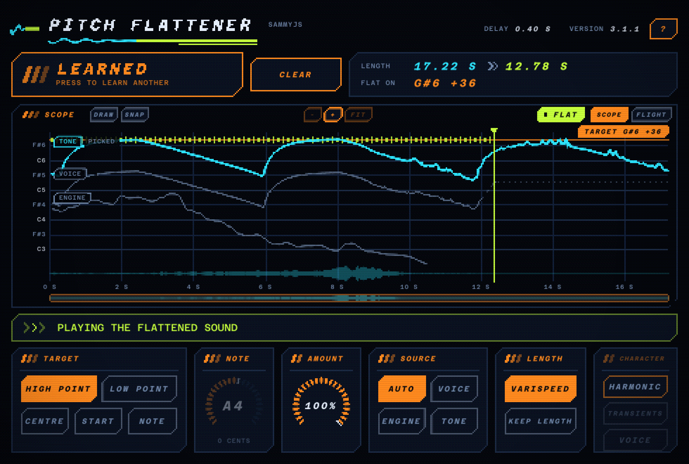
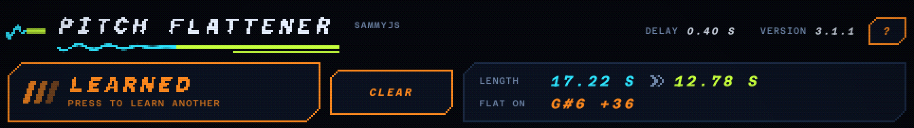
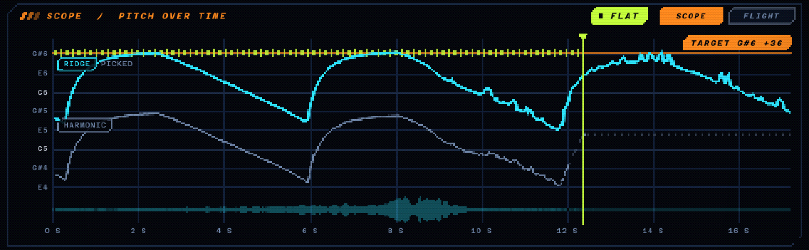
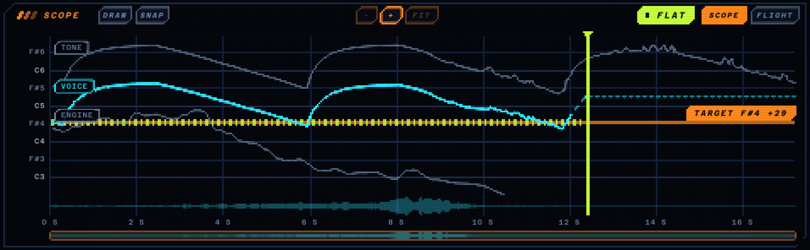
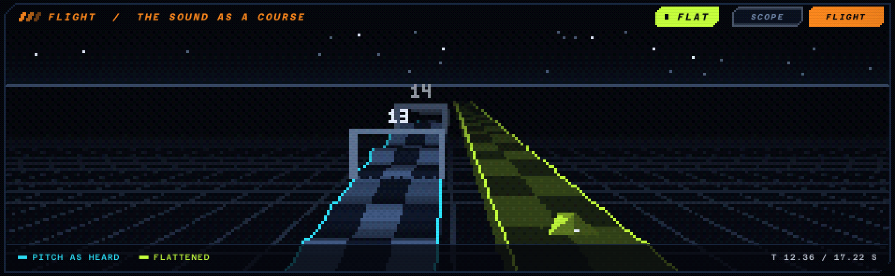
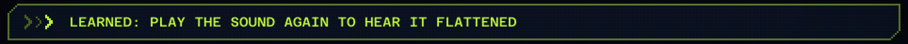
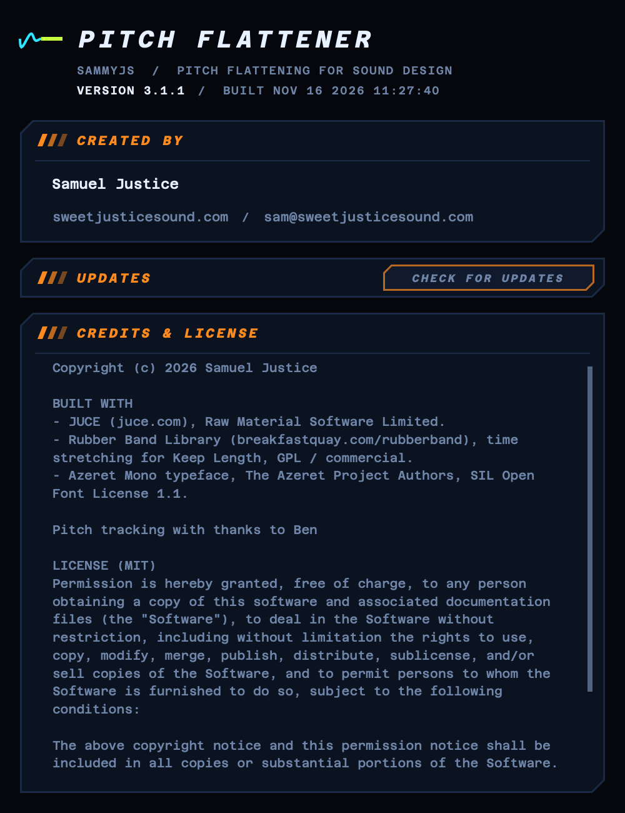
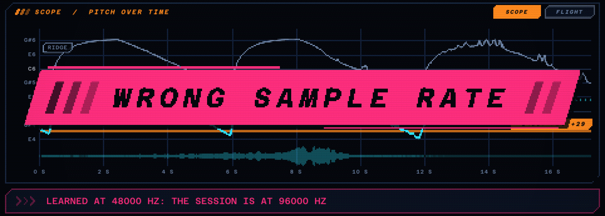

# SammyJs Pitch Flattener

A plug-in by **Samuel Justice** that learns one sound and plays it back with its pitch flattened. Play it the sound once: it reads the pitch of the whole sound and renders a flat version by speeding the playback up and slowing it down from moment to moment, the way a tape would. Play the sound again, from the start or from any point in it, and the flat version plays in its place. Use it to take the sweep out of a pass-by, the wail out of a siren, the climb out of an engine run-up or the wobble out of a held note.

It comes in [Sammy J's Plugins](https://github.com/samueljustice/plugins/releases/latest), one installer for all of these plug-ins.



## Features

- **Learn by playing**: press LEARN and play the sound once. It passes through untouched while it is recorded, and Learn stops by itself after a second of silence.
- **Flat however fast it bends**: the pitch is taken out by changing the playback speed, not by shifting the pitch, so a fast sweep comes out as flat as a slow one, with nothing smeared and no warble. The length changes with it.
- **Recognises the sound wherever it starts**: play the learned sound again from the top or from the middle, and the flat version takes over at the matching moment. Anything else passes through.
- **Two pitch readings**: one follows the whole series of harmonics (voices, engines, whines), the other follows the strongest partial (sirens, whistles and higher sounds). The plug-in picks the one that flattens the sound better, and you can overrule it with a click.
- **Five targets**: flatten to the top of the pitch, the bottom, where it spends its time, where it starts, or a note you choose.
- **Amount**: take out all of the movement, or leave some of it in.
- **Two views**: SCOPE draws the pitch over time exactly; FLIGHT flies the sound as a course, its pitch as a track that rises and falls beside the level lane of the flattened sound.
- **Says what to do next**: the next button to press pulses, a banner across the display announces each change, and a bar under it says what is happening in plain words.
- **A fixed delay of 0.4 s**, reported to the host, so hosts that compensate delay line the result up with the original.
- **Mono or stereo**.

## How to use it

Pitch Flattener is made for a rack, such as a sound library's DSP rack, or a track in a DAW: learn the sound, then play or render it.

1. **Put it on the sound.** Load Pitch Flattener in the rack or on the track that plays the sound.
2. **Press LEARN.** The button shows ARMED and waits for sound.
3. **Play the sound once, to its end.** The button shows LISTENING and counts the seconds. The sound passes through untouched while it is recorded. Learn stops after a second of silence, when the player stops, or when you press the button again.
4. **Wait a moment.** The button shows ANALYSING while the plug-in reads the pitch and renders the flat version, then LEARNED.
5. **Play the sound again.** From the start or from any point in it, the flattened sound plays in its place. Audition it, or render it as you would any effect.
6. **Choose the result.** Change TARGET, NOTE, AMOUNT or LINE at any time; the flat version is rendered again from the same reading, with no need to learn the sound again.

**CLEAR** forgets the sound. Press LEARN again to learn another one in its place.

## The window

The window is drawn in chunky pixels, like an old console screen.

### LEARN, CLEAR and the readouts



The **LEARN** button shows what the plug-in is doing, with a hint under the word:

| LEARN shows | Hint | What it means |
|---|---|---|
| **LEARN** | PLAY THE SOUND ONCE | Nothing is learned. The button pulses: it is the next thing to press. |
| **ARMED** | WAITING FOR SOUND | Learn is on and waiting for the sound to start. Press again to cancel. |
| **LISTENING** | the seconds recorded | The sound is being recorded, and passes through untouched. Press again to stop there. |
| **ANALYSING** | READING THE PITCH | The plug-in is reading the sound's pitch and rendering the flat version. |
| **LEARNED** | PRESS TO LEARN ANOTHER | A sound is learned. Press to learn another one in its place. |

Recording starts at the first sound that is not silent, keeping 50 ms before it, so the start is not cut off. A click shorter than 50 ms is not taken for the sound: Learn keeps waiting.

| Control or readout | What it does |
|---|---|
| **CLEAR** | Forgets the learned sound. Audio then passes through unchanged until another sound is learned. |
| **LENGTH** | The learned sound's length (cyan) and the flattened sound's length (lime). |
| **FLAT ON** | The note the sound is flattened to, with cents. |
| **DELAY** | The delay the plug-in reports to the host: always 0.40 s. |
| **?** | Opens the About window: version, credits and the update check. |

### SCOPE



SCOPE draws the learned sound from start to end: its pitch over time on a note scale, seconds along the bottom.

- **The two pitch lines**: the harmonic reading and the ridge reading, each labelled. The line the sound is flattened by is drawn in cyan, on top; the other is grey. With LINE on AUTO, **PICKED** marks the one Auto chose.
- **Clicking the other line** flattens the sound by it instead (it sets LINE to that reading). Hover over a line to see what it is good at. A line that found too little pitch in the sound to flatten by is drawn faint and cannot be picked; its tooltip says so. If LINE is set to that reading, the sound is flattened by the other one, and SCOPE draws the other one in cyan as the line in use, while the LINE button stays where you set it.
- **Dashed stretches** are where the tracker found no pitch and the line only bridges the gap.
- **The target line** (orange) is the pitch the sound is flattened to, tagged with its note where the tag covers neither the line in use nor a label.
- **The play head** (lime) shows where the flattened sound is while it plays, as a moment of the original, with a trail of lime ticks along the target behind it.
- **The level strip** along the bottom is the learned sound's level.
- **RENDERING** appears at the top while the flat version is rendered again after a change to the controls.
- **FLAT**, beside the tabs, is lit while the flattened sound is playing.



Here the harmonic line is chosen and the target is the low point, so the target line runs along the bottom of the sweep.

Click **SCOPE** or **FLIGHT** at the top right to switch views. The choice is saved with the session. Until you choose, the window shows FLIGHT while nothing is learned and SCOPE once something is.

### FLIGHT



FLIGHT flies the learned sound as a course. The camera travels along the sound from start to end.

| On screen | What it stands for |
|---|---|
| **The track** (cyan edges, left) | The pitch as heard: it rises and dips exactly as the pitch line in use does. |
| **The flat lane** (lime edges, right) | The flattened sound: level at the target. With AMOUNT below 100% it moves part of the way back towards the track. |
| **The gates** | One across the track at every whole second of the sound, numbered. |
| **The dart** | Rides the lane at the play head while the flattened sound plays. |
| **T** at the bottom right | Where the flight is in the sound, and the sound's length. |

While nothing plays, the flight cruises along the sound at half speed and loops. While nothing is learned, it flies a demo course and says DEMO RUN.

### The guidance bar



The bar under the display says what to do or what is happening:

| The bar says | When |
|---|---|
| PRESS LEARN, THEN PLAY THE SOUND ONCE | Nothing is learned. |
| LEARN IS ARMED: PLAY THE SOUND ONCE | Learn is waiting for the sound. |
| LISTENING: LET THE SOUND PLAY TO ITS END | The sound is being recorded. |
| ANALYSING THE SOUND | The pitch is being read and the flat version rendered. |
| LEARNED: PLAY THE SOUND AGAIN TO HEAR IT FLATTENED | Ready. |
| PLAYING THE FLATTENED SOUND | The sound was recognised and its flat version is playing. |
| NO STEADY PITCH FOUND: THE SOUND IS LEFT AS IT IS | Neither pitch reading found a steady pitch in the sound. |
| LEARNED AT 48000 HZ: THE SESSION IS AT 96000 HZ | The session runs at another sample rate than the sound was learned at (the rates shown are the real ones). |

### Banners

A banner across the display announces each change, and the next steps while you learn.


| Banner | Colour | What it means |
|---|---|---|
| **LEARN FIRST** | orange | Nothing is learned. It blinks for a second in every four, with chevrons pointing up at LEARN. |
| **PLAY THE SOUND** | lime | Learn is armed: play the sound. |
| **LISTENING** | magenta | The sound is being recorded, with the seconds so far and a blinking recording square. |
| **ANALYSING** | cyan | The pitch is being read, with a bar sweeping along the banner. |
| **LEARNED** | lime | The sound is learned and flattened. Shown once, followed by **PLAY IT AGAIN**. |
| **FLATTENED** | lime | The flattened sound has started playing. After it, the FLAT tag stays lit while it plays. |
| **NO STEADY PITCH** | magenta | The sound was learned, but neither pitch reading found a steady pitch in it: it is left as it is. |
| **WRONG SAMPLE RATE** | magenta | The session runs at another sample rate than the sound was learned at. It stays until the rates match. |
| **CLEARED** | white | The sound was forgotten. |

### The controls


**TARGET**: the pitch the sound is flattened to. Where the sound is above the target it is slowed down, and where it is below it is sped up, so the target decides whether the result comes out shorter or longer.

| Target | What it does | Use it for |
|---|---|---|
| **HIGH POINT** | Flattens the sound to the top of its pitch. The flattened sound is never longer than the original. The default. | A pass-by's approach, a siren's peak; any time the result should not get longer. |
| **CENTRE** | Flattens the sound to the pitch it spends most of its time at, so it changes least overall, and its length changes least. | Vibrato and wobble, where the sound should stay close to how it was. |
| **LOW POINT** | Flattens the sound to the bottom of its pitch. The flattened sound is longer than the original. | A deeper, slower result. |
| **START** | Flattens the sound to the pitch it opens on. | Sounds that should hold the note they begin with. |
| **NOTE** | Flattens the sound to the pitch set with the NOTE control. | Putting the sound on a particular note. |

The high point, centre and low point are counted by level, so a loud part of the sound outweighs a long quiet one, and a stray moment at the very top or bottom does not move them.

| Control | What it does |
|---|---|
| **NOTE** | The pitch the sound is flattened to when the target is NOTE (C1 to C8, A4 by default). Type a note name such as A3, or C#4 +20 for cents. It is dimmed for the other targets. |
| **AMOUNT** | How much of the pitch movement is taken out. 100% leaves the sound flat; 50% leaves half of its movement in; 0% leaves it as it was. |

Double-click NOTE or AMOUNT to return it to its default.

**LINE**: which reading of the sound's pitch it is flattened by.

| Line | What it does |
|---|---|
| **AUTO** | Takes the reading that flattens the sound better: it flattens the sound by each, reads both results back, and keeps the flatter one. The default. |
| **HARMONIC** | Reads the pitch from the sound's whole series of harmonics. Suits voices, engines and whines, up to about 1 kHz. |
| **RIDGE** | Follows the strongest partial from start to end. Suits sirens, whistles and anything pitched higher, and a whine in a burst of noise. |

Auto's pick is a measurement, and the ear sometimes disagrees with it. If the result sounds wrong (it wobbles, or jumps where the sound does not), choose the other line here or click it in SCOPE. If the line you choose finds too little pitch in the sound to flatten by, the sound is flattened by the other line instead, so it is never left untouched while one of the two can read it.

TARGET, NOTE, AMOUNT and LINE are host parameters, saved with the session and open to automation. A change renders the flat version again in the background.

## About and updates

Click **?** at the top right for the About window, with the version, the credits and the licence. CHECK FOR UPDATES asks GitHub whether a newer version is out.



When the window opens, Pitch Flattener asks GitHub, at most once a day, whether a newer version is out. If there is one, it offers it once per host session: DOWNLOAD opens the Sammy J's Plugins installer's page, LATER closes the offer, and SKIP THIS VERSION does not offer that version again. Offline, nothing happens.


## Good to know

- **The length changes.** The pitch is taken out by playing the sound faster where it is below the target and slower where it is above, the way speeding and slowing a tape changes its pitch. That is what keeps the result flat however fast the pitch bends, and it is also why the result is shorter or longer than the original. LENGTH shows both. HIGH POINT never makes the sound longer, LOW POINT makes it longer, and CENTRE changes the length least. When the result is longer, the plug-in tells the host how much longer, so a render keeps the end.
- **The speed changes by up to three octaves either way.** Pitch movement beyond that is not fully taken out.
- **A delay of 0.4 s.** The output is always the input 0.4 s later, whether the flat version or the input itself is playing, and bypass is delayed the same, so switching never shifts the audio in time. The plug-in reports the delay, so hosts that compensate delay line the result up with the original. That time is what lets it recognise where the sound is before the audio reaches the output.
- **A sound with no steady pitch is left as it is**, such as noise or a crash: when neither pitch reading can follow it, the window says NO STEADY PITCH, and the sound passes through unchanged.
- **The same sound, played the same way.** The plug-in recognises the learned recording itself. The same sound played at another speed or pitch, or another take of it, is not recognised, and passes through.
- **The flattened sound follows the playback level.** Play the sound louder or quieter than it was learned, and the flattened sound comes out louder or quieter by the same amount. The level is measured when the plug-in finds the sound in the input; within about a tenth of a decibel of the learned level counts as the same.
- **Stopping the player in the middle of the sound** returns the output to the input. Jumping to another place in the sound finds that place. Played to its end, the rest of the flattened sound plays out, then the input.
- **Rendering offline** works: when the host renders faster than real time, the plug-in waits for its search instead of running ahead of it.
- **The learned sound is kept in memory only.** It is not saved with the session: after reopening the session, learn it again. The controls and the chosen view are saved.
- **One sound per instance.** Learning another sound replaces the first. For several sounds, use several instances: each is independent.
- **The sample rate must match.** The flattened sound plays only at the sample rate it was learned at. At another rate the window says WRONG SAMPLE RATE, and the audio passes through.
- **Up to 120 seconds per sound.** Learn stops by itself at two minutes.
- **Mono and stereo.** A stereo sound on a mono track plays as the two channels mixed; a mono sound on a stereo track plays on both.
- **Loud sounds stay under full scale.** If the flattened version would peak over -0.1 dBFS, it is turned down as a whole to fit.



## Measured

`PitchFlattenerCoreTests` makes sounds whose pitch moves in a known way, flattens each, and measures the result with a pitch meter that shares nothing with the plug-in's trackers. "Travels" is how far the measured pitch moves over the whole sound, with the outer 5% of readings left out. These are the figures it prints:

| Sound | Line Auto picked | Pitch travels before | After |
|---|---|---|---|
| A pass-by: a rich tone falling 7 semitones through the middle (4.00 s, flattened to its high point: 3.32 s) | Ridge | 6.99 st | 0.00 st |
| A siren: a tone wailing between 700 and 1700 Hz | Ridge | 15.17 st | 0.00 st |
| An engine run-up: a harmonic series climbing from 60 to 200 Hz | Harmonic | 19.60 st | 0.07 st |
| Vibrato: a voice-like tone wobbling a semitone at 6 Hz (flattened to its centre) | not printed | 0.91 st | 0.10 st |

The same tests check that flattening to the high point never makes the sound longer, that the low point makes it longer, that the centre keeps a vibrato's length within 2%, that half the amount leaves half the movement, that a chosen note is hit, that a whine falling an octave and a half in 0.15 s in noise is followed, and that noise and silence are left alone.

## System requirements

- macOS 11 or later (Apple Silicon and Intel): VST3, AU and AAX
- Windows 10 or later (64-bit): VST3 and AAX

## Building

### Prerequisites

- CMake 3.15 or higher
- Xcode Command Line Tools (macOS) or Visual Studio 2022 (Windows), with C++20
- JUCE 8.0.8 at `../SDK/JUCE`, relative to this folder
- The UI fonts in `Resources/Fonts`, and the update check from `../common`

### Build instructions

From the repository root:

```bash
cmake -S pitchflattener -B pitchflattener/build -DCMAKE_BUILD_TYPE=Release -DPITCHFLATTENER_BUILD_TESTS=ON
cmake --build pitchflattener/build --config Release
pitchflattener/build/PitchFlattenerCoreTests
pitchflattener/build/PitchFlattenerTests_artefacts/Release/PitchFlattenerTests
```

The bundles land in `pitchflattener/build/PitchFlattener_artefacts/Release/{AU,VST3}`, and are also copied to your plug-in folders after the build; add `-DPITCHFLATTENER_COPY_AFTER_BUILD=OFF` to skip that. Add `-DSAMMYJ_AAX=ON` to build AAX as well, with the AAX SDK bundled with JUCE or the one at `-DAAX_SDK_PATH=<folder>`. An unsigned AAX loads only in a developer build of Pro Tools. On macOS, `./build.sh` in this folder builds, signs and installs the VST3 and AU in one go.

`PitchFlattenerCoreTests` checks the pitch reading and the flattening on made-up sounds whose pitch is known (the figures above). `Tests/build_core_tests.sh` builds and runs it without CMake. `PitchFlattenerTests` checks the rest: finding the learned sound in the input, the engine driven through real audio blocks, the processor as a host sees it, and the window. `--png <folder>` writes pictures of the window in every state (the pictures on this page come from it), and `--sound <file>` learns that audio file for them.

## Credits

Created by Samuel Justice, Creative Sound Supervisor at [Sweet Justice](https://www.sweetjusticesound.com).

- Built with [JUCE](https://juce.com), Raw Material Software Limited.
- UI font: [Azeret Mono](https://github.com/displaay/Azeret), The Azeret Project Authors, SIL Open Font License 1.1.
- Pitch tracking with thanks to Ben

## License

MIT License. See [LICENSE](LICENSE) for details.
