# SammyJs Pitch Flattener

A VST3/AU plugin that removes pitch movement from a sound while keeping its energy and character. Use it to take the Doppler sweep out of a pass-by, iron the wail out of a siren, take the vibrato out of a voice or instrument, or lock a warbling tone to one note so the pitch is malleable again.

### 🎉 Latest Release v2.3.0 - [Download Here](https://github.com/samueljustice/plugins/releases/tag/pitchflattener-v2.3.0)

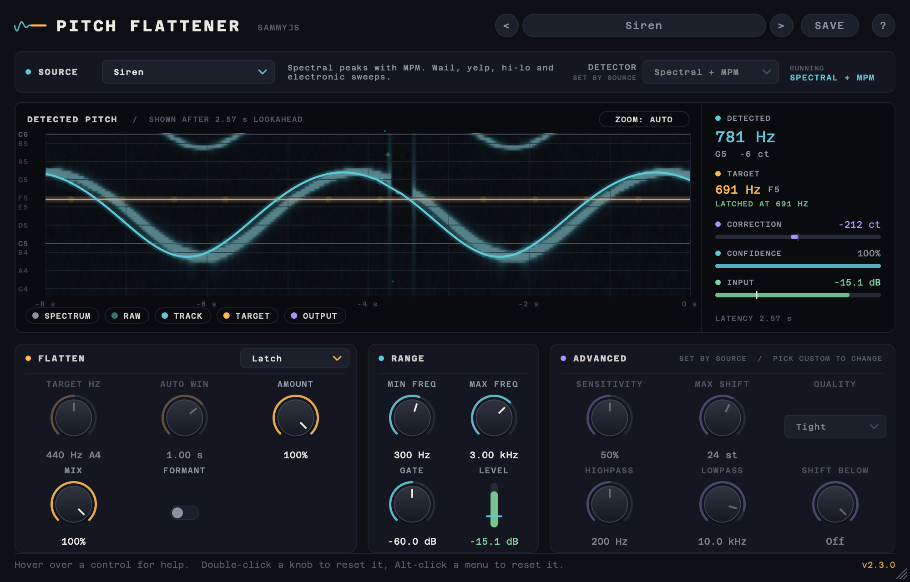

> **2.0 is a rewrite of the detection and correction engine.** 1.x reacted late and fought itself, so it mostly made "weird cool sounds". 2.0 looks ahead, picks a pitch detector built for your kind of source, and lines the correction up with the audio sample-accurately. See [What changed in 2.0](#what-changed-in-20).

## Contents

- [Designed for offline rendering](#designed-for-offline-rendering)
- [Quick start](#quick-start)
- [A tour of the interface](#a-tour-of-the-interface)
  1. [Header and presets](#1-header-and-presets)
  2. [Source strip](#2-source-strip)
  3. [Pitch display](#3-pitch-display)
  4. [Readouts](#4-readouts)
  5. [Flatten](#5-flatten)
  6. [Range](#6-range)
  7. [Advanced](#7-advanced)
  8. [Help bar, tooltips and shortcuts](#8-help-bar-tooltips-and-shortcuts)
  - [About window](#about-window)
- [Source Types and detectors](#source-types-and-detectors)
- [Measured performance](#measured-performance)
- [Tips](#tips)
- [What changed in 2.0](#what-changed-in-20)
- [Building](#building)
- [Credits and licences](#credits-and-licences)
- [Version history](#version-history)

## Designed for offline rendering

Pitch Flattener runs as a normal realtime plugin, so it loads in any VST3/AU host or rack. It is built for hosts that render offline, such as the **Soundminer DSP rack**, a DAW bounce, or AudioSuite-style processing:

- It looks **about 2.6 s ahead**, so it knows where the pitch is going before it shifts anything.
- It reports that delay to the host. With delay compensation, which Soundminer and every major DAW have, the output lines up with the input exactly.
- The latency is the same whatever the settings, so changing Source Type never shifts your audio in time.
- It is not meant for live monitoring.

## Quick start

1. Pick the **Source Type** that matches your sound (Siren, Engine / Doppler, Vocal / Speech...). This loads a tuned detector and settings for it.
2. Leave **Target** on **Latch** to hold each sound at the pitch it starts on, or choose **Fixed** and set **Target Hz** to flatten everything to one note.
3. Play or render the sound. In the display, the teal **TRACK** line should follow the pitch of the source and the violet **OUTPUT** line should sit flat on the amber **TARGET** line.
4. If the track jumps or drops out, narrow **Min / Max Freq** around the source, or try another Source Type.
5. Save the result as a preset with **SAVE** if you'll want it again.

## A tour of the interface

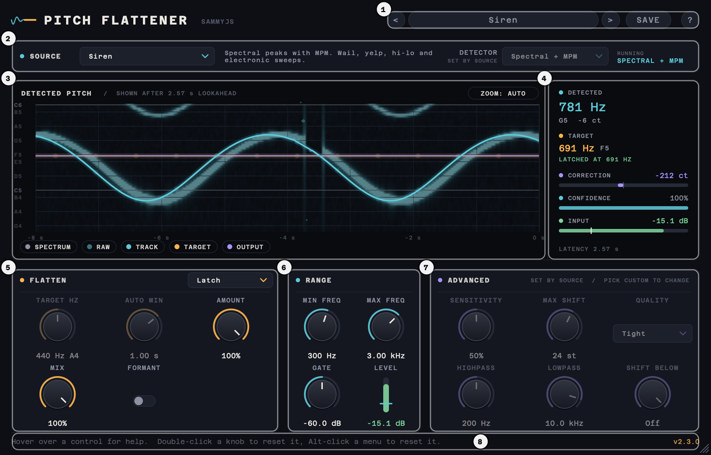

| # | Part | What it's for |
|---|---|---|
| 1 | [Header and presets](#1-header-and-presets) | Load, step through and save presets; open the About window. |
| 2 | [Source strip](#2-source-strip) | Say what you're flattening; see which detector is running. |
| 3 | [Pitch display](#3-pitch-display) | The last 8 s of detected pitch, target and output over a spectrogram. |
| 4 | [Readouts](#4-readouts) | Numbers for the newest analysed moment: pitch, target, correction, confidence, level. |
| 5 | [Flatten](#5-flatten) | What pitch the sound is flattened to, how much, and how it sounds. |
| 6 | [Range](#6-range) | Where in this particular file to listen for the pitch. |
| 7 | [Advanced](#7-advanced) | Detection and shifter settings the Source Type sets; adjustable on Custom. |
| 8 | [Help bar](#8-help-bar-tooltips-and-shortcuts) | Explains whatever is under the mouse. |

The window can be resized from the bottom-right corner, from 60 % to 200 % of its normal size. It keeps its proportions and the layout scales as a whole.

### 1. Header and presets


The preset bar on the right of the header holds:

- **<** and **>**: step to the previous or next preset. They go through the factory presets and then your own, in menu order, and wrap around at the ends.
- **The preset name**: click it to open the preset menu. It reads "No preset" when the settings didn't come from a preset: on a new instance, after Reset to Defaults, or once the preset they came from has been deleted.
- **SAVE**: stores the current settings as a user preset.
- **?**: opens the [About window](#about-window).

#### The preset menu

<p>
  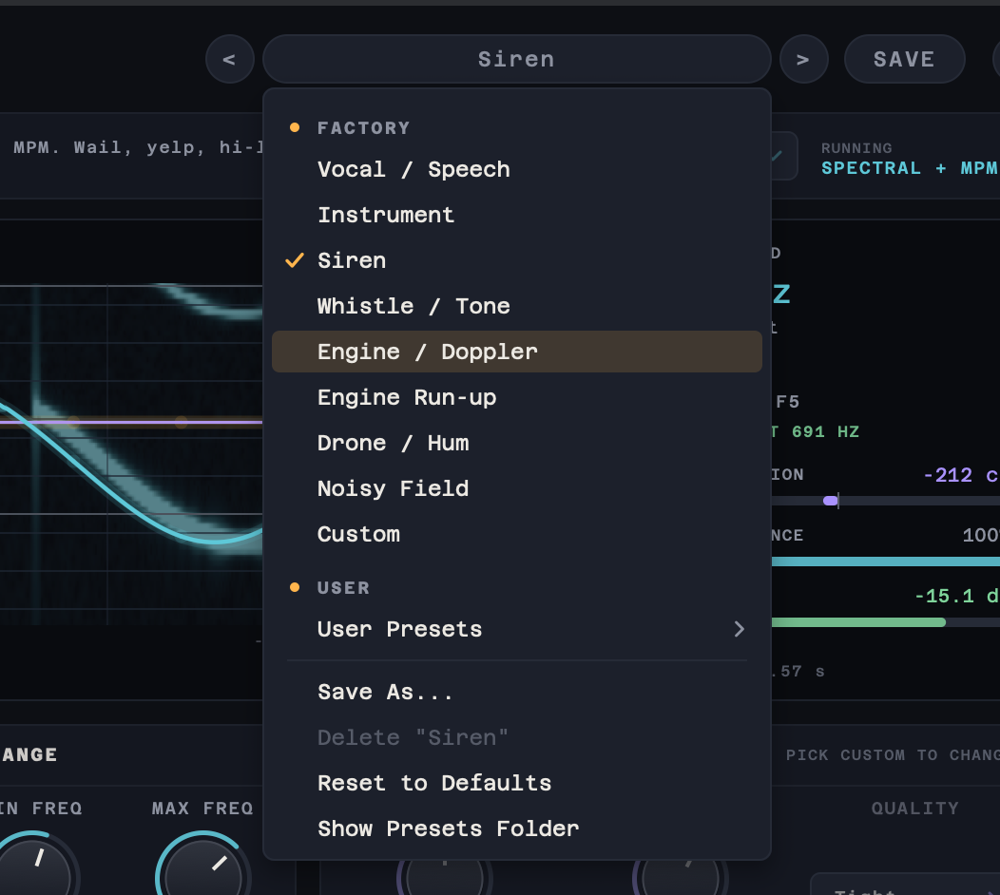
  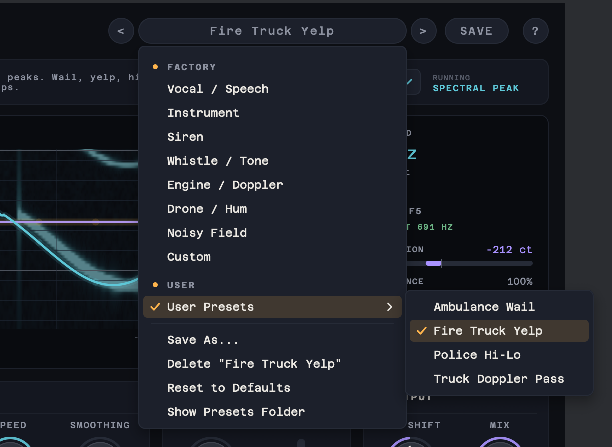
</p>

- **FACTORY**: one preset per Source Type, with its tuned detector, frequency range, tracking and target settings.
- **USER**: your own presets, in the **User Presets** submenu, sorted by name.
- A tick marks the current preset. When it is one of yours, the User Presets entry is ticked too (right).
- **Save As...**: saves the current settings under a new name.
- **Delete "*name*"**: moves the current user preset to the trash (or deletes it where there is no trash). It is greyed out when the current preset isn't one of yours.
- **Reset to Defaults**: sets every parameter back to its default, after asking.
- **Show Presets Folder**: opens the folder your presets are stored in.

#### Preset dialogs

Saving, replacing, deleting and resetting each ask first:

<p>
  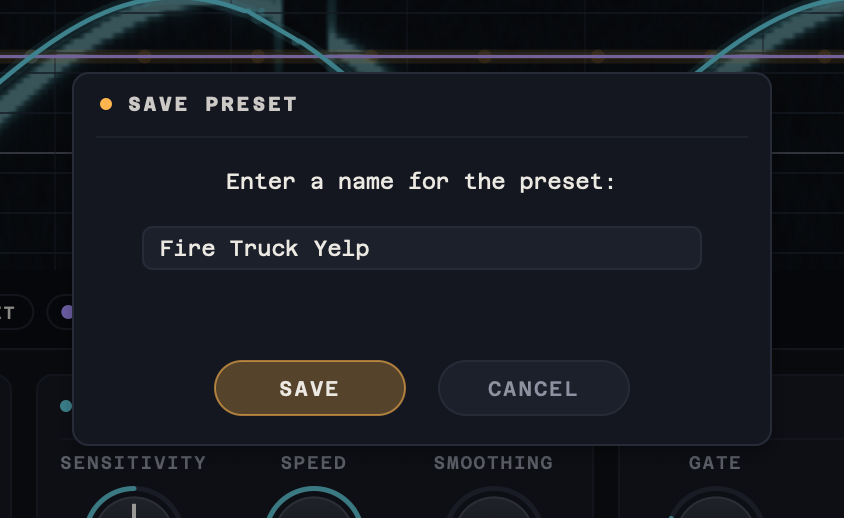
  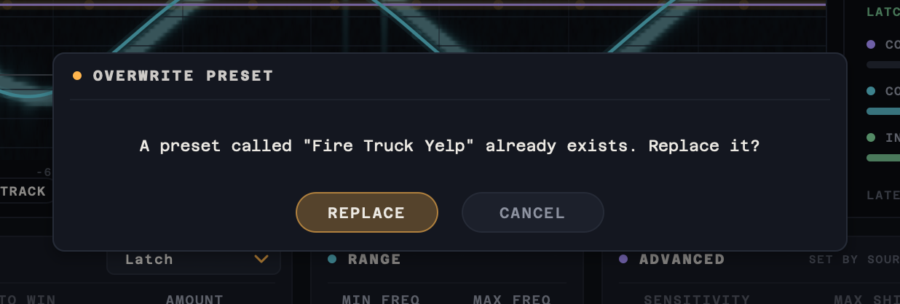
</p>
<p>
  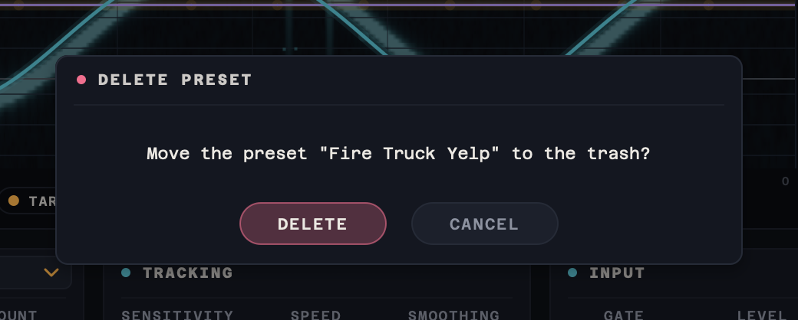
  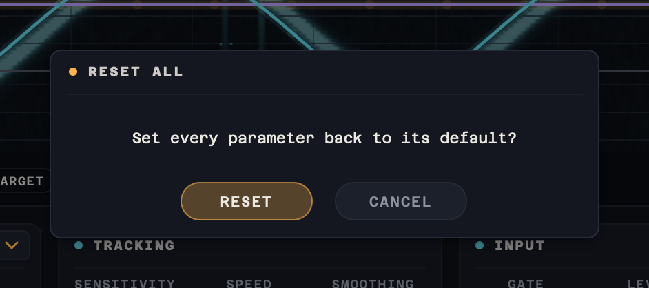
</p>

- **Save Preset** asks for a name. The characters `" # @ , ; : < > * ^ | ? \ /` are removed, and the name is kept to 128 characters.
- **Overwrite Preset** appears when a preset with that name already exists.
- **Delete Preset** moves the file to the trash, so it can be recovered. Where there is no trash, the file is deleted.
- **Reset All** puts every parameter back to its default value.

#### Where presets live

User presets are plain `.xml` files, named after the preset, so they are easy to back up, share or rename:

- macOS: `~/Library/SammyJs/PitchFlattener/Presets/User`
- Windows: `%APPDATA%\SammyJs\PitchFlattener\Presets\User`

Extra `.xml` presets dropped into the `Factory` folder next to `User` are listed after the built-in factory presets. The current preset is saved with your session.

Presets saved with 1.x lived in `Documents/PitchFlattener Presets`. To use them, copy their `.xml` files into the User folder above; they are converted when loaded.

### 2. Source strip


From left to right:

- **SOURCE**: what you're flattening. Picking a Source Type loads tuned settings for that kind of sound. The Flatten and Range controls stay adjustable; the Detector and the Advanced settings can be changed after switching to Custom, which keeps the current values.
- **The description**: a short note on the chosen Source Type: which detector it uses and the sounds it suits.
- **DETECTOR** (*set by source*): the pitch detection algorithm. Each Source Type picks one. It can be changed on Custom, as a rescue for a sound no Source Type handles.
- **RUNNING**: the detector that is actually running. After a change it can lag for a moment while the new detector is set up.

<p>
  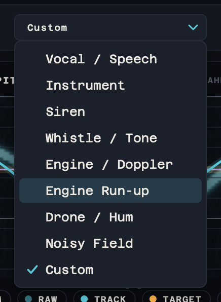
  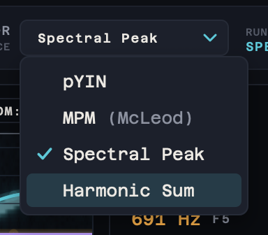
</p>

See [Source Types and detectors](#source-types-and-detectors) for which to pick and how each detector works.

### 3. Pitch display

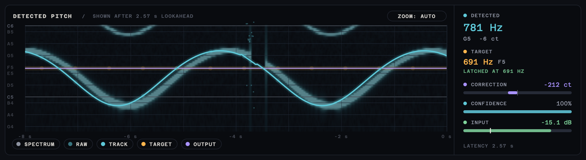

The display shows the last 8 s of pitch on a log-frequency axis, with note names on the left and seconds along the bottom. The title says how far behind the input it runs: each moment is drawn once the tracker has decided it, so the display lags by the lookahead (about 2.6 s).

The legend chips along the bottom each switch one layer on or off:

| Chip | Shows |
|---|---|
| **SPECTRUM** | A spectrogram of the signal the detector hears (after the detection filters), drawn behind the lines. |
| **RAW** | Dim teal dots: the detector's raw best guess for each analysis frame, before tracking. |
| **TRACK** | The teal line: the final, cleaned pitch track the flattener follows. |
| **TARGET** | The amber line: the pitch the sound is flattened to. |
| **OUTPUT** | The violet line: the detected pitch after the correction. When flattening works it sits on the target line. |

**ZOOM** (top right) switches the vertical range. **AUTO** fits the view to the recent pitch; **RANGE** shows the whole Min..Max Freq detection range:

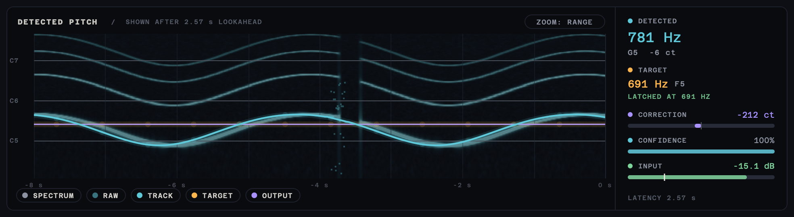

#### Wobble warning

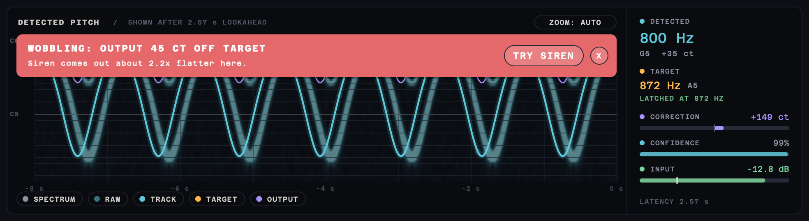

While sound plays, the plugin measures the pitch of its own flattened output against the target. If the output stays well off the target (more than about 35 cents, for more than a second), a red warning appears across the graph with how far off it is.

It then replays the last few seconds through every Source Type in the background, keeping your target settings, and measures each one's output the same way:

- If one comes out clearly flatter, the warning names it, with a **TRY** button that switches to it, just as picking it from the Source menu would.
- If none does clearly better, it says so and suggests narrowing Min / Max Freq around the sound or setting a Fixed target.

The warning goes once the output has been flat for about two seconds; **X** hides it until then, or until a setting changes. It only judges what it can measure: a sound too short or too noisy for the meter to read, such as a ricochet's crack, never raises it. With Amount or Mix turned below 95 % the result isn't meant to be flat, so it stays quiet.

What it looks like on other sources:

**Voice with vibrato and a slow drift** (Vocal / Speech, Latch). The track wobbles with vibrato, drifts down and back, and is bridged across the breath gaps; the output stays on the latched pitch:

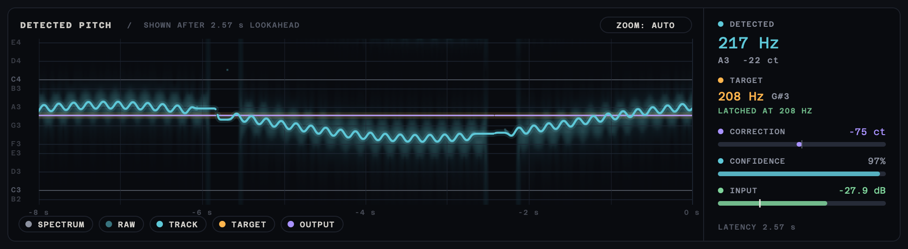

**Engine pass-by** (Engine / Doppler, Latch). The Doppler drop of a passing engine is about 2.5 semitones. The target latches the approach pitch and the output holds it through the pass:

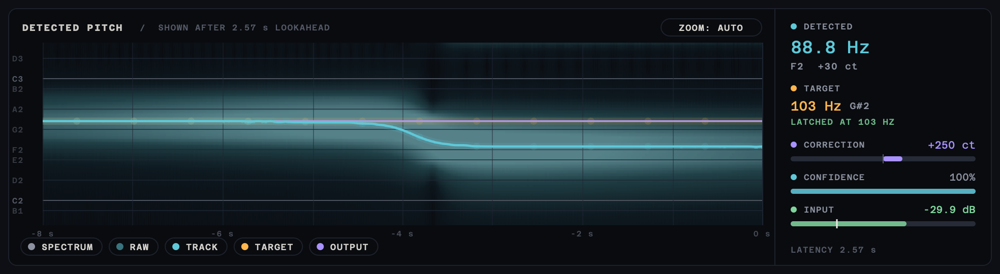

### 4. Readouts

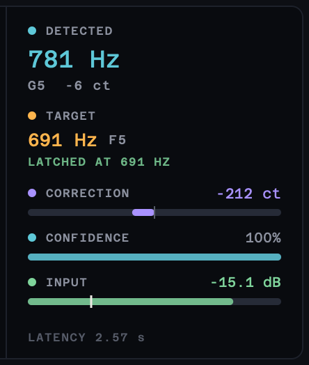

The column to the right of the display gives numbers for the newest analysed moment:

- **DETECTED**: the tracked pitch in Hz, its nearest note and how many cents it is off that note. "NO PITCH" when nothing pitched is heard.
- **TARGET**: the pitch it is being flattened to, and the target mode's state:
  - "LATCHED AT *x* HZ", or "LISTENING TO LATCH" while waiting for a pitch to latch on to
  - "FIXED TARGET"
  - "AUTO: FOLLOWS CONTOUR"
- **CORRECTION**: the shift being applied, in cents. The bar fills left or right from its centre tick; each half spans the Max Shift setting.
- **CONFIDENCE**: how sure the detector is that the sound is pitched.
- **INPUT**: the live input level. The white tick on the bar marks the Gate.
- **LATENCY**: the delay reported to the host. If the shifter ever runs short of audio, an **UNDERRUNS** count appears beside it.

<br clear="right">

### 5. Flatten

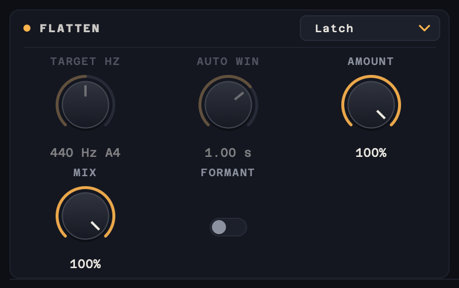

The amber section sets the pitch the sound is flattened to, how much is removed, and how the result sounds.

- **Target mode** (the menu in the section's title bar):
  - **Latch** (default) locks to the opening pitch of each sound: the median of its first ~300 ms, read with lookahead. The latch is decided before the sound plays, so it is flattened from its first sample, soft or breathy attacks included. It re-latches when a new sound starts after more than a second without pitch, so a file with several separate sounds flattens each to its own pitch. This is the mode for batch work: no pitch to type per file.
  - **Fixed** flattens everything to **Target Hz**. Use it to put a sound on a chosen note, or when the start of a sound is too quiet to latch on.
  - **Auto** removes movement faster than **Auto Win** and keeps the slower overall contour. Use it to take out vibrato or warble without changing the melody. It deliberately keeps slow movement, so it isn't the mode for a Doppler drop.
- **TARGET HZ** (Fixed): the pitch everything is flattened to. You can type a note name such as `A4` into its value.
- **AUTO WIN** (Auto, 200 ms–2 s): movement faster than this is removed, slower movement is kept. Half of the knob's travel covers 200–600 ms, where vibrato and warble live. Longer is flatter.
- **AMOUNT** (0–100 %): how much of the pitch deviation is removed. 100 % is completely flat; 50 % halves a Doppler sweep.
- **MIX**: blends in the time-aligned dry signal. Keep it at 100 % for flattening; partial mixes can sound phasey.
- **FORMANT**: keeps a voice's character natural when it is shifted. Leave it off for machines and sirens.

<br clear="right">

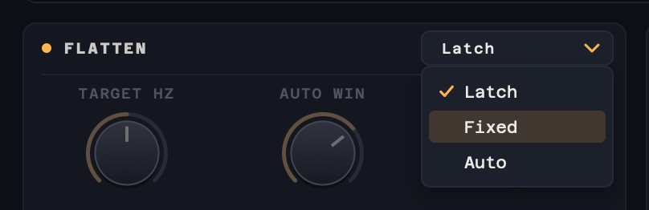

Only the knob the current mode uses is lit. The other is dimmed but keeps its value:

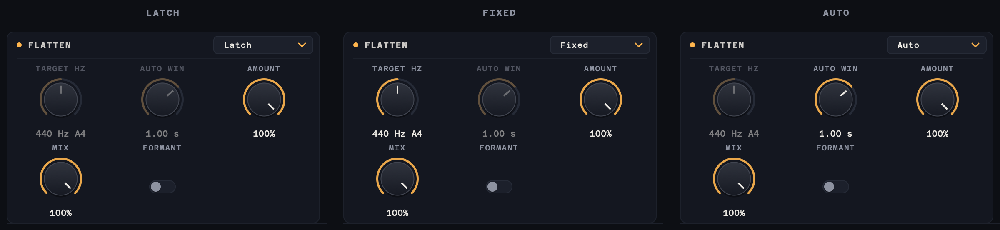

### 6. Range

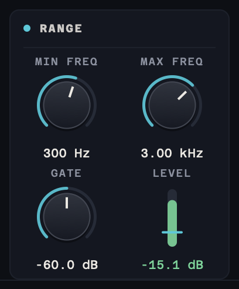

The teal section says where to listen in this particular file. The Source Type sets sensible values; these are the ones worth adjusting per file.

- **MIN FREQ / MAX FREQ**: the pitch search range. Bracket your source; a tighter range is more reliable and stops the tracker jumping an octave or locking onto rumble.
- **GATE** (-80 to -40 dB): input quieter than this counts as unpitched. Raise it to ignore room tone or a quiet tail between sounds. From about -40 dB up it starts cutting into the sound itself, so the knob stops there. Pure tones such as whistles track best at -60 dB or higher.
- **LEVEL**: the live input level. It turns green when the input is above the gate (the teal line), so the detector is listening.

<br clear="right">

### 7. Advanced

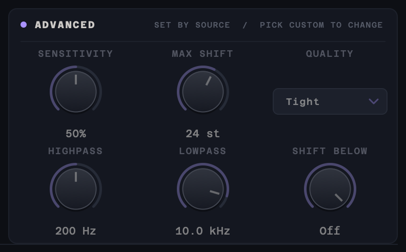

The violet section holds the detection and shifter settings each Source Type tunes for its kind of sound. They are dimmed and locked unless the Source Type is **Custom**: pick the closest Source Type first, then switch to Custom to adjust from there (choosing Custom changes nothing by itself). The **Detector** menu in the source strip works the same way.

- **SENSITIVITY**: how readily a sound counts as pitched. Raise it for quiet or breathy sources such as creature calls; lower it for shimmering tones and noisy recordings.
- **MAX SHIFT** (6–36 semitones): the largest correction allowed. Below 6 it mostly stops the flattening, so the knob starts there. Engine Run-up sets 36; Siren, Whistle / Tone and Drone / Hum set 24; the others set 12.
- **SHIFT BELOW** (200 Hz–20 kHz, or Off): only the sound below this frequency goes through the shifter; above it the audio passes through unshifted. The two bands are split before shifting by a crossover that sums back flat. An engine's exhaust and body resonances, its roar and any steady whine stay at fixed frequencies while the engine's pitch moves. Shifting everything drags them down as the correction grows, which is heard as a dive. With Shift Below they stay put. Engine Run-up sets 1.2 kHz; the others set Off.
- **QUALITY**:
  - **Smooth** uses the shifter's standard window and gives the best sound on sustained tones.
  - **Tight** uses a short window and follows very fast sweeps and transients more closely.
- **HIGHPASS / LOWPASS**: filters that apply to the detector's input only, to keep rumble or hiss out of detection. They do not change the sound.

<br clear="right">

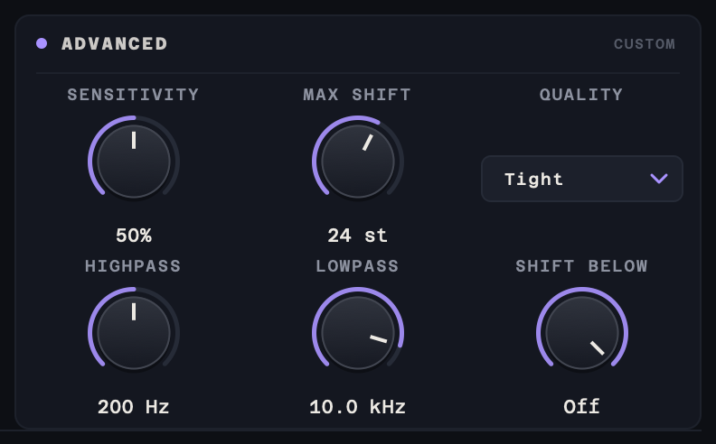

Speed, Smoothing and Gap Fill are set by each Source Type and aren't on the panel: measured across 58 recordings, the only thing they changed was making results worse at their extremes. See the [parameter audit](docs/parameter-audit.md).

### 8. Help bar, tooltips and shortcuts

The bar along the bottom explains whatever is under the mouse, including each part of the display. The version number is on its right.


The header buttons also show tooltips:


Shortcuts:

- **Double-click a knob** to reset it to its default.
- **Alt-click a menu** to reset it to its default. Alt-clicking Source resets the Source Type and loads its settings.
- **Drag a knob** up or down to change it, or click its value to type one in.

### About window

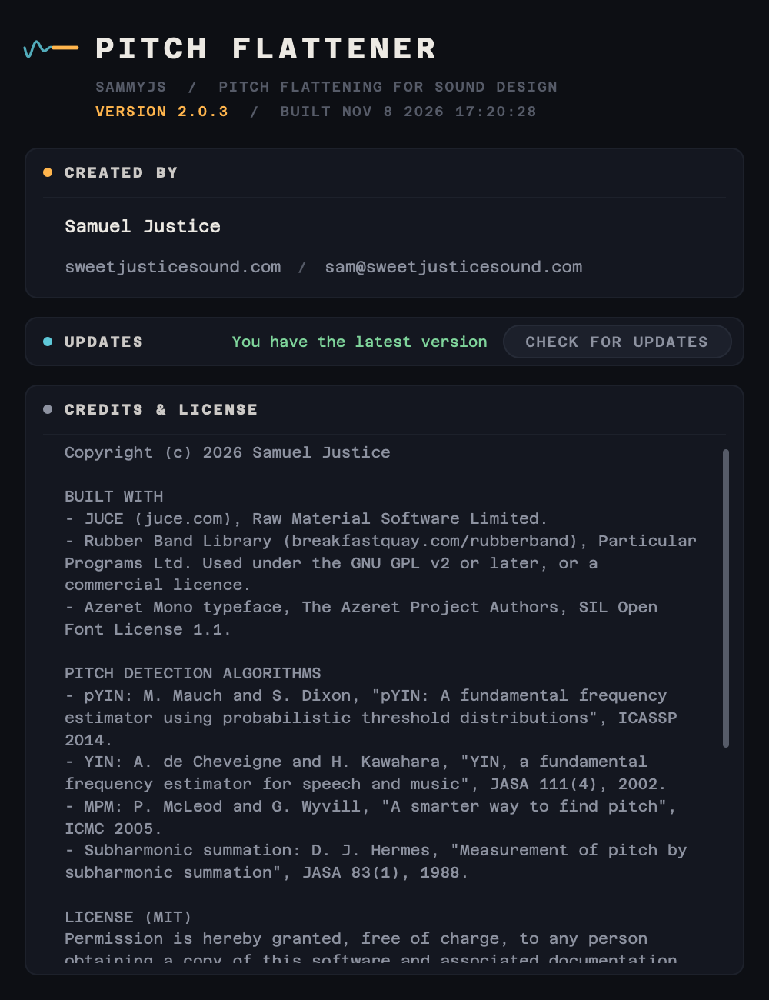

**?** in the header opens the About window:

- the version and build date
- **CREATED BY**, with links to the website and email
- **UPDATES**: **CHECK FOR UPDATES** looks up the latest Pitch Flattener release on GitHub and tells you whether a newer version is available
- **CREDITS & LICENSE**: the libraries, typeface and research papers it is built on, and the licence

<br clear="right">

## Source Types and detectors

Each Source Type chooses a pitch detector and tuned defaults. Flatten and Range can be changed at any time; the Detector and the Advanced settings on Custom; Speed, Smoothing and Gap Fill always come from the Source Type.

| Source Type | Detector | Use it for |
|---|---|---|
| **Vocal / Speech** | pYIN (probabilistic YIN) | Voices, singing, vocal-like animal calls. Ignores breaths and consonants and follows the voice smoothly. Formant preservation is on by default. |
| **Instrument** | MPM (McLeod Pitch Method) | Solo melodic instruments: vibrato, warble, tape wow. |
| **Siren** | Spectral + MPM | Wail, yelp, hi-lo and electronic sweeps, even in traffic noise. Uses the Tight window to follow fast sweeps, and a 24-semitone Max Shift so a siren that switches pattern stays flat. |
| **Whistle / Tone** | Spectral + MPM | Whistles, feedback, test tones, theremin. Very stable on near-pure tones; low Sensitivity and a 24-semitone Max Shift keep shimmering feedback flat. |
| **Engine / Doppler** | Harmonic Sum (subharmonic summation) | Engines, pass-bys, props, motors and trains. Follows the whole harmonic series, so it does not jump octaves and copes with a weak or missing fundamental. |
| **Engine Run-up** | Harmonic Sum, with the [hindsight guide](#hindsight-guide-harmonic-sum) | Revs and run-ups that climb an octave or more. Max Shift 36 semitones so the whole climb can be held flat, and Shift Below 1.2 kHz so the exhaust's fixed resonances stay where they are instead of diving. |
| **Drone / Hum** | Harmonic Sum, heavy smoothing | Hums, generators and drones down to 25 Hz, with a 24-semitone Max Shift. |
| **Noisy Field** | Harmonic Sum, strict voicing | Rough field recordings with lots of broadband noise. |
| **Custom** | Any | Your own settings. Choosing Custom doesn't change anything. |

### How the detectors work

- **pYIN** (Mauch & Dixon 2014) runs YIN's cumulative-mean-normalised difference function, computed with FFTs. It weighs every dip in that function against a Beta-distributed prior over YIN thresholds, so each frame produces several pitch candidates with probabilities instead of one guess.
- **MPM** (McLeod & Wyvill 2005) uses the normalised squared difference function. It picks the first "key maximum" within a fraction of the highest one, which avoids octave errors on bright instruments.
- **Spectral Peak** uses Gaussian-windowed FFTs at several lengths: short windows for fast sweeps, long ones for steady tones. Each peak is refined with quadratic interpolation and time-frequency reassignment, which gives the instantaneous frequency even mid-sweep. Its salience is measured against the local noise floor. A harmonic-support check makes the fundamental win over its overtones.
- **Spectral + MPM** runs both on every frame and gives the tracker both sets of candidates, each weighted by its own detector's confidence. MPM is the sharper of the two on very fast yelps but loses the pitch in heavy noise; Spectral Peak survives the noise but smears the fastest sweeps. Where both are confident, MPM's pitch is favoured; in noise MPM's confidence drops and Spectral Peak carries the track. Spectral Peak needs its strongest peak to stand 6 dB further above the noise floor than it does on its own, so noise with no pitch in it, such as the traffic left after a siren passes, is left alone rather than shifted.
- **Harmonic Sum** (subharmonic summation, Hermes 1988) works on a whitened, log-frequency spectrum and adds up the energy at every candidate's harmonics. An odd/even-harmonic test settles octave ambiguities, for example when the fundamental is missing.

### Tracking, using lookahead

Every detector feeds the same tracker, which can see well into the future of the signal:

1. **Fixed-lag Viterbi** over the candidates, plus an "unpitched" state. Jumps faster than the Tracking Speed and octave jumps are expensive, so the best continuous path wins. This removes octave errors and glitches.
2. **Octave repair and median filter** against the local median pitch.
3. **Gap fill:** short dropouts are bridged. Before a sound starts, the correction is set up in advance, so the first syllable or rev is already flattened.
4. **Centred Gaussian smoothing** in cents. It is zero-phase, so the curve doesn't lag.
5. **Target and correction:** the shift needed to move the track to the target, limited by Max Shift.

#### Hindsight guide (Harmonic Sum)

Each frame detector decides one moment at a time. Through a fast engine run-up the strongest partial keeps changing (the firing rate, a half order, a cylinder harmonic), so the track can hop from one to another and the correction jumps with it. When the detector is Harmonic Sum (Engine / Doppler, Engine Run-up, Drone / Hum, Noisy Field, or Custom with Harmonic Sum), a second tracker works in hindsight alongside it:

- Every second it analyses the last 8¼ s of the signal as a whole, so each moment is judged knowing what came before and after it. It measures how the whole set of partials moves together and follows one line through the run-up.
- It only steps in when the sound behaves like an engine: its first pass must jump between partials, and most of those jumps must be whole octaves of the line it follows. Tonal pads, synths and everything the other Source Types are for are left to the normal tracker.
- Where the normal track stays within a semitone and a half of the guide, the normal track is kept, with its finer detail. The guide replaces it only where the normal track has hopped to another partial. The guide also takes its octave from the normal track, so the target stays where it was.

It runs on its own thread while you play, and on the audio thread when rendering offline, so the result is the same either way. It needs no settings and leaves the latency unchanged. A run-up can span more than Max Shift, though: past that point the output rises smoothly instead of staying flat.

The shifter is **Rubber Band Library R3** (the "finer" engine) in high-consistency mode. Each ~3 ms chunk is shifted by the correction measured at the same moment in the audio.

## Measured performance

`tests/FlattenTests.cpp` renders synthetic sources through the exact plugin DSP, at random host block sizes, and measures how flat the output is with an independent pitch meter:

| Test signal | Input pitch range | Output error (median / 90th pct) |
|---|---|---|
| Siren wail, 550–1350 Hz sweep | 1520 cents | 2 / 4 cents |
| Siren yelp, 1 octave triangle at 3 Hz (6 oct/s) | 1060 cents | 17 / 39 cents |
| Siren cycle: fast yelp, then a two-tone horn an octave lower, then a wail | 1910 cents | 2 / 42 cents |
| Siren yelp in heavy noise (about 0 dB SNR) | 1060 cents | 17 / 40 cents |
| Voice, 50-cent vibrato + 3-semitone drift, formants, gaps | 350 cents | 7 / 11 cents |
| Engine pass-by, 25 m/s Doppler | 250 cents | 1 / 5 cents |
| Engine with missing fundamental, Doppler | 200 cents | 5 / 11 cents |
| Engine pass-by in heavy noise (Noisy Field) | 300 cents | 2 / 5 cents |
| Instrument, 35-cent vibrato at 6 Hz | 70 cents | 8 / 11 cents |
| Whistle, ±100-cent drift | 200 cents | 0.7 / 1.3 cents |

The suite runs in CI on every release build. To run it locally:

```bash
cmake -B build-tests -S . -DPITCHFLATTENER_BUILD_TESTS=ON -DPITCHFLATTENER_COPY_AFTER_BUILD=OFF
cmake --build build-tests --target PitchFlattenerTests
./build-tests/PitchFlattenerTests_artefacts/Release/PitchFlattenerTests --block 0 --wav /tmp/pf
```

`--wav` writes each test's input and output so you can listen to them.

To see how a real recording fares, `--file sound.wav` plays it through a Source Type's settings (`--source 2`, Siren, by default) and prints the track, target, correction and output pitch every 100 ms, with how far the output lands from the target. `--detector n`, `--minfreq`, `--maxfreq` and `--maxshift` override those settings, `--step` changes the reporting interval (use 0.01 for short sounds) and `--out processed.wav` writes the result, lined up with the input. `--advise sound.wav` runs the wobble warning's Source Type check on a whole recording (starting from `--source n`) and prints how flat each Source Type comes out. `--realtime` plays the file at real-time pace, as a live host would, so the hindsight guide runs on its own thread. `--split hz` (0 = off) and `--formant 0|1` override Shift Below and formant preservation, and `--guide 0` turns the hindsight guide off. `--sweep param v1,v2,... --file sound.wav --source n` changes one parameter across those values and prints the flatness for each (how the [parameter audit](docs/parameter-audit.md) was measured).

## Tips

- **Doppler pass-by:** choose Engine / Doppler and Latch. If the approach is too quiet to latch on, use Fixed with the engine's idle pitch.
- **Engine run-up:** choose Engine Run-up. If the high end still sounds like it rises with the engine, switch to Custom and lower Shift Below; if the low end seems to dive, raise it. For pass-bys keep Engine / Doppler: its 12-semitone Max Shift stops a tracking slip from becoming a big jump.
- **Siren:** choose Siren and Fixed at the pitch you want. For a wail, Smooth quality can sound cleaner: switch Source Type to Custom (it keeps the Siren settings) and set Quality to Smooth. For a yelp, keep Tight.
- **Ricochets and whizzes:** choose Siren. Raise Max Freq to about 6 kHz for bright ones that start above 3 kHz; don't lower Min Freq, or the low thump of the impact competes with the whine. If you can hear two tones at once and the result moves the wrong way, switch Source Type to Custom and set Detector to Spectral Peak.
- **Vibrato only:** use Auto mode with an Auto Window of 300–600 ms.
- **Half-flattened, more natural result:** set Amount to 50–70 %.
- **The output jumps or warbles:** narrow Min/Max Freq around the source, or try another Source Type (the wobble warning suggests one when it can). Turn on RAW in the display to see what the detector is hearing.

## What changed in 2.0

- **New detectors:** pYIN, MPM, Spectral Peak and Harmonic Sum, chosen by Source Type. The O(N²) YIN and WORLD DIO are gone. DIO re-analysed a 0.5 s buffer on every audio block and read its answer from the least reliable end of it.
- **Lookahead tracking:** a Viterbi tracker with octave repair, gap fill and zero-phase smoothing, replacing the block-rate exponential smoothing and the 5 %-change threshold.
- **Sample-accurate correction:** the shifter is fed audio whose pitch has already been decided, and each chunk gets the correction measured at that point. In 1.x the correction was applied to audio from a different moment.
- **Fixed in the shifter:** the 1.x RubberBand feeder pushed overlapping, duplicated audio into the stretcher whenever Lookahead was above 1x, which is where most of the old artefacts came from. It also padded underruns by repeating samples. Both are fixed. The engine is now R3 with proper start padding and delay compensation.
- **Reported latency and tail:** the dry/wet mix is time-aligned, and bypass stays time-aligned too.
- **New UI** in the SammyJs design language, with a scrolling pitch display showing raw detection, the final track, the target and the corrected output.
- **Removed parameters:** Detection Rate, Threshold, Hold Time, Jump Limit, Confidence, the DIO settings, Lookahead, Hard Flatten, and RubberBand's R2-only Transients, Phase and Window options. Their jobs are now done by the tracker. 1.x sessions still load: matching settings are kept and the algorithm choice is mapped to a Custom detector.

## Building

Prerequisites: CMake 3.15+, a C++17 compiler (Xcode on macOS, Visual Studio 2022 on Windows), and the SDK folder next to this one containing JUCE 8.0.8 and Rubber Band 4.0.0 built as a static library (see `.github/workflows/build-release_pitchflattener.yml`).

```bash
./build.sh
```

This builds and installs:
- VST3: `/Library/Audio/Plug-Ins/VST3/`
- AU: `/Library/Audio/Plug-Ins/Components/`

## Credits and licences

Created by Samuel Justice, [www.sweetjusticesound.com](https://www.sweetjusticesound.com).

- [JUCE](https://juce.com) framework.
- [Rubber Band Library](https://breakfastquay.com/rubberband/) for pitch shifting (GPL / commercial).
- UI font: [Azeret Mono](https://github.com/displaay/Azeret), SIL Open Font License 1.1.
- Algorithms:
  - YIN, de Cheveigné & Kawahara (2002)
  - pYIN, Mauch & Dixon (2014)
  - MPM, McLeod & Wyvill (2005)
  - Subharmonic summation, Hermes (1988)
  - Time-frequency reassignment, Auger & Flandrin (1995)

## Version history

- **v2.3.1**: It tells you when a new version is out: when you open it and a newer release has been published, a small window offers Download (the release page), Later or Skip this version. It checks in the background at most once a day, and says nothing when you're offline. The sound, the parameters and saved sessions are unchanged from 2.3.0.
- v2.3.0: A simpler panel, from a measured audit of every parameter: Flatten, Range and Advanced sections; Speed, Smoothing and Gap Fill are set by the Source Type; the Re-latch button and Manual Override are gone (sessions with Override on load as Fixed at the Override pitch); Gate is limited to -80…-40 dB and Max Shift to 6…24 semitones; Whistle / Tone and Drone / Hum are retuned. Automation on Gate, Max Shift, Auto Window or the hidden controls needs recording again.
- v2.2.0: Latch decides before a sound plays, so soft or breathy starts are flattened from the first sample instead of wobbling until it latches. A red warning appears over the display when the output is wobbling, and suggests a Source Type that comes out clearly flatter, with a button to switch to it.
- v2.1.0: Siren uses a new detector, Spectral + MPM: fast yelps track far more closely, and the traffic noise left after a siren is no longer shifted. Siren also sets Max Shift to 24 semitones, so a siren that switches pattern (yelp, two-tone, wail) stays flat; choosing any Source Type now sets Max Shift. Saved sessions and presets keep their settings, but Detector automation recorded in a VST3 host with 2.0.x needs recording again.
- v2.0.3: Hosts list it under **Sammy J**, alongside the other plug-ins. The sound, parameters and saved sessions are unchanged.
- v2.0.2: Manual Override flattens to Override Hz again, in every target mode; About window copyright runs to the build year; README tour of the interface.
- v2.0.1: consistent styling for every menu, submenu, dialog, tooltip and text field; preset bar and menu reworked; user presets tracked by file; CI stapling retries.
- v2.0.0: new detection and correction engine, Source Types, lookahead tracking, sample-accurate latency, new UI, test suite.
- v1.2.5: help text and About button scaling fixes, FFT visualiser.
- v1.1.0: added FFT pitch tracking.
- v1.0.0: initial release.
