# SammyJs Reversinator

A VST3/AU real-time reverser for macOS and Windows. Reversinator is a faithful, modernised recreation of **Backwards Machine** (The Sound Guy, 2007), the classic plugin that "reverses continuous audio in real time". Its three effects, Reverse Playback, Forward Backwards and Reverse Repeat, were rebuilt from a study of the original's signal flow, so they behave and sound like it. They run inside a new interface that shows the reverser at work.

### 🎉 Latest Release v2.0.1 - [Download Here](https://github.com/samueljustice/plugins/releases/tag/reversinator-v2.0.1)

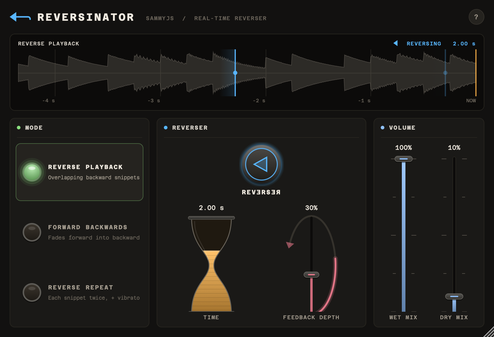

## Features

- **The three Backwards Machine effects**, with the original's sweeps, windows, vibrato, feedback routing, gain staging, parameter ranges and control tapers.
- **Checked against the real thing.** The vendor's dry demo clip, run through Reversinator, nulls against the vendor's own Backwards Machine renders of it:

  | Effect | Correlation | Residual |
  |---|---|---|
  | Reverse Playback | 0.9994 | 29 dB down |
  | Forward Backwards | 0.9995 | 30 dB down |
  | Reverse Repeat | 0.9990 | 27 dB down |

  For comparison, a single 192 kbps MP3 round trip, the format the demos were published in, leaves about 33 dB. The renders match how the vendor made the demos: processed at 44.1 kHz with the snippet clock started 448 samples before the clip, and Reverse Repeat at the TIME its demo used (2.0047 s).
- **Click-free everywhere.** REVERSER switches with a 10 ms crossfade, as on the original. TIME changes crossfade between the old and new read positions. Switching effects crossfades straight into the new one, because every effect shares the same input history. Host bypass crossfades too, and the effect keeps running underneath, so un-bypassing lands in a live effect. Wet, dry and feedback changes are smoothed. All of this is independent of the host's buffer size.
- **Live snippet display**: a scrolling view of the recent input with each read head drawn as it sweeps backwards through it, so you can see what each effect is doing.
- **Modern interface** in the spirit of the original: mode lamps, the big REVERSER button, an hourglass TIME control and a feedback loop. The window is resizable from 75% to 200%. Menus, fields, links, tooltips and keyboard focus rings share Subbertone's look.
- Mono or stereo at any sample rate. The effect itself is a delay, so no latency is reported to the host.

## A tour of the window

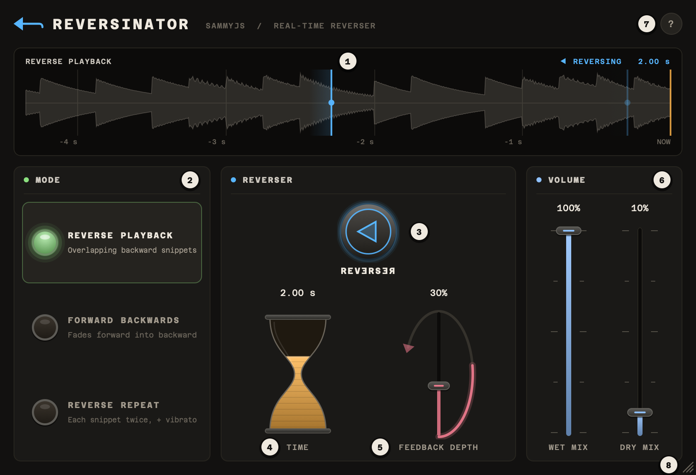

1. [Snippet display](#1-snippet-display)
2. [MODE](#2-mode)
3. [REVERSER](#3-reverser)
4. [TIME](#4-time)
5. [FEEDBACK DEPTH](#5-feedback-depth)
6. [VOLUME](#6-volume)
7. [About](#7-about)
8. [Resizing](#8-resizing)

### 1. Snippet display

The display shows the last few seconds of input and where the effect is reading from it. Time runs from right to left: **NOW** is the right-hand edge, with a grid line for every second before it.

- The grey shape is the input's level, newest at the right.
- The amber line at NOW is where new audio comes in.
- Each blue line with a dot is a **read head**: the point in the input being played back. A head starts at NOW and sweeps back to 2 × TIME ago, playing what it passes backwards at normal speed. It brightens as its snippet fades in and dims as it fades out.
- Top left is the effect's name. Top right is **REVERSING** or **FORWARDS** (see [REVERSER](#3-reverser)) and the TIME setting.

The display always shows enough history for every head, a little over twice TIME (two and a half times in Reverse Repeat). Each effect at TIME 2.00 s:

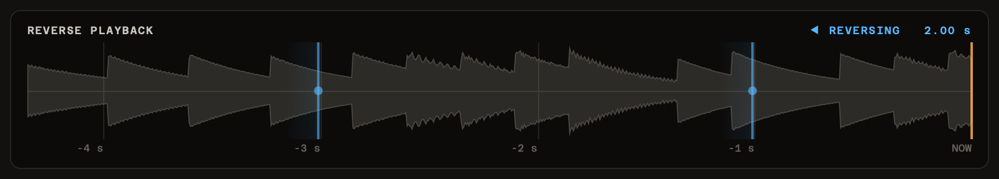

**Reverse Playback**: two heads, TIME apart. As one fades out the other fades in, so the backwards stream never stops.

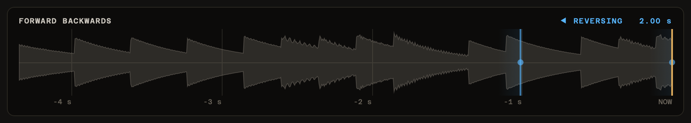

**Forward Backwards**: one backwards head, plus a dot at NOW for the forwards sound. As one brightens the other fades, so the sound turns smoothly from forwards to backwards and back, once per TIME period.

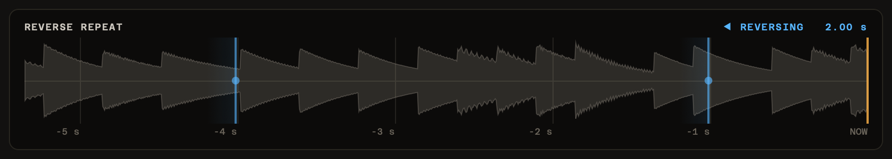

**Reverse Repeat**: the backwards head and its repeat. The repeat plays again, TIME/2 later and with a slight vibrato, what the first head played.

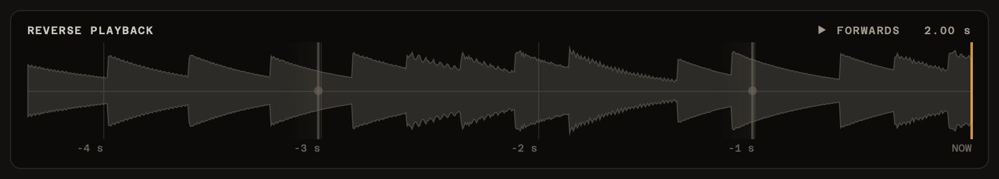

**REVERSER set to forwards**: the heads turn grey but keep moving. The effect keeps running, so switching back to reverse lands in it at once.

### 2. MODE

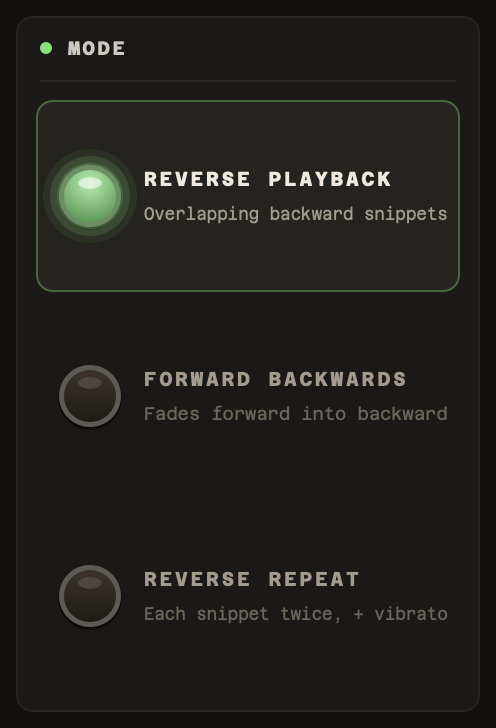

Click a lamp to choose one of the three effects. The lit lamp is the one playing, and each lamp sums up its effect in a line:

- **Reverse Playback**: overlapping backward snippets, for a continuous backwards stream.
- **Forward Backwards**: fades between the forwards sound and the backwards one.
- **Reverse Repeat**: each snippet backwards twice, the second time with a slight vibrato.

Switching crossfades into the new effect over 30 ms. Every effect reads the same input history, so the new one is in full flow straight away. [The effects](#the-effects) explains how each one works.

### 3. REVERSER

 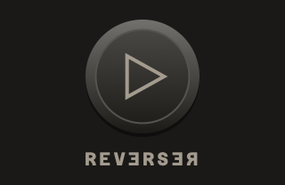

The big round button chooses between the effect and the forwards input:

- **Arrow left, blue glow** (the default): you hear the effect, and the display reads REVERSING.
- **Arrow right, grey**: you hear the input forwards at the WET MIX level, with DRY MIX added, and the display reads FORWARDS.

The switch crossfades over 10 ms, so it never clicks, and the effect keeps running underneath. Automate it to flip a phrase backwards and back on the beat. The label under the button reads REVƎRSƎЯ, partly backwards, as on Backwards Machine.

### 4. TIME

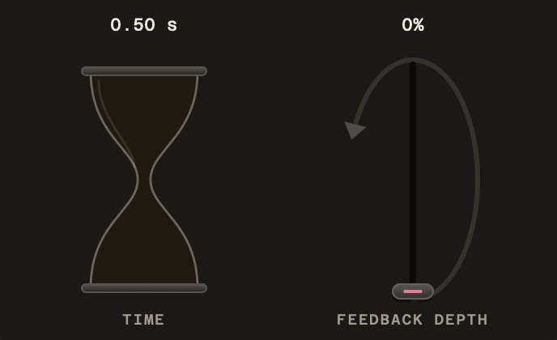 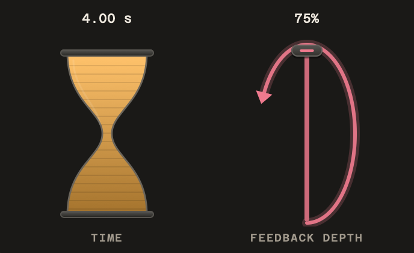

*TIME and FEEDBACK DEPTH at their minimum (left) and maximum (right).*

The hourglass sets the length of each snippet that is played backwards, from 0.5 to 4 seconds. Sand fills it from the bottom as TIME gets longer. The default of 2 seconds tends to sound best. Short times get more of the control's travel: halfway up is about 1.4 s.

TIME changes crossfade over 20 ms from the old timing to the new, so you can sweep it while audio plays. The snippet display widens or narrows to match.

### 5. FEEDBACK DEPTH

The loop, beside the hourglass, feeds the effect back into itself, from 0 to 75%. It lights up from the bottom as you raise it, and its arrowhead lights fully at the maximum. Each pass through the loop is reversed again, so feedback builds cascades of echoes that alternate direction. It is usually not needed, so the default is 0%. Even at 75% the feedback dies away rather than building up.

### 6. VOLUME

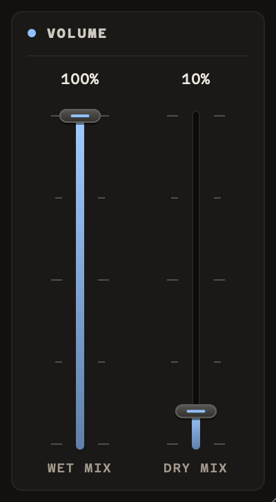

- **WET MIX**: the level of the effect, and of the forwards input when REVERSER is set to forwards. The default is 100%.
- **DRY MIX**: mixes in the original input. Usually 0% (the default), but useful for hearing forwards and backwards together.

Both use the original's squared law, so 50% is -12 dB. The ticks mark every 25%.

### 7. About

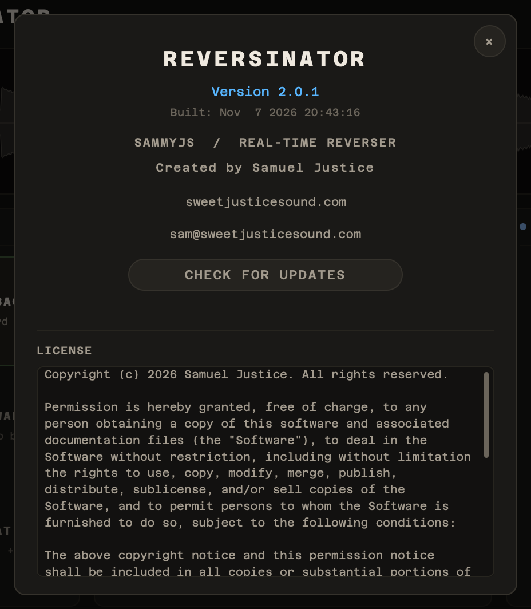

**?** at the top right opens the About panel: the version and build date, links to the website and email, and the licence. Close it with **×** or by clicking outside it. While it is open, Tab moves only between its own controls.

**CHECK FOR UPDATES** asks GitHub for the latest Reversinator release and tells you whether you have it ("You have the latest version" or "Version x.y.z is available"), or why it could not check. The plugin contacts GitHub only when you click this button. New versions are on the [releases page](https://github.com/samueljustice/plugins/releases).

### 8. Resizing

Drag the grip in the bottom-right corner to resize the window, from 75% to 200% of its normal size (615 × 420 to 1640 × 1120). The proportions stay the same, and the size is saved with your session.

## Mouse and keyboard

| To | Do this |
|---|---|
| Set TIME, FEEDBACK DEPTH, WET MIX or DRY MIX | Drag the control up or down. A click on it jumps straight to that point. |
| Nudge one of them | Scroll the mouse wheel over it. |
| Reset one of them to its default | Double-click it, or Alt-click it (Option-click on a Mac). |
| Type a value | Click the value above the control (see below). |
| Choose an effect | Click its lamp. |
| Switch REVERSER | Click the round button. |
| See what a control does | Rest the mouse on it. |

### Typing a value

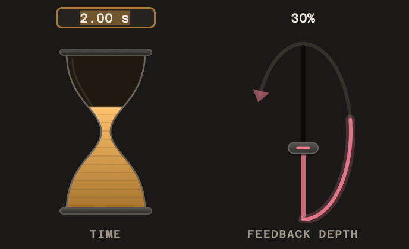 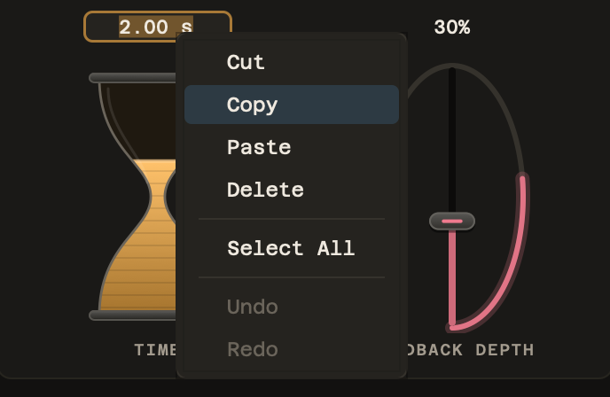

Clicking a value opens it for typing with the text selected, so you can type straight over it. The unit is optional: `1.5` and `1.5 s` both work. A value outside the range is set to the nearest end of it. Press Return to set the value, Tab to set it and move on to the next one, or Escape to leave it unchanged. Right-click while typing for Cut, Copy, Paste, Delete, Select All, Undo and Redo.

### Tooltips

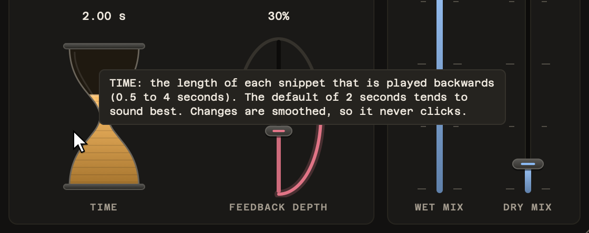

Rest the mouse on any control for a moment and a tooltip says what it does.

### Keyboard

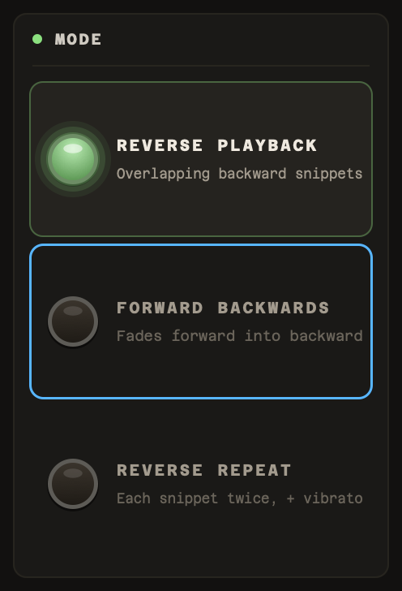

When the host passes keystrokes to the plugin window, Tab and Shift-Tab move the keyboard focus through the mode lamps, REVERSER, the four value boxes and **?**. A blue ring shows which lamp or button has it, and Return presses that one. A value box opens for typing as soon as Tab reaches it. The ring appears only once you press Tab, and a click hides it again. Above, Reverse Playback is playing and the ring is on Forward Backwards.

## The effects

Every effect is built from the same voice. A delay line's delay time is swept by a sawtooth from 0 up to 2 × TIME over each TIME period, so the read head runs backwards through the input at normal speed: each period plays the previous TIME seconds of audio in reverse. A `0.5 + 0.5·sin` window fades each snippet in and out, and is silent at the exact moment the sweep jumps back. That is why there are no clicks at the snippet boundaries.

| Effect | What you hear |
|---|---|
| **Reverse Playback** | Two voices half a period apart, so their windows always add up to one. You hear a continuous, overlapping backwards stream. |
| **Forward Backwards** | One backwards voice crossfaded against the dry input on the opposite window. The sound smoothly alternates between playing forwards and backwards, once per TIME period. |
| **Reverse Repeat** | One backwards voice, plus a copy of it played again half a period later with a slight 5 Hz vibrato. Each snippet is heard backwards twice. |

The [snippet display](#1-snippet-display) draws each voice as a read head.

**Feedback** sends each voice's output back into its own delay line, so repeats are re-reversed into cascades that alternate direction. As on the original, each delay line's input is halved and the output doubled, so FEEDBACK DEPTH is the true loop gain. At the 75% maximum, the feedback dies away rather than running away.

### Differences from the original

The sound is the original's. Reversinator deliberately differs only where Backwards Machine glitched:

- **Moving TIME** crossfades over 20 ms from read heads still running on the old timing to heads on the new timing. The original crossfaded over one host buffer from a frozen read head, so how much it glitched depended on the buffer size.
- **Switching effects** crossfades over 30 ms into the new effect, which starts with the input history already in place. The original cut to silence and refilled its buffers.
- **Long TIME settings** work across the whole range. In Reverse Playback and Reverse Repeat, the original's delay memory wrapped above about 3 s (at 44.1 kHz), so the end of each snippet read the wrong audio.
- **REVERSER** always crossfades over a full 10 ms. The original's crossfade was shortened when the host buffer was smaller than 10 ms.
- **Sample rates above 50 kHz** (88.2 kHz and up) use a double-precision snippet clock, so the reversed audio is exactly in tune and each snippet lasts exactly TIME. The original's float32 clock loses precision as the sample rate rises. Up to 50 kHz, which includes 44.1 and 48 kHz, it makes parts of each snippet play a few cents sharp or flat (up to about a quarter of a semitone at some TIME settings), and there Reversinator keeps it, sample for sample. At 96 kHz the error would reach half a semitone, and at 192 kHz a whole semitone.

## Controls

| Control | Range | Default | Description |
|---|---|---|---|
| **Mode** | 3 effects | Reverse Playback | Reverse Playback, Forward Backwards or Reverse Repeat. |
| **REVERSER** | Reverse / Forward | Reverse | Whether you hear the effect or the original forwards audio, at the wet level. The effect keeps running either way, so switching back lands in a live effect. |
| **TIME** | 0.5 – 4 s | 2.00 s | The length of each snippet that is played backwards. 2 seconds tends to sound best. Same square-law taper as the original. |
| **FEEDBACK DEPTH** | 0 – 75 % | 0 % | How much of the effect is fed back into itself. Usually not needed. |
| **WET MIX** | 0 – 100 % | 100 % | Level of the effect. Squared law: 50% is -12 dB. |
| **DRY MIX** | 0 – 100 % | 0 % | Mixes in the original input. Usually 0%, but useful for hearing forwards and backwards together. |

Hosts list these for automation as Effect Mode, Reverser, Time, Feedback Depth, Wet Mix and Dry Mix.

## Tips

- **Matching the tempo.** The effect often sounds just as interesting out of time, but to get close use `TIME = N × 60 / BPM` with N = 1, 2, 4 and so on. For example, at 120 BPM, N = 4 gives 2 seconds, which is one bar of 4/4. At 44.1 and 48 kHz this is approximate: as on the original, the snippet clock runs up to about 0.25% fast or slow depending on TIME, so over a long passage it slowly drifts off the grid. At 120 BPM and 44.1 kHz, with TIME at 2 s, that is about 40 ms per minute. Above 50 kHz (88.2 kHz and up) the clock is exact.
- **Reverse reverb.** Put Reversinator before a reverb, then print and reverse the result, or simply use Reverse Playback on a reverb return.
- **Transitions.** Automate REVERSER to flip a phrase backwards and return cleanly on the downbeat.
- **Ambience.** Forward Backwards with a long TIME and some DRY MIX turns a loop into a slowly breathing palindrome.
- **Cascades.** Reverse Playback with 40–75% feedback builds layered, alternating-direction echoes.

## Upgrading from 1.x

Version 2 rebuilds the effect to match Backwards Machine, so some settings changed:

- **Envelope** and **Crossfade** are gone. The original's windows are fixed, and the new engine uses them.
- **TIME** is now 0.5–4 s (was 30 ms–5 s), and **FEEDBACK DEPTH** is now 0–75% (was 0–100%), as on the original.
- **WET MIX** and **DRY MIX** now use the original's squared law, so settings below 100% are quieter than in 1.x. For example, 50% was -6 dB and is now -12 dB, so a 1.x mix may need rebalancing.
- **REVERSER** now defaults to on. Set to forwards, it now plays the input at the WET MIX level with DRY MIX added on top, as on the original, where 1.x passed the input through unchanged. So forward passages in 1.x sessions change level unless WET MIX is 100% and DRY MIX 0%. For example, WET 50% is now -12 dB, and WET 100% with DRY 100% is +6 dB.
- **Saved settings:** sessions saved with 1.x still open. TIME and FEEDBACK values outside the new ranges are clamped, and the removed controls are ignored.
- **Automation:** hosts that identify parameters by ID store automation as positions along each control's range, so TIME and FEEDBACK DEPTH lanes recorded in 1.x replay rescaled onto the new ranges. For example, a 1.x TIME point at 2.00 s now plays at about 1.89 s, and FEEDBACK at 50% plays at 37.5%.
- **Automation in Logic Pro and GarageBand:** these identify Audio Unit parameters by their position in the list, and removing Envelope and Crossfade moved them. Only the Mode and TIME lanes carry over (TIME rescaled as above). The 1.x Envelope, Dry Mix, Wet Mix and Crossfade lanes now drive DRY MIX, WET MIX, REVERSER and FEEDBACK DEPTH, and the 1.x Reverser and Feedback lanes are lost. Delete those lanes and redraw them.
- **macOS:** builds now run on macOS 11 and later. Previous builds required the macOS version they were built on.

## Building

### Prerequisites

- CMake 3.22 or higher
- macOS: Xcode or the Command Line Tools. Windows: Visual Studio 2022.
- JUCE 8.0.8 in `../SDK/JUCE`, relative to this folder

### Build

```bash
cmake -B build -DCMAKE_BUILD_TYPE=Release
cmake --build build --config Release
```

The plugins are written to `build/Reversinator_artefacts/Release/VST3/` and `.../AU/`. To install, copy them to `~/Library/Audio/Plug-Ins/VST3/` and `~/Library/Audio/Plug-Ins/Components/`.

Options:

- `-DREVERSINATOR_FORMATS="AU;VST3;Standalone"` also builds a standalone app.
- `-DREVERSINATOR_BUILD_TESTS=ON` builds `ReversinatorTests`, an offline test runner:
  - `ReversinatorTests selftest` checks stability across sample rates, layouts and block sizes, block-size independence, click-free automation and mode switching, and state save/restore.
  - `ReversinatorTests render in.wav out.wav --mode 1 --time 1.5` renders a file through the effect.
  - `ReversinatorTests screenshot out.png` renders the editor to an image.
  - `ReversinatorTests hostcheck "build/.../SammyJs Reversinator.vst3"` loads and exercises the built plugin.

## Developer

Created by Samuel Justice
Website: [www.sweetjusticesound.com](https://www.sweetjusticesound.com)
Email: sam@sweetjusticesound.com

Backwards Machine is a trademark of The Sound Guy, Inc. Reversinator is an independent recreation and is not affiliated with or endorsed by them.

## License

See [LICENSE](LICENSE). The plugin uses the JUCE framework; see JUCE's license for its terms.

## Version History

- **v2.0.1**: The interface takes on Subbertone's look: menus, value-box editing, links, keyboard focus rings, tooltips, the scrollbar and the resize grip, with nothing left in JUCE's default style. Fixes the licence text's "fi" ligature, the display's arrow sizes, and Tab reaching the controls behind the About panel. The sound and parameters are unchanged.
- **v2.0.0**: Rebuilt to match Backwards Machine: the original's three effects, ranges, tapers, defaults and gain staging. New interface with a live snippet display. Click-free TIME, mode, REVERSER and host bypass changes. Fixes the macOS minimum-version problem, the Windows dependency on the Visual C++ runtime, a crash risk in the update check, and the build break.
- **v1.0.0**: Initial release with a grain-based overlap-add engine, three reverse modes and a resizable UI.
