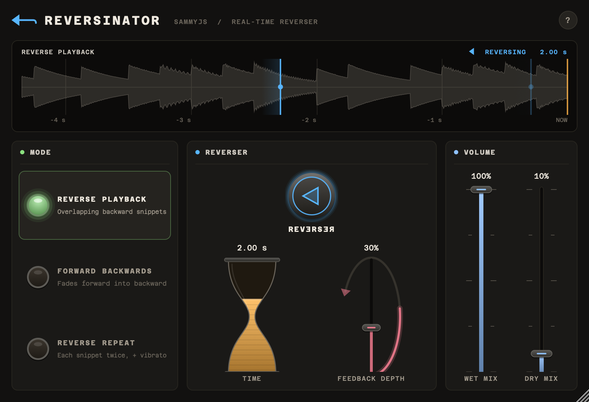

## SammyJs Reversinator 2.0.3

Hosts now list Reversinator under **Sammy J**, in one folder with the other plug-ins. Logic shows it as "Sammy J: SammyJs Reversinator", and the VST3 and Windows installer name Sammy J as the vendor. The sound, the parameters and saved sessions are unchanged from 2.0.2, and existing projects still find the plugin.

Want every plug-in at once? The [Sammy J's Plugins installer](https://github.com/samueljustice/plugins/releases/latest) installs the newest version of each.

### Downloads

| File | Contents |
|---|---|
| `SammyJs_Reversinator_Installer.pkg` | macOS installer (AU + VST3, universal) |
| `SammyJs_Reversinator_Installer.exe` | Windows installer (VST3) |
| `Reversinator-macOS-AU.zip`, `Reversinator-macOS-VST3.zip`, `Reversinator-Windows-VST3.zip` | The plugins on their own |

*Backwards Machine is a trademark of The Sound Guy, Inc. Reversinator is an independent recreation and is not affiliated with or endorsed by them.*
