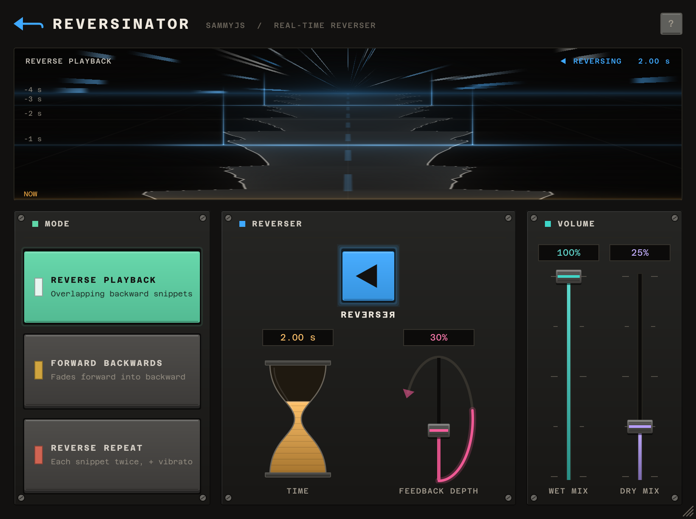

## SammyJs Reversinator 2.1.0

Reversinator has a new look: a display that shows the reverser as a road into the past, and controls built like hardware. The parameters and saved sessions are unchanged from 2.0.4.

### What's new

- **The display is a road into the past.** NOW is the near edge and the past runs away to the horizon, with a line across for every second. The road is as wide as the input was loud. Each read head is a gate of light sweeping back along it, and stars stream out of the horizon while the effect is reversing. With REVERSER set to forwards, the scene turns grey.
- **Controls built like hardware.**
  - Each mode has its own coloured key: mint, mustard and coral. The one playing stays pushed in and lit.
  - REVERSER is a big square key, lit blue while reversing.
  - The faders have ridged caps, and each value is a lit readout in its control's colour.
  - Panels, buttons, menus and tooltips are square-cornered.
- **A taller window**, 820 x 612 at its normal size, to give the display room. It still resizes from 75% to 200%.

The display is drawn with OpenGL. If OpenGL is not available, it falls back to the flat timeline.

### Fixes

- Apple silicon builds now produce the same output as Intel and Windows builds. They differed by a rounding step in the delay calculation, about 62 dB below the signal.

The [README](https://github.com/samueljustice/plugins/blob/reversinator-v2.1.0/reversinator/README.md#a-tour-of-the-window) has a tour of the new window.

Want every plug-in at once? The [Sammy J's Plugins installer](https://github.com/samueljustice/plugins/releases/latest) installs the newest version of each.

### Downloads

| File | Contents |
|---|---|
| `SammyJs_Reversinator_Installer.pkg` | macOS installer (AU + VST3, universal) |
| `SammyJs_Reversinator_Installer.exe` | Windows installer (VST3) |
| `Reversinator-macOS-AU.zip`, `Reversinator-macOS-VST3.zip`, `Reversinator-Windows-VST3.zip` | The plugins on their own |

*Backwards Machine is a trademark of The Sound Guy, Inc. Reversinator is an independent recreation and is not affiliated with or endorsed by them.*
