# Roarschach

A VST3/AU modular voice processor by **Samuel Justice**, built for exploration and fun. One insert holds fifteen modules (pitch and size, a small speaker in a resonant room, clean-up, de-essing, detail, a vocoder, a ring modulator, shimmer, growl, a phaser, tube roar, an ensemble, a top-end tamer, a tracked sub and overtones) that run in any order, between an input stage and a level-matched output with a limiter and a clipper. Use a few lightly for a bigger, wider voice, or stack them into creatures, machines and anything in between.

### 🎉 Latest Release v1.1.0 - [Download Here](https://github.com/samueljustice/plugins/releases/tag/roarschach-v1.1.0)


## Features

- **Fifteen modules, any order**: every module has an On switch and can sit anywhere in the chain. Drag a module by its header, use its **•••** menu, or press Alt+Left / Alt+Right on one of its controls. A move crossfades over 30 ms, so it is click-free even while audio plays.
- **Pitch and size, separately**: PITCH shifts the voice from two octaves down to one octave up, with Shift, Snap and Mono modes, and SIZE gives it a bigger throat.
- **Full bandwidth at any sample rate**: the audio is never resampled. At 96 or 192 kHz a two-octave drop brings the recording's ultrasonic content down into the audible band.
- **Texture**: GROWL chops the voice into a growl, SHIMMER adds a liquid wobble, SWIRL a sweeping phaser, ROAR two-stage tube saturation, ENSEMBLE a chorus of voices that makes the chain stereo.
- **A room**: CHAMBER plays the voice through a small speaker into a tight, resonant room and blends it back under the voice, with eight bundled rooms, three speakers, speaker breakup, stereo width and a low-end Boom.
- **Machines**: a 32-band VOCODER on a pulse carrier one or two octaves below the voice, and a RING modulator with a fixed or pitch-tracking carrier and a small resonant body.
- **Weight**: SUB adds a tracked octave below the voice; OVERTONE turns the low end into overtones so the weight carries on small speakers.
- **Control**: CLEAN (tone EQ, gate and a leveller), DE-ESS, DETAIL (lifts the quiet parts and pushes the loud parts into a soft ceiling) and TAME (holds back harsh top end).
- **A finished output**: OUTPUT matches the level to the input, then Push drives a true-peak-safe limiter with a clipper after it. Attack and Release set how clean or crunchy the limiting is, and Auto release keeps it clean. MIX blends in the dry voice, phase-matched to the processed one.
- **A creature that reacts**: an OpenGL creature that forms out of drifting cloud, whose jaw, eyes, skin and throat follow the voice and every module. It softens back into fog when the input goes quiet, and slowly evolves with sustained intensity.
- **Dice**: one die loads a random factory preset, one rolls a whole new creature, and one on each module rolls just that module, always inside each knob's useful range. Every roll can be undone.
- **Presets**: 49 factory presets (Init plus six groups: Creatures, Voices, Machines, Signal Flow, Vocoder, Utility). Save your own with SAVE. They are plain files, easy to back up and share.
- **Full recall**: every parameter, the module order, the preset name and the window size are saved with your session, and the factory presets are exposed to the host as programs.
- **Resizable interface**: drag the corner to scale the whole window from 50% to 125% (never larger than the screen).
- **Constant latency** of about 46 ms (2192 samples at 48 kHz), the same for every setting and every module order, reported to the host so it is compensated. Host bypass stays in time and switches without clicks. Mono or stereo, full DAW automation.

## How it works

The voice comes in through **IN**, runs through the fifteen modules (two rows of eight in the window, read left to right, top row first) and leaves through **OUTPUT**. IN and OUTPUT always stay at the ends; everything between them can move.

The default order, and what each module does:

| # | Module | What it does |
|---|---|---|
| 1 | **PITCH** | Shifts the pitch of the voice and, separately, the size of the throat (the formants). Lower and bigger is a bigger creature. A tube drive after the shift adds warmth or grit. |
| 2 | **CHAMBER** | Plays the voice through a small speaker into a tight, resonant room and blends it back under the voice: an edge and a sense of size, or the voice inside a box, a booth or a can. Off by default. |
| 3 | **CLEAN** | A voice channel strip: a tone EQ, a gate that closes on room noise between words, and a leveller that evens out the level and catches peaks. |
| 4 | **DE-ESS** | Softens harsh S and T sounds. |
| 5 | **DETAIL** | Lifts the quiet parts (breaths, consonants, word endings) a long way while the loud syllables stay where they are, and pushes the loud parts into a soft ceiling. |
| 6 | **VOCODER** | A 32-band vocoder whose carrier is a buzz one or two octaves below the voice: a gravelly machine voice under the words. Off by default. |
| 7 | **RING** | A ring modulator: metallic sidebands from a carrier at a fixed frequency or at a ratio of the voice's pitch, with an optional small resonant box around it. Off by default. |
| 8 | **SHIMMER** | A copy of the voice shifted by a few hertz beats against the voice: a liquid wobble. |
| 9 | **GROWL** | Chops the voice's level many times a second, the rough flutter of a growl. |
| 10 | **SWIRL** | A phaser that sweeps notches up and down the voice. |
| 11 | **ROAR** | Two-stage tube saturation with a tone stack between the stages: warm at first, gritty and dense when pushed. |
| 12 | **ENSEMBLE** | A chorus of three or six voices that spreads to the sides. It makes the chain stereo. |
| 13 | **TAME** | Holds back the harsh top end, only when it gets loud. |
| 14 | **SUB** | An octave below the voice that follows its pitch. |
| 15 | **OVERTONE** | Turns the low end into overtones, so its weight can be heard on speakers that cannot play it. |

Where a module sits changes the sound. CHAMBER after PITCH puts the pitched voice in the room; after ROAR it is an amp into a cabinet; last, it puts the whole creature in the room. ROAR before GROWL drives the voice and then chops it; ROAR after GROWL distorts the chopped voice. SUB before ROAR sends the octave through the tube, so its rumble gets harmonics locked to the voice. The VOCODER late in the chain vocodes everything before it. The Signal Flow presets each show one of these placements.

The chain is mono up to the first module that makes stereo: ENSEMBLE, SHIMMER in Stereo mode, or CHAMBER with Width above 0%. An **ST** badge on the connector after that module marks the point.

### Moving modules

- **Drag** a module by its header. While you hold it, the other tiles slide aside to show where it will land. Press Escape to cancel.
- **The ••• menu** in the header: Move to Start, Move Earlier, Move Later, Move to End, Move After (any other module), Turn Off / Turn On, and Reset Chain Order (back to the default order above).
- **The keyboard**: with one of a module's controls focused, Alt+Left moves it one place earlier and Alt+Right one place later.

The order is saved with the session and with presets, and the host can automate it. The fourteen modules other than CHAMBER each have a position parameter, 1st to 14th, that counts only those fourteen; CHAMBER's position parameter is the place it is inserted among them (before 1st, after 1st, ... after 14th). The tiles number all fifteen, so for a module after CHAMBER the host shows one place lower than its tile.


 

### The output stage

OUTPUT always ends the chain. In order, it:

1. **Matches the level** of the processed voice to the input, so turning modules on and off does not make the voice much louder or quieter. The matching never drives the voice into the ceiling by itself: that is Push's job.
2. **Pushes** the voice by up to +24 dB. Push is measured against the ceiling, so lowering the Ceiling lowers the output without driving the limiter harder.
3. **Mixes** in the dry voice at the same loudness as the processed one (the dry is pushed too, and the two are blended at equal power), so the limiter and the clipper hold the ceiling at any Mix and Mix changes the character, not the level.
4. **Limits** at the **Ceiling** with a look-ahead limiter. More Push is louder and denser; the peaks never pass the ceiling, which is true-peak safe.
5. **Clips** what the limiter leaves for it. **Clip** sets how many dB of each peak above the ceiling are clipped instead of limited (Off by default), and **Shape** sets the clipper from Soft (rounded peaks) to Hard (flat peaks, brighter and more aggressive). The clipper is oversampled, so it does not add aliasing.

**Attack and Release decide whether the limiting is clean or crunchy.** When the limiter's gain recovers quickly enough to move between the peaks of a low note's waveform, it turns that waveform's every peak down a little and lets it back up in between. That reshapes the low end and adds a dense, buzzy distortion on top of the voice: maximizer crunch, which sounds big on roars and impacts.

- **Release** sets how much crunch there is. Very short releases (2 to 10 ms) let the gain follow the bass and crunch clearly; 25 to 60 ms is gritty; from about 200 ms up it is clean.
- **Attack** sets which frequencies can crunch. The limiter starts turning down this long before each peak, and only notes whose waveform peaks are further apart than that can crunch: roughly everything below 1 / (2 × Attack). At 2 ms (the default) that is everything below about 250 Hz, the whole low end of a creature voice; at 5 ms only the lowest notes; at 10 ms almost nothing. 0.3 to 3 ms is the crunchy range. Shorter attacks are also punchier on transients.
- **Auto** (on by default) adapts the release to the material and holds the gain steady between bass peaks, so the low end stays clean whatever the Attack. Release still sets how quickly Auto breathes, across its whole range. Turn Auto off to use Release directly.

For crunch, turn Auto off, set Release to a few milliseconds, and raise Push until you hear it. Lower Mix to blend the crunched voice with the clean one. The Utility presets Crunch Lift and Smashed are starting points.

### Native sample rate

Roarschach runs at the host's sample rate and never resamples the audio. PITCH reads the input at that rate through a long, high-quality interpolator, and nothing before PITCH in the default order cuts the top end. So at 96 or 192 kHz, a −12 or −24 st shift with Formant on Follow brings the recording's ultrasonic content down into the audible band: at 192 kHz, a 40 kHz component lands at 10 kHz cleanly. This is the point of recording creature performances at high sample rates, and PITCH's range goes down to −24 st for it. OUTPUT's gentle low-pass at 18 kHz, after the chain, is the only fixed top cut.

## Controls

Every control has a tooltip: hover over it to see what it does, and where its useful range is. The footer of each module shows what the module is doing right now (hover over it for an explanation). Double-click any knob to reset it to its default. The mode chip under the knobs opens a menu of the module's choices, and the die beside it rolls the module; the ••• button moves the module.


### The dice

Three kinds of die roll new settings: one beside the preset name, one after the last module, and one on every module.

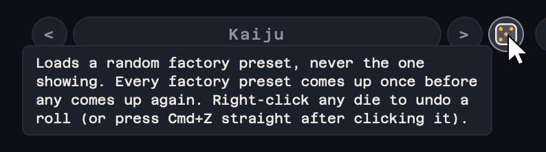

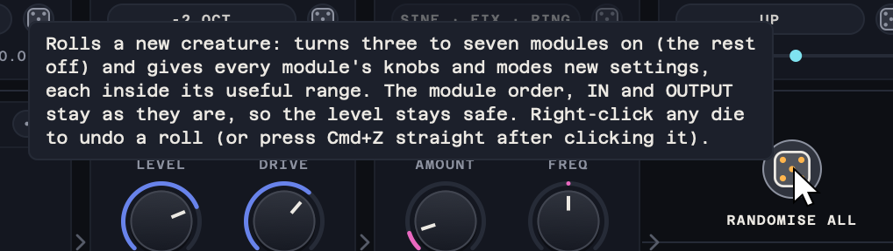

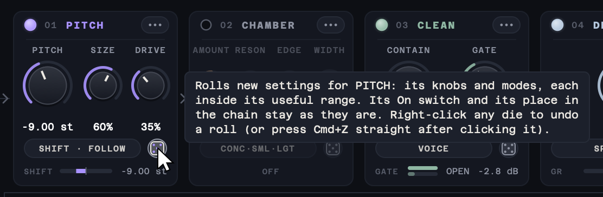

Each roll is one step you can take back: right-click any die for **Undo** and **Redo** (with the keyboard, Shift+F10 on a die opens the same menu), or press Cmd+Z (Ctrl+Z on Windows) straight after clicking a die, and Shift+Cmd+Z (Shift+Ctrl+Z) to redo. Once you use another control, these keys go back to the host's own undo; some hosts keep them for themselves anyway, and the right-click menu always works. Undo takes back only what the roll changed, and a knob you turned afterwards stays where you put it, even one the roll had changed. Loading a preset or session, even the same one again, ends the history. The host sees every control a roll changes, so it records the roll and its automation follows.

- **Random preset** (the die beside the preset name): loads a random factory preset, never the one showing. Every factory preset comes up once before any comes up again.
- **Randomise all** (the die after the last module): a new creature. It turns three to seven modules on and the rest off (at least two of them ones that change the voice, not only CLEAN, DE-ESS, DETAIL and TAME), and gives every module's knobs and modes new settings. The preset name shows `*`, as for any edit.
- **A module's die** (beside its mode chip): new settings for that module's knobs and modes only. Its On switch and its place in the chain stay as they are.

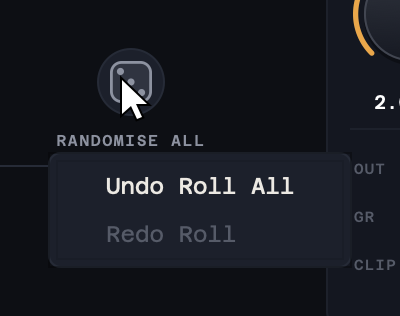

One RANDOMISE ALL roll from the Big Bad Narrator preset. Before, PITCH, CLEAN, DE-ESS, DETAIL, ROAR, TAME, SUB, OVERTONE and CHAMBER are on; after, CLEAN, VOCODER, RING, SHIMMER and ENSEMBLE are, every module has new settings, the preset name shows `*`, and the creature has a faint dark metal muzzle round its mouth from RING. The module order, IN and OUTPUT are as they were.

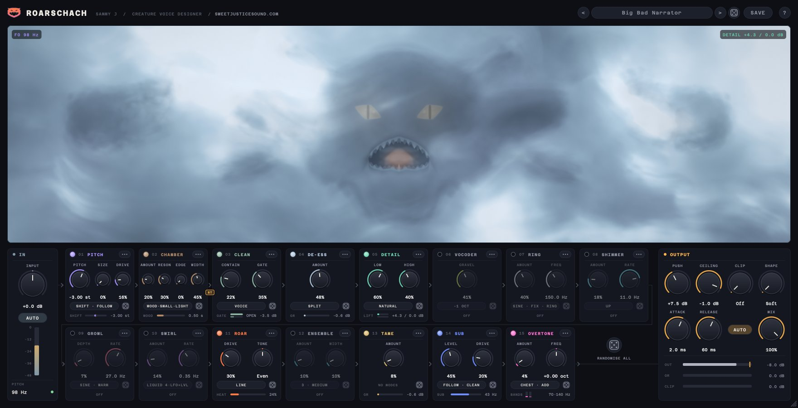

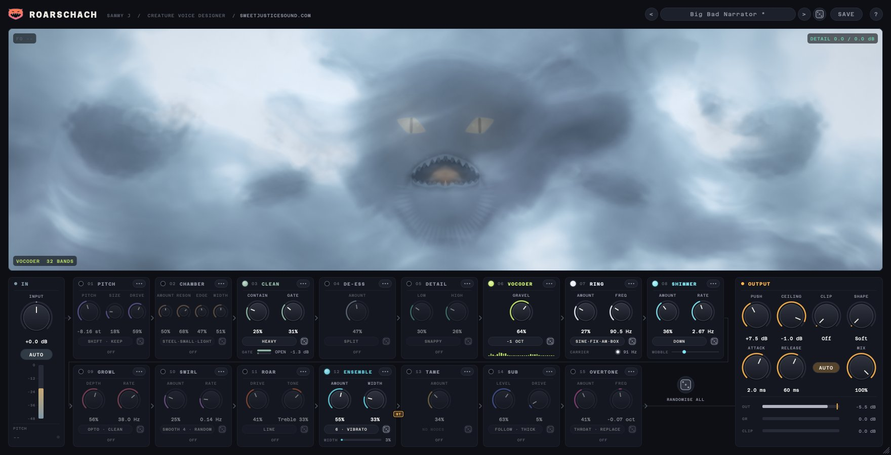

A roll only lands where a knob is useful: each knob rolls inside the range the [parameter audit](docs/parameter-audit.md) found usable, never into its dead or harmful ends (PITCH −14 to −2 st, Swirl up to 50% and its Deep 6 circuit up to 30%, Ring Freq 60–450 Hz, Chamber 15–65%, and so on), and each mode is picked evenly from its options (Boom leaves out Heavy). The dice never move a module or touch IN or OUTPUT, so the level stays safe: on five real voice takes, 200 rolls each, 998 of the 1,000 rolls played within 3 LU of Init (the other two 3.0 and 3.8 LU quieter), and none went over the ceiling. Knobs glide to their new values and modules fade in and out, so a roll does not click while audio plays.

The close-ups below are from the Kaiju preset; RING and OUTPUT are from Cyber Commander, and the CHAMBER tiles from the presets named under them. Every knob's travel was measured on real voice recordings and mapped so that all of it does something; the measurements are in [docs/parameter-audit.md](docs/parameter-audit.md).

### IN


| Control | Range | Default | Description |
|---|---|---|---|
| **Input** | −24 to +24 dB | 0 dB | Level into the plug-in, before everything else. With Auto on, it raises or lowers the levelled voice by half as much. |
| **Auto** | on / off | On | Brings any voice to the same working level, so every module reacts the same way to a quiet or a loud take. |

The meter shows the input level and the readout the voice's pitch. A stereo input is summed to mono here.

### PITCH


| Control | Range | Default | Description |
|---|---|---|---|
| **Pitch** | −24 to +12 st | −2 st | How far the voice is shifted, in semitones. −2 to −4: a bigger human; −5 to −9: a creature; −10 to −14: a monster (add Size, or Formant Keep to hold the words). Below −15 the words blur with Follow; above +6 the throat stops following. In Mono mode it sets the note held (0 st = C3). |
| **Size** | 0 to 100% | 0% | Makes the throat bigger: lowers the formants and adds body. With Pitch below −18 st and Follow, the throat is already at its lowest, so Size only adds body. |
| **Drive** | 0 to 100% | 1% | Tube drive after the shift: up to about 25% warmth, 35–70% grit, 100% heavy. |
| **Mode** | Shift / Snap / Mono | Shift | Shift moves the voice by the set interval. Snap also lands each note on the nearest semitone. Mono holds the voice on one note, set by Pitch (0 st = C3). |
| **Formant** | Follow / Keep | Follow | Follow moves the throat with the pitch, for a bigger or smaller creature. Keep leaves the throat where it is, so only the pitch changes. |

### CLEAN


| Control | Range | Default | Description |
|---|---|---|---|
| **Contain** | 0 to 100% | 22% | Evens out the level and catches peaks before the creature stages. It starts working at the bottom of the travel. |
| **Gate** | 0 to 100% | 47% | Closes on room noise between words; higher settings close further and harder. 25–40% suits dialogue. |
| **Tone** | Flat / Voice / Heavy / Radio | Voice | The voice EQ. Flat leaves the voice as it is, Voice cleans up the low mids, Heavy cuts the boom and low mids hard for a tight, forward chest (it thins the lows), Radio is a narrow, lo-fi band. |

### DE-ESS


| Control | Range | Default | Description |
|---|---|---|---|
| **Amount** | 0 to 100% | 49% | Softens harsh S and T sounds: more travel takes them down further. |
| **Mode** | Split / Wide | Split | Split turns down only the hiss above about 3.5 kHz on each S. Wide turns down the whole voice for the length of the S, which also tames lisps and mouth noise but dips the words. |

### DETAIL


| Control | Range | Default | Description |
|---|---|---|---|
| **Low** | 0 to 100% | 25% | Lifts the quiet parts (breaths, consonants, tails) while the loud syllables stay where they are. 40–60% is a clear lift; it never lifts the room tone the gate is taking out. |
| **High** | 0 to 100% | 19% | Pushes the loud parts up into a soft ceiling: denser and more forward. 30–60% is a strong, even level. |
| **Speed** | Natural / Snappy | Natural | How quickly the level follows the voice. Natural is smooth; Snappy recovers faster and sounds more lively. |

DETAIL leaves the room tone between lines alone, so it lifts the voice, not the noise floor.

### VOCODER


| Control | Range | Default | Description |
|---|---|---|---|
| **Gravel** | 0 to 100% | 41% | How much of the pulse-carrier vocoder is heard. About 30% is gritty with the words fully intact; about 70% is a dominant buzz. |
| **Octave** | −1 Oct / −2 Oct | −1 Oct | Register of the vocoder's pulse carrier: −1 Oct is low and buzzy, −2 Oct lower and rougher. The filter bank keeps its weight above the deepest bass. |

### RING


| Control | Range | Default | Description |
|---|---|---|---|
| **Amount** | 0 to 100% | 40% | How much of the ring-modulated voice is heard. About 20% adds a metallic edge, 50% is an equal metallic blend, 100% is pure ring. |
| **Freq** (Track Fixed) | 20 Hz to 4 kHz | 150 Hz | The carrier frequency. 110–450 Hz gives a metallic voice; below about 50 Hz it becomes a tremolo; above about 1.3 kHz it squeaks. |
| **Ratio** (Track Follow) | ×0.25 to ×4 | ×1.00 | The carrier as a multiple of the voice's pitch. Whole-number ratios stay in tune with the voice; in-between ratios clang; below ×0.35 it chops. |
| **Carrier** | Sine / Triangle / Square | Sine | The carrier waveform. Sine is smooth, Triangle a softened sine, Square buzzy and hard. |
| **Track** | Fixed / Follow | Fixed | Fixed holds the carrier at one frequency. Follow moves it with the voice's pitch. |
| **Mode** | Ring / AM | Ring | Ring removes the original pitch and leaves only the metallic sidebands. AM keeps the original voice and adds the sidebands around it. |
| **Body** | Off / Box / Can | Off | Puts the voice inside a small resonant box. Box is a hard, hollow enclosure; Can is smaller and more metallic. |

The second knob is Freq when Track is Fixed and Ratio when Track is Follow.

### SHIMMER


| Control | Range | Default | Description |
|---|---|---|---|
| **Amount** | 0 to 100% | 18% | A liquid wobble: a copy of the voice moved a few hertz beats against the voice. 15–30% is a subtle layer; 90–100% a full wobble. |
| **Rate** | 0.5 to 25 Hz | 11 Hz | How fast the wobble beats. 0.5–2 Hz is a liquid swell, 3–9 Hz a warble, 13 Hz and up rough. |
| **Mode** | Up / Down / Up+Down / Stereo | Up | Which way the copy is moved. Up and Down wobble differently, Up+Down uses both, Stereo puts one on each side (summed to mono, Stereo wobbles less). |

### GROWL


| Control | Range | Default | Description |
|---|---|---|---|
| **Depth** | 0 to 100% | 25% | How deeply the voice is chopped. 15–35% adds texture; 45–100% is an obvious growl. |
| **Rate** | 2 to 150 Hz | 27 Hz | How fast the voice is chopped. 5–7 Hz stutters, 20–35 Hz growls, 60–100 Hz buzzes. Not used by the Throat shape. |
| **Shape** | Sine / Opto / Square / Throat / Rattle | Sine | Sine is smooth, Opto pulses like a lamp, Square switches hard, Throat locks to half the voice's pitch (Rate is not used), Rattle speeds up as the voice gets louder. |
| **Character** | Clean / Warm / Grind | Warm | What the chop does to the tone. Clean only changes the level, Warm rounds the low end, Grind adds a gritty edge. |

### SWIRL


| Control | Range | Default | Description |
|---|---|---|---|
| **Amount** | 0 to 100% | 21% | How much of the sweeping phaser is mixed in. |
| **Rate** | 0.05 to 10 Hz | 0.35 Hz | How fast the phaser sweeps. 0.15–0.5 Hz is slow and liquid, 1–2.5 Hz animated, 4 Hz and up a warble. |
| **Circuit** | Liquid 4 / Smooth 4 / Talky 4 / Deep 6 / Deep 12 / Dark 5 | Liquid 4 | The phaser's circuit: how many notches it has and how deep they cut, from a liquid four-stage to a dense twelve-stage sweep. |
| **Motion** | LFO / LFO+Level / Random | LFO+Level | What moves the sweep. LFO is steady, LFO+Level sweeps further on loud words, Random wanders. |

### ROAR


| Control | Range | Default | Description |
|---|---|---|---|
| **Drive** | 0 to 100% | 45% | Tube saturation. 25–45% gives warmth and presence; 70–100% grit. |
| **Tone** | Bass 100% to Treble 100% | Treble 3% | Tilts what the tube drives harder: the bass or the treble. It works at any Drive. |
| **Voicing** | Line / Mic | Line | Line drives the tube flat. Mic first trims the boom and the air, as from a close microphone. |

### ENSEMBLE


| Control | Range | Default | Description |
|---|---|---|---|
| **Amount** | 0 to 100% | 10% | How much of the chorus of voices is mixed in. |
| **Width** | 0 to 150% | 10% | How far the chorus spreads to the sides. Past about 100% the chorus thins when the mix is summed to mono. |
| **Voices** | 3 / 6 | 3 | How many voices sing along: 3 is tight, 6 is a crowd. |
| **Motion** | Slow / Medium / Fast / Vibrato | Medium | How the voices drift. Slow, Medium and Fast set the movement; Vibrato makes them waver in pitch. |

### TAME


| Control | Range | Default | Description |
|---|---|---|---|
| **Amount** | 0 to 100% | 6% | Holds back harsh top end when it gets loud; higher settings start lower and hold back harder. |

### SUB


| Control | Range | Default | Description |
|---|---|---|---|
| **Level** | 0 to 100% | 49% | Level of the octave underneath the voice. 40–65% is a solid octave. With Overtone in Replace, Sub Level also adds weight through the overtones. |
| **Drive** | 0 to 100% | 20% | Drive on the octave. Up to about 20% it stays clean; above that it gets thicker and growlier. |
| **Register** | Follow / Tight / Deep | Follow | Where the octave sits. Follow tracks the voice an octave down, Tight keeps it at 55 Hz or above, Deep goes a full octave down to about 32 Hz. |
| **Character** | Clean / Resonant / Thick | Clean | The octave's colour. Clean is a pure low tone, Resonant rings and drives harder, Thick adds a second, fuller layer. |

### OVERTONE


| Control | Range | Default | Description |
|---|---|---|---|
| **Amount** | 0 to 100% | 4% | How strongly the low end is echoed as overtones. They let the voice's weight be heard on small speakers without adding more bass. In Lean and Replace the original low end is cut more as Amount rises. |
| **Freq** | −1 to +1 oct | 0 oct | Moves the overtone bands up or down together. Higher translates better to small speakers; lower is warmer. |
| **Pattern** | Chest / Throat / Beast / Speaker / Broad / Tracked | Chest | Which low regions are turned into overtones. Chest: body and octave. Throat: gruff upper growl. Beast: hollow, odd-heavy snarl. Speaker: high overtones for small or radio-like creatures. Broad: one wide low band. Tracked: follows the voice's pitch exactly. |
| **Mode** | Add / Lean / Replace | Add | Add keeps the original low end. Lean lowers it. Replace removes it, so the low end is heard only through its overtones. |

Placed after SUB (the default), OVERTONE also makes SUB's octave audible on small speakers.

### CHAMBER

CHAMBER plays the voice through a small speaker into a tight, resonant room, then blends it back under the untreated voice. A little gives a voice an edge and a sense of size; more puts it inside a box, a booth or a can. The rooms are small and ringing, not a hall reverb. CHAMBER is Off by default (and in sessions saved before it existed), and sits right after PITCH.

| Control | Range | Default | Description |
|---|---|---|---|
| **Amount** | 0 to 100% | 50% | How much of the voice played into the room is blended under the dry voice. 15–35% adds a subtle edge, 45–65% is a clear chamber; around 80% the two are equal; at 100% the room leads. |
| **Reson** (Resonance) | 0 to 100% | 40% | How much the room rings after each sound. Lower is tight and boxy; higher lets its resonances sustain longer. The level stays the same. |
| **Edge** | 0 to 100% | 30% | Drives the small speaker into breakup: grit at 15–35%, a cranked speaker at 50–70%, torn and buzzing towards 100%. Heard once Amount is about 60% or more. |
| **Width** | 0 to 100% | 35% | How far the room spreads to the sides. 0% keeps it centred; 100% is the room's full stereo. Summed to mono it sounds the same at any Width. |
| **Room** | 8 rooms (below) | Concrete Room | The room the speaker plays into. |
| **Speaker** | Tiny / Small / Horn | Small | The speaker the voice is played through. Tiny is thin and nasal, Small a compact full-range box, Horn a narrow, honking paging horn. |
| **Boom** | Off / Light / Medium / Heavy | Light | Low-end weight added after the whole chain, a shelf at 110 Hz: Light +3 dB, Medium +6 dB, Heavy +9 dB. |

The mode chip shows the room, the speaker and the Boom, shortened to fit (CONC · SML · LGT is Concrete Room, Small, Light). Click it for a menu with one list for each, the current choice ticked. When CHAMBER is on, its footer shows the room and how long it rings at the current Resonance.

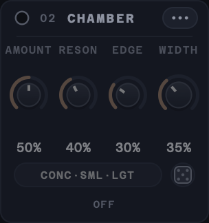 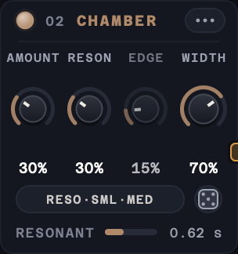 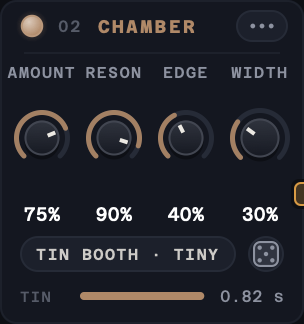 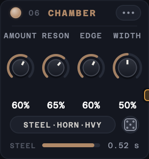

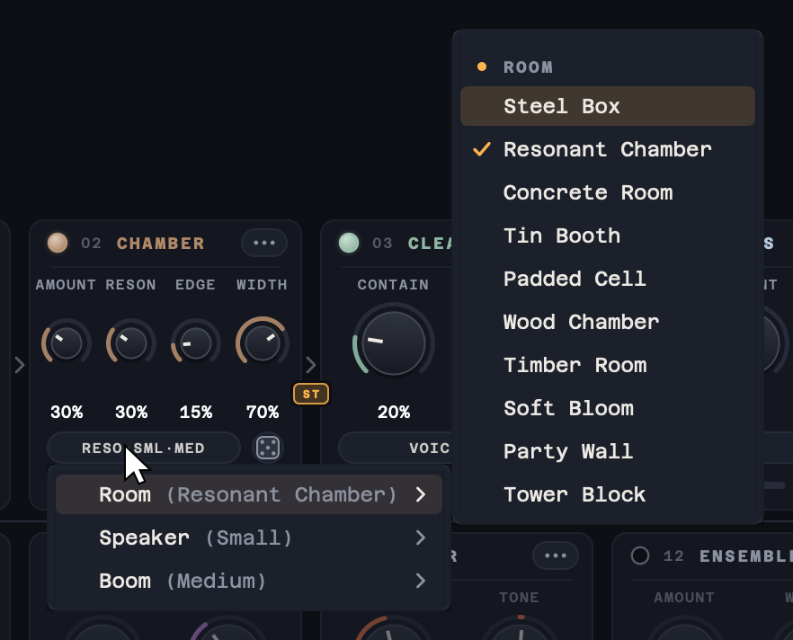

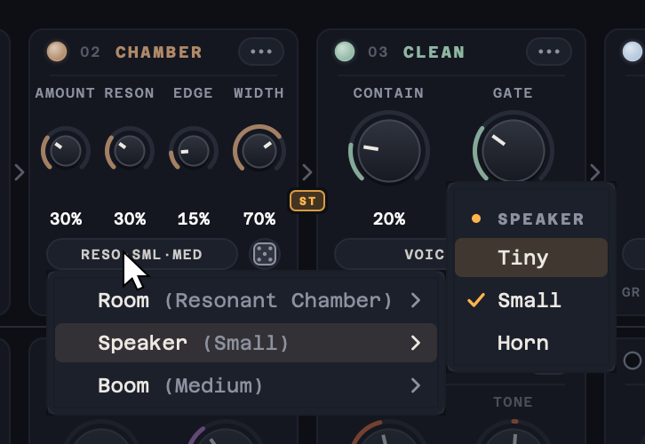 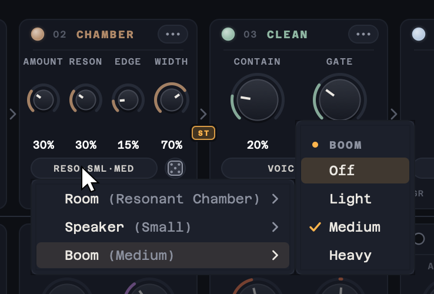

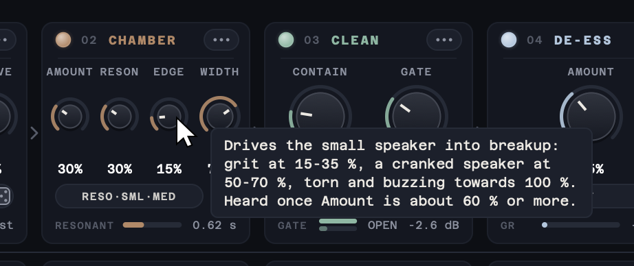 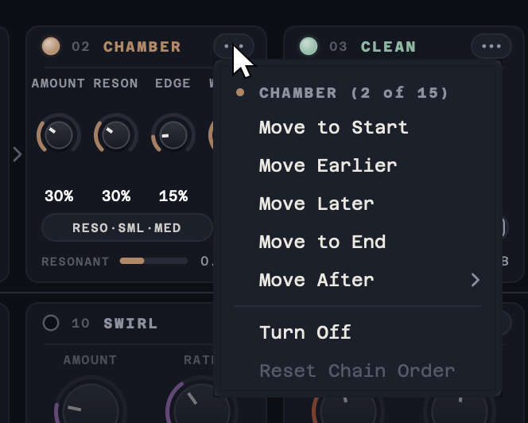

| Room | Character | Decay (about) |
|---|---|---|
| **Steel Box** | Bright and metallic | 0.4 s |
| **Resonant Chamber** | Long and ringing | 0.7 s |
| **Concrete Room** | Hard and dense | 0.6 s |
| **Tin Booth** | Thin, with a sharp ring | 0.5 s |
| **Padded Cell** | Dark and short | 0.35 s |
| **Wood Chamber** | Warm | 0.55 s |
| **Timber Room** | Sparse and soft | 0.55 s |
| **Soft Bloom** | A diffuse swell, with almost no ring | 0.2 s |

The decays are at Resonance 40%, which plays each room as captured; Resonance stretches them to about half or up to 1.6 times (as far as each room allows).

- **Where it sits** decides what goes into the room. After PITCH (the default) the pitched voice is in the room, and CLEAN's gate then trims its tail. After ROAR it is an amp into a cabinet: the speaker tames ROAR's fizz. Last, it puts the whole creature, SUB included, in the room.
- **Boom** works after the whole chain wherever CHAMBER sits, so it also lifts SUB and the pitched voice. On presets that are already low and dense, keep it at Off or Light: Medium and Heavy make OUTPUT's limiter duck the voice's presence.
- **Latency:** none, at any setting or position. Changing Room crossfades over 50 ms; the block where the change happens costs about three times a normal one (CHAMBER alone uses under 1% of a core at 48 kHz, about 4–7% at 192 kHz).
- **The rooms** in release builds are captured rooms, bundled (encrypted) in the plug-in and licensed for use only within Roarschach (see [License](#license)). A build from source without them uses modelled rooms with the same names, voiced to match.

### OUTPUT


| Control | Range | Default | Description |
|---|---|---|---|
| **Push** | 0 to +24 dB | +8 dB | Drives the voice into the ceiling. Push 8–12 is clean and dense; for loud, Push 14–18 with Clip 6–9. The peaks never pass the ceiling. |
| **Ceiling** | −12 to 0 dB | −1 dB | The highest level the output can reach, true-peak safe. It sets the output level only: Push decides how hard the limiter works. |
| **Clip** | Off to 18 dB | Off | How many dB of each peak above the ceiling are clipped instead of limited. Raise Push to drive into it. |
| **Shape** | Soft to Hard | Soft | Clip shape. Soft rounds the peaks gently; Hard clips them flat, which is brighter and more aggressive. |
| **Attack** | 0.2 to 10 ms | 2 ms | How early the limiter starts turning down before a peak. With Auto off and a short Release, 0.3–3 ms crunches the low end. |
| **Release** | 1 ms to 1 s | 60 ms | How fast the limiter recovers. With Auto off: 2–10 ms crunch, 25–60 ms grit, 200 ms and up clean. |
| **Auto** | on / off | On | Auto release: adapts the recovery to the material and keeps the low end clean. Release sets how quickly it breathes. |
| **Mix** | 0 to 100% | 100% | Blends the processed voice with the dry voice, which is delayed and phase-matched to line up with it. The two are matched in loudness, so Mix changes the character, not the level. |

The meters show the output level (with the ceiling marked), the limiter's gain reduction (GR) and how much the clipper takes (CLIP). See [The output stage](#the-output-stage) for how Attack and Release shape the crunch.

## Visualiser

The creature above the chain is drawn live in OpenGL from the audio and the controls. It forms out of slowly swirling cloud, all of it seen through a drifting veil of pale, cool blue-grey mist: when the voice comes in, its eyes and mouth glow through first, then the brow and teeth, then the head, and the cloud condenses into a mirror-symmetric blot of ink smoke that reads through the mist as a soft dark shape. The mist thins a little around the eyes and on loud roars but never clears. When it goes quiet the face softens back into fog, with the eyes the last to fade.

 
 
 

**It evolves.** Sustained intensity (loud, heated, growling, driven sound, not just high knob settings) slowly grows it from a pale pressed blot into something larger: a soft moth-like spirit, a horned beast, a dripping liquid horror, a winged and horned wyrm, and finally a many-eyed thing with a crown of spines. The stages blend into each other and never switch: horns and spines grow out of the head, extra eyes open from creases in the skin, and the change takes minutes, not seconds. Quiet lets it cool and settle back over minutes. A long, hard session leaves its mark: it only drifts all the way home after a long stretch of quiet. Which modules carry the sound also leans its character: SHIMMER, SWIRL and ENSEMBLE make it more fluid, ROAR, GROWL and the clipper more bestial, the VOCODER, RING and OVERTONE more eldritch, and SUB, a low PITCH and a straining limiter heavier and darker. Every instance grows its own creature, and the creature and how far it has evolved are saved with the session.

**Its colour follows your settings.** The clouds and the mist lean slowly towards a colour that suits the sound you have set up. Heavier ROAR, GROWL, PITCH Drive, a deeper pitch, SUB Drive and OUTPUT Push and Clip warm it towards ember red. The VOCODER, RING, SHIMMER, Snap or Mono pitch, the Radio tone and the metal rooms turn it a clear electric blue. SWIRL, ENSEMBLE and OVERTONE tint it violet. A big CHAMBER room leans it to a lichen green-grey on its own, and turns the other colours towards stone. Mixed settings mix their colours: heavy drive with the vocoder is a rust, drive with SWIRL a crimson rose, the vocoder with SWIRL an indigo, drive in a big room a warm stone and the vocoder in one a teal. Init and light settings keep the pale blue-grey, and so does Mix at 0%. Only the hue and its strength move: the mist stays as pale and as thick, and the eyes and throat keep a warm glow that stands apart from the clouds, turning a hotter gold when the clouds are warm. The colour never jumps: after a preset change, a roll of the dice or a turned knob it drifts to the new colour over several seconds, turning round the colour wheel no faster than a twelfth of the way each second, through soft tones rather than grey.

Right-click the creature for **Evolution: Live** (it keeps evolving), **Evolution: Frozen** (it holds its current form and colour, also after the editor is closed or the project reloaded; it still moves with the voice) and **Reset creature** (it eases back to a blot over a few seconds and grows a new one).

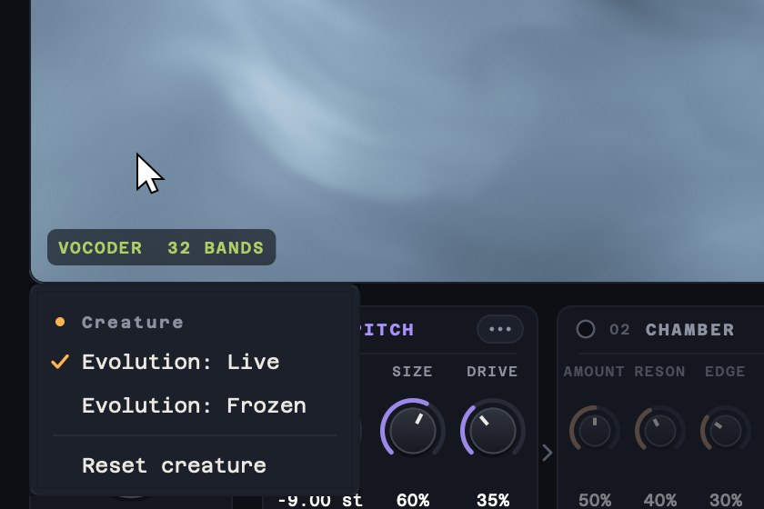

On top of whatever form it has taken, every module still shows on it:

- Its jaw opens with the voice; PITCH and SIZE make its head and jaw bigger.
- GROWL stirs the smoke and shivers its lips, SHIMMER ripples its skin and drips ink, SWIRL spins a pair of eddies through the smoke and sweeps a sheen up and down its face, and ENSEMBLE stretches the smoke out to the sides.
- ROAR heats its eyes and throat, SUB sends rings out of its throat, the VOCODER lights a fan of 32 ridges under its jaw (one per band), and OVERTONE lights one rib per overtone under its chin (hollow in Replace).
- RING puts a flickering dark metal muzzle round its mouth, DE-ESS glints on its teeth, TAME dims its crown, and CLEAN's gate closes its lips between words.
- CHAMBER leaves an after-image: while the room rings, its wings and tendrils trail each movement for longer, and Boom adds a slow swell to its breathing.
- At the output, the limiter throbs at its temples and the clipper throws sparks off its edges.

The top corners show the voice's pitch (F0) and how much DETAIL is lifting and holding. After 1.5 seconds of silence the creature falls asleep, dissolving into fog, and the label ASLEEP appears; it gathers itself again as soon as sound comes back.

## Presets

Use the arrows either side of the preset name to step through presets, or click the name for the full list, grouped by category. The die after the arrows loads a random factory preset (see [The dice](#the-dice)). SAVE stores the current settings as a user preset, and the list also has Save As, Delete and Show Presets Folder.


The list opens with Init, then one submenu per group, with the current preset ticked in its group. Your own presets are under USER.

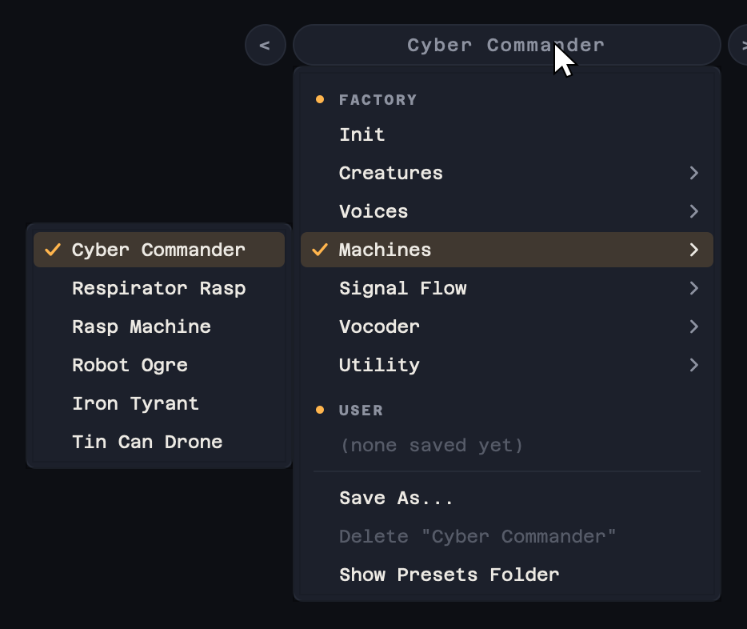

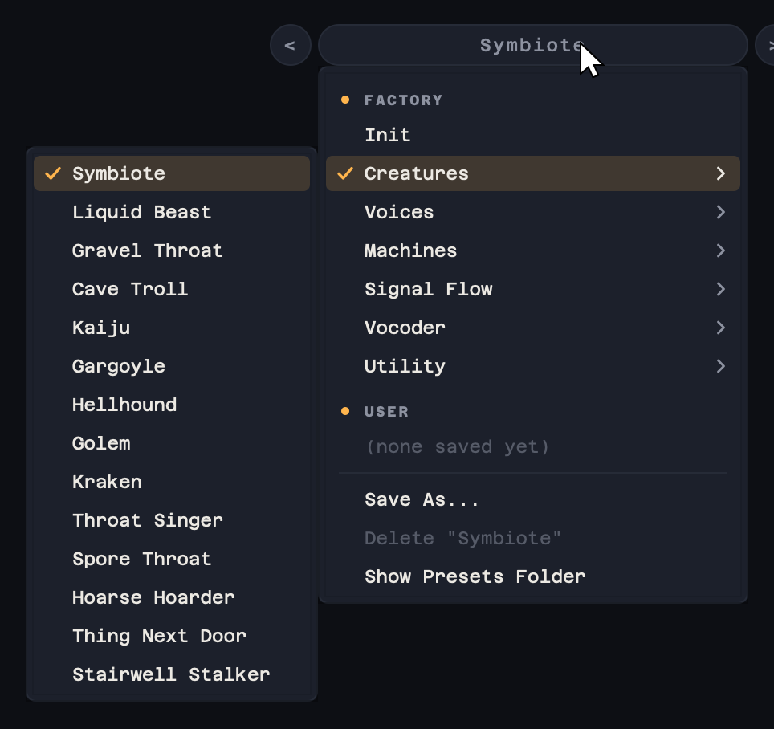 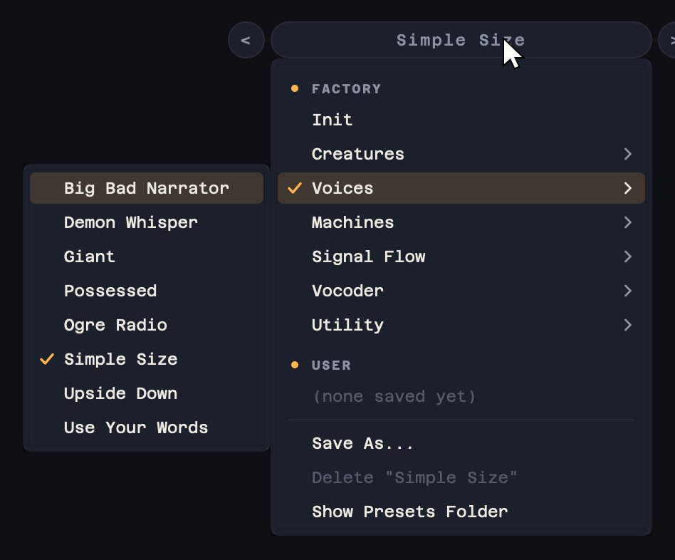

| Group | Presets |
|---|---|
| | Init (every control at its default: a slightly lower, bigger voice with a light wobble, growl, tube edge, sub and overtones) |
| **Creatures** | Symbiote, Liquid Beast, Gravel Throat, Cave Troll, Kaiju, Gargoyle, Hellhound, Golem, Kraken, Throat Singer, Spore Throat, Hoarse Hoarder |
| **Voices** | Big Bad Narrator, Demon Whisper, Giant, Possessed, Ogre Radio, Simple Size, Upside Down, Use Your Words |
| **Machines** | Cyber Commander, Respirator Rasp, Rasp Machine, Robot Ogre, Iron Tyrant, Tin Can Drone, Angry Pepper Pot, Ball Bearing |
| **Signal Flow** | Scorched Swirl, Molten Chorus, Sub Furnace, Ribcage, Tar Pit, Breathing Walls, Chopped Space, Vocoded Fire, Clanking Choir |
| **Vocoder** | Pulse Choir, Two Octaves Down, Gravel Pit, Iron Lung |
| **Utility** | Detail Only, Subtle Size, Clean Lift, Loud & Contained, Crunch Lift, Smashed, Phone Monster |

Every preset sets every control, including the module order. The Signal Flow presets move modules to show what a placement does: for example, Tar Pit drives and chops the voice before PITCH lowers it, and Breathing Walls puts DETAIL last, so it lifts every tail and breath the other modules make.

Six character presets are each built around one technique, and each works best with the delivery it describes:

- **Upside Down** (Voices): a deep, creaking villain voice. Your own voice stays at pitch and in the centre, is levelled in gentle stages, and gets low-end girth and a tight, clean octave underneath, with the top gently softened, all in a wide room.
- **Use Your Words** (Voices): a commanding voice that seems to come from inside the listener. It is pitched an octave down and played through a rattling speaker into a small room, with a heavy low-end thump and a crowd of voices, then blended half and half with your natural voice, which stays on top.
- **Spore Throat** (Creatures): a dry, human-sounding horror throat. The low end is cut away, the voice is narrowed to its mid-range screech, the wet mouth clicks are lifted, and a rattle speeds up as you get louder. Perform the clicks and screeches yourself: it frames a performance rather than inventing one.
- **Hoarse Hoarder** (Creatures): an enormous beast that still speaks clearly. The voice is pitched eight semitones down with a lower throat, over a gravelly vocoder bed and a light rumble, with breaths lifted between lines, in a wide, ringing chamber.
- **Angry Pepper Pot** (Machines): a furious voice in a metal shell. A low ring modulator chops the voice into a staccato electronic stutter, and nothing else colours it. Shout, and pitch your delivery up to hector.
- **Ball Bearing** (Machines): a small, chirpy machine. The voice is raised an octave and stepped to semitones, with a faint synthetic buzz, a quick warble and a tiny speaker. Coo and chirp short syllables rather than speaking.

A few contrasting presets, each playing the same voice (the creature is shown at a different stage of growth in each):

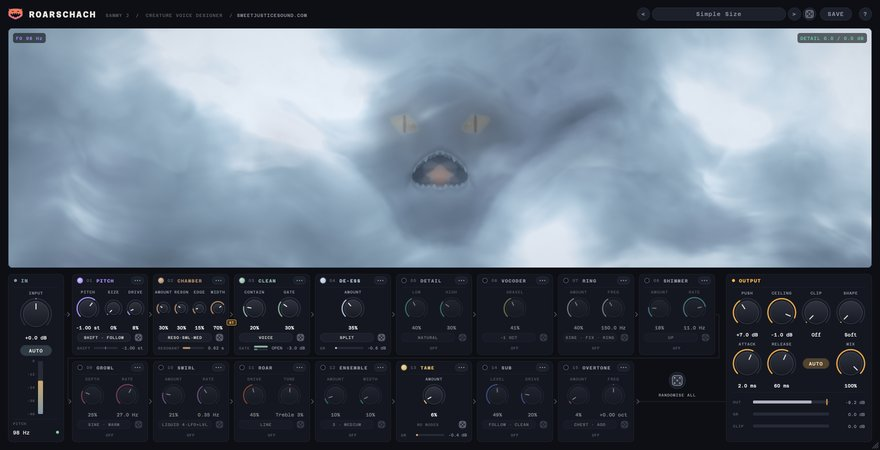 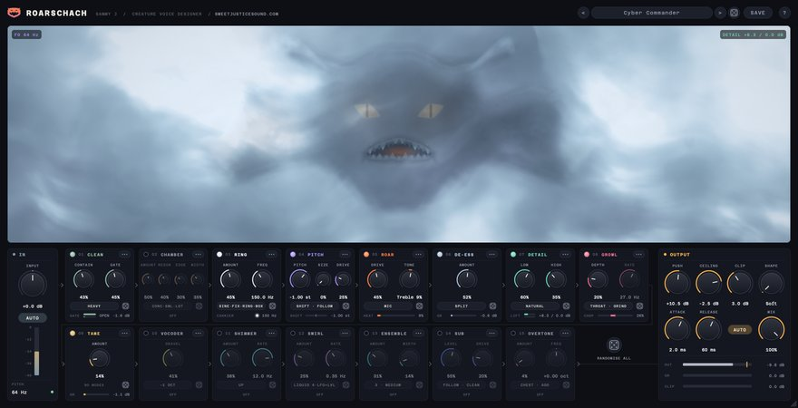
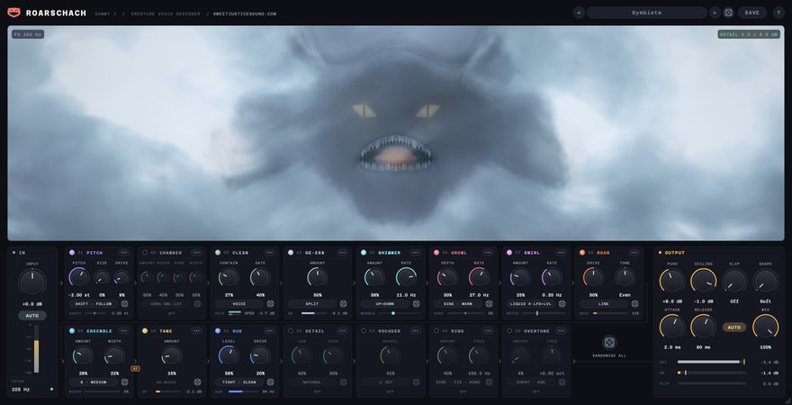 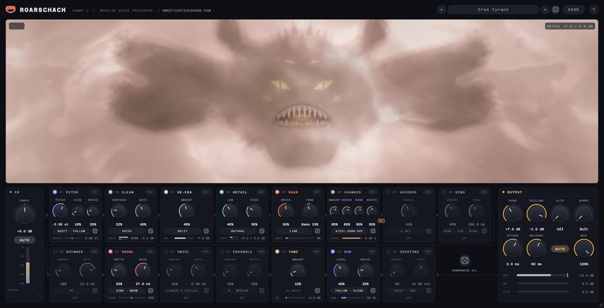
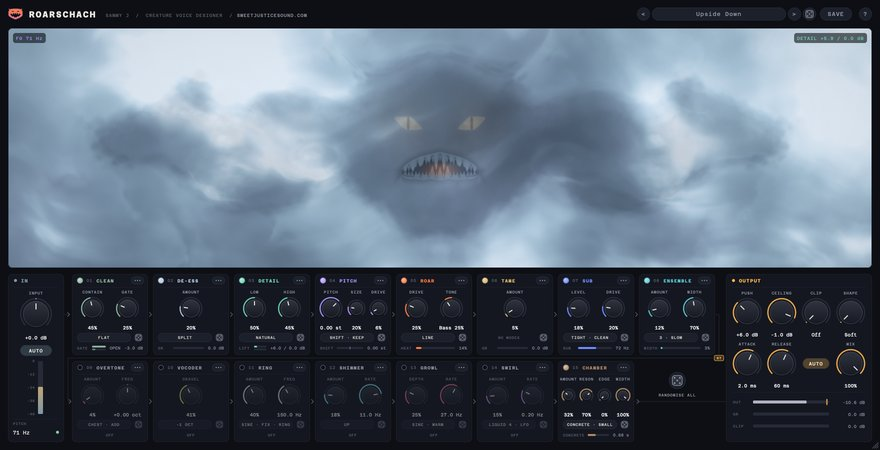 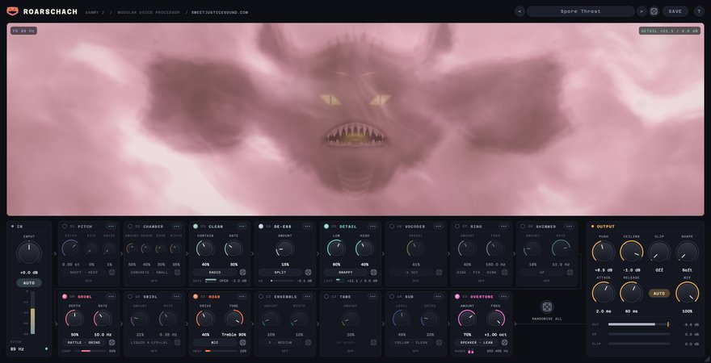
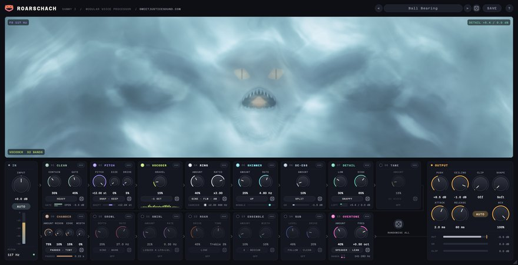

Each preset's settings sit in the useful part of every knob's travel, as measured in [docs/parameter-audit.md](docs/parameter-audit.md), and every preset except the deliberately loud Utility ones (Loud & Contained, Crunch Lift and Smashed) plays within about 1.5 LU of Init.

Eleven presets use CHAMBER:

- **Simple Size**: a subtly bigger, wider voice with a touch of chamber and low-end weight. The voice is lowered a semitone and lightly cleaned, and a little of a hard, resonant room is blended under it, with no creature effects.
- **Iron Tyrant**: a low, driven voice fed from ROAR into a horn speaker in a steel box, like an amp into a cabinet. Metal modes ring on every syllable, over a heavy low end.
- **Tin Can Drone**: talking down a pipe. A tiny speaker in a ringing tin booth, through CLEAN's Radio tone.
- **Use Your Words**: the octave-down voice played through a small speaker into a rattling concrete room with Heavy Boom, right after PITCH.
- **Ball Bearing**: the raised voice played through a tiny speaker in a padded cell, a dead box at the end of its chain.
- **Big Bad Narrator** sits in a warm wooden room. **Cave Troll**, **Gargoyle** and **Demon Whisper** put the whole creature in a room, with CHAMBER last: concrete, hard stone and a soft bloom. **Upside Down** and **Hoarse Hoarder** do the same in a concrete room and a resonant chamber, so the octave and the rumble ring in the room too.

User presets are kept in:

- macOS: `~/Library/Audio/Presets/SammyJs/Roarschach`
- Windows: `%APPDATA%\SammyJs\Roarschach\Presets`

Each preset is a small `.roarschachpreset` XML file. Any control a preset doesn't contain is set to its default.

## About and updates

Click **?** at the top right to open the About window, with the credits, the version and the license. CHECK FOR UPDATES asks GitHub for the latest Roarschach release and tells you if a newer one is out. Roarschach only checks when you click it.


## Quick start

- **Instant creature:** start from a Creatures preset, then set PITCH and SIZE for how big it should be.
- **Big but clear:** "Big Bad Narrator" or "Giant". Keep GROWL and ROAR low and let DETAIL keep every word up front. For barely-processed size, try "Simple Size".
- **Gravelly throat:** turn the VOCODER on with GRAVEL at 40–70%, and add some GROWL.
- **Machine voice:** a Machines preset, or turn RING on and try Track Follow at a ratio of ×0.5 or ×1.5.
- **Two voices at once:** "Possessed", or lower MIX to 70–80% so some of the performance stays under the creature.
- **Just more detail:** "Detail Only" brings up breaths and word endings and holds down shouts, with every creature module off.
- **Crunchy and loud:** "Crunch Lift" or "Smashed", or turn OUTPUT's Auto off, set Release to a few milliseconds and raise Push.
- **Weight on small speakers:** raise OVERTONE, or try "Phone Monster".
- **High sample rate recordings:** set PITCH to −12 or −24 st with Formant on Follow to bring the ultrasonic detail down into the voice.
- **Try moving the modules:** load a Signal Flow preset, then choose Reset Chain Order from any module's ••• menu to hear the same settings in the default order.

## System requirements

- macOS 11 or later (Apple Silicon and Intel): VST3 and AU
- Windows 10 or later (64-bit): VST3

## Building

### Prerequisites
- CMake 3.22 or higher
- Xcode Command Line Tools (macOS) or Visual Studio 2022 (Windows)
- JUCE 8.0.8, expected at `../SDK/JUCE` relative to this folder

### Build instructions

```bash
cmake -B build -DCMAKE_BUILD_TYPE=Release
cmake --build build --config Release
```

The plugin is built to:
- VST3: `build/Roarschach_artefacts/Release/VST3/`
- AU: `build/Roarschach_artefacts/Release/AU/`

Options:

- `-DROARSCHACH_FORMATS=Standalone` builds a standalone app instead (handy for UI work), or `-DROARSCHACH_FORMATS="AU;VST3;Standalone"` for all three.
- `-DROARSCHACH_IR_DIR=<folder>`, with the `ROARSCHACH_IR_KEY` environment variable set to 64 hex digits, packs CHAMBER's room captures from that folder into the build, encrypted. The captures are not in this repository; without them CHAMBER uses its modelled rooms.
- `-DROARSCHACH_TESTS=ON` builds `RoarschachTests`, an offline test runner that drives the real processor at several sample rates and block sizes:
  - `RoarschachTests` runs every test: parameters, constant latency, exact dry and bypass nulls, the dry's phase match, stereo, click-free module moves in any order, the output ceiling, state round-trip, every factory preset, non-finite input, block sizes, native-rate pitch at 192 kHz, RING, OVERTONE and CHAMBER, the editor, the dice, and CPU use. `--quick` runs shorter versions, and test names (for example `RoarschachTests latency presets`) run only those. It exits non-zero on a failure.
  - `RoarschachTests --render in.wav outdir [--preset NAME]...` renders a file through factory presets at the file's own sample rate. `--only`, `--without` (module codes such as `GR` or `RM`) and `--order` change the chain for the render, and `--roll FROM TO` renders one Randomise All roll per seed (with `--metrics out.json`, the loudness of each).
  - `RoarschachTests --snapshot out.png` writes a picture of the editor, and `RoarschachTests --snapshots folder` writes the window, the chain, menus, a tooltip and a drag, with the creature.

### Installation

- Copy the `.vst3` bundle to `~/Library/Audio/Plug-Ins/VST3/`
- Copy the `.component` bundle to `~/Library/Audio/Plug-Ins/Components/`

## Credits

Created by Samuel Justice, Creative Sound Supervisor at [Sweet Justice](https://www.sweetjusticesound.com).

- UI font: [Azeret Mono](https://github.com/displaay/Azeret), SIL Open Font License 1.1.
- All the signal processing is original, built on [JUCE](https://juce.com).

## License

The code is under the MIT License. See [LICENSE](LICENSE) for details.

CHAMBER's bundled rooms (the room captures that release builds carry inside the plug-in) are not covered by the MIT License: they are © Samuel Justice, all rights reserved, and licensed for use only within Roarschach. See [LICENSE-IRS](LICENSE-IRS).

The measurements behind every knob's range and taper are in [docs/parameter-audit.md](docs/parameter-audit.md).
