# Roarschach

A VST3/AU creature voice designer by **Samuel Justice**. Roarschach turns a spoken or shouted performance into a big, liquid, gravelly monster voice that still reads as words. One insert holds fourteen modules (pitch and size, clean-up, de-essing, detail, a vocoder, a ring modulator, shimmer, growl, a phaser, tube roar, an ensemble, a top-end tamer, a tracked sub and overtones) that run in any order, between an input stage and a level-matched output with a limiter and a clipper.

### 🎉 Latest Release v1.0.0 - [Download Here](https://github.com/samueljustice/plugins/releases/tag/roarschach-v1.0.0)

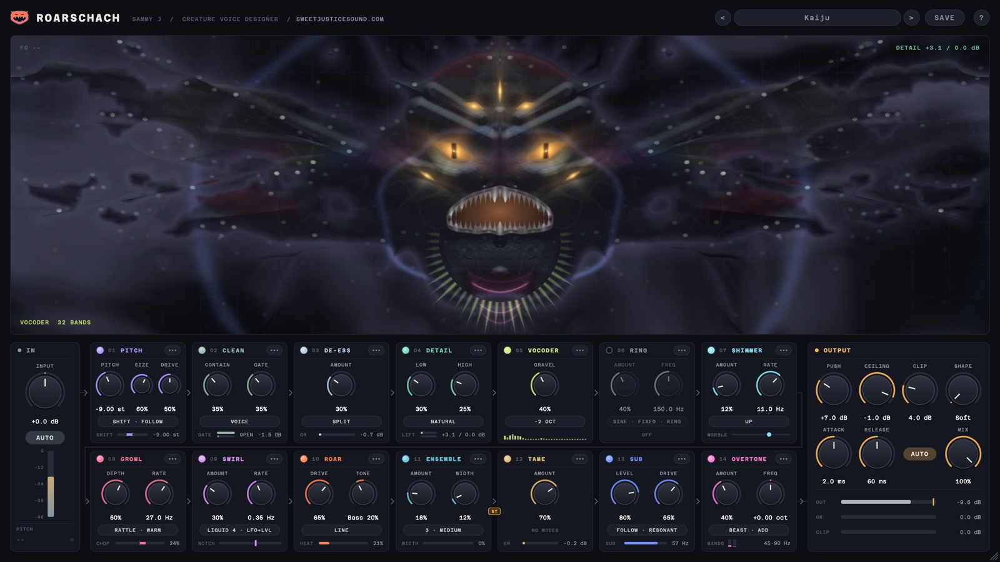

## Features

- **Fourteen modules, any order**: every module has an On switch and can sit anywhere in the chain. Drag a module by its header, use its **•••** menu, or press Alt+Left / Alt+Right on one of its controls. A move crossfades over 30 ms, so it is click-free even while audio plays.
- **Pitch and size, separately**: PITCH shifts the voice from two octaves down to one octave up, with Shift, Snap and Mono modes, and SIZE gives it a bigger throat.
- **Full bandwidth at any sample rate**: the audio is never resampled. At 96 or 192 kHz a two-octave drop brings the recording's ultrasonic content down into the audible band.
- **Texture**: GROWL chops the voice into a growl, SHIMMER adds a liquid wobble, SWIRL a sweeping phaser, ROAR two-stage tube saturation, ENSEMBLE a chorus of voices that makes the chain stereo.
- **Machines**: a 32-band VOCODER on a pulse carrier one or two octaves below the voice, and a RING modulator with a fixed or pitch-tracking carrier and a small resonant body.
- **Weight**: SUB adds a tracked octave below the voice; OVERTONE turns the low end into overtones so the weight carries on small speakers.
- **Control**: CLEAN (tone EQ, gate and a leveller), DE-ESS, DETAIL (lifts the quiet parts and pushes the loud parts into a soft ceiling) and TAME (holds back harsh top end).
- **A finished output**: OUTPUT matches the level to the input, then Push drives a true-peak-safe limiter with a clipper after it. Attack and Release set how clean or crunchy the limiting is, and Auto release keeps it clean. MIX blends in the dry voice, phase-matched to the processed one.
- **A creature that reacts**: an OpenGL creature that forms out of drifting cloud, whose jaw, eyes, skin and throat follow the voice and every module. It softens back into fog when the input goes quiet, and slowly evolves with sustained intensity.
- **Presets**: 40 factory presets (Init plus six groups: Creatures, Voices, Machines, Signal Flow, Vocoder, Utility). Save your own with SAVE. They are plain files, easy to back up and share.
- **Full recall**: every parameter, the module order, the preset name and the window size are saved with your session, and the factory presets are exposed to the host as programs.
- **Resizable interface**: drag the corner to scale the whole window from 50% to 125%.
- **Constant latency** of about 46 ms (2192 samples at 48 kHz), the same for every setting and every module order, reported to the host so it is compensated. Host bypass stays in time and switches without clicks. Mono or stereo, full DAW automation.

## How it works

The voice comes in through **IN**, runs through the fourteen modules (two rows of seven in the window, read left to right, top row first) and leaves through **OUTPUT**. IN and OUTPUT always stay at the ends; everything between them can move.

The default order, and what each module does:

| # | Module | What it does |
|---|---|---|
| 1 | **PITCH** | Shifts the pitch of the voice and, separately, the size of the throat (the formants). Lower and bigger is a bigger creature. A tube drive after the shift adds warmth or grit. |
| 2 | **CLEAN** | A voice channel strip: a tone EQ, a gate that closes on room noise between words, and a leveller that evens out the level and catches peaks. |
| 3 | **DE-ESS** | Softens harsh S and T sounds. |
| 4 | **DETAIL** | Lifts the quiet parts (breaths, consonants, word endings) a long way while the loud syllables stay where they are, and pushes the loud parts into a soft ceiling. |
| 5 | **VOCODER** | A 32-band vocoder whose carrier is a buzz one or two octaves below the voice: a gravelly machine voice under the words. Off by default. |
| 6 | **RING** | A ring modulator: metallic sidebands from a carrier at a fixed frequency or at a ratio of the voice's pitch, with an optional small resonant box around it. Off by default. |
| 7 | **SHIMMER** | A copy of the voice shifted by a few hertz beats against the voice: a liquid wobble. |
| 8 | **GROWL** | Chops the voice's level many times a second, the rough flutter of a growl. |
| 9 | **SWIRL** | A phaser that sweeps notches up and down the voice. |
| 10 | **ROAR** | Two-stage tube saturation with a tone stack between the stages: warm at first, gritty and dense when pushed. |
| 11 | **ENSEMBLE** | A chorus of three or six voices that spreads to the sides. It makes the chain stereo. |
| 12 | **TAME** | Holds back the harsh top end, only when it gets loud. |
| 13 | **SUB** | An octave below the voice that follows its pitch. |
| 14 | **OVERTONE** | Turns the low end into overtones, so its weight can be heard on speakers that cannot play it. |

Where a module sits changes the sound. ROAR before GROWL drives the voice and then chops it; ROAR after GROWL distorts the chopped voice. SUB before ROAR sends the octave through the tube, so its rumble gets harmonics locked to the voice. The VOCODER late in the chain vocodes everything before it. The Signal Flow presets each show one of these placements.

The chain is mono up to the first module that makes stereo: ENSEMBLE, or SHIMMER in Stereo mode. An **ST** badge on the connector after that module marks the point.

### Moving modules

- **Drag** a module by its header. While you hold it, the other tiles slide aside to show where it will land. Press Escape to cancel.
- **The ••• menu** in the header: Move to Start, Move Earlier, Move Later, Move to End, Move After (any other module), Turn Off / Turn On, and Reset Chain Order (back to the default order above).
- **The keyboard**: with one of a module's controls focused, Alt+Left moves it one place earlier and Alt+Right one place later.

The order is saved with the session and with presets, and the host can automate it (each module has a position parameter, 1st to 14th).

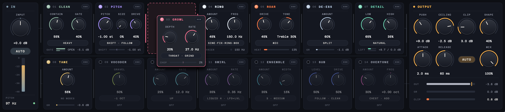

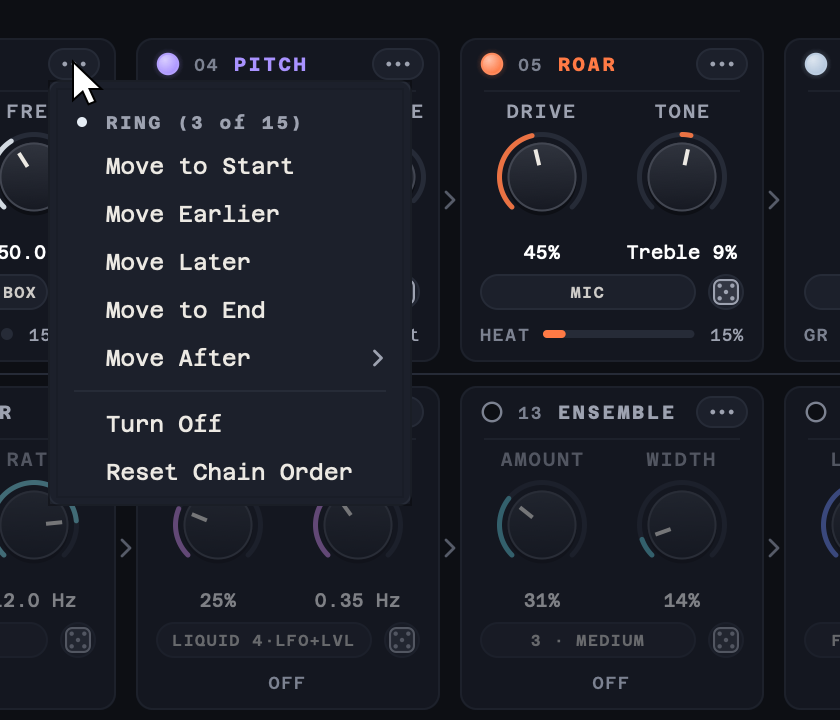 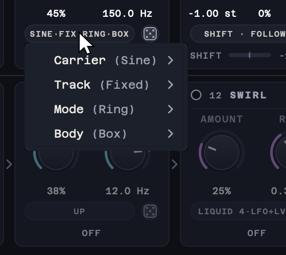

### The output stage

OUTPUT always ends the chain. In order, it:

1. **Matches the level** of the processed voice to the input, so turning modules on and off does not make the voice much louder or quieter. The matching never drives the voice into the ceiling by itself: that is Push's job.
2. **Pushes** the voice by up to +24 dB.
3. **Mixes** in the dry voice, so the limiter and the clipper hold the ceiling at any Mix.
4. **Limits** at the **Ceiling** with a look-ahead limiter. More Push is louder and denser; the peaks never pass the ceiling, which is true-peak safe.
5. **Clips** what the limiter leaves for it. **Clip** sets how many dB of each peak above the ceiling are clipped instead of limited (Off by default), and **Shape** sets the clipper from Soft (rounded peaks) to Hard (flat peaks, brighter and more aggressive). The clipper is oversampled, so it does not add aliasing.

**Attack and Release decide whether the limiting is clean or crunchy.** When the limiter's gain recovers quickly enough to move between the peaks of a low note's waveform, it turns that waveform's every peak down a little and lets it back up in between. That reshapes the low end and adds a dense, buzzy distortion on top of the voice: maximizer crunch, which sounds big on roars and impacts.

- **Release** sets how much crunch there is. Very short releases (1 to 5 ms) let the gain follow the bass and crunch clearly; around 50 ms it is gritty; from about 300 ms up it is clean.
- **Attack** sets which frequencies can crunch. The limiter starts turning down this long before each peak, and only notes whose waveform peaks are further apart than that can crunch: roughly everything below 1 / (2 × Attack). At 2 ms (the default) that is everything below about 250 Hz, the whole low end of a creature voice; at 5 ms only the lowest notes; at 10 ms almost nothing. Shorter attacks are also punchier on transients.
- **Auto** (on by default) adapts the release to the material and holds the gain steady between bass peaks, so the low end stays clean whatever the Attack. Release still sets how quickly Auto breathes. Turn Auto off to use Release directly.

For crunch, turn Auto off, set Release to a few milliseconds, and raise Push until you hear it. Lower Mix to blend the crunched voice with the clean one. The Utility presets Crunch Lift and Smashed are starting points.

### Native sample rate

Roarschach runs at the host's sample rate and never resamples the audio. PITCH reads the input at that rate through a long, high-quality interpolator, and nothing before PITCH in the default order cuts the top end. So at 96 or 192 kHz, a −12 or −24 st shift with Formant on Follow brings the recording's ultrasonic content down into the audible band: at 192 kHz, a 40 kHz component lands at 10 kHz cleanly. This is the point of recording creature performances at high sample rates, and PITCH's range goes down to −24 st for it. OUTPUT's gentle low-pass at 18 kHz, after the chain, is the only fixed top cut.

## Controls

Every control has a tooltip: hover over it to see what it does. The footer of each module shows what the module is doing right now (hover over it for an explanation). Double-click any knob to reset it to its default. The mode chip under the knobs opens a menu of the module's choices; the ••• button moves the module.

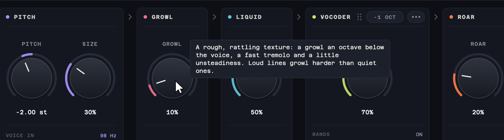

The close-ups below are from the Kaiju preset; RING and OUTPUT are from Cyber Commander.

### IN

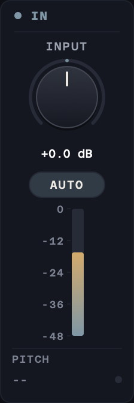

| Control | Range | Default | Description |
|---|---|---|---|
| **Input** | −24 to +24 dB | 0 dB | Level into the plug-in, before everything else. |
| **Auto** | on / off | On | Brings any voice to the same working level, so every module reacts the same way to a quiet or a loud take. |

The meter shows the input level and the readout the voice's pitch. A stereo input is summed to mono here.

### PITCH

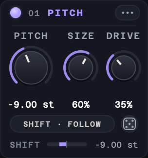

| Control | Range | Default | Description |
|---|---|---|---|
| **Pitch** | −24 to +12 st | −2 st | How far the voice is shifted, in semitones. Lower is bigger. |
| **Size** | 0 to 100% | 0% | Makes the throat bigger: lowers the formants and adds body. |
| **Drive** | 0 to 100% | 5% | Tube drive after the shift: warmth first, then grit. |
| **Mode** | Shift / Snap / Mono | Shift | Shift moves the voice by the set interval. Snap also lands each note on the nearest semitone. Mono holds the voice on one note. |
| **Formant** | Follow / Keep | Follow | Follow moves the throat with the pitch, for a bigger or smaller creature. Keep leaves the throat where it is, so only the pitch changes. |

### CLEAN

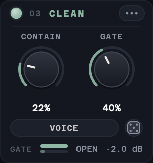

| Control | Range | Default | Description |
|---|---|---|---|
| **Contain** | 0 to 100% | 35% | Evens out the level and catches peaks before the creature stages. |
| **Gate** | 0 to 100% | 35% | Closes on room noise between words. |
| **Tone** | Flat / Voice / Heavy / Radio | Voice | Flat leaves the voice as it is, Voice cleans up the low mids, Heavy adds weight without boom, Radio is a narrow, lo-fi band. |

### DE-ESS

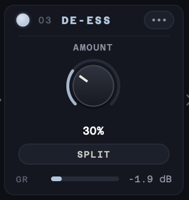

| Control | Range | Default | Description |
|---|---|---|---|
| **Amount** | 0 to 100% | 30% | Softens harsh S and T sounds. |
| **Mode** | Split / Wide | Split | Split turns down only the hiss on each S. Wide turns down the whole voice. |

### DETAIL

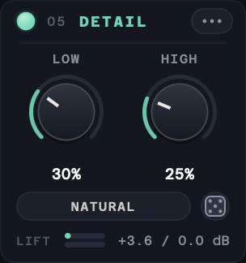

| Control | Range | Default | Description |
|---|---|---|---|
| **Low** | 0 to 100% | 30% | Lifts the quiet parts (breaths, consonants, tails) while the loud syllables stay where they are. |
| **High** | 0 to 100% | 25% | Pushes the loud parts up into a soft ceiling: denser and more forward. |
| **Speed** | Natural / Snappy | Natural | How quickly the level follows the voice. Natural is smooth; Snappy recovers faster and sounds more lively. |

DETAIL leaves the room tone between lines alone, so it lifts the voice, not the noise floor.

### VOCODER

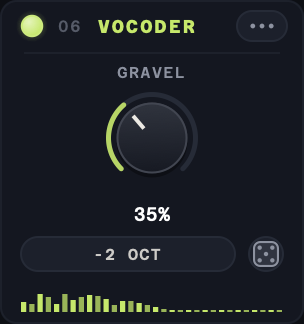

| Control | Range | Default | Description |
|---|---|---|---|
| **Gravel** | 0 to 100% | 50% | How much of the pulse-carrier vocoder is heard: a gravelly machine voice under the words. |
| **Octave** | −1 Oct / −2 Oct | −1 Oct | Pitch of the vocoder's pulse carrier: one or two octaves below the voice. |

### RING

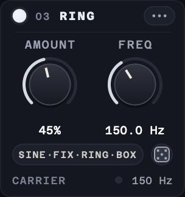

| Control | Range | Default | Description |
|---|---|---|---|
| **Amount** | 0 to 100% | 40% | How much of the ring-modulated voice is heard. Low settings add a metallic edge; high settings turn the voice into a machine. |
| **Freq** (Track Fixed) | 20 Hz to 4 kHz | 150 Hz | The carrier frequency. Low values give a robotic flutter, the low hundreds a clangy metallic voice, higher values a bell-like, alien tone. |
| **Ratio** (Track Follow) | ×0.25 to ×4 | ×1.00 | The carrier as a multiple of the voice's pitch. Whole and half ratios stay in tune with the voice; other ratios clash. |
| **Carrier** | Sine / Triangle / Square | Sine | The carrier waveform. Sine is smooth, triangle slightly brighter, square buzzy and hard. |
| **Track** | Fixed / Follow | Fixed | Fixed holds the carrier at one frequency. Follow moves it with the voice's pitch. |
| **Mode** | Ring / AM | Ring | Ring removes the original pitch and leaves only the metallic sidebands. AM keeps the original voice and adds the sidebands around it. |
| **Body** | Off / Box / Can | Off | Puts the voice inside a small resonant box. Box is a hard, hollow enclosure; Can is smaller and more metallic. |

The second knob is Freq when Track is Fixed and Ratio when Track is Follow.

### SHIMMER

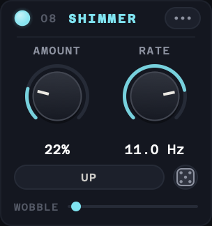

| Control | Range | Default | Description |
|---|---|---|---|
| **Amount** | 0 to 100% | 12% | A liquid wobble: a copy of the voice moved a few hertz beats against the voice. |
| **Rate** | 0.5 to 40 Hz | 11 Hz | How fast the wobble beats. |
| **Mode** | Up / Down / Up+Down / Stereo | Up | Which way the copy is moved. Up and Down wobble differently, Up+Down uses both, Stereo puts one on each side. |

### GROWL

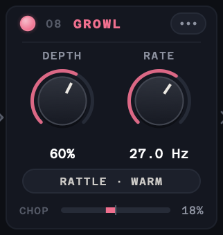

| Control | Range | Default | Description |
|---|---|---|---|
| **Depth** | 0 to 100% | 48% | How deeply the voice is chopped. |
| **Rate** | 1 to 150 Hz | 27 Hz | How fast the voice is chopped. Around 25–30 Hz reads as a rough growl; lower rates stutter. |
| **Shape** | Sine / Opto / Square / Throat / Rattle | Sine | Sine is smooth, Opto pulses like a lamp, Square switches hard, Throat locks to half the voice's pitch, Rattle speeds up on loud lines. |
| **Character** | Clean / Warm / Grind | Warm | What the chop does to the tone. Clean only changes the level, Warm rounds the low end, Grind adds a gritty edge. |

### SWIRL

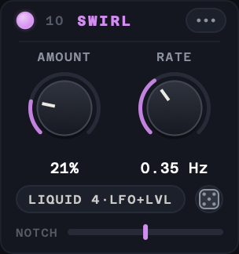

| Control | Range | Default | Description |
|---|---|---|---|
| **Amount** | 0 to 100% | 30% | How much of the sweeping phaser is mixed in. |
| **Rate** | 0.05 to 10 Hz | 0.35 Hz | How fast the phaser sweeps. |
| **Circuit** | Liquid 4 / Smooth 4 / Talky 4 / Deep 6 / Deep 12 / Dark 5 | Liquid 4 | The phaser's circuit: how many notches it has and how deep they cut, from a liquid four-stage to a dense twelve-stage sweep. |
| **Motion** | LFO / LFO+Level / Random | LFO+Level | What moves the sweep. LFO is steady, LFO+Level sweeps further on loud words, Random wanders. |

### ROAR

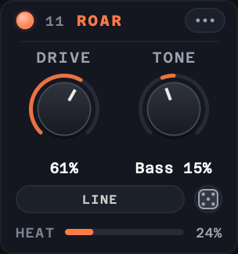

| Control | Range | Default | Description |
|---|---|---|---|
| **Drive** | 0 to 100% | 45% | Tube saturation: warm at first, gritty and dense when pushed. |
| **Tone** | Bass 100% to Treble 100% | Treble 10% | Tilts what the tube drives harder: the bass or the treble. |
| **Voicing** | Line / Mic | Line | Line drives the tube flat. Mic first trims the boom and the air, as from a close microphone. |

### ENSEMBLE

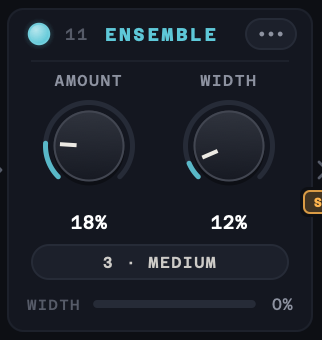

| Control | Range | Default | Description |
|---|---|---|---|
| **Amount** | 0 to 100% | 18% | How much of the chorus of voices is mixed in. |
| **Width** | 0 to 150% | 12% | How far the chorus spreads to the sides. |
| **Voices** | 3 / 6 | 3 | How many voices sing along: 3 is tight, 6 is a crowd. |
| **Motion** | Slow / Medium / Fast / Vibrato | Medium | How the voices drift. Slow, Medium and Fast set the movement; Vibrato makes them waver in pitch. |

### TAME

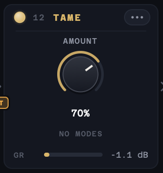

| Control | Range | Default | Description |
|---|---|---|---|
| **Amount** | 0 to 100% | 30% | Holds back harsh top end when it gets loud. |

### SUB

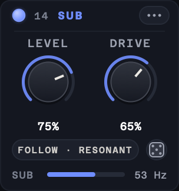

| Control | Range | Default | Description |
|---|---|---|---|
| **Level** | 0 to 100% | 45% | Level of the octave underneath the voice. |
| **Drive** | 0 to 100% | 60% | Drive on the octave: rounder or growlier. |
| **Register** | Follow / Tight / Deep | Follow | Where the octave sits. Follow tracks the voice, Tight keeps it in a firm low band, Deep always goes a full octave down. |
| **Character** | Clean / Resonant / Thick | Clean | The octave's colour. Clean is a pure low tone, Resonant rings and drives harder, Thick adds a second, fuller layer. |

### OVERTONE

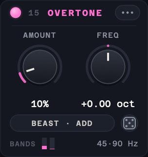

| Control | Range | Default | Description |
|---|---|---|---|
| **Amount** | 0 to 100% | 10% | How strongly the low end is echoed as overtones. They let the voice's weight be heard on small speakers without adding more bass. |
| **Freq** | −1 to +1 oct | 0 oct | Moves the overtone bands up or down together. Higher translates better to small speakers; lower is warmer. |
| **Pattern** | Chest / Throat / Beast / Speaker / Broad / Tracked | Chest | Which low regions are turned into overtones. Chest: body and octave. Throat: gruff upper growl. Beast: hollow, odd-heavy snarl. Speaker: high overtones for small or radio-like creatures. Broad: one wide low band. Tracked: follows the voice's pitch exactly. |
| **Mode** | Add / Lean / Replace | Add | Add keeps the original low end. Lean lowers it. Replace removes it, so the low end is heard only through its overtones. |

Placed after SUB (the default), OVERTONE also makes SUB's octave audible on small speakers.

### OUTPUT

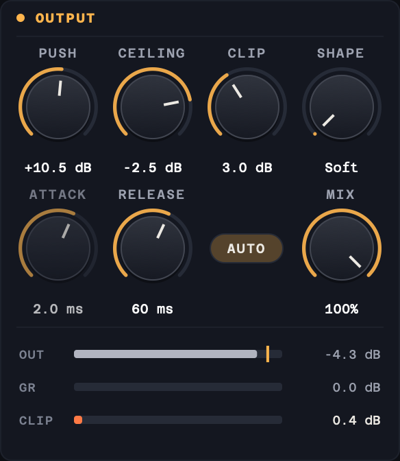

| Control | Range | Default | Description |
|---|---|---|---|
| **Push** | 0 to +24 dB | +8 dB | Drives the voice into the ceiling. More push is louder and denser; the peaks never pass the ceiling. |
| **Ceiling** | −12 to 0 dB | −1 dB | The highest level the output can reach, true-peak safe. |
| **Clip** | Off to 18 dB | Off | How many dB of each peak above the ceiling are clipped instead of limited. Raise Push to drive into it. |
| **Shape** | Soft to Hard | Soft | Clip shape. Soft rounds the peaks gently; Hard clips them flat, which is brighter and more aggressive. |
| **Attack** | 0.05 to 10 ms | 2 ms | How early the limiter starts turning down before a peak. Shorter is punchier and crunchier on the low end. |
| **Release** | 1 ms to 1 s | 60 ms | How fast the limiter recovers. Very short times make the gain follow the bass and crunch; long times are clean. |
| **Auto** | on / off | On | Auto release: adapts the recovery to the material and keeps the low end clean. Release sets how quickly it breathes. |
| **Mix** | 0 to 100% | 100% | Blends the processed voice with the dry voice, which is delayed and phase-matched to line up with it. |

The meters show the output level (with the ceiling marked), the limiter's gain reduction (GR) and how much the clipper takes (CLIP). See [The output stage](#the-output-stage) for how Attack and Release shape the crunch.

## Visualiser

The creature above the chain is drawn live in OpenGL from the audio and the controls. It forms out of slowly drifting cloud: when the voice comes in, its eyes and mouth glow through first, then the brow and teeth, then the head, and the cloud condenses into a mirror-symmetric ink blot. When it goes quiet the face softens back into fog, with the eyes the last to fade.

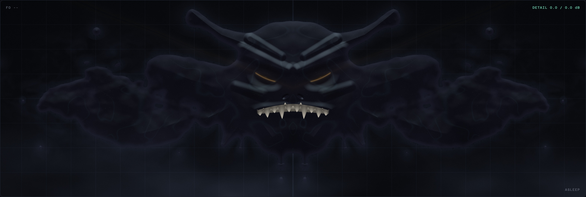 
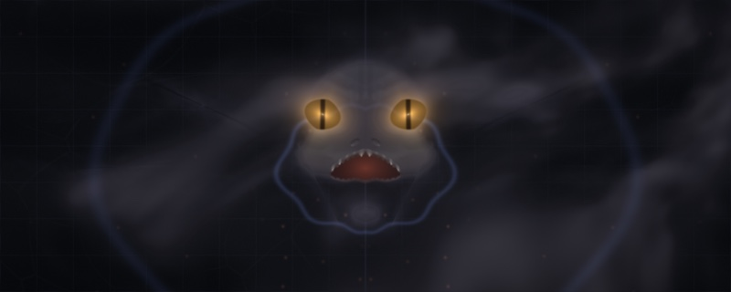 
 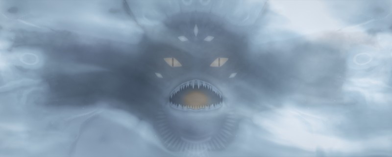

**It evolves.** Sustained intensity (loud, heated, growling, driven sound, not just high knob settings) slowly grows it from a pale pressed blot into something larger: a soft moth-like spirit, a horned beast, a dripping liquid horror, a winged and horned wyrm, and finally a many-eyed thing with a crown of spines. The stages blend into each other and never switch: horns and spines grow out of the head, extra eyes open from creases in the skin, and the change takes minutes, not seconds. Quiet lets it cool and settle back over minutes. A long, hard session leaves its mark: it only drifts all the way home after a long stretch of quiet. Which modules carry the sound also leans its character: SHIMMER, SWIRL and ENSEMBLE make it more fluid, ROAR, GROWL and the clipper more bestial, the VOCODER, RING and OVERTONE more eldritch, and SUB, a low PITCH and a straining limiter heavier and darker. Every instance grows its own creature, and the creature and how far it has evolved are saved with the session.

Right-click the creature for **Evolution: Live** (it keeps evolving), **Evolution: Frozen** (it holds its current form; it still moves with the voice) and **Reset creature** (it eases back to a blot over a few seconds and grows a new one).

On top of whatever form it has taken, every module still shows on it:

- Its jaw opens with the voice; PITCH and SIZE make its head and jaw bigger.
- GROWL shakes its teeth, SHIMMER ripples its skin and drips ink, SWIRL sweeps a sheen up and down its face, and ENSEMBLE spreads filaments to the sides.
- ROAR heats its eyes, SUB sends rings out of its throat, the VOCODER lights a fan of 32 ridges under its jaw (one per band), and OVERTONE lights one rib per overtone under its chin (hollow in Replace).
- RING puts flickering metal plates over its mouth, DE-ESS glints on its teeth, TAME dims its crown, and CLEAN's gate closes its lips between words.
- At the output, the limiter swells veins at its temples and the clipper throws sparks off its edges.

The top corners show the voice's pitch (F0) and how much DETAIL is lifting and holding. After 1.5 seconds of silence the creature falls asleep, dissolving into fog, and the label ASLEEP appears; it gathers itself again as soon as sound comes back.

## Presets

Use the arrows either side of the preset name to step through presets, or click the name for the full list, grouped by category. SAVE stores the current settings as a user preset, and the list also has Save As, Delete and Show Presets Folder.


| Group | Presets |
|---|---|
| | Init (every control at its default: a slightly lower, bigger voice with a light wobble, growl, tube edge, sub and overtones) |
| **Creatures** | Symbiote, Liquid Beast, Gravel Throat, Cave Troll, Kaiju, Gargoyle, Hellhound, Golem, Kraken, Throat Singer |
| **Voices** | Big Bad Narrator, Demon Whisper, Giant, Possessed, Ogre Radio |
| **Machines** | Cyber Commander, Respirator Rasp, Rasp Machine, Robot Ogre |
| **Signal Flow** | Scorched Swirl, Molten Chorus, Sub Furnace, Ribcage, Tar Pit, Breathing Walls, Chopped Space, Vocoded Fire, Clanking Choir |
| **Vocoder** | Pulse Choir, Two Octaves Down, Gravel Pit, Iron Lung |
| **Utility** | Detail Only, Subtle Size, Clean Lift, Loud & Contained, Crunch Lift, Smashed, Phone Monster |

Every preset sets every control, including the module order. The Signal Flow presets move modules to show what a placement does: for example, Tar Pit drives and chops the voice before PITCH lowers it, and Breathing Walls puts DETAIL last, so it lifts every tail and breath the other modules make.

User presets are kept in:

- macOS: `~/Library/Audio/Presets/SammyJs/Roarschach`
- Windows: `%APPDATA%\SammyJs\Roarschach\Presets`

Each preset is a small `.roarschachpreset` XML file. Any control a preset doesn't contain is set to its default.

## About and updates

Click **?** at the top right to open the About window, with the credits, the version and the license. CHECK FOR UPDATES asks GitHub for the latest Roarschach release and tells you if a newer one is out. Roarschach only checks when you click it.

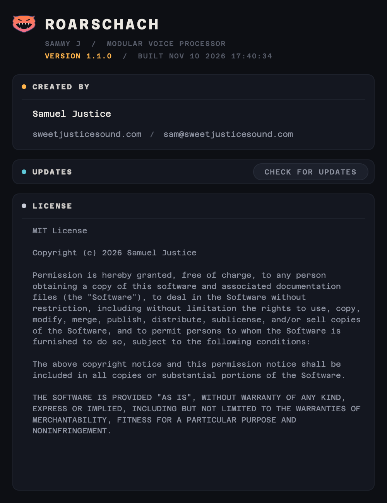

## Quick start

- **Instant creature:** start from a Creatures preset, then set PITCH and SIZE for how big it should be.
- **Big but clear:** "Big Bad Narrator" or "Giant". Keep GROWL and ROAR low and let DETAIL keep every word up front.
- **Gravelly throat:** turn the VOCODER on with GRAVEL at 40–70%, and add some GROWL.
- **Machine voice:** a Machines preset, or turn RING on and try Track Follow at a ratio of ×0.5 or ×1.5.
- **Two voices at once:** "Possessed", or lower MIX to 70–80% so some of the performance stays under the creature.
- **Just more detail:** "Detail Only" brings up breaths and word endings and holds down shouts, with every creature module off.
- **Crunchy and loud:** "Crunch Lift" or "Smashed", or turn OUTPUT's Auto off, set Release to a few milliseconds and raise Push.
- **Weight on small speakers:** raise OVERTONE, or try "Phone Monster".
- **High sample rate recordings:** set PITCH to −12 or −24 st with Formant on Follow to bring the ultrasonic detail down into the voice.
- **Try moving the modules:** load a Signal Flow preset, then choose Reset Chain Order from any module's ••• menu to hear the same settings in the default order.

## System requirements

- macOS 11 or later (Apple Silicon and Intel): VST3 and AU
- Windows 10 or later (64-bit): VST3

## Building

### Prerequisites
- CMake 3.22 or higher
- Xcode Command Line Tools (macOS) or Visual Studio 2022 (Windows)
- JUCE 8.0.8, expected at `../SDK/JUCE` relative to this folder

### Build instructions

```bash
cmake -B build -DCMAKE_BUILD_TYPE=Release
cmake --build build --config Release
```

The plugin is built to:
- VST3: `build/Roarschach_artefacts/Release/VST3/`
- AU: `build/Roarschach_artefacts/Release/AU/`

Options:

- `-DROARSCHACH_FORMATS=Standalone` builds a standalone app instead (handy for UI work), or `-DROARSCHACH_FORMATS="AU;VST3;Standalone"` for all three.
- `-DROARSCHACH_TESTS=ON` builds `RoarschachTests`, an offline test runner that drives the real processor at several sample rates and block sizes:
  - `RoarschachTests` runs every test: parameters, constant latency, exact dry and bypass nulls, the dry's phase match, stereo, click-free module moves in any order, the output ceiling, state round-trip, every factory preset, non-finite input, block sizes, native-rate pitch at 192 kHz, RING and OVERTONE, the editor, and CPU use. `--quick` runs shorter versions, and test names (for example `RoarschachTests latency presets`) run only those. It exits non-zero on a failure.
  - `RoarschachTests --render in.wav outdir [--preset NAME]...` renders a file through factory presets at the file's own sample rate. `--only`, `--without` (module codes such as `GR` or `RM`) and `--order` change the chain for the render.
  - `RoarschachTests --snapshot out.png` writes a picture of the editor, and `RoarschachTests --snapshots folder` writes the window, the chain, menus, a tooltip and a drag, with the creature.

### Installation

- Copy the `.vst3` bundle to `~/Library/Audio/Plug-Ins/VST3/`
- Copy the `.component` bundle to `~/Library/Audio/Plug-Ins/Components/`

## Credits

Created by Samuel Justice, Creative Sound Supervisor at [Sweet Justice](https://www.sweetjusticesound.com).

- UI font: [Azeret Mono](https://github.com/displaay/Azeret), SIL Open Font License 1.1.
- All the signal processing is original, built on [JUCE](https://juce.com).

## License

MIT License. See [LICENSE](LICENSE) for details.
