# Roarschach

A VST3/AU modular voice processor by **Samuel Justice**, built for exploration and fun. One insert holds fifteen modules (pitch and size, a small speaker in a resonant room, clean-up, de-essing, detail, a vocoder, a ring modulator, shimmer, growl, a phaser, tube roar, an ensemble, a top-end tamer, a tracked sub and overtones) that run in any order, between an input stage and a level-matched output with a limiter and a clipper. Use a few lightly for a bigger, wider voice, or stack them into creatures, machines and anything in between.

It comes in [Sammy J's Plugins](https://github.com/samueljustice/plugins/releases/latest), one installer for all of these plug-ins.


## Overview

Roarschach is a chain of fifteen modules. Each has an On switch and can sit anywhere in the chain: drag it by its header, use its **•••** menu, or press Alt+Left / Alt+Right on one of its controls. A move crossfades over 30 ms, so it is click-free while audio plays.

PITCH shifts the voice from two octaves down to one octave up, with Shift, Snap and Mono modes, and SIZE gives it a bigger throat. The audio is never resampled, so at 96 or 192 kHz a two-octave drop brings the recording's ultrasonic content down into the audible band. For texture there is GROWL, which chops the voice into a growl, SHIMMER, a liquid wobble, SWIRL, a sweeping phaser, ROAR, two-stage tube saturation, and ENSEMBLE, a chorus of voices that makes the chain stereo. CHAMBER plays the voice through a small speaker into a tight, resonant room and blends it back under the voice; it has ten bundled rooms, three speakers, speaker breakup, stereo width and a low-end Boom. VOCODER is a 32-band vocoder on a pulse carrier one or two octaves below the voice, and RING is a ring modulator with a fixed or pitch-tracking carrier and a small resonant body. SUB adds a tracked octave below the voice, and OVERTONE turns the low end into overtones so the weight carries on small speakers. The rest keep things under control: CLEAN (tone EQ, a gate and a leveller), DE-ESS, DETAIL (lifts the quiet parts and pushes the loud parts into a soft ceiling) and TAME (holds back harsh top end).

IN brings each take to one working level, and OUTPUT matches the level back to the input; both learn one gain for the take and hold it, and keep it with the session, so a bounce matches what you heard. Then Push drives a true-peak-safe limiter with a clipper after it. Attack and Release set how clean or crunchy the limiting is, and Auto release keeps it clean. MIX blends in the dry voice, phase-matched to the processed one.

Above the chain is an abstract ink blot drawn in OpenGL. It gathers out of lit cloud when the voice comes in, swirls and tears open with it, ripples on hits and dissolves back into smoke when it stops. Every module leaves its own trace on it, every session grows a different one, it slowly evolves with sustained intensity, and its clouds drift towards a colour that suits your settings. The whole window takes that colour with it: the paper behind the controls and their one accent colour follow the cloud, while the text, knobs and marks stay in near-black ink.

There are three kinds of dice: one loads a random factory preset, one rolls a whole new creature, and one on each module rolls just that module, always inside each knob's useful range. A module can be held so that a full roll leaves it alone, and every roll can be undone. There are 51 factory presets (Init plus six groups: Creatures, Voices, Machines, Signal Flow, Vocoder, Utility), and SAVE stores your own as plain files that are easy to back up and share. Every parameter, the module order, the preset name and the window size are saved with your session, and the factory presets are exposed to the host as programs.

The window scales from 65% to 125% by dragging its corner (never larger than the screen). A new window opens as large as the display comfortably allows, and the size you choose is remembered. Latency is constant at about 46 ms (2192 samples at 48 kHz), the same for every setting and every module order, and is reported to the host so it is compensated. Host bypass stays in time and switches without clicks. It runs mono or stereo, with full DAW automation; in the host every parameter is named with its module first (PITCH Size, ROAR Drive), so each automation lane says where it belongs.

## How it works

The voice comes in through **IN**, runs through the fifteen modules (two rows of eight in the window, read left to right, top row first) and leaves through **OUTPUT**. IN and OUTPUT always stay at the ends; everything between them can move.

The default order, and what each module does:

| # | Module | What it does |
|---|---|---|
| 1 | **PITCH** | Shifts the pitch of the voice and, separately, the size of the throat (the formants). Lower and bigger is a bigger creature. A tube drive after the shift adds warmth or grit. |
| 2 | **CHAMBER** | Plays the voice through a small speaker into a tight, resonant room and blends it back under the voice: an edge and a sense of size, or the voice inside a box, a booth or a can. Off by default. |
| 3 | **CLEAN** | A voice channel strip: a tone EQ, a gate that closes on room noise between words, and a leveller that evens out the level and catches peaks. |
| 4 | **DE-ESS** | Softens harsh S and T sounds. |
| 5 | **DETAIL** | Lifts the quiet parts (breaths, consonants, word endings) a long way while the loud syllables stay where they are, and pushes the loud parts into a soft ceiling. |
| 6 | **VOCODER** | A 32-band vocoder whose carrier is a buzz one or two octaves below the voice: a gravelly machine voice under the words. Off by default. |
| 7 | **RING** | A ring modulator: metallic sidebands from a carrier at a fixed frequency or at a ratio of the voice's pitch, with an optional small resonant box around it. Off by default. |
| 8 | **SHIMMER** | A copy of the voice shifted by a few hertz beats against the voice: a liquid wobble. |
| 9 | **GROWL** | Chops the voice's level many times a second, the rough flutter of a growl. |
| 10 | **SWIRL** | A phaser that sweeps notches up and down the voice. |
| 11 | **ROAR** | Two-stage tube saturation with a tone stack between the stages: warm at first, gritty and dense when pushed. |
| 12 | **ENSEMBLE** | A chorus of three or six voices that spreads to the sides. It makes the chain stereo. |
| 13 | **TAME** | Holds back the harsh top end, only when it gets loud. |
| 14 | **SUB** | An octave below the voice that follows its pitch. |
| 15 | **OVERTONE** | Turns the low end into overtones, so its weight can be heard on speakers that cannot play it. |

Where a module sits changes the sound. CHAMBER after PITCH puts the pitched voice in the room; after ROAR it is an amp into a cabinet; last, it puts the whole creature in the room. ROAR before GROWL drives the voice and then chops it; ROAR after GROWL distorts the chopped voice. SUB before ROAR sends the octave through the tube, so its rumble gets harmonics locked to the voice. The VOCODER late in the chain vocodes everything before it. The Signal Flow presets each show one of these placements.

The chain is mono up to the first module that makes stereo: ENSEMBLE, SHIMMER in Stereo mode, or CHAMBER with WIDE above 0%. An **ST** tag at the end of that module's footer marks the point.

### Moving modules

- **Drag** a module by its header. While you hold it, the other tiles slide aside to show where it will land. Press Escape to cancel.
- **The ••• menu** in the header: Move to Start, Move Earlier, Move Later, Move to End, Move After (any other module), Turn Off / Turn On, and Reset Chain Order (back to the default order above).
- **The keyboard**: with one of a module's controls focused, Alt+Left moves it one place earlier and Alt+Right one place later.

The order is saved with the session and with presets, and the host can automate it. The fourteen modules other than CHAMBER each have a position parameter, 1st to 14th, that counts only those fourteen; CHAMBER's position parameter is the place it is inserted among them (before 1st, after 1st, ... after 14th). The tiles number all fifteen, so for a module after CHAMBER the host shows one place lower than its tile.

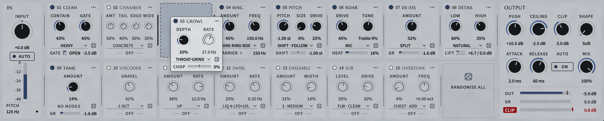

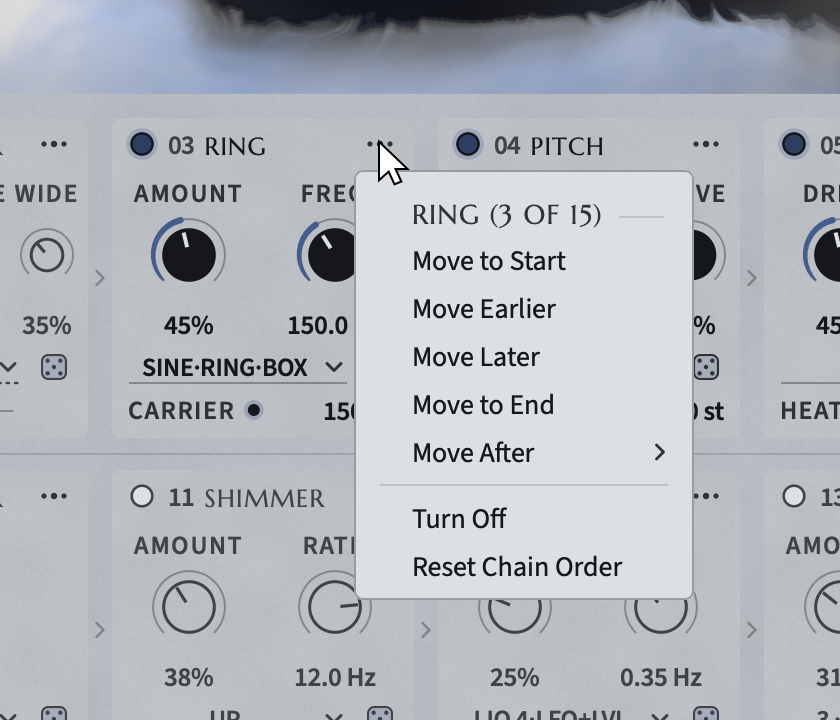 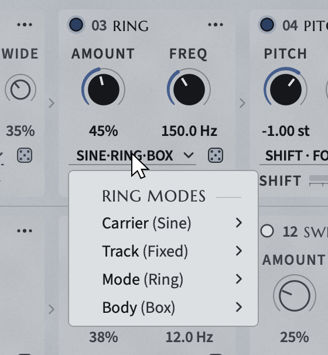

### The output stage

OUTPUT always ends the chain. In order, it:

1. **Matches the level** of the processed voice to the input, so turning modules on and off does not make the voice much louder or quieter. It learns what the modules do to the level of the voice and then holds that one gain: it does not ride the level, does not duck after a loud sound and leaves what CLEAN's leveller and the other dynamics do. After a settings change it follows only once the voice has shown a clear difference. The **MATCH** switch at the top of the OUTPUT tile (Level Match in the host, on by default) switches it off. The matching never drives the voice into the ceiling by itself: that is Push's job.
2. **Pushes** the voice by up to +24 dB. Push is measured against the ceiling, so lowering the Ceiling lowers the output without driving the limiter harder.
3. **Mixes** in the dry voice at the same loudness as the processed one (the dry is pushed too, and the blend follows how alike the two are, so a processed voice close to the dry adds no level at mid Mix), so the limiter and the clipper hold the ceiling at any Mix and Mix changes the character, not the level. The blend is judged over the last 0.4 s, so on a chain that follows the dry on vowels but not on esses (heavy drive, the vocoder) an ess straight after a loud vowel can sit up to about 3 dB under at mid Mix: a mild de-essing.
4. **Limits** at the **Ceiling** with a look-ahead limiter. More Push is louder and denser; the peaks never pass the ceiling, which is true-peak safe.
5. **Clips** what the limiter leaves for it. **Clip** sets how many dB of each peak above the ceiling are clipped instead of limited (Off by default), and **Shape** sets the clipper from Soft (rounded peaks) to Hard (flat peaks, brighter and more aggressive). The clipper is oversampled, so it does not add aliasing.

**Attack and Release decide whether the limiting is clean or crunchy.** When the limiter's gain recovers quickly enough to move between the peaks of a low note's waveform, it turns that waveform's every peak down a little and lets it back up in between. That reshapes the low end and adds a dense, buzzy distortion on top of the voice: maximizer crunch, which sounds big on roars and impacts.

- **Release** sets how much crunch there is. Very short releases (2 to 10 ms) let the gain follow the bass and crunch clearly; 25 to 60 ms is gritty; from about 200 ms up it is clean.
- **Attack** sets which frequencies can crunch. The limiter starts turning down this long before each peak, and only notes whose waveform peaks are further apart than that can crunch: roughly everything below 1 / (2 × Attack). At 2 ms (the default) that is everything below about 250 Hz, the whole low end of a creature voice; at 5 ms only the lowest notes; at 10 ms almost nothing. 0.3 to 3 ms is the crunchy range. Shorter attacks are also punchier on transients.
- **Auto** (on by default) adapts the release to the material and holds the gain steady between bass peaks, so the low end stays clean whatever the Attack. Release still sets how quickly Auto breathes, across its whole range. Turn Auto off to use Release directly.

**The learnt levels are kept.** What IN, ROAR and the level match have learnt is kept when playback stops and saved with the session, so a region plays the same from wherever playback starts and a bounce matches what you heard. They are learnt on the first play of a take: play it through once, loudest part included, before bouncing. A preset starts from a match measured on dialogue, so the first play is already close. A settings change during playback is heard as it is until the match has heard enough of the voice to weigh it.

For crunch, turn Auto off, set Release to a few milliseconds, and raise Push until you hear it. Lower Mix to blend the crunched voice with the clean one. The Utility presets Crunch Lift and Smashed are starting points.

### Native sample rate

Roarschach runs at the host's sample rate and never resamples the audio. PITCH reads the input at that rate through a long, high-quality interpolator, and nothing before PITCH in the default order cuts the top end. So at 96 or 192 kHz, a −12 or −24 st shift with Formant on Follow brings the recording's ultrasonic content down into the audible band: at 192 kHz, a 40 kHz component lands at 10 kHz cleanly. This is the point of recording creature performances at high sample rates, and PITCH's range goes down to −24 st for it. OUTPUT's gentle low-pass at 18 kHz, after the chain, is the only fixed top cut.

## Controls

Every control has a tooltip: hover over it to see what it does, and where its useful range is. A knob the current settings do not use is dimmed, and still turns (SHIMMER's Rate at Amount 0, for example, or GROWL's Rate with the Throat shape); one that does only a little is half-dimmed. A module that is Off shows a hollow light, open knobs and OFF in its footer. The footer of each module shows what the module is doing right now (hover over it for an explanation). The die beside the mode chip rolls the module, and the ••• button moves it.

**Knobs.** Drag a knob up and down; hold Shift while dragging for fine control (a tenth of the travel, and on PITCH under half a cent a pixel). Shift can be pressed or let go in the middle of a drag without a jump. The mouse wheel moves a knob in steps that land on round values:

| Knob | Wheel step | With Shift |
|---|---|---|
| PITCH (semitones) | 1 st | 1 cent |
| Percent | 1% | 0.1% |
| Decibels | 0.5 dB | 0.1 dB |
| Octaves (OVERTONE Freq) | 0.05 oct | 0.01 oct |
| Hz, ratio, ms | 1% of the travel | 0.1% of the travel |

Right-click a knob for **Reset to Default** (it shows the default, and is greyed out when the knob is already there) and **Type a Value**; where the host offers its own options for the parameter, they follow under a HOST heading. Double-click also resets a knob.

**Mode chips.** The chip under the knobs opens one list with all of the module's choices, each under a heading such as SWIRL CIRCUIT and SWIRL MOTION, the current ones ticked. To step the first choice the chip shows without opening the list, scroll over the chip, or move to it with Tab and press Up or Down. It stops at either end.

**Solo.** Alt-click a module's On switch to hear it alone: every other module goes off. Alt-click it again to turn back on the modules that were on. Alt-clicking another module's switch moves the solo there. The modules that were on are remembered until another preset or the session is loaded; after that, Alt-click starts a new solo. The switches change as one edit, so the host records one step per click.

**Names in the host.** Each parameter's name in the host starts with its module: PITCH Size, ROAR Drive, ENSEMBLE Width, OUTPUT Clip Shape, IN Gain. A host that shows short names gets the longest form that fits, such as PI Size.

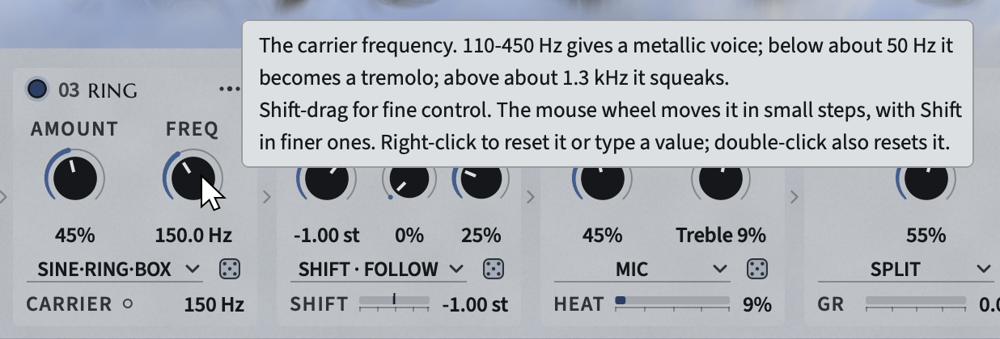

### The dice

Three kinds of die roll new settings: one beside the preset name, one after the last module, and one on every module.

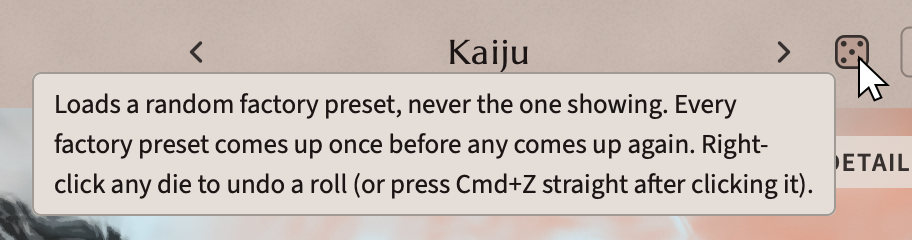

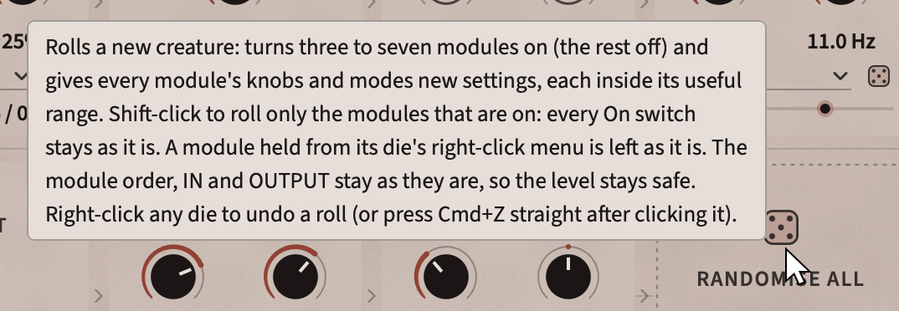

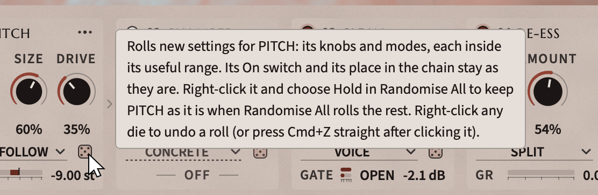

Each roll is one step you can take back: right-click any die for **Undo** and **Redo** (with the keyboard, Shift+F10 on a die opens the same menu), or press Cmd+Z (Ctrl+Z on Windows) straight after clicking a die, and Shift+Cmd+Z (Shift+Ctrl+Z) to redo. Once you use another control, these keys go back to the host's own undo; some hosts keep them for themselves anyway, and the right-click menu always works. Undo takes back only what the roll changed, and a knob you turned afterwards stays where you put it, even one the roll had changed. A preset loaded from the preset bar (the list, the arrows or the preset die) is a step in the same history (see [Presets](#presets)); a preset or session loaded any other way, from the host's program list or a session recall, even the same one again, ends it. The host sees every control a roll changes, so it records the roll and its automation follows.

- **Random preset** (the die beside the preset name): loads a random factory preset, never the one showing. Every factory preset comes up once before any comes up again.
- **Randomise all** (the die after the last module): a new creature. It turns three to seven modules on and the rest off (at least two of them ones that change the voice, not only CLEAN, DE-ESS, DETAIL and TAME), and gives every module's knobs and modes new settings. A dot appears after the preset name, as for any edit. **Shift-click** it to roll new settings for the modules that are on only: every On switch, and every module that is off, stays as it is.
- **A module's die** (beside its mode chip): new settings for that module's knobs and modes only. Its On switch and its place in the chain stay as they are.
- **Hold in Randomise All**: right-click a module's die and choose it to keep that module (its On switch and its settings) as it is when Randomise All rolls the rest. A held die carries a small ink pin on its corner. Held modules that are on count towards the three to seven. The holds are saved with the session and stay through preset loads; they are not parameters, so the host does not record them.

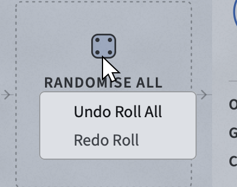

One RANDOMISE ALL roll from the Big Bad Narrator preset. Before, PITCH, CHAMBER, CLEAN, DE-ESS, DETAIL, ROAR, TAME, SUB and OVERTONE are on; after, CLEAN, VOCODER, RING, GROWL, ENSEMBLE and SUB are, every module has new settings, a dot follows the preset name, and the ink blot has taken a new shape and the window a new colour. The module order, IN and OUTPUT are as they were.

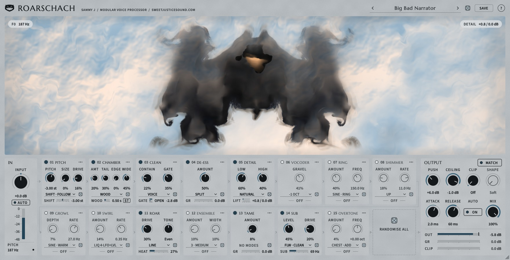

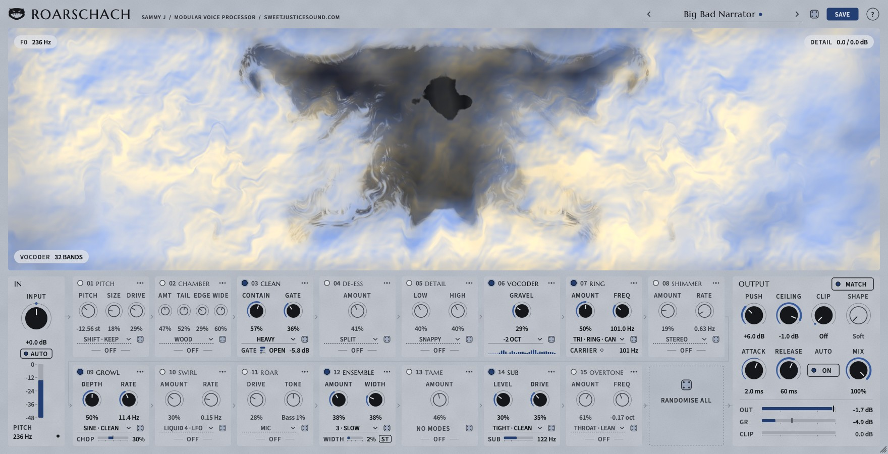

A roll only lands where a knob is useful: each knob rolls inside the range the [parameter audit](docs/parameter-audit.md) found usable, never into its dead or harmful ends (PITCH −14 to −2 st, Swirl up to 50% and its Deep 6 circuit up to 30%, Ring Freq 60–450 Hz, Chamber 15–65%, and so on), and each mode is picked evenly from its options (Boom leaves out Heavy). The dice never move a module or touch IN or OUTPUT, so the level stays safe: on five real voice takes, 200 rolls each, 998 of the 1,000 rolls played within 3 LU of Init (the other two 3.0 and 3.8 LU quieter), and none went over the ceiling. Knobs glide to their new values and modules fade in and out, so a roll does not click while audio plays.

The close-ups below are from the Kaiju preset; RING and OUTPUT are from Cyber Commander, and the CHAMBER tiles from the presets named under them. Every knob's travel was measured on real voice recordings and mapped so that all of it does something; the measurements are in [docs/parameter-audit.md](docs/parameter-audit.md).

### IN

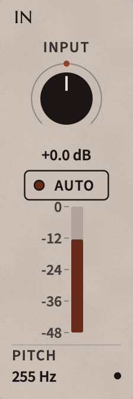

| Control | Range | Default | Description |
|---|---|---|---|
| **Input** | −24 to +24 dB | 0 dB | Level into the plug-in, before everything else. With Auto on, it raises or lowers the levelled voice by half as much. |
| **Auto** | on / off | On | Brings any voice to the same working level, so every module reacts the same way to a quiet or a loud take. It learns one gain per take from the performance itself (not from room tone, hum or noise before it) and holds it, so a whisper stays a whisper and a roar a roar; OUTPUT takes the same gain back. Turn it off and on again to learn a new take. |

The meter shows the input level and the readout the voice's pitch. A stereo input is summed to mono here.

Auto holds one working level per instance, set by the loud end of what it has heard: it turns down when a louder passage arrives, and once learnt it does not turn up again by itself. On a track that carries several takes at different levels, the loudest of them sets the gain for all; turn Auto off and on to learn again from the next one, or use one instance per take. A take heard only as unpitched sound (breath, hiss, a whispered rasp) is raised by at most 12 dB until some pitched voice comes in.

### PITCH

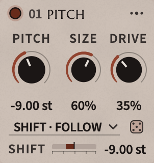

| Control | Range | Default | Description |
|---|---|---|---|
| **Pitch** | −24 to +12 st | −2 st | How far the voice is shifted, in semitones. −2 to −4: a bigger human; −5 to −9: a creature; −10 to −14: a monster (add Size, or Formant Keep to hold the words). Below −15 the words blur with Follow; above +6 the throat stops following. In Mono mode it sets the note held (0 st = C3). |
| **Size** | 0 to 100% | 0% | Makes the throat bigger: lowers the formants and adds body. With Pitch below −18 st and Follow, the throat is already at its lowest, so Size only adds body. |
| **Drive** | 0 to 100% | 1% | Tube drive after the shift: up to about 25% warmth, 35–70% grit, 100% heavy. |
| **Mode** | Shift / Snap / Mono | Shift | Shift moves the voice by the set interval. Snap also lands each note on the nearest semitone. Mono holds the voice on one note, set by Pitch (0 st = C3). |
| **Formant** | Follow / Keep | Follow | Follow moves the throat with the pitch, for a bigger or smaller creature. Keep leaves the throat where it is, so only the pitch changes. |

PITCH moves each word start and plosive once, cleanly, and leaves silence silent after a start or a reset. In Keep, rough and breathy sound (growls, croaks, breath, weak consonants) moves with the pitch too, while esses stay where they are; at large shifts a rough voice can flutter in tone between its pitched and unpitched parts. Modules that follow the voice's pitch after PITCH (the VOCODER, RING Follow, SUB, OVERTONE Tracked and GROWL Throat) take each phrase's pitch in time with the shifted voice.

### CLEAN

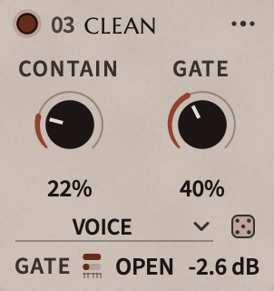

| Control | Range | Default | Description |
|---|---|---|---|
| **Contain** | 0 to 100% | 22% | Evens out the level and catches peaks before the creature stages. It starts working at the bottom of the travel. |
| **Gate** | 0 to 100% | 47% | Closes on room noise between words; higher settings close further and harder. 25–40% suits dialogue. |
| **Tone** | Flat / Voice / Heavy / Radio | Voice | The voice EQ. Flat leaves the voice as it is, Voice cleans up the low mids, Heavy cuts the boom and low mids hard for a tight, forward chest (it thins the lows), Radio is a narrow, lo-fi band. |

The gate closes on room tone that sits at least 30 dB under the loud part of the take. A noisier recording than that is only partly reduced at the default; raising Gate closes further but starts to take the quiet edges of words. Clean a very noisy recording before it reaches the plug-in.

### DE-ESS

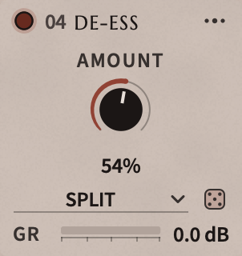

| Control | Range | Default | Description |
|---|---|---|---|
| **Amount** | 0 to 100% | 51% | How far sibilance is turned down: about 5 dB at 25%, 9 dB at 50%, 15 dB at 75% and 20 dB at 100% on a normal ess. It follows the voice: a steady rasp or hiss passes, an ess that jumps out is caught. |
| **Mode** | Split / Wide | Split | Split dips only the top of the voice, from about 3 kHz up. Wide turns the whole voice down for the length of the ess, which also tames lisps and mouth noise but dips the words; if the sound lasts longer than a third of a second Wide lets go, so it never sits on a long hiss. |

DE-ESS dips a shelf only while an ess sounds and lets go within about 20 ms, so the vowel after it keeps its brightness. It measures how bright the voice normally is over the last couple of seconds and acts on sounds that jump above that, so a breathy or rasping performance keeps its top end. A sound as bright as an ess is always treated as one, however long it lasts, so a pure hiss is turned down. Above about 75% it reaches into a steady rasp too (2 to 4 dB at 75%, 5 to 11 dB at 100%), and at 100% speech loses some vowel brightness above 3 kHz (3 to 6 dB).

When a rasp follows speech with no pause, its first half second is dipped by about 4 to 5 dB at the top while DE-ESS learns that this is the voice now. An ess straight after a long rasp, or the first ess after playback starts, is reduced a little less than usual (7 to 8 dB instead of 9 to 10 at 50%).

### DETAIL

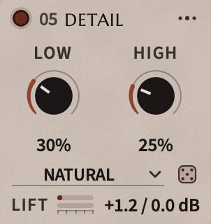

| Control | Range | Default | Description |
|---|---|---|---|
| **Low** | 0 to 100% | 25% | Lifts the quiet parts (breaths, consonants, tails) while the loud syllables stay where they are. 40–60% is a clear lift; it never lifts the room tone the gate is taking out. |
| **High** | 0 to 100% | 19% | Pushes the loud parts up into a soft ceiling: denser and more forward. 30–60% is a strong, even level. |
| **Speed** | Natural / Snappy | Natural | How quickly the level follows the voice. Natural is smooth; Snappy recovers faster and sounds more lively. |

DETAIL leaves the room tone between lines alone, so it lifts the voice, not the noise floor. On pitched sound it follows the syllable rather than each cycle of the voice, so low notes (and a voice after PITCH down or SUB) come through clean.

### VOCODER

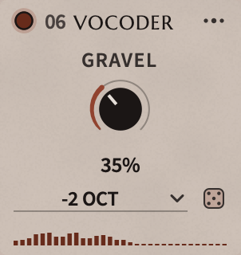

| Control | Range | Default | Description |
|---|---|---|---|
| **Gravel** | 0 to 100% | 41% | How much of the pulse-carrier vocoder is heard. About 30% is gritty with the words fully intact; about 70% is a dominant buzz. |
| **Octave** | −1 Oct / −2 Oct | −1 Oct | Register of the vocoder's pulse carrier: −1 Oct is low and buzzy, −2 Oct lower and rougher. The filter bank keeps its weight above the deepest bass. |

Esses and breath come out of the vocoder at the level they went in, level with the vowels, at every Gravel setting.

### RING

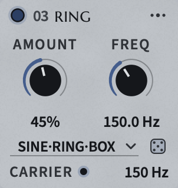

| Control | Range | Default | Description |
|---|---|---|---|
| **Amount** | 0 to 100% | 40% | How much of the ring-modulated voice is heard. About 20% adds a metallic edge, 50% is an equal metallic blend, 100% is pure ring. |
| **Freq** (Track Fixed) | 20 Hz to 4 kHz | 150 Hz | The carrier frequency. 110–450 Hz gives a metallic voice; below about 50 Hz it becomes a tremolo; above about 1.3 kHz it squeaks. |
| **Ratio** (Track Follow) | ×0.25 to ×4 | ×1.00 | The carrier as a multiple of the voice's pitch. Whole-number ratios stay in tune with the voice; in-between ratios clang; below ×0.35 it chops. |
| **Carrier** | Sine / Triangle / Square | Sine | The carrier waveform. Sine is smooth, Triangle a softened sine, Square buzzy and hard. |
| **Track** | Fixed / Follow | Fixed | Fixed holds the carrier at one frequency. Follow moves it with the voice's pitch. |
| **Mode** | Ring / AM | Ring | Ring removes the original pitch and leaves only the metallic sidebands. AM keeps the original voice and adds the sidebands around it. |
| **Body** | Off / Box / Can | Off | Puts the voice inside a small resonant box. Box is a hard, hollow enclosure; Can is smaller and more metallic. |

The second knob is Freq when Track is Fixed and Ratio when Track is Follow.

### SHIMMER

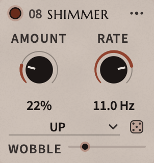

| Control | Range | Default | Description |
|---|---|---|---|
| **Amount** | 0 to 100% | 18% | A liquid wobble: a copy of the voice moved a few hertz beats against the voice. 15–30% is a subtle layer; 90–100% a full wobble. |
| **Rate** | 0.5 to 25 Hz | 11 Hz | How fast the wobble beats. 0.5–2 Hz is a liquid swell, 3–9 Hz a warble, 13 Hz and up rough. |
| **Mode** | Up / Down / Up+Down / Stereo | Up | Which way the copy is moved. Up and Down wobble differently, Up+Down uses both, Stereo puts one on each side (summed to mono, Stereo wobbles less). |

### GROWL

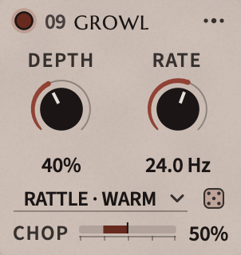

| Control | Range | Default | Description |
|---|---|---|---|
| **Depth** | 0 to 100% | 25% | How deeply the voice is chopped. 15–35% adds texture; 45–100% is an obvious growl. |
| **Rate** | 2 to 150 Hz | 27 Hz | The average rate of the pulses. 5–7 Hz stutters, 20–35 Hz growls, 60–100 Hz buzzes. Not used by the Throat shape. |
| **Shape** | Sine / Opto / Square / Throat / Rattle | Sine | Sine is smooth, Opto pulses like a lamp, Square switches hard. From about 10 Hz up, each cycle of these three differs a little in length and depth, so the result is a rough voice rather than a steady chop; slower settings are a regular tremolo. Rattle speeds up as the voice gets louder. Throat locks to half the voice's pitch (Rate is not used). |
| **Character** | Clean / Warm / Grind | Warm | How much the pulse distorts the tone. Clean only changes the level, Warm rounds the low end, Grind adds a gritty edge. Grind has a ceiling: at working level it is as loud as Warm, while a very hot voice comes out 3 to 5 dB under Warm and a very quiet one 1 to 2 dB over. |

### SWIRL

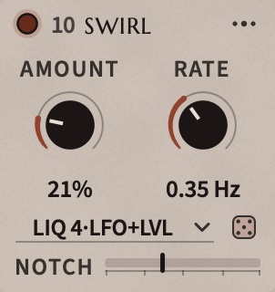

| Control | Range | Default | Description |
|---|---|---|---|
| **Amount** | 0 to 100% | 21% | How much of the sweeping phaser is mixed in. |
| **Rate** | 0.05 to 10 Hz | 0.35 Hz | How fast the phaser sweeps. 0.15–0.5 Hz is slow and liquid, 1–2.5 Hz animated, 4 Hz and up a warble. |
| **Circuit** | Liquid 4 / Smooth 4 / Talky 4 / Deep 6 / Deep 12 / Dark 5 | Liquid 4 | The phaser's circuit: how many notches it has and how deep they cut, from a liquid four-stage to a dense twelve-stage sweep. Deep 6 holds its level over the whole Amount travel. |
| **Motion** | LFO / LFO+Level / Random | LFO+Level | What moves the sweep. LFO is steady, LFO+Level sweeps further on loud words, Random wanders. |

### ROAR

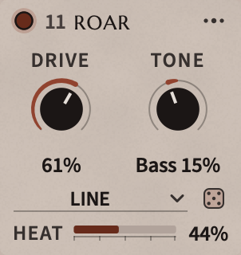

| Control | Range | Default | Description |
|---|---|---|---|
| **Drive** | 0 to 100% | 45% | Tube saturation. 25–45% gives warmth and presence; 70–100% grit. Drive changes the tone, not the level: ROAR learns the level for each setting and holds it. |
| **Tone** | Bass 100% to Treble 100% | Treble 3% | Tilts what the tube drives harder: the bass or the treble. It works at any Drive. |
| **Voicing** | Line / Mic | Line | Line drives the tube flat. Mic first trims the boom and the air, as from a close microphone. |

ROAR learns one makeup gain for the setting it is on, from the loud end of the voice going in against what comes out, and then holds it. Within a line, loud words are still pushed harder into the tube than quiet ones. The learnt gain is saved with the session.

The first time a take plays at a new Drive, Tone or Voicing, ROAR is learning: the level settles over the first seconds, and again when the take reaches a louder passage than it has shown so far. From the second pass the gain does not move, and a region, a punch-in or a bounce matches playback, so play the loudest part of the take once before committing. Moving Drive by more than 2% (Tone by 4%) starts a new learn, and so does changing anything before ROAR in the chain (Input, Auto, or a module before it switched, edited or moved); it holds its current level while it learns. While Drive is automated the gain holds, and afterwards it settles over the following seconds of the take: a quick step of up to about 2.5 dB after a large move, then, on that pass only, a slow ride of up to about 2 dB.

At high Drive the tube compresses: quiet passages, breaths and room tone between loud words come up (a passage 20 dB down rises about 4 dB at 80% and 7 dB at 100%), so gate before ROAR if that matters. Through Push, a driven ROAR can read up to about 1 LU louder than the dry voice on dense material such as screams and rasp; the level match takes that up.

### ENSEMBLE

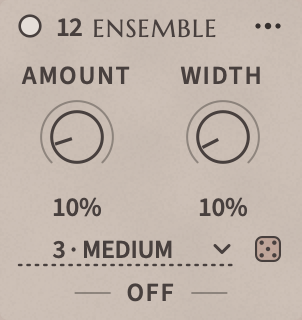

| Control | Range | Default | Description |
|---|---|---|---|
| **Amount** | 0 to 100% | 10% | How much of the chorus of voices is mixed in. The chorus works above about 120 Hz; below that the voice passes straight through, so the low end stays solid. |
| **Width** | 0 to 150% | 10% | How far the chorus spreads to the sides. Past about 100% the chorus thins when the mix is summed to mono. Width is held back whenever the chorus's sides would outweigh the voice in the middle, so the image never turns out of phase. |
| **Voices** | 3 / 6 | 3 | How many voices sing along: 3 is tight, 6 is a crowd. |
| **Motion** | Slow / Medium / Fast / Vibrato | Medium | How the voices drift. Slow, Medium and Fast set the movement; Vibrato makes them waver in pitch. |

Below about 60 Hz the voice stays mono, narrowing from 120 Hz down. The width is held back sooner at high Amount with wide settings, on bright or noisy voices and with Vibrato. Vibrato on a low voice can sit about 1 dB under the dry level. With six voices on a low sustained note (about 100 to 120 Hz), a mono fold can dip deeply for a moment as the voices sweep through the low crossover; three voices are steadier there.

### TAME

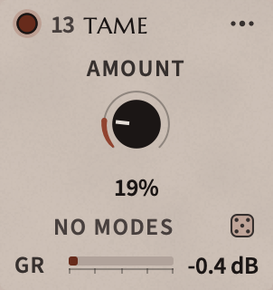

| Control | Range | Default | Description |
|---|---|---|---|
| **Amount** | 0 to 100% | 6% | Holds back harsh top end when it jumps out. Low settings leave a bright voice alone; higher settings hold back its loud moments, then its whole top end. |

TAME watches the top two bands (2.5 to 6.5 kHz, and above 6.5 kHz) and holds them back when they jump out: harsh consonants, a scream's edge, the fizz of a driven stage. It compares each band with its usual share of the voice, so a performance that is bright all the way through keeps its top end at low settings, also when it gets louder. Below about 7% it does not act on a voice simply because it is loud, so a screech keeps its edge there. From about 7% to 25% it turns to the voice's usual level as well, the loud moments first: a swell 10 dB above the usual level loses about 8 dB at 25%, the sound between swells about 3. Higher settings reach further in: a steady rasp is down 5 to 8 dB at 25%, 10 to 13 dB at 50% and 17 to 20 dB at 100%. To hold a scream's top back, use 15 to 25%.

### SUB

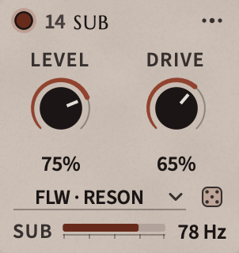

| Control | Range | Default | Description |
|---|---|---|---|
| **Level** | 0 to 100% | 49% | How much of the octave layer is added. 40–65% is a solid octave. It follows the voice's own level: at the default it sits a little under the voice at most. With Overtone in Replace, Sub Level also adds weight through the overtones. |
| **Drive** | 0 to 100% | 20% | Drive on the octave. Up to about 20% it stays clean; above that it gets thicker and growlier. |
| **Register** | Follow / Tight / Deep | Follow | Where the layer sits. Follow is one octave under the voice. Tight is one octave under, kept at 55 Hz or above. Deep goes as many octaves under the voice as it takes to land between about 46 and 131 Hz: a true sub under any voice, howls and screeches included. |
| **Character** | Clean / Resonant / Thick | Clean | The octave's colour. Clean is a pure low tone, Resonant rings and drives harder, Thick adds a second, fuller layer. |

The readout shows the layer's frequency. Each phrase after a pause (about 150 ms without a voiced pitch, breaths and noise included) picks its octave from its own pitch, so a line plays the same wherever playback starts from a pause. The Level figure is for a phrase as a whole: the layer rings a little longer than the voice, so at the very start and end of a sound it can be the louder of the two for a moment, and with Drive turned up its added harmonics can lift it slightly past the voice. SUB followed by a strong OVERTONE can add up to slightly more than the voice, since each module limits its own layer.

### OVERTONE

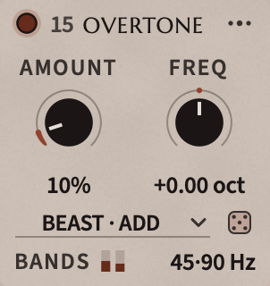

| Control | Range | Default | Description |
|---|---|---|---|
| **Amount** | 0 to 100% | 4% | How much of the overtone layer is added. The overtones let the voice's weight be heard on small speakers without adding more bass. In Add the layer starts to be heard from about a third of the way up; in Lean and Replace the original low end is cut more as Amount rises. The layer never comes out louder than the voice. |
| **Freq** | −1 to +1 oct | 0 oct | Moves the overtone bands up or down together. Higher translates better to small speakers; lower is warmer. |
| **Pattern** | Chest / Throat / Beast / Speaker / Broad / Tracked | Chest | Which low regions are turned into overtones. Chest: body and octave. Throat: gruff upper growl. Beast: hollow, odd-heavy snarl. Speaker: high overtones for small or radio-like creatures. Broad: one wide low band. Tracked: follows the voice's pitch exactly. |
| **Mode** | Add / Lean / Replace | Add | Add keeps the original low end. Lean lowers it. Replace removes it, so the low end is heard only through its overtones. |

Chest, Throat, Beast, Speaker and Broad are fixed sets of bands. With a higher voice a set moves up by whole octaves (two at most), so it still has something to work on on howls and higher voices; the readout shows where the bands are. The octave is chosen at the start of each phrase and moves inside a phrase only when the voice has clearly left it, so playing from the middle of a phrase can give a different octave from playing the whole line: bounce from a pause. Tracked follows the pitch itself and suits very high voices.

Placed after SUB (the default), OVERTONE also makes SUB's octave audible on small speakers.

### CHAMBER

CHAMBER plays the voice through a small speaker into a tight, resonant room, then blends it back under the untreated voice. A little gives a voice an edge and a sense of size; more puts it inside a box, a booth or a can. The rooms are small and ringing, not a hall reverb. CHAMBER is Off by default (and in sessions saved before it existed), and sits right after PITCH.

| Control | Range | Default | Description |
|---|---|---|---|
| **AMT** (CHAMBER Amount) | 0 to 100% | 50% | How much of the voice played into the room is blended under the dry voice. 15–35% adds a subtle edge, 45–65% is a clear chamber; around 80% the two are equal; at 100% the room leads. |
| **TAIL** (CHAMBER Resonance) | 0 to 100% | 40% | How much the room rings after each sound. Lower is tight and boxy; higher lets its resonances sustain longer. The level stays the same. |
| **EDGE** (CHAMBER Edge) | 0 to 100% | 30% | Drives the small speaker into breakup: grit at 15–35%, a cranked speaker at 50–70%, torn and buzzing towards 100%. Heard once AMT is about 60% or more. |
| **WIDE** (CHAMBER Width) | 0 to 100% | 35% | How far the room spreads to the sides. 0% keeps it centred; 100% is the room's full stereo. Summed to mono it sounds the same at any setting. |
| **Room** | 10 rooms (below) | Concrete Room | The room the speaker plays into. |
| **Speaker** | Tiny / Small / Horn | Small | The speaker the voice is played through. Tiny is thin and nasal, Small a compact full-range box, Horn a narrow, honking paging horn. |
| **Boom** | Off / Light / Medium / Heavy | Light | Low-end weight added after the whole chain, a shelf at 110 Hz: Light +3 dB, Medium +6 dB, Heavy +9 dB. |

The names in brackets are the ones the host shows. The mode chip shows the room; click it for one list with the rooms, the speakers and the Boom settings under their own headings, the current choices ticked (the wheel over the chip steps the room). When CHAMBER is on, its footer shows the room and how long it rings at the current TAIL.

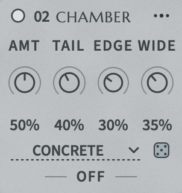 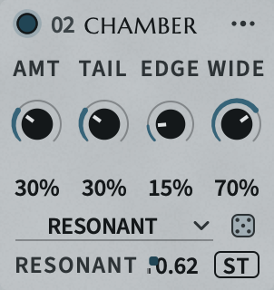 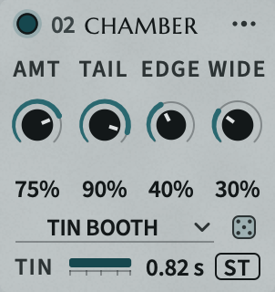 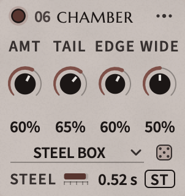

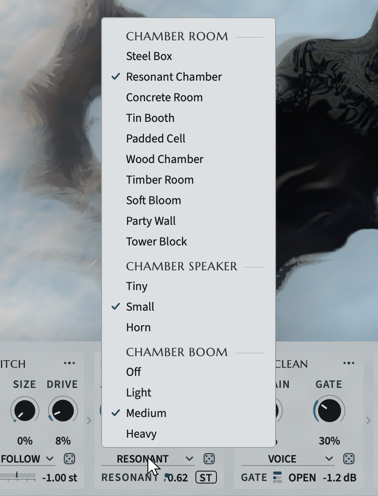

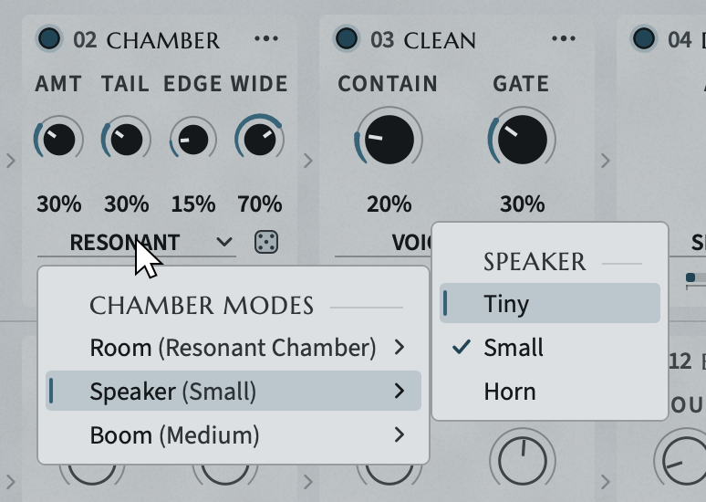 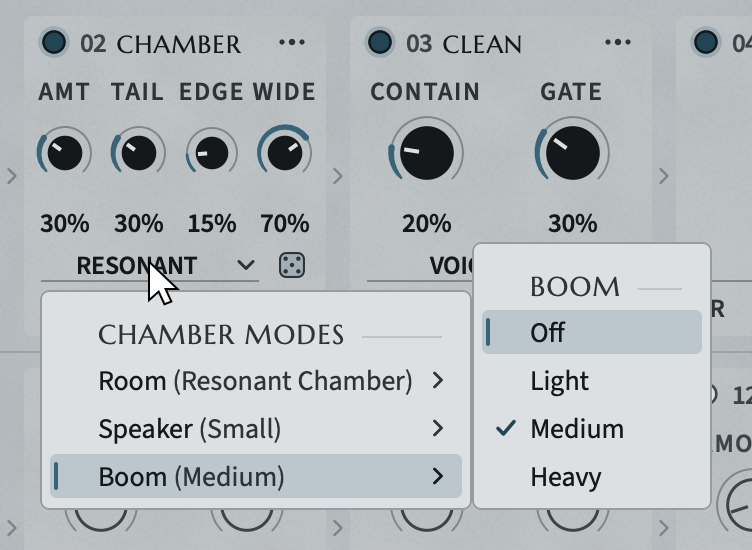

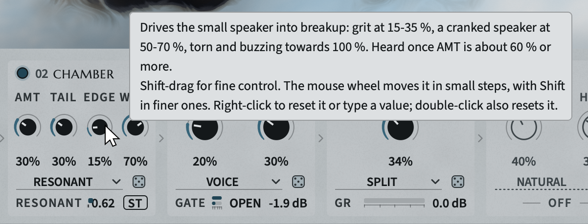 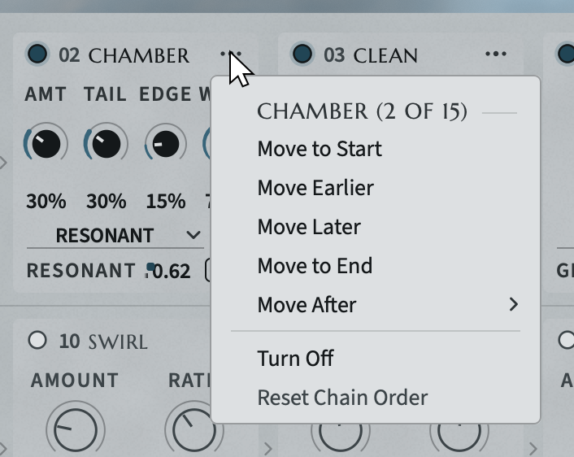

| Room | Character | Decay (about) |
|---|---|---|
| **Steel Box** | Bright and metallic | 0.4 s |
| **Resonant Chamber** | Long and ringing | 0.7 s |
| **Concrete Room** | Hard and dense | 0.6 s |
| **Tin Booth** | Thin, with a sharp ring | 0.5 s |
| **Padded Cell** | Dark and short | 0.35 s |
| **Wood Chamber** | Warm | 0.55 s |
| **Timber Room** | Sparse and soft | 0.55 s |
| **Soft Bloom** | A diffuse swell, with almost no ring | 0.2 s |
| **Party Wall** | A big concrete room heard through the wall: dark and booming | 0.8 s |
| **Tower Block** | Further down the hall: darker still, a low body that hangs | 0.8 s |

The decays are at Resonance 40%, which plays each room as captured; Resonance stretches them to about half or up to 1.6 times (as far as each room allows). The rooms are small: the ring ends within about 0.4 to 0.7 s. For a long space, follow the plug-in with a reverb.

Every room has headroom at every setting: each was measured at the extremes of every CHAMBER control, in every position in the chain and in every preset that uses it, and none clips or gets past OUTPUT's ceiling. Party Wall and Tower Block peak within about 0.5 dB of the other rooms, and from Resonance 40% up they peak lower than any of them. At Chamber 100% a room gives OUTPUT's limiter a few dB more to do, most with Resonance low and the Tiny or Horn speaker.

- **Where it sits** decides what goes into the room. After PITCH (the default) the pitched voice is in the room, and CLEAN's gate then trims its tail. After ROAR it is an amp into a cabinet: the speaker tames ROAR's fizz. Last, it puts the whole creature, SUB included, in the room.
- **Boom** works after the whole chain wherever CHAMBER sits, so it also lifts SUB and the pitched voice. On presets that are already low and dense, keep it at Off or Light: Medium and Heavy make OUTPUT's limiter duck the voice's presence.
- **Latency:** none, at any setting or position. Changing Room crossfades over 50 ms; the block where the change happens costs about three times a normal one (CHAMBER alone uses under 1% of a core at 48 kHz, about 4–7% at 192 kHz).
- **The rooms** in release builds are captured rooms, bundled (encrypted) in the plug-in and licensed for use only within Roarschach (see [License](#license)). A build from source without them uses modelled rooms with the same names, voiced to match.

### OUTPUT

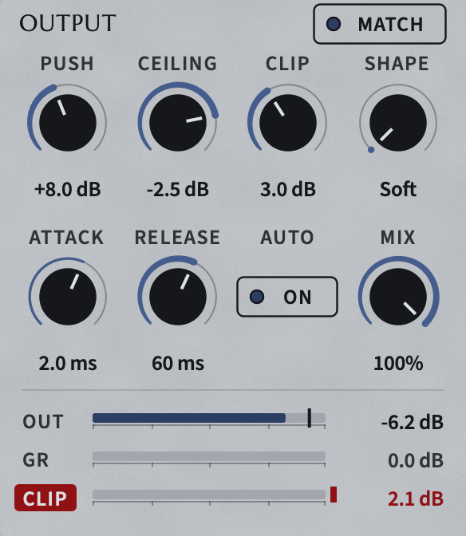

| Control | Range | Default | Description |
|---|---|---|---|
| **Push** | 0 to +24 dB | +6.5 dB | Drives the voice into the ceiling. Push 8–12 is clean and dense; for loud, Push 14–18 with Clip 6–9. The peaks never pass the ceiling. |
| **Ceiling** | −12 to 0 dB | −1 dB | The highest level the output can reach, true-peak safe. It sets the output level only: Push decides how hard the limiter works. |
| **Clip** | Off to 18 dB | Off | How many dB of each peak above the ceiling are clipped instead of limited. Raise Push to drive into it. |
| **Shape** | Soft to Hard | Soft | Clip shape. Soft rounds the peaks gently; Hard clips them flat, which is brighter and more aggressive. |
| **Attack** | 0.2 to 10 ms | 2 ms | How early the limiter starts turning down before a peak. With Auto off and a short Release, 0.3–3 ms crunches the low end. |
| **Release** | 1 ms to 1 s | 60 ms | How fast the limiter recovers. With Auto off: 2–10 ms crunch, 25–60 ms grit, 200 ms and up clean. |
| **Auto** | on / off | On | Auto release: adapts the recovery to the material and keeps the low end clean. Release sets how quickly it breathes. |
| **Match** | on / off | On | Level match, the switch at the top of the tile: holds the processed voice at the level of the input (see [The output stage](#the-output-stage)). Off: the voice leaves at the level the modules give it, and Push still drives it into the ceiling. |
| **Mix** | 0 to 100% | 100% | Blends the processed voice with the dry voice, which is delayed and phase-matched to line up with it. The two are matched in loudness, so Mix changes the character, not the level. |

The meters show the output level (with the ceiling marked), the limiter's gain reduction (GR) and how much the clipper takes (CLIP). See [The output stage](#the-output-stage) for how Attack and Release shape the crunch.

## Visualiser

The view above the chain is drawn live in OpenGL from the audio and the controls: an abstract ink creature, a mirrored blot that the voice gathers out of a cloudy sky. It is not a face or a figure; what it looks like is left to you.

**Asleep**, the view is a slow sky of lit cloud in three layers, with banks, gaps and shaded undersides, a cool blue-grey at the default settings. The cloud is faintly grey because it carries a little ink everywhere.

**When a voice comes in**, the cloud near the middle starts to turn, and the ink in it streams inwards along mirrored eddies, leaving the cloud it came from paler. It gathers first as dark shreds in several places, then they join into one folded mass: a body on the middle line, lobes and limbs to both sides, bays where the cloud shows through. Where the ink is densest the cloud in front of it parts. Until a new instance first hears sound, one line of help appears at the bottom of the view after a moment of quiet.


**While it sounds**, the mass never holds a pose. The flow keeps carrying its edge off as smoke and the voice keeps pulling more ink in, so its inside is marbled by where the ink came from, and banks of cloud drift across parts of it. Louder sound stirs the eddies faster.

**A roar** tears a ragged rift open down its middle. The rift follows the phrase with weight, rather than snapping open on every syllable, and the blot swells larger and darker while the roar lasts, letting the swell go over seconds afterwards. In some blots the rift is lit from inside by a warm glow, with lit breath drifting out into the cloud; in others it stays a dark tear onto the shaded cloud behind. The light comes and goes.

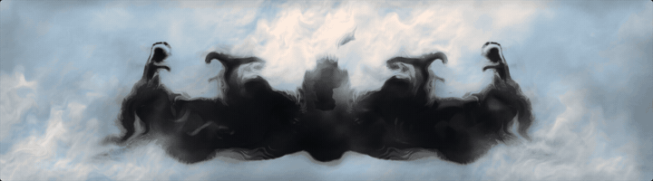

**When the voice stops**, the ink lets go: its limbs tear into ribbons first, then smoke, then the grey of the cloud, and a few seconds later nothing of its outline is left. After 1.5 seconds of silence the label ASLEEP appears; the creature gathers itself again as soon as sound comes back.

**While the host bypasses the plug-in**, the creature sleeps. The chain keeps running underneath so that leaving bypass is seamless, but the view treats what it does as silence: the ink lets go at once, nothing ripples it, the F0 and DETAIL readouts and the chain's meters rest, and the unheard sound does not grow the creature. It also goes to sleep at once when the host stops sending audio. As soon as the host processes sound again, the creature wakes with it.

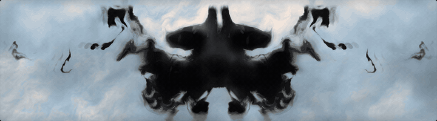

**Every blot is different.** Each instance grows its blot from its own seed, and each preset gives it a different one, so the same preset looks different in another session. The seed and how far the creature has evolved are saved with the session.

**It evolves.** Sustained intensity (loud, heated, growling, driven sound, not just high knob settings) slowly grows it: a young blot is a dense mass the eddies barely tear; as it grows, more lobes and limbs arrive one at a time, the eddies tear it into ribbons, and branches keep reaching outwards. The change takes minutes, not seconds, and never jumps. Quiet lets it settle back over minutes; after a long, hard session it only drifts all the way back after a long stretch of quiet. Which modules carry the sound also leans its character: SHIMMER, SWIRL and ENSEMBLE make its limbs longer, looser and droopier; ROAR, GROWL and the clipper make its middle heavier and its rift wider; the VOCODER, RING and OVERTONE make it branch earlier and reach further; SUB and a low PITCH make it hang lower and move more slowly.

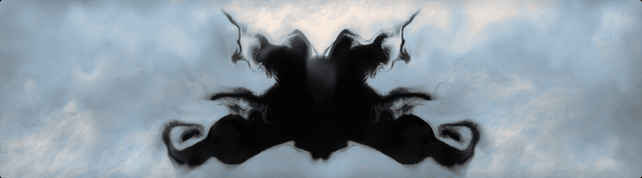

**Its colour follows your settings.** The clouds lean slowly towards a colour that suits the sound you have set up. Heavier ROAR, GROWL, PITCH Drive, a deeper pitch, SUB Drive, OUTPUT Push and Clip and CHAMBER's EDGE warm it towards ember red. The VOCODER, RING, SHIMMER, Snap or Mono pitch, the Radio tone and the metal rooms turn it a clear electric blue. SWIRL, ENSEMBLE and OVERTONE tint it violet. A big CHAMBER room (a high AMT and a long TAIL) leans it to a lichen green-grey on its own, and turns the other colours towards stone. Mixed settings mix their colours: heavy drive with the vocoder is a rust, drive with SWIRL a crimson rose, the vocoder with SWIRL an indigo, drive in a big room a warm stone and the vocoder in one a teal. Only the modules that are on and how far their knobs are turned count, not where they sit in the chain. Init and light settings keep the pale blue-grey, and so does Mix at 0%. The dense ink stays near black in every colour; its thin edges and the loose ink in the cloud take a little of the hue, and the light in the rift keeps a warm glow of its own. The colour never jumps: after a preset change, a roll of the dice or a turned knob it drifts to the new colour over several seconds, turning round the colour wheel no faster than a twelfth of the way each second, through soft tones rather than grey. The window follows the cloud too: its paper takes a pale wash of the same colour and the controls one deeper accent of it, always light enough that the near-black ink of the text, knobs and meters stays easy to read.

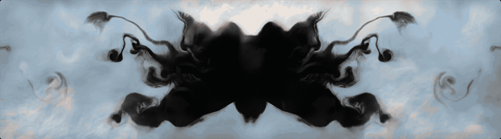

Right-click the creature for **Evolution: Live** (it keeps evolving), **Evolution: Frozen** (it holds its current form and colour, also after the editor is closed or the project reloaded; it still moves with the voice) and **Reset creature** (it eases back to a young blot over a few seconds and grows a new one). Under **Visualiser**, **Full** draws the creature as smoothly as the graphics card allows, **Low** draws it at a lighter quality and at most 15 frames a second, and **Off** shows a still cloud and leaves the graphics card alone (the readouts and the ASLEEP label still follow the sound); the choice is kept on this computer and applies to every instance. The view draws nothing while it is hidden. On macOS it also stops while its window is minimised, and slows to two frames a second while its window is covered or on another desktop.

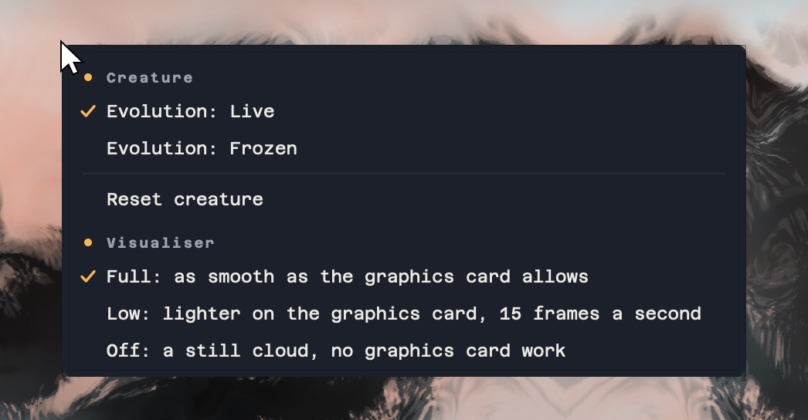

Whatever form it has taken, every module leaves its own trace on it, each a different kind of change to the shape, the flow or the ink, and each as strong as the module is working (nothing while it is Off). The traces on the shape share one limit, so with many modules on at once they still bend one blot.

- **PITCH** sets its weight: shifted down the mass is wider and lower and its loose ink sinks; shifted up it is taller and thinner and the ink rises. SIZE makes it larger.
- **CLEAN** tidies it: the frayed edge pulls back to a clean one, and while the gate is shut the limbs draw back towards the body and the rift closes.
- **DE-ESS**: each S throws a fine spray of ink off the rim round the rift, drawn back in as the de-esser acts.
- **DETAIL** sets the edge's fingers: Low gives it broad scallops, High a hairline fringe.
- **VOCODER** lays layers through the ink along the way it is carried, from its 32 bands; Gravel makes the ink clot.
- **RING** sends ripples through the shape from the rift, spaced by the carrier.
- **SHIMMER** sends small pale beads rising through the dark ink.
- **GROWL** runs an uneven ruffle along the edge at the growl's own rate and depth.
- **SWIRL** turns a pair of whorls either side of the body that wind its limbs into spiral arms, with the cloud turning round them; the sweep moves them in and out.
- **ROAR** tears the rift wider and swells and darkens the body, with faster eddies.
- **ENSEMBLE** leaves pale echoes of the outline stepped outwards, in drifting patches, spaced by its Width.
- **TAME** pulls the limbs in and rounds the edge off, and the body darkens while it holds back.
- **SUB** heaves the whole mass slowly at the sub's own pace, hangs a dark pool of ink under it, and each new low note pushes the ink outwards once.
- **OVERTONE** draws thin wisps of ink up out of the top of the body, one for each overtone, as long as that overtone is loud, bent by the flow and torn at the tips; in Replace the body thins as they grow. Below about 10% of Amount it draws none, and they reach their full length from about a third.
- **CHAMBER** turns the cloud into the room: the near cloud thickens into walls at the edges of the view, the room's ringing sends slow bands outwards through the cloud, and the blot's shadow in it grows long and soft.
- **OUTPUT**: a limiter working hard darkens the body, and a clipped peak throws a few beads of ink off its rim.


**Hits ripple it.** A hit with weight in the low end (a stomp, a thump, a heavy low attack at the start of a roar) ripples the picture like a struck water surface: one broad swell leaves the body's edge at once, fast at first and slowing as it spreads, and settles over about two seconds. Its slope catches the light, lifted where it faces up and shaded where it faces down, so the cloud heaves visibly without any line being drawn; it is wider than it is tall, and the cloud bends and breaks it up. A stronger hit makes a larger swell. A hit that follows close behind adds to the swell already spreading rather than starting another. The syllables of steady talking, sung notes, bright consonants and a held tone do not ripple it; a sustained low end makes the surface tremble finely instead.

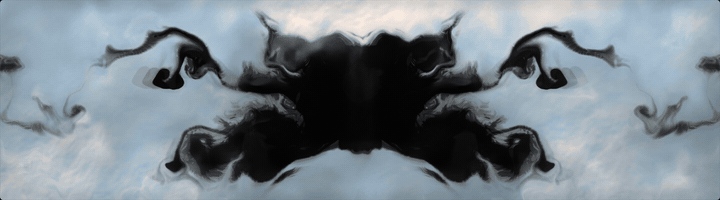

The top corners show the voice's pitch (F0) and how much DETAIL is lifting and holding. On slower graphics cards the creature lowers its own detail to stay smooth; without OpenGL the view shows a still cloud.

## Presets

Use the arrows either side of the preset name to step through presets, or click the name for the full list, grouped by category. The die after the arrows loads a random factory preset (see [The dice](#the-dice)). SAVE stores the current settings as a user preset, and the list also has Save As, Delete and Show Presets Folder.

A preset load from the preset bar can be undone: choose **Undo Load** in the list, or press Cmd+Z (Ctrl+Z on Windows) straight after loading, to get back the sound you had, edits and all. **Redo Load** loads the preset again, so you can compare the two. Loads and dice rolls share one history.


The list opens with Init, then one submenu per group, with the current preset ticked in its group. Your own presets are under USER.

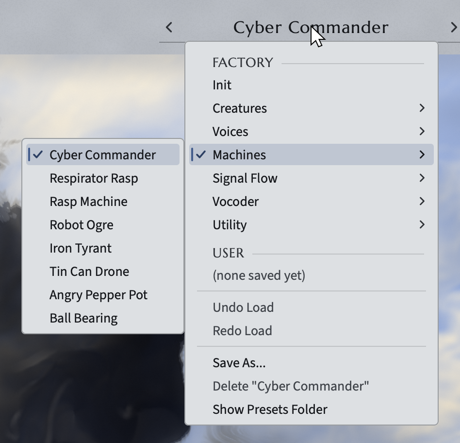

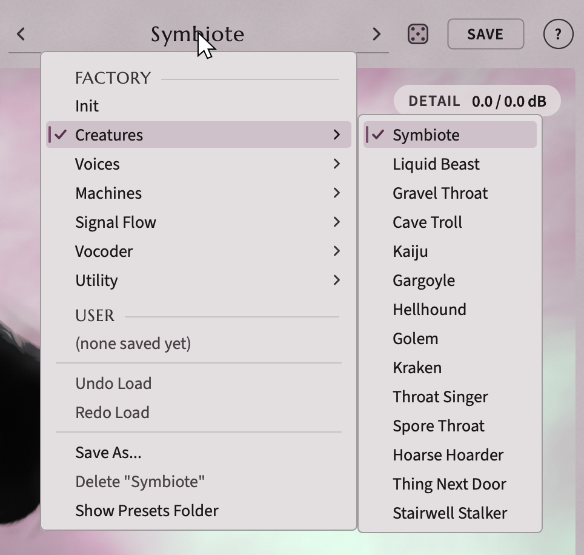 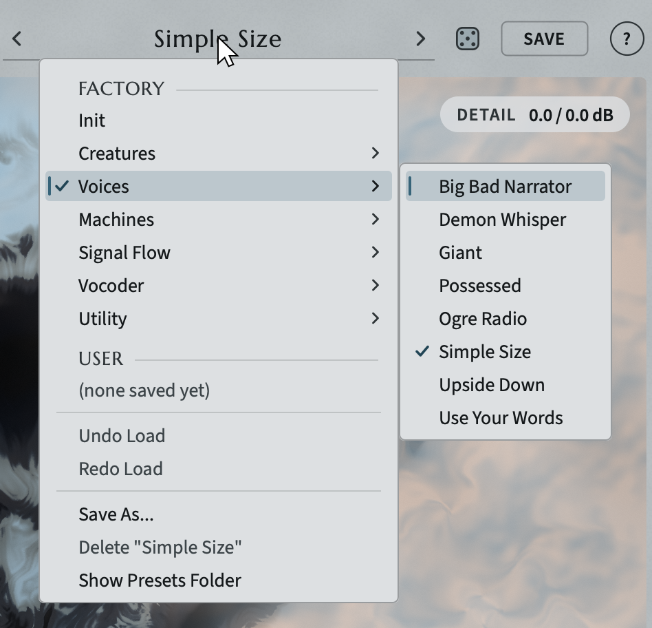

| Group | Presets |
|---|---|
| | Init (every control at its default: a slightly lower, bigger voice with a light wobble, growl, tube edge, sub and overtones) |
| **Creatures** | Symbiote, Liquid Beast, Gravel Throat, Cave Troll, Kaiju, Gargoyle, Hellhound, Golem, Kraken, Throat Singer, Spore Throat, Hoarse Hoarder, Thing Next Door, Stairwell Stalker |
| **Voices** | Big Bad Narrator, Demon Whisper, Giant, Possessed, Ogre Radio, Simple Size, Upside Down, Use Your Words |
| **Machines** | Cyber Commander, Respirator Rasp, Rasp Machine, Robot Ogre, Iron Tyrant, Tin Can Drone, Angry Pepper Pot, Ball Bearing |
| **Signal Flow** | Scorched Swirl, Molten Chorus, Sub Furnace, Ribcage, Tar Pit, Breathing Walls, Chopped Space, Vocoded Fire, Clanking Choir |
| **Vocoder** | Pulse Choir, Two Octaves Down, Gravel Pit, Iron Lung |
| **Utility** | Detail Only, Subtle Size, Clean Lift, Loud & Contained, Crunch Lift, Smashed, Phone Monster |

Every preset sets every control, including the module order. The Signal Flow presets move modules to show what a placement does: for example, Tar Pit drives and chops the voice before PITCH lowers it, and Breathing Walls puts DETAIL last, so it lifts every tail and breath the other modules make.

Six character presets are each built around one technique, and each works best with the delivery it describes:

- **Upside Down** (Voices): a deep, creaking villain voice. Your own voice stays at pitch and in the centre, is levelled in gentle stages, and gets low-end girth and a tight, clean octave underneath, with the top gently softened, all in a wide room.
- **Use Your Words** (Voices): a commanding voice that seems to come from inside the listener. It is pitched an octave down and played through a rattling speaker into a small room, with a heavy low-end thump and a crowd of voices, then blended half and half with your natural voice, which stays on top.
- **Spore Throat** (Creatures): a dry, human-sounding horror throat. The low end is cut away, the voice is narrowed to its mid-range screech, the wet mouth clicks are lifted, and a rattle speeds up as you get louder. Perform the clicks and screeches yourself: it frames a performance rather than inventing one.
- **Hoarse Hoarder** (Creatures): an enormous beast that still speaks clearly. The voice is pitched eight semitones down with a lower throat, over a gravelly vocoder bed and a light rumble, with breaths lifted between lines, in a wide, ringing chamber.
- **Angry Pepper Pot** (Machines): a furious voice in a metal shell. A low ring modulator chops the voice into a staccato electronic stutter, and nothing else colours it. Shout, and pitch your delivery up to hector.
- **Ball Bearing** (Machines): a small, chirpy machine. The voice is raised an octave and stepped to semitones, with a faint synthetic buzz, a quick warble and a tiny speaker. Coo and chirp short syllables rather than speaking.

A few contrasting presets, each playing the same voice, with the colour settled for the preset (the window's paper and the controls take the same colour as the cloud):

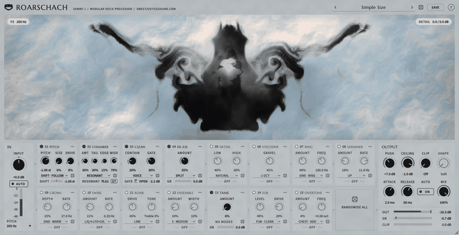 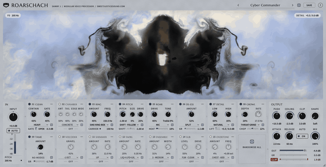
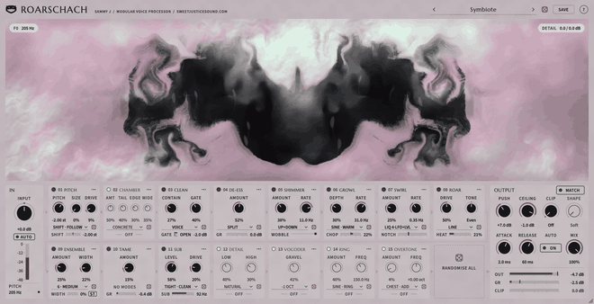 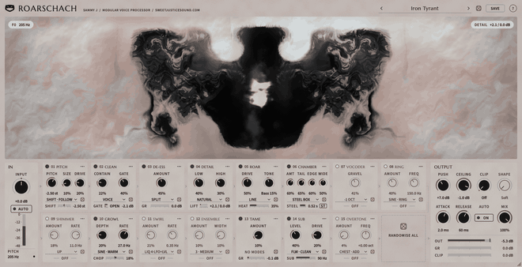
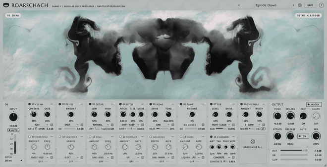 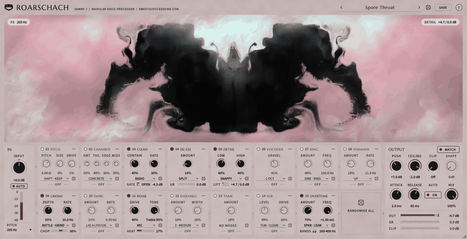
 

Each preset's settings sit in the useful part of every knob's travel, as measured in [docs/parameter-audit.md](docs/parameter-audit.md), and every preset except the deliberately loud Utility ones (Loud & Contained, Crunch Lift and Smashed) plays within about 0.6 LU of Init on dialogue once the level stages have learnt the take (measured as the median over seven dialogue takes, on the fourth play). Each preset also carries the level match measured for it on that dialogue, so its first play starts close.

Thirteen presets use CHAMBER:

- **Simple Size**: a subtly bigger, wider voice with a touch of chamber and low-end weight. The voice is lowered a semitone and lightly cleaned, and a little of a hard, resonant room is blended under it, with no creature effects.
- **Iron Tyrant**: a low, driven voice fed from ROAR into a horn speaker in a steel box, like an amp into a cabinet. Metal modes ring on every syllable, over a heavy low end.
- **Tin Can Drone**: talking down a pipe. A tiny speaker in a ringing tin booth, through CLEAN's Radio tone.
- **Use Your Words**: the octave-down voice played through a small speaker into a rattling concrete room with Heavy Boom, right after PITCH.
- **Ball Bearing**: the raised voice played through a tiny speaker in a padded cell, a dead box at the end of its chain.
- **Thing Next Door**: a slow, low creature with a heavy chop and a deep octave, heard mostly through the wall of the next room: Party Wall at Chamber 85%, so the room leads.
- **Stairwell Stalker**: a hissing stalker, barely lower, with breaths lifted, a quick rattle and a wide crowd of voices, ringing far down the hall in Tower Block at full width and a long Resonance.
- **Big Bad Narrator** sits in a warm wooden room. **Cave Troll**, **Gargoyle** and **Demon Whisper** put the whole creature in a room, with CHAMBER last: concrete, hard stone and a soft bloom. **Upside Down** and **Hoarse Hoarder** do the same in a concrete room and a resonant chamber, so the octave and the rumble ring in the room too.

User presets are kept in:

- macOS: `~/Library/Audio/Presets/SammyJs/Roarschach`
- Windows: `%APPDATA%\SammyJs\Roarschach\Presets`

Each preset is a small `.roarschachpreset` XML file. Any control a preset doesn't contain is set to its default.

## About and updates

Click **?** at the top right to open the About window, with the credits, a five-step quick start, the latency the plug-in reports to the host (in milliseconds and samples, at the current sample rate), the version and the license. CHECK FOR UPDATES asks GitHub for the latest Roarschach release and tells you if a newer one is out. Roarschach only checks when you click it.


## Quick start

- **Instant creature:** start from a Creatures preset, then set PITCH and SIZE for how big it should be.
- **Big but clear:** "Big Bad Narrator" or "Giant". Keep GROWL and ROAR low and let DETAIL keep every word up front. For barely-processed size, try "Simple Size".
- **Gravelly throat:** turn the VOCODER on with GRAVEL at 40–70%, and add some GROWL.
- **Machine voice:** a Machines preset, or turn RING on and try Track Follow at a ratio of ×0.5 or ×1.5.
- **Two voices at once:** "Possessed", or lower MIX to 70–80% so some of the performance stays under the creature.
- **Just more detail:** "Detail Only" brings up breaths and word endings and holds down shouts, with every creature module off.
- **Crunchy and loud:** "Crunch Lift" or "Smashed", or turn OUTPUT's Auto off, set Release to a few milliseconds and raise Push.
- **Weight on small speakers:** raise OVERTONE, or try "Phone Monster".
- **High sample rate recordings:** set PITCH to −12 or −24 st with Formant on Follow to bring the ultrasonic detail down into the voice.
- **Try moving the modules:** load a Signal Flow preset, then choose Reset Chain Order from any module's ••• menu to hear the same settings in the default order.

## System requirements

- macOS 11 or later (Apple Silicon and Intel): VST3 and AU
- Windows 10 or later (64-bit): VST3

## Building

### Prerequisites
- CMake 3.22 or higher
- Xcode Command Line Tools (macOS) or Visual Studio 2022 (Windows)
- JUCE 8.0.8, expected at `../SDK/JUCE` relative to this folder

### Build instructions

```bash
cmake -B build -DCMAKE_BUILD_TYPE=Release
cmake --build build --config Release
```

The plugin is built to:
- VST3: `build/Roarschach_artefacts/Release/VST3/`
- AU: `build/Roarschach_artefacts/Release/AU/`

Options:

- `-DROARSCHACH_FORMATS=Standalone` builds a standalone app instead (handy for UI work), or `-DROARSCHACH_FORMATS="AU;VST3;Standalone"` for all three.
- `-DROARSCHACH_IR_DIR=<folder>`, with the `ROARSCHACH_IR_KEY` environment variable set to 64 hex digits, packs CHAMBER's room captures from that folder into the build, encrypted. The captures are not in this repository; without them CHAMBER uses its modelled rooms.
- `-DROARSCHACH_TESTS=ON` builds `RoarschachTests`, an offline test runner that drives the real processor at several sample rates and block sizes:
  - `RoarschachTests` runs every test: parameters, constant latency, exact dry and bypass nulls, the dry's phase match, stereo, click-free module moves in any order, the output ceiling, state round-trip, every factory preset, non-finite input, block sizes, native-rate pitch at 192 kHz, RING, OVERTONE and CHAMBER, CHAMBER's headroom in every room (`chamberclip`), the editor, the dice, and CPU use. `--quick` runs shorter versions, and test names (for example `RoarschachTests latency presets`) run only those. It exits non-zero on a failure.
  - `RoarschachTests --render in.wav outdir [--preset NAME]...` renders a file through factory presets at the file's own sample rate. `--only`, `--without` (module codes such as `GR` or `RM`) and `--order` change the chain for the render, and `--roll FROM TO` renders one Randomise All roll per seed (with `--metrics out.json`, the loudness of each).
  - `RoarschachTests --snapshot out.png` writes a picture of the editor, and `RoarschachTests --snapshots folder` writes the window, the chain, menus, a tooltip and a drag, with the creature.

### Installation

- Copy the `.vst3` bundle to `~/Library/Audio/Plug-Ins/VST3/`
- Copy the `.component` bundle to `~/Library/Audio/Plug-Ins/Components/`

## Credits

Created by Samuel Justice, Creative Sound Supervisor at [Sweet Justice](https://www.sweetjusticesound.com).

- UI fonts: [Marcellus](https://github.com/google/fonts/tree/main/ofl/marcellus) and [Source Sans 3](https://github.com/adobe-fonts/source-sans), both under the SIL Open Font License 1.1 (each font's licence is beside it in [Resources/Fonts](Resources/Fonts)).
- All the signal processing is original, built on [JUCE](https://juce.com).

## License

The code is under the MIT License. See [LICENSE](LICENSE) for details.

CHAMBER's bundled rooms (the room captures that release builds carry inside the plug-in) are not covered by the MIT License: they are © Samuel Justice, all rights reserved, and licensed for use only within Roarschach. See [LICENSE-IRS](LICENSE-IRS).

The measurements behind every knob's range and taper are in [docs/parameter-audit.md](docs/parameter-audit.md).
