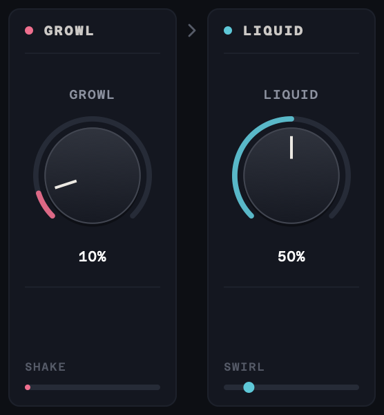
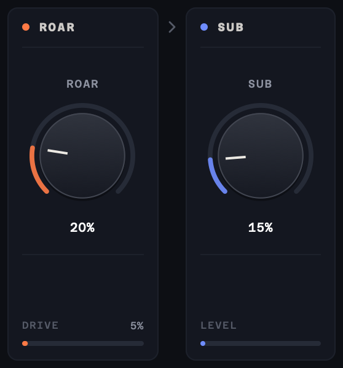

# Roarschach

A VST3/AU creature voice designer by **Samuel Justice**. Roarschach turns a spoken or shouted performance into a big, liquid, gravelly monster voice that still reads as words. One insert takes the voice down in pitch and up in size, adds growl, a liquid stereo movement, tube roar and a tracked sub, and finishes with a clean, level output. Two modules, DETAIL and VOCODER, can be dragged to any point in the chain.

### 🎉 Latest Release v1.0.0 - [Download Here](https://github.com/samueljustice/plugins/releases/tag/roarschach-v1.0.0)


## Features

- **Pitch and size, separately**: PITCH moves the voice down (or up) by up to an octave while the vowels stay in place, and SIZE lowers the vowel resonances and adds chest and throat resonance, so the voice sounds as if it comes from a bigger body.
- **Growl**: a rough, rattling texture an octave below the voice, with a fast tremolo and a little unsteadiness. Loud lines growl harder than quiet ones.
- **Liquid**: a slow pitch shimmer, a phaser and an ensemble that turns the mono voice into a wide, wet stereo sound.
- **Roar**: tube saturation that drives the lows and highs hardest, 2x oversampled. Harshness in the top end is tamed automatically, and the level stays about the same as you turn it up.
- **Sub**: a clean tone an octave below the voice that follows its pitch, for weight. It only sounds while the voice is voiced.
- **DETAIL**, a dual upward/downward level compressor: it lifts quiet breaths, mouth sounds and word endings and holds down the loudest parts, without raising room noise or silence.
- **VOCODER**, a classic 32-band analog-style vocoder design: steep 8-pole bands from 80 Hz to 12 kHz play the voice on a buzzy pulse tone that follows its pitch one or two octaves down. Consonants are rebuilt from noise, so the words stay readable.
- **Movable modules**: drag DETAIL and VOCODER by their headers to any of six points in the chain, or pick a point from their ••• menu. Moves crossfade over 20 ms, so they are click-free, even while audio plays.
- **Always-on clean-up and finishing**: a gate, a leveller, a low shelf and a de-esser before the chain; a high and low cut, automatic level matching and a peak limiter after it, so turning the knobs doesn't make the output jump in loudness.
- **A creature that reacts**: an OpenGL view of a mirror-symmetric ink-blot creature whose jaw, eyes, skin and throat follow the voice and every control. It falls asleep when the input goes quiet.
- **Presets**: 22 factory presets in four groups (Creatures, Voices, Vocoder, Utility). Save your own with SAVE. They are plain files, easy to back up and share.
- **Full recall**: every parameter, the module positions, the preset name and the window size are saved with your session, and the factory presets are exposed to the host as programs.
- **Resizable interface**: drag the corner to scale the whole window from 50% to 125%.
- **Constant latency** of about 31 ms (1506 samples at 48 kHz), the same for every setting and module position, reported to the host so it is compensated. The dry signal is delayed to match, so MIX blends cleanly. Host bypass switches without clicks. Mono or stereo, full DAW automation.

## How it works

The voice runs through a fixed chain of stages, left to right in the window:

1. **Clean-up (IN)**, always on: a high-pass at 60 Hz and a low shelf trim the bass that later stages add a lot of; a gate that follows the noise floor keeps room tone down; a gentle compressor evens out the level; and a de-esser softens sharp S sounds, only when they dominate.
2. **PITCH**: shifts the pitch while the vowels stay in place, and SIZE scales the vowel resonances down and adds body and throat resonance. The stage tracks the voice's pitch, which GROWL, SUB and VOCODER follow too.
3. **GROWL**: adds roughness an octave below the voice, a fast tremolo and a slight unsteadiness, harder on loud lines.
4. **LIQUID**: a slow pitch shimmer, a phaser and an ensemble. The chain is mono up to here; LIQUID makes it stereo.
5. **ROAR**: tube saturation with the bass and treble pushed into it, then a top-band compressor that tames the fizz.
6. **SUB**: a clean octave below the voice, added only while the voice is voiced.
7. **Finishing (OUT)**, always on: a 35 Hz low cut and a 15 kHz high cut, automatic level matching to the input, and a peak limiter with a -1 dBFS ceiling that hardly works on normal lines. MIX then blends the dry input with the creature.

**DETAIL** and **VOCODER** are movable: each sits at one of six points in the chain, **Start** (right after the clean-up), **After Pitch**, **After Growl**, **After Liquid**, **After Roar** or **End** (just before finishing). Where they sit changes the sound. Early on, the stages after them work on the evened-out or vocoded voice; late in the chain, DETAIL evens out and VOCODER vocodes what the stages before them made. If both sit at the same point, DETAIL runs first. Both start at Start.

To move one, drag its panel by the header (the dotted grip beside the name). Drop markers appear in every gap between the panels; let go on one to move the module there.


Or click **•••** in the header and choose where it should go. The menu ticks where it sits now. The chip also opens with Tab and Return.


Either way, the host records the move as one change, the panels slide to their new places, and the audio crossfades over 20 ms. Automation and presets move the panels too.

## Controls

Every control has a tooltip: hover over it to see what it does.


### In
| Readout | Description |
|---|---|
| **Always on** | The steps of the automatic clean-up: gate, leveller, low shelf and de-esser. They have no controls. |
| **Input** | The input level. |


### Pitch
| Control | Range | Description |
|---|---|---|
| **Pitch** | -12 to +12 st | Shifts the voice down (or up) in semitones while the vowels stay in place, so the words stay clear. Default -2 st. |
| **Size** | 0 to 100% | Body size: lowers the vowel resonances and adds chest and throat resonance. The pitch stays where it is. |

The readouts show the pitch of the voice going in (VOICE IN) and where it comes out after the shift (VOICE OUT). At Pitch 0 and Size 0 the stage is a plain delay.


### Growl and Liquid
| Control | Range | Description |
|---|---|---|
| **Growl** | 0 to 100% | A rough, rattling texture: a growl an octave below the voice, a fast tremolo and a little unsteadiness. Loud lines growl harder than quiet ones. SHAKE shows how much it is shaking the voice right now. |
| **Liquid** | 0 to 100% | Wet, shifting movement: a slow pitch shimmer, a phaser and an ensemble that also spreads the sound into stereo. At 0 the voice stays mono. SWIRL shows the slow movement. |



### Roar and Sub
| Control | Range | Description |
|---|---|---|
| **Roar** | 0 to 100% | Tube saturation that drives the lows and highs hardest. Harshness in the top end is tamed automatically, and the level stays about the same as you turn it up. DRIVE shows how hard it is driven right now. |
| **Sub** | 0 to 100% | A clean tone an octave below the voice that follows its pitch, for weight. It only sounds while the voice is voiced. LEVEL shows its level right now. |



### Out
| Control | Range | Description |
|---|---|---|
| **Mix** | 0 to 100% | Blend between the dry input and the creature voice. The dry signal is delayed to line up with it. |
| **Output** | readout | The output level, after the finishing stage. |


### Detail (movable)
| Control | Range | Description |
|---|---|---|
| **Low** | 0 to 100% | Lifts the quiet parts (breaths, word endings, small mouth sounds) toward the level of the rest, by up to 24 dB. Room noise and silence are left alone. |
| **High** | 0 to 100% | Holds down the loudest parts so shouts don't jump out. Higher settings start lower and hold harder. |
| **•••** | 6 positions | Where DETAIL sits in the chain (see [How it works](#how-it-works)). |

LIFT shows how much the quiet parts are being lifted, and HOLD how much the loud parts are held down. With Low and High at 0, DETAIL leaves the level alone.


### Vocoder (movable)
| Control | Range | Description |
|---|---|---|
| **Gravel** | 0 to 100% | How much of the vocoder is blended in, and how gritty it is: higher settings let more rasp through. Some of the voice always stays underneath, so the words stay readable. At 0% the vocoder is off and uses no CPU. |
| **-1 OCT / -2 OCT** | 2 settings | The vocoder's tone sits one or two octaves below the voice. Click to switch. |
| **•••** | 6 positions | Where VOCODER sits in the chain (see [How it works](#how-it-works)). |

BANDS shows the level of each of the 32 bands, and whether the vocoder is ON. Its tone follows the voice's pitch, shifted by PITCH when the vocoder sits after it, and SIZE moves its vowel resonances down too.


Double-click any knob to reset it to its default.

## Visualiser

The creature at the top of the window is drawn live in OpenGL, from the audio and the controls. It is mirror-symmetric, like an ink blot. Its jaw opens with the voice, its eyes and colour heat up with ROAR, it shakes with GROWL, its skin ripples and drips with LIQUID, rings pulse out of its throat with SUB, and PITCH and SIZE make its head bigger and its jaw wider. With the vocoder on, its 32 bands glow as a fan of ridges under the jaw, each as long as its band is loud. DETAIL adds a fine speckle to the ink. The top corners show the voice's pitch (F0) and how much DETAIL is lifting and holding.


After 1.5 seconds of silence the creature falls asleep: its eyes close, it breathes slowly and mist drifts in. It wakes as soon as sound comes back.


## Presets

Use the arrows either side of the preset name to step through presets, or click the name for the full list, grouped by category. SAVE stores the current settings as a user preset, and the list also has Save As, Delete and Show Presets Folder.


| Group | Presets |
|---|---|
| | Init (every control at its default) |
| **Creatures** | Liquid Beast, Gravel Throat, Cave Troll, Kaiju, Gargoyle, Hellhound, Golem, Kraken |
| **Voices** | Big Bad Narrator, Demon Whisper, Giant, Possessed, Ogre Radio |
| **Vocoder** | Pulse Choir, Two Octaves Down, Gravel Pit, Robot Ogre, Iron Lung |
| **Utility** | Detail Only, Subtle Size, Clean Lift |

Every preset sets every control, including where DETAIL and VOCODER sit.

User presets are kept in:

- macOS: `~/Library/Audio/Presets/SammyJs/Roarschach`
- Windows: `%APPDATA%\SammyJs\Roarschach\Presets`

Each preset is a small `.roarschachpreset` XML file. Any control a preset doesn't contain is set to its default.

## About and updates

Click **?** at the top right to open the About window, with the credits, the version and the license. CHECK FOR UPDATES asks GitHub for the latest Roarschach release and tells you if a newer one is out. Roarschach only checks when you click it.


## Quick start

- **Instant creature:** start from a Creatures preset, then set PITCH and SIZE for how big it should be.
- **Big but clear:** "Big Bad Narrator" or "Giant". Keep GROWL and ROAR low and let DETAIL keep every word up front.
- **Gravelly throat:** raise GRAVEL to 40–70% with the VOCODER after PITCH, and add some GROWL.
- **Two voices at once:** "Possessed", or lower MIX to 70–80% so some of the performance stays under the creature.
- **Just more detail:** "Detail Only" brings up breaths and word endings and holds down shouts, with every creature stage off.
- **Try moving the modules:** VOCODER at the end vocodes the finished creature for a rigid, robotic sound; DETAIL at the end squashes everything like a pushed radio.

## System requirements

- macOS 11 or later (Apple Silicon and Intel): VST3 and AU
- Windows 10 or later (64-bit): VST3

## Building

### Prerequisites
- CMake 3.22 or higher
- Xcode Command Line Tools (macOS) or Visual Studio 2022 (Windows)
- JUCE 8.0.8, expected at `../SDK/JUCE` relative to this folder

### Build instructions

```bash
cmake -B build -DCMAKE_BUILD_TYPE=Release
cmake --build build --config Release
```

The plugin is built to:
- VST3: `build/Roarschach_artefacts/Release/VST3/`
- AU: `build/Roarschach_artefacts/Release/AU/`

Options:

- `-DROARSCHACH_FORMATS=Standalone` builds a standalone app instead (handy for UI work), or `-DROARSCHACH_FORMATS="AU;VST3;Standalone"` for all three.
- `-DROARSCHACH_TESTS=ON` builds `RoarschachTests`, an offline test runner that drives the real processor at several sample rates and block sizes:
  - `RoarschachTests` runs every test: finite, bounded output; silence stays silent; constant latency; exact dry and bypass nulls; state round-trip; click-free module moves; every factory preset; CPU use. It exits non-zero on a failure.
  - `RoarschachTests --render in.wav outdir [preset ...]` renders a file through factory presets.

### Installation

- Copy the `.vst3` bundle to `~/Library/Audio/Plug-Ins/VST3/`
- Copy the `.component` bundle to `~/Library/Audio/Plug-Ins/Components/`

## Credits

Created by Samuel Justice, Creative Sound Supervisor at [Sweet Justice](https://www.sweetjusticesound.com).

- UI font: [Azeret Mono](https://github.com/displaay/Azeret), SIL Open Font License 1.1.
- All the signal processing is original, built on [JUCE](https://juce.com).

## License

MIT License. See [LICENSE](LICENSE) for details.
