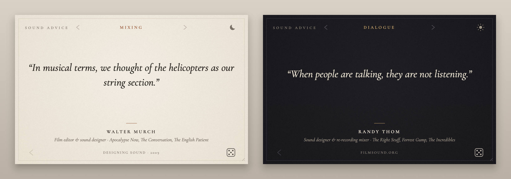

# Sound Advice

A small, quiet page of advice from the great creative people behind film, TV and game sound: sound designers, mixers, editors and audio directors, plus a legendary Disney Imagineer on leading creative work. Pick what you're working on (mixing, trailers, creatures, dialogue, silence, running a creative team...) and it deals you something one of the greats said or did about it. Roll the die for another.

It's a VST3 / AU plug-in (audio passes straight through, untouched) and a standalone app (no audio device at all), so it can sit on a mix bus or on a second screen. Paper by day, ink by night.



**[Download the latest release](https://github.com/samueljustice/plugins/releases/tag/soundadvice-v1.0.11)**: macOS installer (app, VST3, AU; signed and notarised, universal, macOS 11+), the app on its own as a `.dmg`, or the Windows installer (VST3 and app).

## What's in it

839 entries from 147 people, kept to concrete, technically creative advice: sources and processing, recording, design methods and specific mix decisions, each tied to the production it came from. The sound designers and mixers all have film, TV or game credits on IMDb, and every entry links to the interview, article or SoundWorks Collection video it came from. Nothing predates 2005, either in the source or in the work it describes, apart from the Star Wars prequels. The Creativity & Teams category draws on a legendary Disney Imagineer's book about creative work: leading teams, finding a theme, critique, risk and knowing when to stop. Two kinds:

- **Quotes**, in quotation marks and italics: their own words, kept short. When a quote is about a particular film, show or game, it's named above it ("On Arrival").
- **Field notes**: a technique, decision or story from that source, retold in a sentence or two. "Field note" is printed above them.

Click a person's name to open their IMDb (or other profile) page; click the source line at the foot of the page to read the original article. Right-click to copy.

### Categories

| Category | Entries |
|---|---|
| Mixing | 252 |
| Action & Impact | 92 |
| Trailers | 30 |
| Creatures & Voices | 87 |
| Ambience & Worlds | 116 |
| Dialogue | 173 |
| Field Recording | 189 |
| Weapons & Vehicles | 52 |
| Sci-Fi & Magic | 144 |
| Horror & Tension | 53 |
| Silence & Restraint | 69 |
| Music & Sound | 66 |
| Games | 32 |
| Story & Emotion | 117 |
| Craft & Technique | 206 |
| Collaboration & Career | 81 |
| Creativity & Teams | 75 |

**Anything** deals from all of them. Each category is a shuffled deck: you see every entry in it once before any comes round again.

## Using it

| | |
|---|---|
| Die, Return or → | Another from this category |
| ‹ (bottom left), ← or Backspace | The one before |
| ‹ › at the top, ↑ ↓ | Previous / next category |
| Category name | Choose from the list |
| Moon / sun | Night or paper |
| ⌘C / Ctrl+C, or right-click | Copy |

Drag the bottom-right corner to resize. The category and theme are saved with your session; every time you open it (or reopen the window) it deals a fresh entry.

## The database

The entries live in `data/*.json`, one file per research group, each entry with its person, kind, categories and source (title, publication, URL, year). `tools/build_quotes.py` checks them (known person and category, a source URL, quotes 15 words or fewer, no duplicates), gives each a stable id and writes `Resources/quotes.json`, which is embedded in the plug-in:

```bash
python3 tools/build_quotes.py
```

To add an entry, add it to a data file (or a new one) with its source, run the script and rebuild. `data/credits.json` sets the credits line shown under each name. To leave someone out, put their name in `data/omit.txt`; to drop a single entry (too generic, a fragment, a near-duplicate), put its id in `data/omit-entries.txt`. Either way the research stays in the data files and the build just skips it. `data/contexts.json` names the production a quote is about, shown above it. `data/rewrites.json` changes an entry's wording (for example to name who did the work) without changing its id. The `SoundAdviceTests` program checks the built database: a sanity floor of 300 entries, every category stocked, and the no-repeat dealing.

## Building

Needs JUCE 8.0.8 at `../SDK/JUCE` (see the [root README](../README.md)).

```bash
cmake -B build -DCMAKE_BUILD_TYPE=Release
cmake --build build --config Release
./build/SoundAdviceTests_artefacts/Release/SoundAdviceTests
```

`-DSOUNDADVICE_TOOLS=ON` also builds `SoundAdvicePreview`, which renders the editor to PNGs without a host:

```bash
./build/SoundAdvicePreview_artefacts/Release/SoundAdvicePreview previews 6
./build/SoundAdvicePreview_artefacts/Release/SoundAdvicePreview --hero docs/screenshot.png <paper-entry-id> <night-entry-id>
```

`--icon Resources/icon.png` redraws the app icon (and `icon.ico` beside it). The `--hero` form makes the image at the top of this page; entry ids are in `Resources/quotes.json`.

## Releases

Push a tag `soundadvice-vX.Y.Z` from `main` to build, sign, notarise and publish a release (`.github/workflows/build-release_soundadvice.yml`): a macOS installer (`.pkg`, with the app, VST3 and AU), the app on its own (`.dmg`), a Windows installer (VST3 and app) and zips of each. The tag's number becomes the version everywhere. Pull requests that touch `soundadvice/` build, test and package without releasing, and the workflow can be run by hand for a dry run.

## Credits

Type: [Cormorant Garamond](https://github.com/CatharsisFonts/Cormorant) by Christian Thalmann, under the SIL Open Font License (`Resources/Fonts/OFL.txt`).

The words and work belong to the people quoted. Each entry links to where it came from; go and read the originals, they're better than any summary.
