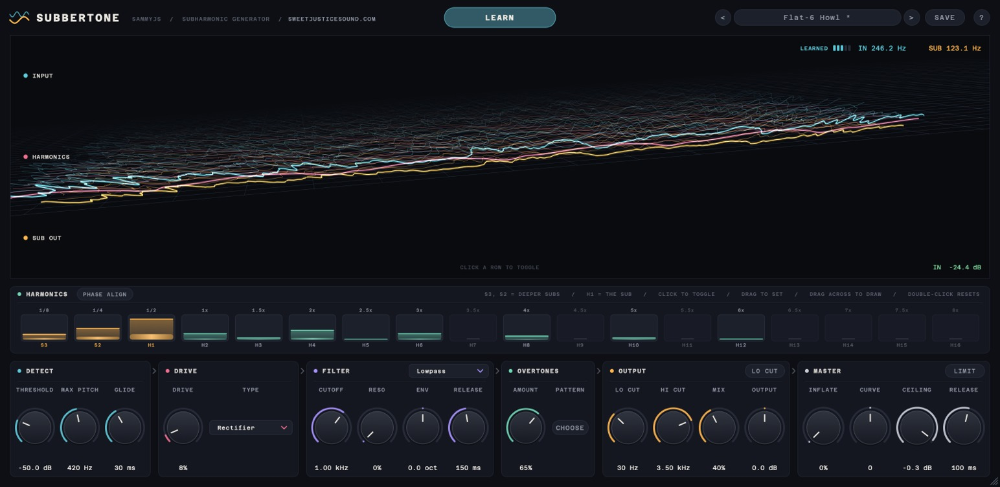
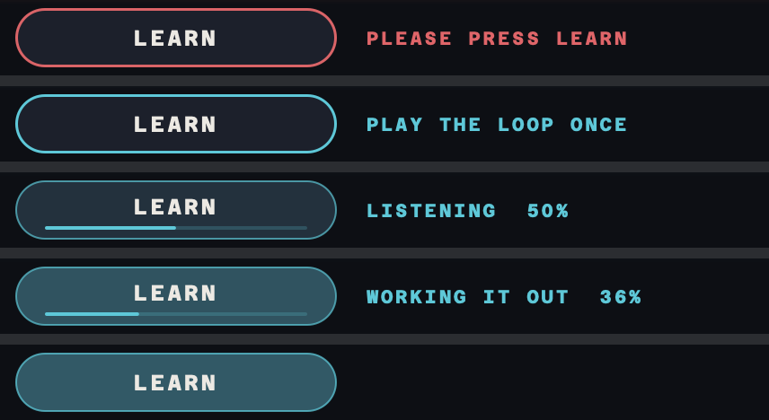
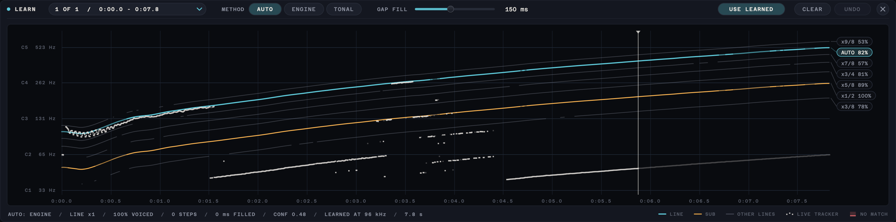
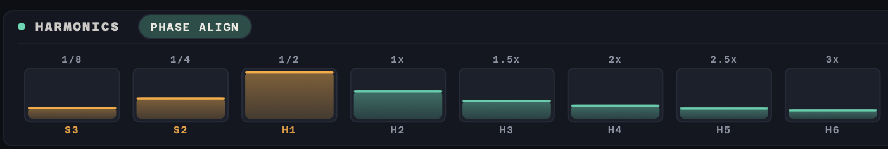
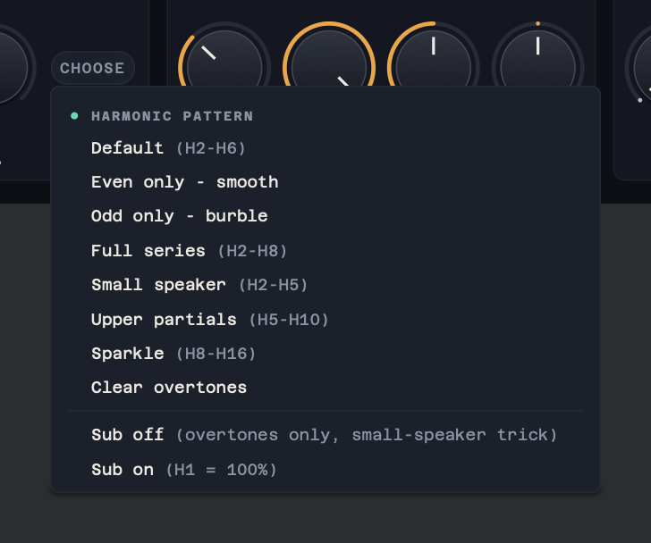
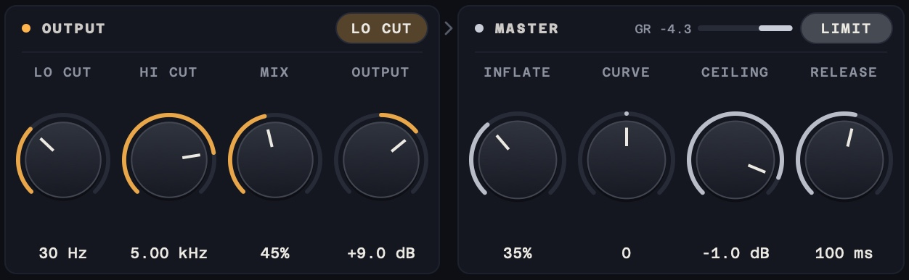
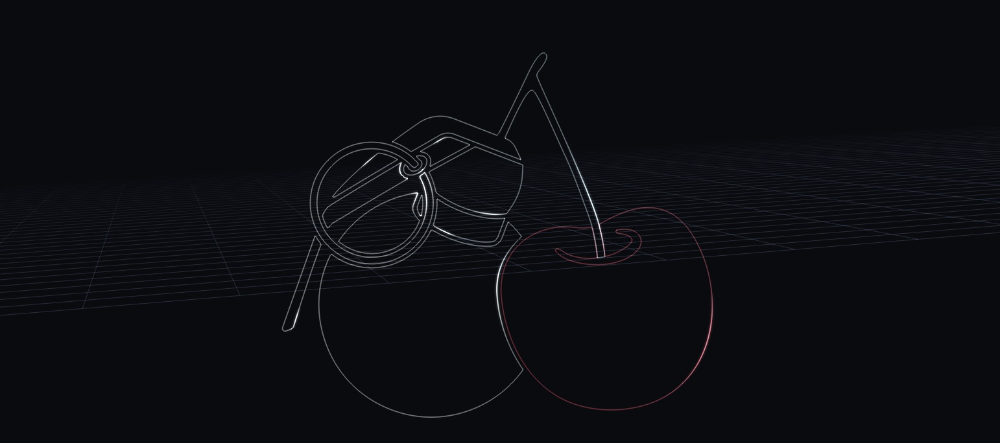
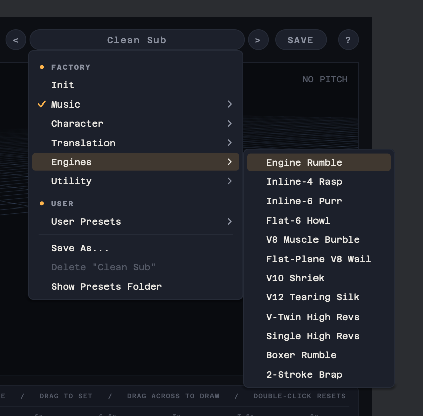
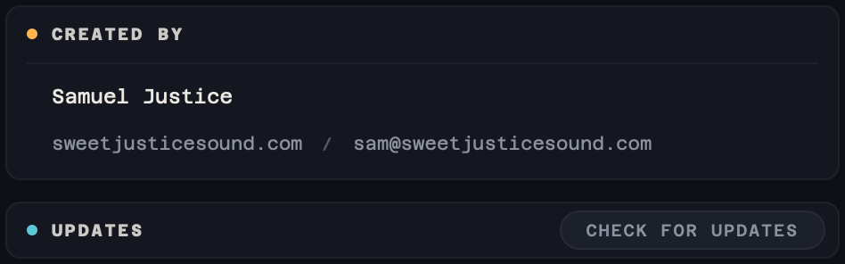

# SammyJs Subbertone


A VST3/AU subharmonic generator by **Samuel Justice**, made mostly for cars and other engines. Subbertone tracks the pitch of an engine or exhaust, synthesises a clean sub one octave below it, and lets you build its harmonics bar by bar, so a thin recording gets weight that follows the revs. Engines are hard to track as they play, so LEARN works the pitch out from one pass of a loop, with hindsight, and the sub then follows that. It also works on voices, creature sounds, drones and bass, from a pure sub reinforcement, to the small-speaker "hear the bass on a phone" trick, to a growling, talking octave-down bass. A mastering stage (Inflate and a brickwall limiter) finishes the output. See [Known limitations](#known-limitations) for what it does not do well yet.

It comes in [Sammy J's Plugins](https://github.com/samueljustice/plugins/releases/latest), one installer for all of these plug-ins.



## Overview

The sub is a phase-continuous sine one octave below the input. It follows your playing, glides between notes and fades with the input. All processing is per sample, so it is click-free at any buffer size. Tracking is made steady for difficult material: octave jumps must be confirmed before the sub follows them, short dropouts are held, and a Glide control smooths noisy or wandering sources such as engines.

Learn is for what live tracking struggles with: loop a passage in your host, press LEARN and play it once. Subbertone works out the pitch of the whole pass with hindsight, and from then on, in that passage, the sub follows what it learned: no lag, short gaps bridged and every note starting on its own pitch. You can pick which line it follows, and what it learned is saved with the session. See [Learn](#learn).

The harmonic editor has 18 bars. H1 is the sub itself and H2–H16 are its harmonics; S3 and S2, left of H1, are deeper subs. Each bar has a live activity meter. Click to toggle, drag to set, drag across to draw, double-click to reset. The PATTERN menu has ready-made sets (even only, odd only, full series, small speaker, upper partials, sparkle), and "Sub off" leaves only the harmonics: the MaxxBass/RBass trick that makes a sub audible on speakers that cannot play it.

The deeper subs, S2 and S3, are two more clean sines, two and three octaves below the input (a quarter and an eighth of its pitch). They come from the sub's own oscillator, so they glide and jump with it and stay locked to it and to each other. Like the sub, they fade as Drive rises; the overtone Amount doesn't change them. Nothing is made below 20 Hz, where a sub only uses up headroom: each one fades out over the last 3 semitones above 20 Hz. On bass guitar they mostly fall below that (S2 sounds for notes above about 95 Hz, S3 above about 190 Hz). On engines, whose tracked lines run from about 100 to 500 Hz, they land at about 12–130 Hz and add weight under the engine's own tone. Both are off by default.

Phase Align lines the generated harmonics up with the bass's own harmonics, so they add up instead of cancelling. Notes thin out far less, and repeats of the same hit come out at the same level. It works best on bass lines and hits, such as 808s, and helps much less on engines. It turns the phases of the generated harmonics, not the levels you set, and adds no latency. Switching it while a note holds is click-free. Its sound engine uses about 30% more CPU while it's on.

There are six saturation types, each with its own harmonic recipe:

| Type | Character |
|---|---|
| Tape | Smooth, odd harmonics |
| Valve | Warm, strong 2nd harmonic at every drive level |
| Console | Harder knee, brighter |
| Transformer | Soft, mostly odd with a touch of 2nd |
| Rectifier | Even harmonics only, so every partial lines up with the input note's own harmonics (the cleanest "octave" sound) |
| Wavefolder | Harmonics sweep upward as drive rises |

A Driver-style resonant filter follows on the saturated harmonics: lowpass, bandpass or notch, with resonance driven into saturation and an envelope follower that sweeps the cutoff on every note. A steep low cut, 48 dB/oct on the generated sub, S2 and S3 included (10–80 Hz, 30 Hz by default), is for systems that can't play the lowest subs; the harmonic bars still carry the pitch of a sub it removes, and switching it on or off glides smoothly instead of clicking or dipping. The MASTER section has Inflate (Oxford Inflator-style density, with a Curve control) and a look-ahead brickwall limiter with a ceiling, a release and a gain-reduction meter.

There are 32 factory presets in five groups (Music, Character, Translation, Engines, Utility), including engine starting points from inline-4 to V12, V-twin and 2-stroke. SAVE stores your own as plain files that are easy to back up and share, and Subbertone always asks before replacing one. Every parameter, what LEARN learned, the preset name and the window size are saved with your session, and the factory presets are exposed to the host as programs, so VST racks and tools such as Soundminer recall Subbertone exactly.

The window scales from 55% to 140% by dragging its corner, and each instance remembers its size. A 3D OpenGL visualiser shows the input, harmonics and sub output; when there's no signal it draws the Sweet Justice logo. Latency is about 2 ms (the limiter look-ahead and the Inflate oversampling), constant and reported to the host so it is compensated. Host bypass stays in time and switches without clicks, with full DAW automation.

## How it works

1. The input is low-passed to the bass band and analysed with a streaming YIN pitch detector, decimated to about 11 kHz. A tracker confirms octave jumps, rejects outliers and holds through short dropouts. Inside a passage LEARN has learned, the pitch comes from what was learned instead, read slightly ahead so the sub's glide arrives on time.
2. A sine is generated at half the detected pitch, gliding to each new note. Its level follows the bass band's RMS and a voicing gate. S2 and S3 are sines at a quarter and an eighth of the pitch, taken from the same oscillator: it counts its own cycles, and its phase spread over two and four of them gives the two deeper sines, so they can never drift from the sub. A deeper sine that would sound at 20 Hz or below is left out.
3. The sine is shaped by the chosen saturation curve. The DC and fundamental components are then subtracted exactly, leaving only the harmonics. Because the input to the shaper is always a pure sine, each curve acts as a fixed harmonic recipe.
4. The saturated harmonics go through the resonant multimode filter. Its resonant peak is pushed into a soft clipper, and the envelope follower sweeps its cutoff.
5. In parallel, the harmonic bars add exact harmonics of the sub (H2–H16), phase-locked to it. If the bars add up to more than 1.5 times the sub's level, they are all scaled down together, so even 16 bars at 100% can't blow up the level. Harmonics that would land near or above the Nyquist frequency are left out, so nothing aliases.
6. With PHASE ALIGN on, the phase of the bass's own harmonics is measured continuously over the last cycle of the sub, and each generated harmonic that lands on one of them is turned onto the same phase, so the two reinforce instead of cancelling. The Drive harmonics are lined up too. (The sub itself, H1, sits an octave below the bass, so it normally has nothing to line up with, and neither do S2 and S3; at each new note they start in step with the sub, so they too sound the same on every repeat of a hit.) Each harmonic keeps the level you set; only its phase turns, and the audio is not delayed. At a new note, a tail that is still sounding is faded out over 8 ms first, and the sub starts at the phase that lines up best, so repeats of the same hit sound the same. Switched on during playback, it listens for 0.1–0.3 s, then turns the harmonics into line over 50 ms. From 2% Reso up, the Drive harmonics keep their own phase and only the bars are lined up, so Phase Align does little on sounds whose harmonics come from resonant Drive.
7. The clean sub (scaled by H1), S2, S3 and the filtered harmonics are blended by Drive, the overtones are added, and the result goes through the Lo Cut and Hi Cut. It is then mixed with the dry signal.
8. The MASTER stage inflates and limits the final output.

A note on harmonics: odd harmonics of the sub land a fifth and a third above the input note, while even harmonics land exactly on the input's own harmonic series (these are the ones Phase Align lines up). Use even harmonics, Rectifier or Valve when you want the sub to stay consonant with the bass; use odd harmonics, Tape, Console or Wavefolder for more edge. For engines, odd harmonics give the uneven "burble" of a cross-plane V8 or a boxer.

The interface is laid out in processing order: DETECT → DRIVE → FILTER → OVERTONES → OUTPUT → MASTER.

## Learn

Live tracking has to settle each note's pitch as it plays, without hearing what comes next. On most bass lines and 808s that works well. Engines, drones and other sounds with several strong partials, noisy gaps or fast sweeps are harder: the sub can lose the line, jump an octave or trail behind. LEARN is for those passages. It listens to one pass, works the pitch out with hindsight, and from then on the sub follows what it learned whenever the playhead is in that passage.

**To learn a passage:**

1. Loop the passage on your host's timeline (1 to 60 seconds), with its loop or cycle range, not in a clip launcher such as Live's Session View.
2. Click **LEARN**. The prompt beside it reads PLAY THE LOOP ONCE.
3. Start playback and let the loop play through once. LEARN pulses while it listens (LISTENING) and then works the pitch out (WORKING IT OUT); the bar along its bottom shows how far it has got. Working it out takes a fraction of the loop's length. In a host that doesn't tell plug-ins where its loop is, LEARN listens until the loop comes round a second time, so that it can tell the loop from a jump back.
4. LEARN lights up, and the sub follows what it learned.



You can also learn without a loop: click LEARN, play the passage and stop the transport. The longest stretch that played without a jump is learned, if it lasted a second or more (listening stops by itself at 60 seconds). A jump to another place, such as a click on the ruler, doesn't end listening. Learning a passage again replaces only the part it overlaps. One instance holds up to 10 minutes of learned passages; past that, the oldest are forgotten first.

**What LEARN shows:**

| LEARN | Prompt beside it | Meaning |
|---|---|---|
| Red outline, breathing | PLEASE PRESS LEARN | Nothing learned yet. The window's edges breathe red too, until something is learned. While anything else in the window moves, such as the meters during playback, the outline and the edges hold still. |
| Teal outline, breathing | PLAY THE LOOP ONCE | Waiting for playback. |
| Pulsing, with a bar | LISTENING, then WORKING IT OUT | Listening to the loop, then working out the pitch. |
| Red outline, breathing | LOOP TOO SHORT (1 S MIN) | The loop is shorter than a second, too short to learn. Lengthen it in your host, then click LEARN again. |
| Lit | | The playhead is in a learned passage, and the sub follows what was learned. |
| Half lit | | Something is learned, but not where the playhead is (or USE LEARNED is off). |
| Amber edge | | The pitch was ambiguous: double-click to check which line the sub follows. |
| Red dot | | Part of what was learned no longer matches the audio, so that part is tracked live. |
| Dimmed | NEEDS A HOST TIMELINE | The host isn't reporting a timeline here, and LEARN needs one. |

Hover over LEARN or its prompt for the details, such as how much of a passage no longer matches.

**Clicks:**

- **Click** to learn the loop that plays now (when LEARN is lit, to learn it again). While it waits, listens or works, a click cancels.
- **Alt-click** forgets everything learned. For 10 seconds the prompt offers FORGOTTEN: CLICK TO UNDO, which brings it all back.
- **Double-click** opens or closes the Learn view. A double-click never starts, stops or forgets anything: a click on LEARN takes effect a moment later, once it's clear that no second click follows.
- **From the keyboard**, with LEARN focused: Return clicks it, Alt-Return forgets everything, and Shift-Return opens or closes the Learn view. While the prompt offers UNDO, Tab to it and press Return to bring everything back. Screen readers read the prompt, press LEARN, and open the view with LEARN's menu action.

**The Learn view** takes the scope's place while it is open; close it with ×, Esc or another double-click on LEARN. It shows a learned passage on a pitch lane: the line the sub follows (teal) and the sub it makes an octave below (amber), dotted where gap fill bridged them; the other lines the analysis found, faint, each with a tag at the right edge; what the live tracker hears during playback (dots); and, in red, any stretch that no longer matched what was learned. The mouse wheel zooms the pitch axis and a double-click fits it again.



- **Lines:** click another line, or its tag, and the sub follows that one instead, for example the line an octave up (x2). The analysis' own choice is tagged AUTO. Max Pitch doesn't limit a learned line.
- **METHOD:** Auto tries both methods and keeps the line that fits the sound; Engine suits sounds whose partials all move together, such as engines, drones and growls; Tonal suits notes, such as bass lines and melodies. On an engine, Auto may also keep the Tonal line with its hops from one partial to another undone; the status line then names Tonal. Choosing a method works the passage out again. (If the passage's audio is no longer kept, for example after the session was reopened, LEARN arms instead and learns it with that method on its next pass.)
- **GAP FILL:** the longest stretch without a clear pitch that the learned line bridges, 0 to 1000 ms (150 ms by default). Silences are never bridged, so notes keep their ends.
- **USE LEARNED:** off, the pitch is tracked live everywhere, and what was learned is kept.
- **CLEAR** forgets everything learned (with UNDO for 10 seconds). The menu at the left lists every learned passage and can forget the one on show.
- The status line under the lane names the method and the line, and how cleanly the passage was learned. STEPS counts where the line moves by more than a semitone at once, such as a bass line's note changes; an engine's line glides, and steps only where the engine does: at a gear change, a lift-off or an edit.

With the view closed, the scope's readout says whether the sub follows a learned pitch (LEARNED) or the live tracker (LIVE), with five segments for how sure that pitch is.

**Good to know:**

- LEARN follows a sound whose pitch is in the recording throughout: an engine or exhaust recorded close, a voice, a creature, a bass. A recording that is mostly noise with the tone passing through it, such as a pass-by from the roadside or the inside of a moving car, usually gives a broken line or none; live tracking is no better there.
- LEARN needs a host timeline: it remembers each passage by its place in the timeline. The standalone app, Pro Tools' AudioSuite and hosts that run plug-ins without a transport have none, so LEARN is dimmed there.
- For the same reason, loop the passage on the timeline. A clip launcher, such as Live's Session View, Bitwig's Clip Launcher or Logic's Live Loops, repeats a clip while the timeline runs on, so LEARN never hears the loop come round: it listens for up to 60 seconds and learns that stretch of the timeline, which the playhead has left by then. In Live, loop the passage in the Arrangement View.
- At another playback speed (half speed, varispeed, a play rate other than 1), the pitch is tracked live: what was learned at normal speed doesn't line up with the audio then.
- What is learned is saved with the session, so playback after reopening, and offline bounces, follow it too. Subbertone's own presets neither carry nor change it.
- Your host's own presets (such as .aupreset and .vstpreset files) and its default settings for new instances hold Subbertone's whole state, so they carry what LEARN learned, and loading one replaces what is learned. When the one you load holds nothing learned, the prompt offers FORGOTTEN: CLICK TO UNDO for 10 seconds. To try settings without touching what is learned, use Subbertone's own presets; to keep learned passages out of a host default, save the default from an instance that has learned nothing.
- If the audio changes after learning (an edit, another take, a note moved to another pitch, a different plug-in before Subbertone), the parts that no longer match are tracked live, and LEARN shows a red dot; learn the passage again to update it. A small shift in time, such as latency added before Subbertone, is found and allowed for.
- Where a learned passage was quiet enough to count as silence, the sub stops. Lower the Threshold well below where the passage was learned (more than about 7 dB) and those quiet parts are tracked live instead, so they get a sub too; learn the passage again to have them follow learned pitch.
- On a stereo track, insert Subbertone in stereo, so it tracks both sides together. A dual-mono insert, such as Logic's Dual Mono, is two separate Subbertones, one for each side, and each side learns only when LEARN is pressed on that side.

## Known limitations

Subbertone is built around engines first, and LEARN is new. This is what to expect.

**What LEARN handles well**
- Close recordings of an engine or exhaust: run-ups, runs through the gears (a gear shift is a clean step in the line) and steady revs. In tests on about 860 different engine recordings, the learned line was clean on roughly two in three, and on about nine in ten for V10s and eight in ten for V12s, flat-plane V8s and flat-sixes.
- Voices and bass, where it follows the notes.

**What it does not handle well yet**
- **Pass-bys, distant and in-car recordings.** The pitch bends as the car passes and the engine is often quieter than road and wind noise. These stay on live tracking, and the result is hit and miss.
- **Motorcycles with fast gear changes, and animal calls.** About half of the motorcycle recordings and fewer than half of the animal calls gave a clean line. Calls that go above 1 kHz or wobble quickly are the hardest.
- **V-twins, inline-4s and inline-5s** are in between: roughly six in ten.
- **The line can sit an octave higher than you want.** LEARN goes for the strongest line, which on V engines is the firing rate. On some four-cylinder and two-stroke recordings that is twice the firing rate, and the sub comes out higher than it should. Double-click LEARN and pick a lower line in the view.
- **A wrong line doesn't always flag itself.** The amber "pitch was ambiguous" edge shows less often than a wrong line happens. After learning something new, open the view and look at the line against the dots of the live tracker.
- **Live tracking on engines is unsteady.** Without LEARN, the tracker often sits on a lower line than the firing rate and hops between lines as the revs move. Glide and Max Pitch help; LEARN is the fix.

**Limits by design**
- LEARN needs a host timeline and a passage of 1 to 60 seconds, up to 10 minutes in all for each instance. It isn't available in the standalone app, in Pro Tools' AudioSuite or in clip launchers. In hosts that don't report their loop points it finishes on the second pass of the loop.
- The deeper subs make nothing below 20 Hz. With the sub and both deeper subs at 100%, peaks can be about 9 dB higher than the sub alone, so watch the limiter.
- In Pro Tools, Subbertone is offered in mono and stereo, not multi-mono or surround.
- LEARN and the new editor were tested mostly with automated host tests and offline renders. If something behaves oddly in your host, please [open an issue](https://github.com/samueljustice/plugins/issues).

## Controls

### Harmonics
| Control | Range | Default | Description |
|---|---|---|---|
| **S3** | 0 to 100% | 0% (off) | A clean sine three octaves below the input (1/8 of its pitch), locked to the sub; 100% is as loud as the sub at 100%. Nothing is made at 20 Hz or below, so it sounds for inputs above about 190 Hz, such as engines. |
| **S2** | 0 to 100% | 0% (off) | A clean sine two octaves below the input (1/4 of its pitch), locked to the sub; 100% is as loud as the sub at 100%. Nothing is made at 20 Hz or below, so it sounds for inputs above about 95 Hz. |
| **H1** | 0 to 100% | 100% | Level of the clean sub itself. 0 leaves the harmonics, and S2 and S3 if they are up. Drive fades it out, S2 and S3 with it; none is left at Drive 100%. |
| **H2–H16** | 0 to 100% | H2–H6: 60, 40, 30, 24, 20%; H7–H16: 0% | Level of each harmonic of the sub, scaled by the overtone Amount (silent while Amount is at 0%). |
| **PHASE ALIGN** | on / off | off | Lines the generated harmonics up with the bass's own harmonics, so they add up instead of cancelling: notes thin out far less, and repeats of the same hit come out at the same level. Works best on bass lines and hits; it helps much less on engines. |



### Detect
| Control | Range | Default | Description |
|---|---|---|---|
| **Threshold** | -60 to -20 dB | -50 dB | Level below which the sub stops. Set it about 10–25 dB under the IN level your notes reach. Lower lets tails ring on and carries the sub through short gaps; higher separates notes, shortens tails and keeps the sub off hum and noise between notes. At the notes' own level the sub drops out. |
| **Max Pitch** | 100 to 800 Hz | 250 Hz | Highest input pitch the sub follows; 250 Hz suits most bass and 808s. Notes above it are not ignored: they get a sub an octave or more too low. A setting near twice a note's pitch can make a note with a weak fundamental jump an octave. On engines a higher setting also makes the sub louder. It doesn't limit a line LEARN learned. |
| **Glide** | 5 to 500 ms | 12 ms | How quickly the sub follows pitch changes inside a note or a legato line. 5–15 ms keeps bass lines and 808 slides tight; 25–60 ms smooths the warble on engines; above about 150 ms the sub audibly trails moving notes, which suits only steady drones and hum. Notes that start from silence always begin on their own pitch. |

### Drive
| Control | Range | Default | Description |
|---|---|---|---|
| **Type** | 6 types | Tape | Saturation character (see above). |
| **Drive** | 0 to 100% | 30% | Blends the clean sub into its saturated harmonics and drives them harder; at 30% the two are about equally loud. Most of the change in tone happens below about 60%; above that Drive mainly lowers the sub (S2 and S3 with it), and at 100% only the harmonics are left. With the Wavefolder, small moves change a lot: Shift-drag for fine steps. |

### Filter
| Control | Range | Default | Description |
|---|---|---|---|
| **Mode** | Lowpass / Bandpass / Notch | Lowpass | Filter response for the Drive harmonics: lowpass darkens them, bandpass keeps a band of them (thinner, vocal), notch cuts a band out (hollow). Bandpass and notch are heard with the cutoff below about 1 kHz. |
| **Cutoff** | 20 Hz to 20 kHz | 1 kHz | Cutoff for the Drive harmonics. They sit between about twice and sixteen times the sub's pitch (roughly 50 Hz to 1 kHz for bass and 808s), so that is where the filter is heard. Env sweeps up or down from here. At Drive 0% there are no harmonics to filter. |
| **Reso** | 0 to 100% | 0% | Resonance (up to Q 20). Lifts the harmonics around the cutoff and drives them into saturation. Heard when Cutoff sits among the harmonics; near the top it can turn grainy on high-pitched sources. |
| **Env** | -4 to +4 oct | 0 oct | Moves the cutoff with the input level, by up to this many octaves at full level: about two thirds of it on a typical bass, and little on quiet input (Threshold sets where it starts). Decaying notes get a sweep, held notes a fixed shift; negative moves it down. |
| **Release** | 5 ms to 2 s | 150 ms | How slowly the cutoff falls back as a note fades. Heard on hits and plucks when Env sweeps the cutoff through the harmonics; on held notes it only shapes the note's end. |

### Overtones
| Control | Range | Default | Description |
|---|---|---|---|
| **Amount** | 0 to 100% | 0% | Level of the harmonic bars H2–H16; at 0% they are off. Raise it, and the upper bars (H5 and up), when the bass has to be heard on phones and laptops. |
| **Pattern** | menu | | Sets the harmonic bars to a ready-made pattern. Sub off sets H1, S2 and S3 to 0 and leaves only the harmonics; Sub on sets H1 to 100%. |



### Output
| Control | Range | Default | Description |
|---|---|---|---|
| **LO CUT** | on / off | off | Switches the low cut on the generated sub, S2 and S3 included. It doesn't touch the dry signal. It saves no headroom: switching it on can raise peaks by a dB or two. |
| **Lo Cut** | 10 to 80 Hz | 30 Hz | Frequency of the 48 dB/oct low cut. Notes below about twice this frequency lose their sub; the harmonic bars above the cut still carry their pitch. 30–40 Hz suits most systems; above about 60 Hz only high-pitched sources keep a sub. |
| **Hi Cut** | 20 Hz to 20 kHz | 20 kHz | Low-pass on everything the plug-in generates (sub, drive and overtones), not on the dry input. Around 100–300 Hz only the sub is left; above about 2 kHz there is little left to cut. |
| **Mix** | 0 to 100% | 50% | Crossfade between the input and the generated sound: at 50% both play 6 dB down, so the result is quieter than the input; 100% is the generated sound alone. |
| **Output** | -24 to +24 dB | 0 dB | Output level before the master stage, so it also drives the limiter. With LIMIT on, a few dB of gain reduction stays clean on bass; beyond about 6 dB it adds distortion more than loudness. |

### Master
| Control | Range | Default | Description |
|---|---|---|---|
| **Inflate** | 0 to 100% | 0% | Lifts the quieter parts so the sound gets louder and denser. Peaks at 0 dBFS stay where they are, but lower peaks rise with the rest: on quieter material it is mostly a level boost (up to about +4.5 dB). Densest with the peaks just under 0 dBFS; it does less once Output pushes into the limiter. At 0 the stage is bit-transparent. |
| **Curve** | -100 to +100 | 0 | Fine-tunes Inflate: negative lifts less, positive lifts more and adds a little 2nd harmonic. Only audible with Inflate set high on loud material. |
| **LIMIT** | on / off | off | Look-ahead brickwall limiter on the final output. Its gain reduction is shown in the MASTER header. |
| **Ceiling** | -12 to 0 dB | -1.0 dB | Highest sample peak the limiter lets out. It doesn't push the sound into the limiter: raise Output for that. Bright sounds can read up to about 1 dB higher on a true-peak meter, so leave a margin for true-peak limits. |
| **Release** | 1 ms to 1 s | 150 ms | How quickly the limiter lets go after a peak. Short times are louder but distort bass (below about 30 ms on subs); long times stay clean on bass but duck the tails of 808s and hits. 100–300 ms suits most bass. |



### Knobs

- **Drag** a knob up or down, or use the mouse wheel. Hold **Shift** while dragging for fine steps (Cmd or Ctrl work too).
- **Double-click** or **Alt-click** a knob to reset it to its default.
- **Click the value** under a knob to type one in. Units are understood: 2.5k is 2500 Hz, 1.2 s is 1200 ms.
- The frequency and time knobs (Cutoff, Hi Cut, Lo Cut, Glide and both Releases) turn on a musical scale: equal turns make equal steps in pitch or time, and most of the turn covers the settings you will use. Cutoff spends nine tenths of its turn on 20 Hz to 5 kHz, where the Drive harmonics are, and Limiter Release its first tenth on 1 to 10 ms. Every value of each range is still on its knob. Host automation lanes keep each control's own scale, so on these knobs a lane's height doesn't always match the knob's angle, but the values always match.

## Visualiser

The visualiser draws the input, the harmonics and the sub output in 3D. The top right shows the input's pitch and the sub's (NO PITCH while nothing is tracked), with LEARNED or LIVE before them: whether the pitch comes from what LEARN learned or from the live tracker, and five segments for how sure it is. The bottom right shows the input level. Click a row in the visualiser to show or hide that trace. When there's no signal, it draws the Sweet Justice logo:



## Presets

Use the arrows either side of the preset name to step through presets, or click the name for the full list, grouped by category. SAVE stores the current settings as a user preset.



User presets are kept in:

- macOS: `~/Library/Audio/Presets/SammyJs/Subbertone`
- Windows: `%APPDATA%\SammyJs\Subbertone\Presets`

Each preset is a small `.subbertonepreset` XML file. Presets keep loading as new controls are added: a control a preset doesn't contain is set so that the preset sounds as it did when it was saved. The same goes for sessions. Presets hold the controls only; what LEARN learned stays with the session.

## About and updates

Click **?** at the top right to open the About window, with the credits, the version and the license. CHECK FOR UPDATES asks GitHub for the latest Subbertone release and tells you if a newer one is out. Subbertone only checks when you click it.



## Quick start

- **Clean sub reinforcement:** "Clean Sub", or Drive 0%, Mix around 30–50%.
- **Bass that survives laptops and phones:** "Small Speaker" or "Laptop Lift". For the extreme version, PATTERN → "Sub off" leaves only the harmonics.
- **Warm octave-down bass:** Valve or Rectifier, Drive 40–60%, Cutoff around 800 Hz.
- **Talking growl:** Tape or Console, Drive 70%+, Filter Bandpass, Reso 50–70%, Env +2 to +3 oct, Release 100–200 ms.
- **Engines:** start from the Engines preset closest to the vehicle (cylinder count and layout), then raise Glide if the sub wobbles. If it still loses the line, loop the passage and LEARN it (see [Learn](#learn)). For more weight underneath, raise S2, and S3 for engines that run above about 190 Hz.

## System requirements

- macOS 11 or later (Apple Silicon and Intel): VST3 and AU
- Windows 10 or later (64-bit): VST3

## Building

### Prerequisites
- CMake 3.21 or higher
- Xcode Command Line Tools (macOS) or Visual Studio 2022 (Windows)
- JUCE, expected at `../SDK/JUCE` relative to this folder

### Build instructions

```bash
cmake -B build -DCMAKE_BUILD_TYPE=Release
cmake --build build --config Release
```

The plugin is built to:
- VST3: `build/Subbertone_artefacts/Release/VST3/`
- AU: `build/Subbertone_artefacts/Release/AU/`

To also build a standalone app (handy for UI work), configure with:

```bash
cmake -B build-standalone -DCMAKE_BUILD_TYPE=Release -DSUBBERTONE_FORMATS=Standalone
```

### Installation

- Copy the `.vst3` bundle to `~/Library/Audio/Plug-Ins/VST3/`
- Copy the `.component` bundle to `~/Library/Audio/Plug-Ins/Components/`

## Credits

Created by Samuel Justice, Creative Sound Supervisor at [Sweet Justice](https://www.sweetjusticesound.com).

- UI font: [Azeret Mono](https://github.com/displaay/Azeret), SIL Open Font License 1.1.
- The filter section is inspired by the distortion-filter concept of effects such as Native Instruments Driver. No code from it is used.
- Inflate and the limiter are original designs in the spirit of Sonnox Oxford Inflator and Waves L2. No code from either is used.

## License

MIT License. See [LICENSE](LICENSE) for details.
