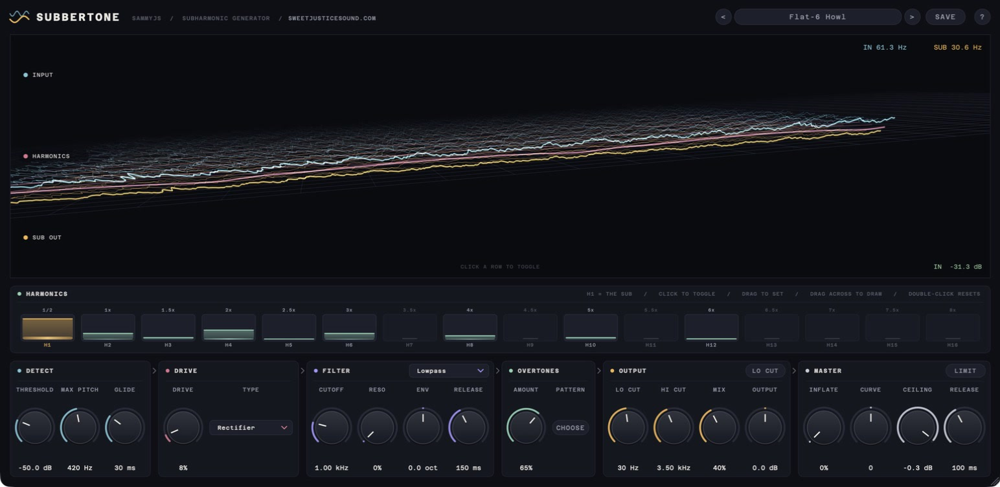
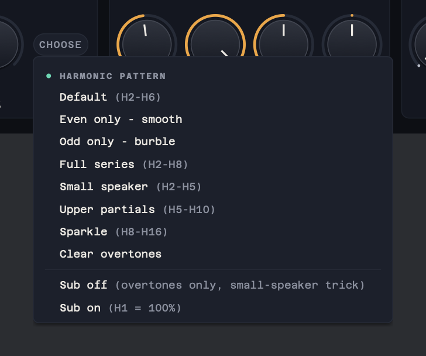
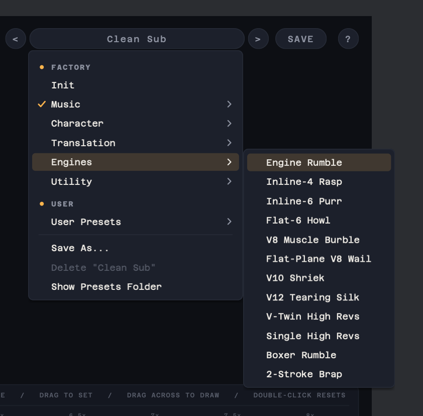

# SammyJs Subbertone

A VST3/AU subharmonic generator. Subbertone tracks the pitch of your bass, engine or drone, synthesises a clean sub one octave below it, and lets you build its harmonics bar by bar: from a pure sub reinforcement, to the small-speaker "hear the bass on a phone" trick, to a growling, talking octave-down bass. A mastering stage (Inflate and a brickwall limiter) finishes the output.

### 🎉 Latest Release v1.2.0 - [Download Here](https://github.com/samueljustice/plugins/releases/tag/subbertone-v1.2.0)



## Features

- **Pitch-tracked sub, one octave down**: a phase-continuous sine that follows your playing, glides between notes and fades with the input. All processing is per sample, so it is click-free at any buffer size.
- **Steady tracking on difficult material**: octave jumps must be confirmed before the sub follows them, and short dropouts are held. A Glide control smooths noisy or wandering sources such as engines.
- **Harmonic editor**: 16 bars, H1 is the sub itself and H2–H16 are its harmonics, each with a live activity meter. Click to toggle, drag to set, drag across to draw, double-click to reset. The PATTERN menu has ready-made sets (even only, odd only, full series, small speaker, upper partials, sparkle), and "Sub off" leaves only the harmonics: the MaxxBass/RBass trick that makes a sub audible on speakers that cannot play it.
- **Six saturation types**, each with a distinct harmonic recipe:
  - **Tape**: smooth, odd harmonics
  - **Valve**: warm, strong 2nd harmonic at every drive level
  - **Console**: harder knee, brighter
  - **Transformer**: soft, mostly odd with a touch of 2nd
  - **Rectifier**: even harmonics only, so every partial lines up with the input note's own harmonics (the cleanest "octave" sound)
  - **Wavefolder**: harmonics sweep upward as drive rises
- **Driver-style resonant filter** on the saturated harmonics: lowpass, bandpass or notch, with resonance driven into saturation and an envelope follower that sweeps the cutoff on every note.
- **Steep low cut**: 48 dB/oct on the generated sub (10–80 Hz, 30 Hz by default), so a very low sub doesn't eat headroom. The harmonics still carry its pitch. Switching it on or off glides smoothly instead of clicking or dipping.
- **MASTER section**: Inflate (Oxford Inflator-style density, with a Curve control) and a look-ahead brickwall limiter with a ceiling, a release and a gain-reduction meter.
- **Presets**: 32 factory presets in five groups (Music, Character, Translation, Engines, Utility), including engine starting points from inline-4 to V12, V-twin and 2-stroke. Save your own with SAVE. They are plain files, easy to back up and share, and Subbertone always asks before replacing one.
- **Full recall**: every parameter, the preset name and the window size are saved with your session, and the factory presets are exposed to the host as programs, so VST racks and tools such as Soundminer recall Subbertone exactly.
- **Resizable interface**: drag the corner to scale the whole window from 55% to 140%. Each instance remembers its size.
- **3D OpenGL visualiser** showing input, harmonics and sub output. When there's no signal it draws the Sweet Justice logo.
- **About 2 ms latency** (the limiter look-ahead and the Inflate oversampling), constant and reported to the host so it is compensated. Host bypass stays in time and switches without clicks. Full DAW automation.

## How it works

1. The input is low-passed to the bass band and analysed with a streaming YIN pitch detector, decimated to about 11 kHz. A tracker confirms octave jumps, rejects outliers and holds through short dropouts.
2. A sine is generated at half the detected pitch, gliding to each new note. Its level follows the bass band's RMS and a voicing gate.
3. The sine is shaped by the chosen saturation curve. The DC and fundamental components are then subtracted exactly, leaving only the harmonics. Because the input to the shaper is always a pure sine, each curve acts as a fixed harmonic recipe.
4. The saturated harmonics go through the resonant multimode filter. Its resonant peak is pushed into a soft clipper, and the envelope follower sweeps its cutoff.
5. In parallel, the harmonic bars add exact harmonics of the sub (H2–H16), phase-locked to it. If the bars add up to more than 1.5 times the sub's level, they are all scaled down together, so even 16 bars at 100% can't blow up the level. Harmonics that would land near or above the Nyquist frequency are left out, so nothing aliases.
6. The clean sub (scaled by H1) and the filtered harmonics are blended by Drive, the overtones are added, and the result goes through the Lo Cut and Hi Cut. It is then mixed with the dry signal.
7. The MASTER stage inflates and limits the final output.

A note on harmonics: odd harmonics of the sub land a fifth and a third above the input note, while even harmonics land exactly on the input's own harmonic series. Use even harmonics, Rectifier or Valve when you want the sub to stay consonant with the bass; use odd harmonics, Tape, Console or Wavefolder for more edge. For engines, odd harmonics give the uneven "burble" of a cross-plane V8 or a boxer.

The interface is laid out in processing order: DETECT → DRIVE → FILTER → OVERTONES → OUTPUT → MASTER.

## Controls

### Harmonics
| Control | Range | Description |
|---|---|---|
| **H1** | 0 to 100% | Level of the clean sub itself. 0 leaves only the harmonics. |
| **H2–H16** | 0 to 100% | Level of each harmonic of the sub, scaled by the overtone Amount. |

### Detect
| Control | Range | Description |
|---|---|---|
| **Threshold** | -60 to -20 dB | Input level needed before the sub is generated. Lower catches quieter notes. |
| **Max Pitch** | 100 to 800 Hz | Highest input fundamental that is tracked. Notes above this are ignored. |
| **Glide** | 5 to 500 ms | How smoothly the sub follows pitch changes. Raise it for noisy or wandering sources such as engines. |

### Drive
| Control | Range | Description |
|---|---|---|
| **Type** | 6 types | Saturation character (see above). |
| **Drive** | 0 to 100% | Crossfades the clean sub into its saturated harmonics while increasing drive. |

### Filter
| Control | Range | Description |
|---|---|---|
| **Mode** | Lowpass / Bandpass / Notch | Filter response for the saturated harmonics. |
| **Cutoff** | 20 Hz to 20 kHz | Filter cutoff. The envelope sweeps up or down from here. |
| **Reso** | 0 to 100% | Resonance (up to Q 20). The peak is driven into saturation, from subtle overtones to full overdrive. |
| **Env** | -4 to +4 oct | How far each note's envelope sweeps the cutoff. Negative sweeps down. |
| **Release** | 5 ms to 2 s | How quickly the filter envelope falls back after each note. |

### Overtones
| Control | Range | Description |
|---|---|---|
| **Amount** | 0 to 100% | Master level for the harmonic bars H2–H16. |
| **Pattern** | menu | Sets the harmonic bars to a ready-made pattern, or switches the sub (H1) off or on. |



### Output
| Control | Range | Description |
|---|---|---|
| **LO CUT** | on / off | Switches the low cut on the generated sub. |
| **Lo Cut** | 10 to 80 Hz | 48 dB/oct low cut frequency. |
| **Hi Cut** | 20 Hz to 20 kHz | Low-pass on the whole sub signal, after drive, filter and overtones. |
| **Mix** | 0 to 100% | Blend between the dry input and the generated sub. |
| **Output** | -24 to +24 dB | Output level, before the master stage (so it also drives the limiter). |

### Master
| Control | Range | Description |
|---|---|---|
| **Inflate** | 0 to 100% | Inflator-style density: louder and fuller without raising the peaks. At 0 the stage is bit-transparent. |
| **Curve** | -100 to +100 | Character of the inflate curve: negative is gentler, positive is more aggressive. |
| **LIMIT** | on / off | Look-ahead brickwall limiter on the final output. Its gain reduction is shown in the MASTER header. |
| **Ceiling** | -12 to 0 dB | The output never goes above this while LIMIT is on. |
| **Release** | 1 ms to 1 s | How quickly the limiter lets go after a peak. |

Double-click any knob to reset it to its default. Click a row in the visualiser to show or hide that trace.

## Presets

Use the arrows either side of the preset name to step through presets, or click the name for the full list, grouped by category. SAVE stores the current settings as a user preset.



User presets are kept in:

- macOS: `~/Library/Audio/Presets/SammyJs/Subbertone`
- Windows: `%APPDATA%\SammyJs\Subbertone\Presets`

Each preset is a small `.subbertonepreset` XML file. Presets from older versions keep loading as new controls are added: any control a preset doesn't contain is set to its default.

## Quick start

- **Clean sub reinforcement:** "Clean Sub", or Drive 0%, Mix around 30–50%.
- **Bass that survives laptops and phones:** "Small Speaker" or "Laptop Lift". For the extreme version, PATTERN → "Sub off" leaves only the harmonics.
- **Warm octave-down bass:** Valve or Rectifier, Drive 40–60%, Cutoff around 800 Hz.
- **Talking growl:** Tape or Console, Drive 70%+, Filter Bandpass, Reso 50–70%, Env +2 to +3 oct, Release 100–200 ms.
- **Engines:** start from the Engines preset closest to the vehicle (cylinder count and layout), then raise Glide if the sub wobbles.

## System requirements

- macOS 11 or later (Apple Silicon and Intel): VST3 and AU
- Windows 10 or later (64-bit): VST3

## Building

### Prerequisites
- CMake 3.21 or higher
- Xcode Command Line Tools (macOS) or Visual Studio 2022 (Windows)
- JUCE, expected at `../SDK/JUCE` relative to this folder

### Build instructions

```bash
cmake -B build -DCMAKE_BUILD_TYPE=Release
cmake --build build --config Release
```

The plugin is built to:
- VST3: `build/Subbertone_artefacts/Release/VST3/`
- AU: `build/Subbertone_artefacts/Release/AU/`

To also build a standalone app (handy for UI work), configure with:

```bash
cmake -B build-standalone -DCMAKE_BUILD_TYPE=Release -DSUBBERTONE_FORMATS=Standalone
```

### Installation

- Copy the `.vst3` bundle to `~/Library/Audio/Plug-Ins/VST3/`
- Copy the `.component` bundle to `~/Library/Audio/Plug-Ins/Components/`

## Credits

- UI font: [Azeret Mono](https://github.com/displaay/Azeret), SIL Open Font License 1.1.
- The filter section is inspired by the distortion-filter concept of effects such as Native Instruments Driver. No code from it is used.
- Inflate and the limiter are original designs in the spirit of Sonnox Oxford Inflator and Waves L2. No code from either is used.

## License

MIT License. See [LICENSE](LICENSE) for details.
