# Swooshbuckler

A whoosh-making rig. Drop in up to ten sounds, press play, and Swooshbuckler rides the faders across them so the layers swell, pass by and fall away. You get a steady stream of doppler passes, swells, hits and tails. Arm the tape and it records every one into a single file, skipping the silence. All that's left is to pick out the good ones.

Swooshbuckler is a standalone app for macOS and Windows, and also a VST3 plug-in (both platforms) and an Audio Unit (macOS).

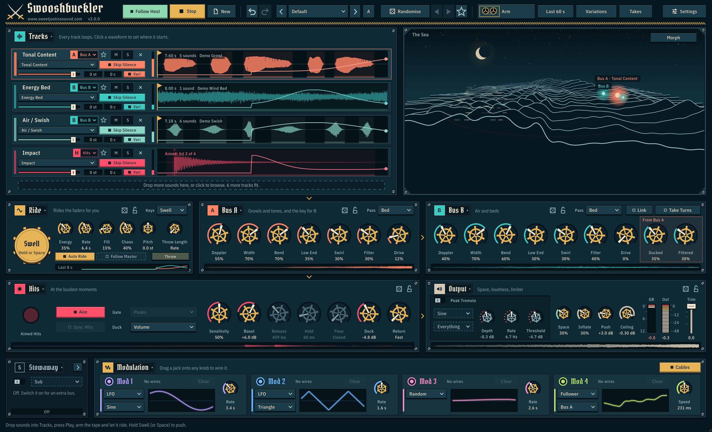

- [Download](#download)
- [Quick start](#quick-start)
- [How it works](#how-it-works)
- [A tour of the window](#a-tour-of-the-window)
  - [Header bar](#header-bar)
  - [Tracks](#tracks)
  - [The sea](#the-sea)
  - [Morph pad](#morph-pad)
  - [Ride](#ride)
  - [Bus A and Bus B](#bus-a-and-bus-b)
  - [Hits](#hits)
  - [Output](#output)
  - [Modulation](#modulation)
  - [Settings and recording](#settings-and-recording)
  - [About](#about)
- [In a DAW](#in-a-daw)
- [Presets and Randomise](#presets-and-randomise)
- [Keyboard, mouse and MIDI](#keyboard-mouse-and-midi)
- [Tips](#tips)
- [Building](#building)
- [Releasing](#releasing)
- [Credits](#credits)

## Download

[](https://github.com/samueljustice/plugins/releases/tag/swooshbuckler-v2.0.0)

Or get every Sammy J plug-in at once, Swooshbuckler included, with one installer that always has the newest version of each (its file names carry the date and time it was built):

[](https://github.com/samueljustice/plugins/releases/latest)
[](https://github.com/samueljustice/plugins/releases/latest)

Swooshbuckler's own release (above, or every version on the [releases page](https://github.com/samueljustice/plugins/releases?q=swooshbuckler)) has these files:

| File | What's in it |
|---|---|
| `Swooshbuckler-x.y.z-macOS-Installer.pkg` | The app, the VST3 and the AU. Click **Customize** to choose which. |
| `Swooshbuckler-x.y.z-macOS-App.dmg` | Just the app. Drag it to Applications. |
| `Swooshbuckler-x.y.z-Windows-Installer.exe` | The app and the VST3. |
| `...-VST3.zip`, `...-AU.zip`, `...-Windows-App.zip` | Each part on its own, for installing by hand. |

macOS builds are universal (Apple silicon and Intel), signed and notarised, and need macOS 11 or later. Windows builds need 64-bit Windows 10 or later.

What's changed in each version is in the [changelog](CHANGELOG.md).

## Quick start

1. **Drop sounds into Tracks**, or click the drop zone to browse. Anything works: cloth, air, engines, animals, metal, voices. Each file gets its own looping track. Swooshbuckler finds the separate sounds in it, guesses what type of sound it is, and sends it to Bus A, Bus B, Stowaway or the Hits.
2. **Press Play.** With **Auto Ride** on (it is by default), every track's fader moves by itself at its own speed. When the layers swell together you get a whoosh.
3. **Shape it** with Energy, Rate and Chaos, or try a preset or **Randomise**.
4. **Arm the tape** (Arm). It records whenever there's sound and skips the quiet stretches. Click again to stop and close the file.
5. Missed a good one? **Last 60 s** saves the last minute, even if the tape wasn't armed.

Hold **Swell**, the space bar or any MIDI note to push every fader up at once. Press **Throw** (or the F key) for one whoosh on demand, with the rig playing or stopped. Return is Play / Stop, R is Randomise, T arms the tape and L saves the last minute. Every key can be changed in Settings: see [Keyboard, mouse and MIDI](#keyboard-mouse-and-midi).

Every knob is a ship's wheel with a sand pointer, and under it its name and its value, always in its own units. The ring around the wheel fills with the value in its section's colour. Every control has a tooltip: rest on it and it tells you its name and what it is set to, and a moment later the whole explanation.

## How it works

```
 Tracks ─┬─> Bus A (tonal, crackle, mixed) ─────────┐
         ├─> Bus B (beds, air)  <── ducked by A ────┤
         ├─> Stowaway (rumble) ─────────────────────┼─> Output ─> tape
         └─> Hits (impacts) <── gate opens on A + B ┘
```

1. **Tracks** loop your sounds. The ride moves each track's fader, so the layers rise and fall on their own.
2. Each track's **sound type** decides where it plays, unless you choose the bus yourself on the lane's bus tag:
   - **Bus A** gets Tonal Content, Crackle and Mixed Content.
   - **Bus B** gets Energy Bed and Air / Swish.
   - **Stowaway** gets Rumble while it is switched on and its Mode is Sub. Otherwise Rumble plays on Bus A.
   - **Hits** gets Impact.
3. **Bus A and Bus B** each turn their tracks into moving sources: doppler passes that fly across the stereo field, with low end, swirl, an envelope filter and drive. Bus A is the key for Bus B: when A gets loud it ducks and darkens B, so the two don't pile up.
4. **Stowaway** is one extra bus beside the two. It is optional: it starts switched off, and its plate has an **On / Off** switch. Its **Mode** decides what it is. In **Sub** it is the rig's sub: only the low end of its tracks comes through, in mono, swelling with Bus A's passes. In **Wake** it is a trail: it opens as Bus A falls away, behind the pass that has just gone by. In **Fly** it is a third mover, with doppler passes of its own. In **Dry** its tracks are only ridden, and go past Space straight to the output stage. A [throw](#throw) reaches it in every mode. The hits duck it like the buses, except in Sub, when the low end stays under the hit. See [Stowaway](#stowaway).
5. **Hits** only play when the hit gate opens. By default the gate opens at the loudest moments of the two buses, so the impacts land on the biggest swells and push the buses out of the way.
6. **Output** adds echoes and reverb, makes it louder and denser, and limits it. The tape and Last 60 s record exactly what you hear.

The small brass arrows between the sections show this flow, and a strip along the bottom of each section's panel shows the last 3 seconds of what it sends on.

## A tour of the window

The window is a landscape one. The header runs along the top. Under it, side by side, are **Tracks** on the left and **the sea** on the right, which together take the top two fifths. Then a row of **Ride**, **Bus A** and **Bus B**; then **Hits** and **Output**, with the Hits' seven knobs directly under Bus A's; and along the bottom **Stowaway** at the left and **Modulation** beside it, with a hint and message line under them. Bus A, Bus B and the Hits share one knob spacing, so their knobs line up in columns; Stowaway's knobs keep the same spacing. Stowaway's plate is the one thing in the window that folds: folded it is slim and Modulation has the rest of the row; open, it shows its knobs and Modulation gives up the width (see [Stowaway](#stowaway)).

The window resizes from its bottom right corner and keeps its shape; everything scales with it, from 85% up to 200%. The first time, it opens at its full size, or at the largest size that fits whole on your screen. After that it opens at the size you left it.

**The look.** Every panel is a flat iron plate with square corners, a pressed edge and a slotted bolt in each corner, and its name is stamped on a riveted nameplate with a tally in its section's colour. Buttons, menus and tags are smaller plates set into it; a lit one turns brass, or its section's colour. Scopes, waveforms, meters and text boxes are windows cut into the plate. Nothing in the window has a rounded corner except the things that are round on a ship: the wheels, the Swell button, the bolts, the lamps and the jacks. Brass is the one accent; Bus A is coral, Bus B turquoise, the Hits cherry, and the four modulators have colours of their own.

**Every name is written one way.** Controls, buttons, menus and tags are in Title Case ("Skip Silence", "Auto Ride", "Last 60 s"); hints and messages are sentences. Capitals are kept for single letters (A, B, M, S) and acronyms (GR, LFO, MIDI). Every label and value is measured before it is drawn, so it is set a little smaller rather than cut; only a name of yours (a file, a preset, a track) is ever shortened, in its middle.

**Three ways a control can be out of play.** Greyed out: it can't be used now (the gate's knobs while Aim is on). Hollow, with a dashed arc or edge: it can be set but does nothing until something else is switched on (Peak Tremolo's knobs while it is off). A chain link in the other bus's colour: it is following another control (Bus B's Doppler, Width and Pass while Link is on).

**Everything that moves runs on one clock**, stepped with the real time of the frame: a preset or a roll passes through the window as a wave, the tape's reels spin up and coast down, the die tumbles before it settles, a wire clicks into its knob, and each track's colour stripe breathes with its ride. Sound answers instantly; the interface eases, and never for longer than a quarter of a second.

### Header bar

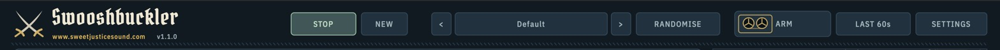

From left to right, in three groups with a thin rule between them: the transport (Follow Host, Play, New), the presets (Undo and Redo, the preset box, A / B, Randomise, its history and the star that keeps a roll) and the tape (the tape, Last 60 s, Variations, Takes). Settings is at the far right.

| Control | What it does |
|---|---|
| **Swooshbuckler** title | Click it, or the version number beside the website link under it, to open [About](#about). |
| **Follow Host** (plug-in only) | On (the default): the rig plays while your DAW's transport plays and stops when it stops, letting the tail ring out. Every transport start begins the ride again from the same place, with the modulators and the morph's Wander starting over too, so the same settings bounce the same way every time. Play still starts and stops the rig by hand in between. Off: only Play, or its automation, starts and stops the rig. Saved with the project. See [In a DAW](#in-a-daw). |
| **Play / Stop** | Starts and stops the whole rig. It is the one filled brass button: a triangle and Play while stopped, a square and Stop while running. Play starts every track from its start flag and the ride from the top. Play fades in over about 60 ms. Stop lets go of the sounds and lets the Fill echoes, the passes in flight and Space ring out, in your speakers and on the tape, until they have died away (6 seconds at most, then a short fade), so a take ends with its tail and not a cut. Press Play during the tail to start again at once (even straight after Stop: sounds that are still letting go fade out in a few milliseconds first, so the restart doesn't click). The app always opens stopped. In a DAW, Play is a parameter you can automate, and it is saved with the project, so a project saved while playing plays when it is opened. |
| **New** | A new session. It stops the rig and the tape, empties all ten tracks, turns off every mute and solo, puts every control back to its default, removes every modulation wire and forgets the session's file. One **Undo** brings all of it back. |
| **Undo** and **Redo** (the two curved arrows) | Take back, and do again, the last thing you changed. See [Undo and redo](#undo-and-redo). |
| The two arrows either side of the preset name | **Previous Preset** and **Next Preset**: step through the presets, the factory ones and then your own, wrapping round at either end. |
| Preset name | Shows the current preset (or "Randomised"). Click it for the list: the factory presets, your own, saving and renaming, A / B and the session. See [Presets and Randomise](#presets-and-randomise). |
| **A** / **B** | Which of the two sets of settings you are on. Click it to go to the other. See [A / B](#a--b). |
| **Randomise** | Rolls a random but musical setting and glides to it. |
| The two triangles | **Previous Roll** and **Next Roll**: step back and forward through the last 20 rolls. See [The roll history](#the-roll-history). |
| The star | **Keep This Roll**: saves the settings as they are as a preset of your own, called Roll, Roll 2 and so on. |
| Tape (**Arm**) | The tape machine. See [Recording](#recording). It reads **Arm**, **Armed** (with a blinking red dot, waiting for sound) or **Rec mm:ss** (recording, reels spinning). |
| **Last 60 s** | Saves the last minute of output to a file, even if the tape wasn't armed. With **Keep the Last** in Settings at 3 or 5 minutes it reads Last 3 Min or Last 5 Min and saves that much. |
| **Variations** | Opens [Render Variations](#render-variations): lots of versions of your sound rendered straight to files. While a batch renders it lights up and reads **Render 37%**. |
| **Takes** | Opens [Takes](#takes): the recordings of this run, to hear, drag out, keep or delete. The number beside it is how many there are. |
| **Settings** | Opens [Settings](#settings-and-recording): where recordings go and how they're written, and the audio device in the app. |

A status line runs along the bottom of the window. The left side always shows a hint. The right side shows the latest message, which fades after about 8 seconds. When a take is saved, the message ("Saved ...") appears in brass at the right of the Tracks title bar instead; click it to open [Takes](#takes), where the file is at the top of the list.

### Tracks

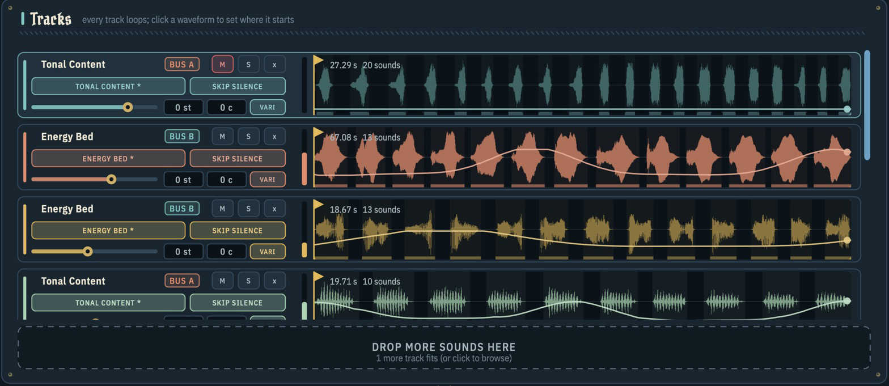

This is where your sounds live: up to ten files, each on its own looping lane. Four whole lanes are always in view; with more than four the list scrolls a lane at a time and never shows half of one. Once a track is loaded the drop zone becomes one slim line under the lanes.

**Loading sounds**

- Drag audio files onto the drop zone, or anywhere in the window, or click the drop zone to browse. You can pick several files at once.
- Each file takes the next empty track. Drop a file onto a lane that already has a sound to replace it.
- Swooshbuckler reads WAV, AIFF, FLAC, OGG and MP3, and on macOS also CAF and M4A.
- Every sound plays from its mono sum, which is what a doppler pass needs: one point that moves. A stereo file whose two sides differ also keeps its stereo width, for beds on Bus B (see [Stereo beds](#stereo-beds)); a stereo file with the same sound on both sides is stored as mono. Files with more channels (up to 7.1.4) are mixed down to stereo first. A stereo sound takes about twice the memory of a mono one: roughly 45 MB a minute at 48 kHz, against 22 MB.
- Files play at their own sample rate. Only the first 10 minutes of a file are loaded; when a longer file is cut, the status line says so ("Loaded the first 10:00 of 23:41").
- The status line accounts for every file you add: how many went in, how many didn't fit (ten tracks at most), and any that couldn't be read.
- Each track gets an automatic loudness trim, so quiet and loud files sit at similar levels before the fader. A peaky sound, such as a hit or a click, is only lifted until its peak reaches full scale, never past it.
- Sounds stay clean when they play faster than they were recorded: pitched up (by Pitch or a track's Semitones), or a 96 kHz file in a 48 kHz session. Anything pushed above the top of the audible range is filtered out instead of folding back down as harsh, off-pitch tones. A sound playing at its own speed is untouched.
- When you load a file, Swooshbuckler finds the separate sounds in it, keeping their natural tails, and guesses what type of sound it is. The guess uses the audio and words in the file name: "hit", "boom" and "slam" suggest an Impact, "wind", "drone" and "rain" an Energy Bed, "whoosh", "cloth" and "sword" Air / Swish, and so on. Naming your files well gets better guesses.

**A track lane**

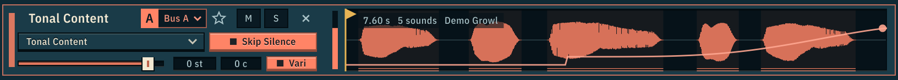

| Part | What it does |
|---|---|
| **Name** | The track is named after its sound type ("Energy Bed", "Tonal Content" and so on) until you rename it. Two tracks of the same type share a name; the lane's shade tells them apart. A lane is drawn in a shade of its bus's colour (coral on Bus A, turquoise on Bus B, cherry on the Hits), and each further track on the same bus is a step lighter or darker. **Double-click** the name to rename it. Return keeps it and Esc cancels. Clear it to go back to the automatic name. |
| **Bus tag** | Where the track plays: **Bus A** (coral), **Bus B** (turquoise) or **Hits** (cherry), in the colour of that section's knobs, with the bus's letter (A, B, or H for the Hits) on a small plate at its left. **Click it** to choose: **Auto** (the bus the sound type picks, the default), **Bus A**, **Bus B** or **Hits**. A ` *` on the tag means you chose it yourself. See [Choosing the bus](#choosing-the-bus). |
| **Star** | Makes this track the **Master**: the one sound the others can follow. Only one track is the Master at a time; click the lit star again to have none. See [The Master track](#the-master-track). |
| **Type badge** | The sound type. Click it to change it, or choose **Auto** to go back to the guess. A ` *` means you set it yourself. On Auto the type decides the bus: see the table below. |
| **Skip Silence** | On (the default): only the sounds play and the gaps between them are skipped, so a recording full of pauses becomes a steady source. The sounds are drawn bright and the gaps faint. Off: the whole file loops, silence and all, and the lane reads "silence kept". |
| **Fader** | The track's level, in dB: 30 dB of travel (each 10% is 3 dB), with the last 5% fading to silence; default −2.1 dB. With Auto Ride on, it sets how high the ride can take the track. Double-click to reset. Each one is also a host parameter, "Track 1" to "Track 10". |
| **Semitones / Cents** | The track's own pitch: up to 24 semitones either way, plus up to 100 cents for fine tuning. It adds to the Ride's Pitch knob and glides to a new setting. **Drag up or down** on a box to change it, and **double-click** to reset. Each one is also a host parameter ("Track 1 Semitones", "Track 1 Cents" and so on). Drag a Mod jack onto the Semitones box to modulate the track's pitch; its plugs sit in a row under the box. |
| **Vari** | On (the default): varispeed, like tape. The pitch and the speed change together, so up an octave also plays twice as fast. Off: the pitch changes and the speed stays the same, through a pitch shifter, which delays that track by about 43 ms. The shifter holds the level of the sound (shifting up only loses what goes above the top of the audible range) and keeps the front of a hit clean. A pitched track is about as loud with Vari on as with it off; pitched up, Vari on carries a small make-up (1 dB per octave) for the top end the faster playback has to filter away. Synced hits allow for both. |
| **M / S / x** | Mute, solo and remove. A muted track keeps its place in the ride, so it comes straight back in when you unmute it. |
| **Waveform** | The yellow **flag** marks where the track starts playing. It loops from there, and the part before the flag is dimmed. **Click or drag** on the waveform to move it, and **double-click** to put it back at the top. The flag is saved with the session; loading a new sound onto the track puts it back at the top. |
| **Ride line** | The line across the waveform traces the track's actual level over the last 8 seconds, like an automation lane scrolling past, with a dot at the right for right now. The thin strip left of the waveform shows the level now. Both include the fader, the ride, and mute and solo. |
| **Playheads** | Thin white lines show where in the file the track is playing (two while it crossfades from one sound to the next). |
| Top left of the waveform | The file length and how many sounds were found in it. |
| **Right-click** a lane | The track's menu: **Master Track**, **Match Pitch to Master** and **Plays On** (the bus). |

**Sound types**

| Type | What it's for | Plays on |
|---|---|---|
| Tonal Content | Sounds with a pitch or a voice: growls, squeals, creatures, tones. | Bus A |
| Crackle | Busy, broken-up texture: fire, debris, sparks. | Bus A |
| Rumble | Low end: sub, thunder, rumble. | Stowaway while it is on and its Mode is Sub, otherwise Bus A |
| Mixed Content | A bit of everything, or no single clear type. | Bus A |
| Energy Bed | Steady sound with body: wind, drones, engines, rain. | Bus B |
| Air / Swish | Air movement: swishes, cloth, flaps, sword swings. | Bus B |
| Impact | Hits and transients. | Hits |

#### Choosing the bus

A track plays on the bus its sound type picks until you say otherwise. Click the **bus tag** on its lane (or right-click the lane and open **Plays On**) and choose:

- **Auto**: the bus the type picks, as in the table above. The menu says which that is. This is the default.
- **Bus A**, **Bus B**, **Hits** or **Stowaway**: the track plays there whatever its type. The tag is marked ` *`. A Stowaway track's tag carries an **S**, and its lane takes Stowaway's kelp green. Choosing Stowaway while it is switched off switches it on, and the status line says so. If Stowaway is switched off later, the tracks sent to it wait: they are not heard, on Stowaway or anywhere else. A waiting lane rests, so it is plain why it is silent: its colour is dimmed, its ride line lies still along the bottom, no playhead runs over it and its tag shows a hollow **S**, until Stowaway is switched on again.

The type, and the name the track takes from it, stay as they are, so a growl can sit under the beds on Bus B, or a swish can go through the hit gate, and still be called what it is. The choice is saved with the session and can be undone. Dropping a new sound on the lane puts it back on Auto.

#### The Master track

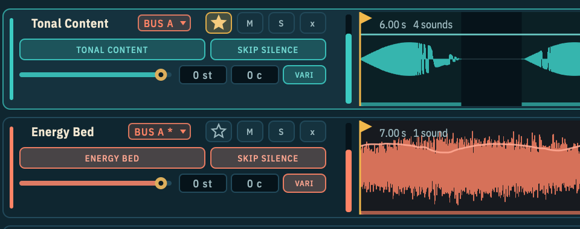

One track can be the **Master**: the sound you want everything else to move like. Click the **star** on its lane; it lights, and any other track that was the Master lets go. Click it again to have no Master.

When a track becomes the Master, Swooshbuckler works out how that sound moves over its length, every 10 ms: how loud it is, what pitch it is at, and how bright it is. Each is measured over the sound's own range (its quietest to its loudest moment, its lowest to its highest pitch, its dullest to its brightest). A long file takes a moment. They are worked out again whenever you edit the Master or drop a new sound on its lane. Three things use them:

- **Follower modulators.** A [Follower](#modulation) can follow **Master**, **Master Pitch** or **Master Brightness**: the Master's loudness, pitch or brightness at the moment it is playing. Wire it to any knob, and that knob moves with the Master sound: Bus B's Filter opening as the Master gets brighter, Space growing as it gets louder, another track's Semitones rising with its pitch.
- **Match Pitch to Master.** Right-click a pitched track's lane and choose **Match Pitch to Master**: its Semitones and Cents are set so the pitch it sits at most of the time is the Master's, to the nearest cent. The Master's own Semitones and Cents count. If the two are more than two octaves apart, the nearest octave in reach is used. A sound with no clear pitch (wind, noise, a hit) is left alone, and the status line says so. It is one undo step.
- **Follow Master**, in the [Ride](#ride) panel: every other track's ride swells with the Master's loudness instead of its own slow wave.

The Master is saved with the session. Removing its track leaves no Master; undo brings it back.

**Undo**

Cmd+Z (Ctrl+Z on Windows), or the Undo arrow in the header, undoes the last sound you loaded or the last track you removed, on whichever track it was, and selects that track. Shift+Cmd+Z (Ctrl+Shift+Z) redoes it. Remove three tracks and three presses bring them all back. Track edits share one history with the knobs and presets, so everything is taken back in the order you did it: see [Undo and redo](#undo-and-redo). Each track keeps up to 40 steps, and all the steps together hold up to about 500 MB of audio: past that the oldest edits are forgotten first, and the latest one can always be undone.

**Hit sync view**

When **Sync Hits** is on in the Hits section, every track on Hits zooms and slides so the transient of the hit it fired last sits on a shared red dashed line, which flashes on every beat. The lane reads "Synced hit N of M". If a track reads "no hits found", turn its Skip Silence off: the whole file then fires as one hit, lined up on its first transient.

### The sea

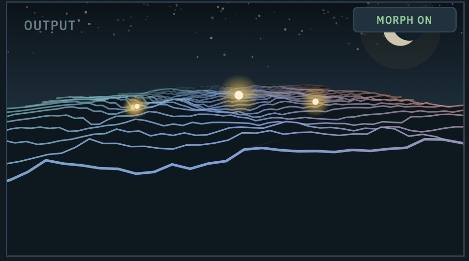

The sea at the top right pictures what the rig is sending out. It is the largest thing in the window, and it runs at the screen's own rate, up to sixty times a second; after five seconds of quiet it steps more slowly to stay out of the way.

- **The waves** are the output's spectrum, lows on the left and highs on the right. The newest wave is at the front, and older ones roll away towards the horizon, going colder and hazier with distance. The water has its own colours, so nothing on it is mistaken for a bus.
- **Each doppler pass** is a glowing ball that arcs across the sea, in its bus's colour (coral for Bus A, turquoise for Bus B). It comes closer the closer the pass, glows brighter the louder it is, and leaves a bump in the water under it that rolls away with the swell. A label above it names the bus, and the track too when only one track plays on that bus ("Bus B · Energy Bed"). Labels keep off the panel's name, the recording lamp and the Morph button, and off each other.
- **A thrown whoosh** is the same comet in brass, and brighter, labelled Throw.
- **Stowaway** shows in its kelp green, by its Mode, with its name (and its track's, when only one plays on it). In **Sub** the whole swell lifts with its level and the water takes its colour. In **Wake** a trail lies on the water where Bus A's comet has just been. In **Fly** it is a third comet. In **Dry**, which does not move, it is a lantern floating in the middle of the water that glows with its level. Switched off, it shows nothing.
- **A hit** fires a short cherry glow along the horizon and a ring widening on the water.
- **The moon** hangs in the left of the sky with its glitter path on the water below it. Its halo warms and widens while the limiter is holding the output down.
- **Every so often the mark appears in the stars**: brighter stars on the outline of the logo, joined by faint lines. It twinkles for a few seconds and fades away. It also comes out when a take is put away.
- While the tape records, a blinking cherry lamp and the word **Rec** show in the corner. The time itself is on the tape's own button in the header, so there is one of it in the window.
- **Click the water** for a short swell, and a ripple where you clicked. Holding Swell raises the swell itself.
- With no sounds loaded the sea is calm, with one line telling you what to do.
- **Morph** (top right) shows or hides the [morph pad](#morph-pad). It reads **Morph On** in green while the morph is switched on.

### Morph pad

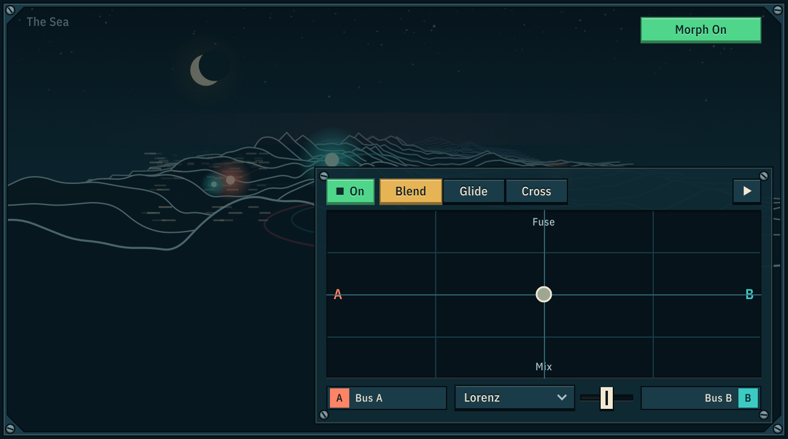

The morph blends Bus A into Bus B spectrally, so the two sounds trade tone and pitch rather than just crossfading. Click **Morph** over the sea to show the pad, then switch the morph on with **On**. The pad docks over the lower right of the sea on a plate of its own, with the sea dimmed behind it, so the sky, the moon and the comets stay in view. The Morph button only shows and hides the pad; the morph keeps running when the pad is hidden.

- **On / Off** switches the morph itself, with a fade rather than a hard switch. The morph takes about 43 ms to do its work, so while it is on, what goes through it runs that much later; the fade is lined up with that, so you never hear the sound doubled while switching. While it's off the pad is veiled and dimmed, but everything still works, so you can set it up first.
- **Blend / Glide / Cross** pick the mode. Changing mode crossfades, so it doesn't click.
- **The dot**: left is Bus A and right is Bus B in every mode. Up and down depends on the mode:

| Mode | What it does | Bottom | Top |
|---|---|---|---|
| **Blend** | Morphs the tone of A into B's. | **Mix**: both sounds' pitches stay audible. | **Fuse**: one fused hybrid texture. |
| **Glide** | The pitches inside the sound slide from A's to B's. | **Move**: the character moves with the pitch. | **Shape**: the character (formants) stays put while the pitch moves. |
| **Cross** | A vocoder: one bus played through the other's tone. | **B thru A** | **A thru B** |

- **Click or drag** on the pad to move the dot. **Double-click** to put it back in the middle.
- **Wander** (the play button at the top right) makes the dot move along a shape by itself, so the morph keeps moving. The whole shape is drawn faintly, with a bright trail behind the dot. Click it again, or click the pad, to stop.
  - The **speed slider**, along the bottom between the Bus A and Bus B labels, sets how fast it goes, from a slow drift to busy.
  - The **shape menu**, beside it, picks the path:
    - **Lorenz** (the default): a chaotic loop that swaps between two wings and never repeats.
    - **Cherries**: the outline of the logo, a grenade with a pair of cherries.
    - **Figure Eight**, **Rose** and **Circle**: these turn slowly, one degree per lap, so they never repeat exactly.
    - **Butterfly**: the butterfly curve, two pairs of wings drawn in one closed line. It turns slowly like the others.
- The **A** and **B** handles under the pad show the two sources. Each side is its whole bus (**Bus A**, **Bus B**) until you tie it to one track: see below.

**Ropes: morphing two single sounds**

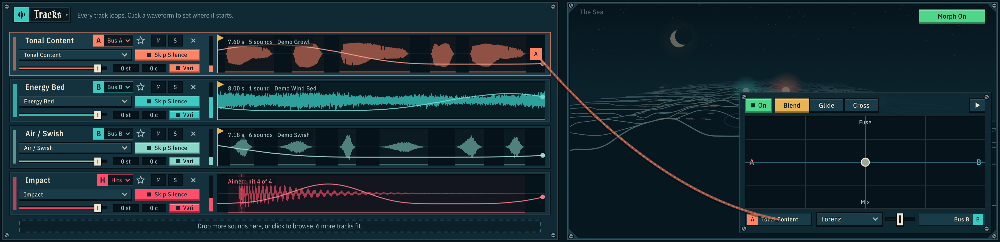

Each side of the morph listens to its whole bus by default. To morph one particular sound instead, **drag the rope** from the **A** or **B** handle under the pad and drop it on a track's lane. The handle takes the track's name and colour, and the rope stays hanging between the two while the pad is showing.

- **A roped side is that one track.** Only that track goes into the morph; the other tracks on its bus play on as they are, unmorphed.
- **An unroped side is its bus**, as before. You can rope one side and leave the other on its bus, or rope both to morph two single sounds.
- **A rope reaches any track**, whichever bus it plays on, the hits included. The morphed result still comes out through Bus A and Bus B in proportion to the dot, so it flies with their doppler passes.
- **With the morph off, a roped track simply plays through its own bus**, exactly as it would without the rope.
- **Double-click a handle** to let its rope go: the side is its bus again. Dropping a rope anywhere that isn't a track leaves things as they were. One track can't be both sides: roping it to the second side lets go of the first.
- Changing a rope while the morph is on dips that side for a few hundredths of a second, so the swap doesn't click.
- Ropes stay with their track when other tracks are added or removed. Removing a roped track lets its rope go, and undo ties it back. Ropes are saved with the session and can be undone.

The wander runs inside the rig, not in the window: the dot keeps flying with the Swooshbuckler window closed, and it is part of an offline bounce. It leaves the Morph X and Morph Y controls alone (so it writes no automation); when you stop it, the dot stays where the wander left it.

### Ride

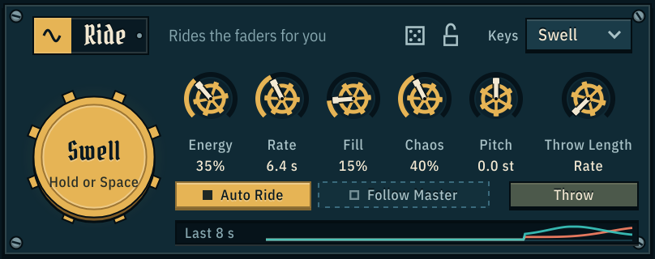

This is where the whooshes come from. With Auto Ride on, each track's fader rises and falls at its own speed (the ten tracks run at different speeds, so they never move together), and the layers swell, overlap and fall away.

Swell is at the left. Its knobs are in a row beside it, with Throw Length at the end; under them are Auto Ride, Follow Master beside it, and Throw under its Throw Length knob. Along the bottom, the **Last 8 s** strip draws where the ride has had the faders over the last eight seconds: Bus A's tracks in coral and Bus B's in turquoise, the newest moment at the right.

| Control | Range (default) | What it does |
|---|---|---|
| **Swell** | button | Hold it to push every track's fader up to its full level, over the ride. Let go and the ride takes over again. It glides rather than jumps. It is a push: held for longer than a couple of seconds, the mix eases back to its usual level with every fader still up (see the note under the table). The space bar does the same, and so does any MIDI note while Keys is set to Swell. |
| **Throw** | button | Throws one whoosh now. See [Throw](#throw) below. The F key does the same. |
| **Auto Ride** | on / off (on) | The faders move by themselves. Off: the movement glides to a stop and each fader stays where you set it. The doppler passes then do the moving: Low End, Swirl and Filter follow how close each pass is. |
| **Follow Master** | on / off (off) | On: every track's ride swells with the [Master track](#the-master-track)'s loudness instead of its own slow wave, so all the layers move like that one sound. See the note under the table. It waits, drawn hollow, until Auto Ride is on and a track is the Master. |
| **Energy** | 0–100% (35%) | How deep the ride dips the faders between swells, evenly in dB: 4 dB more for every 10%, to −36 dB at 90% and silence at 100%. Dimmed with Auto Ride off, when it does nothing. |
| **Rate** | 25 s to 1.9 s (6.4 s) | How fast the faders move: the readout is the time of one rise and fall. It also sets how long each doppler pass lasts, from about 6 s down to about 1.6 s. |
| **Fill** | 0–100% (15%) | Long, softened echoes at about 0.5, 1 and 2 s (each track has its own times, so layered tracks don't echo in step), after each track's fader, so they hang on into the dips of the ride and the gaps of gappy sounds. |
| **Chaos** | 0–100% (40%) | How unpredictable it all is. At 0% the rides and passes repeat in a steady pattern and every track plays its sounds in order from its start. Higher: each swell gets its own size and speed, every pass its own length, speed, closeness and direction, and tracks more often jump to a random sound, sometimes starting partway in. |
| **Pitch** | ±24 semitones (0) | Finer near the middle. Plays every track higher or lower, like changing tape speed: lower is also slower and heavier. It glides to a new setting and isn't locked to whole semitones. |
| **Throw Length** | Rate, or 0.3–6 s (Rate) | How long a thrown whoosh lasts. Its peak is halfway through. Fully left it reads **Rate**: a throw is as long as the ride's own passes, which Rate sets (6 s down to 1.6 s). |
| **Keys** | Swell / Pitch / Throw (Swell) | What MIDI notes do. See [Keys](#keys) below. |

Pitch moves every track at once. To pitch one track on its own, with or without changing its speed, use that track's Semitones, Cents and Vari controls in [Tracks](#tracks).

Swell only lifts the faders up to the ride's ceiling, so with Auto Ride off (or Energy at 0%) the faders are already there and Swell does nothing you'll hear.

**Follow Master** swaps each track's own rise and fall for the Master's: when the Master sound is loud the other faders are up, and when it falls away they dip. The Master itself plays as it is, unridden, since its own sound is the swell. Energy still sets how deep the dips go: at 100% the other layers follow the Master all the way down to silence, at low settings they only lean with it. The faders rise quickly with the Master (about 15 ms) and fall a little slower (about 90 ms). Rate still sets the length of the doppler passes. Follow Master is a host parameter and is saved with the session; presets and Randomise leave it alone.

**The level stays put when the ride changes.** With every fader up all the time (Auto Ride off, Energy below its default, or Swell held) the tracks add up to more than they do while the ride dips them. Swooshbuckler eases the mix down to match, by up to about 5 dB with the faders fully still, so the rig reaches Inflate and the limiter about as loud as with the default ride, and switching Auto Ride on and off compares the movement, not the loudness. It follows Energy and Auto Ride as they glide, and a held Swell over about 2.5 seconds, so a short Swell is still a push. From the default Energy (35%) up, nothing is changed.

How far each knob goes, and why, is measured in the [knob audit](docs/knob-audit.md).

#### Throw

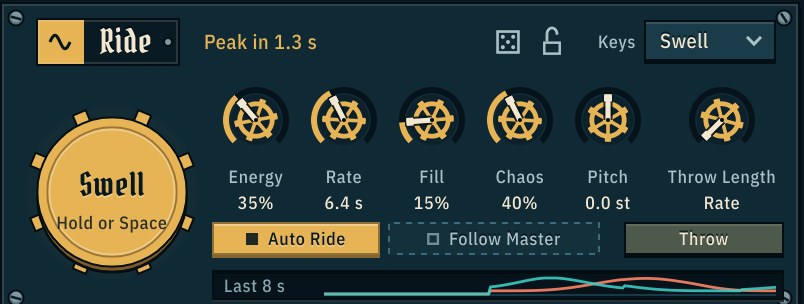

**Throw** fires exactly one whoosh: a single doppler pass, the same on both buses, with a long approach, the peak as it goes by and a shorter tail (the shape of a [Fly-By](#bus-a-and-bus-b) pass). It plays your tracks at their fader levels, through each bus's own Low End, Swirl, Filter and Drive, and with **Aim** on the hit tracks land on its peak.

- **While the rig plays**, the throw goes on top of the ride.
- **With the rig stopped**, you hear just that one whoosh, its tail rings out, and it is silent again. So you can make single whooshes one at a time without the endless ride: arm the tape, press Throw, and each whoosh is recorded with the quiet between them skipped.
- **The peak is heard half a Throw Length after you throw.** While a throw is on its way in, the top of the Ride panel counts down to it ("Peak in 1.2 s"), so you can place it against picture. In the sea a thrown whoosh is drawn as a comet in its own colour.
- Up to four throws can be in flight at once. More than that are dropped until one has finished.
- A throw's hit is as loud with the rig playing as from rest: the hit track plays once, at its fader level.
- A throw takes its own path into the buses: Fill's echoes and the Morph work on the ride, not on a throw.
- Throw from the button, the **F** key, or a MIDI note with Keys set to Throw.

#### Keys

The **Keys** menu at the top right of the Ride panel sets what MIDI notes do. The notes you are holding are shown at the top of the panel ("C3 E3 G3"). In the app, every connected MIDI keyboard is listened to; in a DAW, send notes to the plug-in.

| Keys | What notes do |
|---|---|
| **Swell** | Any held note holds Swell. |
| **Pitch** | The held notes set the pitch. Each note counts as its distance from middle C (MIDI note 60) in semitones, added to the Pitch knob and each track's own Semitones. One note moves every track. Hold several and they are dealt out over your loaded tracks in order: the first track takes the lowest note, the next track the next note, going round again when there are more tracks than notes. So a chord gives each layer its own pitch. Let go of every note and the pitch glides back to the knob. |
| **Throw** | Every note throws one whoosh at that note's pitch. How hard you play sets how close and how loud it passes. Notes played together (within 30 ms) make one whoosh, with their pitches dealt out over the tracks as in Pitch. The pitch stays where the last notes put it until you play again. |

Notes glide from one pitch to the next, so playing never clicks. Each track follows its own Vari switch (on: pitch and speed move together; off: the pitch moves and the speed stays), and the total never goes past two octaves either way. In Swell and Pitch, notes act while the rig is playing; in Throw, a note wakes a stopped rig for its one whoosh.

### Bus A and Bus B

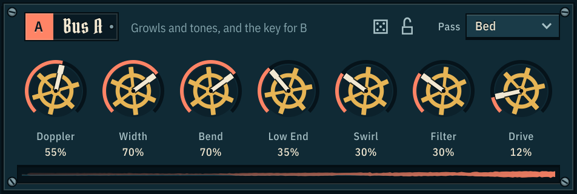

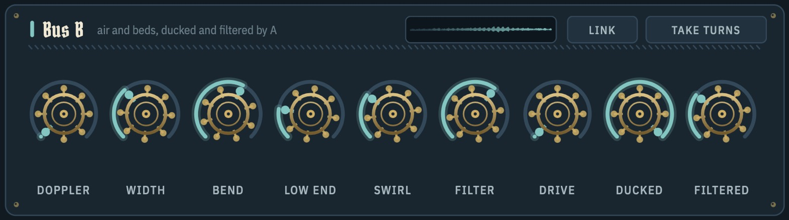

Each bus turns its tracks into a moving source: it runs two doppler passes, half a pass apart, and each one flies across the stereo field. **Pass**, the menu in each bus's title bar, sets how the two follow each other: overlapped into a steady level (Bed) or one at a time (Fly-By). In order, the chain is: doppler passes (with Width and Bend), then Low End, Swirl, Filter and Drive, then the ducking. A pass that comes in fast plays the sound up to twice as fast, and it stays clean: whatever that pushes above the top of the audible range is filtered out instead of folding back down as whistles.

Low End, Swirl and Filter move with the sound: they follow the bus's level against its own recent peak, which with Auto Ride on is mostly the ride's swells. The stiller the faders are (Auto Ride off, a low Energy, or Swell held), the more they follow how close the nearer pass is instead, so the colours keep moving with the passes you see on the sea when the level doesn't.

#### Stereo beds

A wide ambience should stay wide. When a stereo sound plays on **Bus B** with **Pass** set to **Bed**, the bus keeps its stereo width: each pass carries the sound's left and right, not just its mono sum.

- **Doppler** decides how much of the width is heard. At 0% the bed is as wide as the file; as Doppler rises it folds in towards the moving point, and at 100% it is the same single point a mono file gives.
- **Width** scales it too: at 0% everything sits in the middle, mono. A pass that has travelled far to one side narrows on its way out, so the bed is never wider than its source.
- Low End, Swirl, Filter and Drive work on the mono sum, as they do for every sound; the width is added back after them at a matching level.
- Bus A, the Hits, thrown whooshes and Fly-By passes always play the mono sum: a fly-by is one point going past. So do a track with **Vari** off and a sound that is being morphed.
- [Stowaway](#stowaway) in **Dry** keeps a stereo sound's width as well, by its own Width knob.
- A mono file is not touched by any of this. A session stores the extra stereo information only for the sounds that have it.

Bus A ("growls, tones, crackle, rumble - and the key for B") is the aggressive bus. Bus B ("air and beds, ducked and filtered by A") sits under it.

| Control | Default (A / B) | What it does |
|---|---|---|
| **Doppler** | 55% / 40% | How dramatic each pass is: how close it comes, how much it swells and brightens as it goes by, and (with Bend) how far its pitch bends. |
| **Width** | 70% / 70% | How far each pass travels across the stereo field: at 0% it stays in the middle, at 100% it flies fully from side to side. When a pass is off to one side, the ear turned away from it hears it a little duller (only the top end, so a mono fold-down is as solid as without it). |
| **Bend** | 70% / 60% | How much the pitch bends as a pass goes by: it rises on the way in and drops as the pass goes by, like a real fly-by (the rise is the bigger of the two), up to a race-car scream and drop. It changes the pitch only: how the pass swells and brightens is set by Doppler. |
| **Low End** | 35% / 30% | Weight: a sub octave and low overtones, plus a low lift that grows at the bus's loudest moments. The sub octave follows the lowest part of the sound (about 40 to 120 Hz) and holds still on noise, so it stays a note and not a rumble. |
| **Swirl** | 30% / 30% | Movement inside the sound: a phaser, then (from about a third of the way) a flanger that sweeps as the passes come and go. Its level is matched, so it changes the colour, not the loudness. |
| **Filter** | 30% / 40% | A low-pass filter that opens as each pass swells and closes in its tail, so the tails are dark and the peaks bright, like air rushing past. More blends more of it in and closes it further at the peak; the top 40% adds resonance. |
| **Drive** | 12% / 0% | Saturation, from gentle thickening to a hard, flattened growl. The drive rises evenly in dB and the level stays roughly steady, so it adds character rather than just loudness. |
| **Ducked** (B only) | 35% | How far Bus A pushes Bus B down at A's peaks, up to −20 dB, judged against A's own recent peak so it works the same on quiet and loud material. |
| **Filtered** (B only) | 30% | How far Bus A closes a low-pass filter on Bus B at A's peaks, down to about 280 Hz at 100%, so B goes dark under A rather than just quieter. |
| **Pass** (in each title bar) | Bed / Bed | How the bus's two doppler passes follow each other. **Bed**: they overlap, one coming in as the other goes out, so the bus keeps a steady level. Best for beds, air and long energy files. The two are at different pitches while they overlap, which thickens noise and can sound like two notes on a tone. **Fly-By**: one pass at a time, with a long approach, the peak at its closest point and a shorter tail, so each sound is heard once and at one pitch. The level dips between passes (by about 10 dB) without going silent, and the passes are a little louder to make up for it, so a bus is about as loud in either mode. Best for a single clear whoosh, for tones, and for sounds with a sharp start. The passes peak at the same moments in both, so Aim, Link and the sea work the same, and switching mid-pass glides. With Link on, Bus B uses Bus A's Pass and its own menu is dimmed. |
| **Link** (in B's title bar) | off | Bus B flies the same doppler passes as Bus A: at the same moment, as close, in the same direction, with A's Doppler, Width and Pass. The two buses move as one source, for one consistent whoosh. B keeps its own Bend, so its pitch can bend more or less. While linked, B's own Doppler, Width and Pass show a chain link in Bus A's colour and can't be moved, and they come back as you set them when you unlink. Leave it off to keep energy beds on B moving on their own. |
| **Take Turns** (in B's title bar) | off | Only the louder bus plays at full level and the other ducks under it by the Ducked amount (at 0% Ducked it does nothing), so they trade places. The other bus has to be clearly louder (about 2 dB) for 30 ms before the turn passes. Off: A always ducks B. |

Ducked and Filtered are what Bus A does to Bus B, so they sit in a tinted group of their own at the right of Bus B, marked **From Bus A**. While Link is on, Bus B's Doppler and Width read **Linked To A** in place of their own values.

All the knobs run from 0 to 100%. How Bus B gets out of the way (turned down, darkened or just its mids) follows the **Duck** box in the Hits section, and how fast it comes back follows the Hits **Return** knob.

The strip along the bottom of each bus's panel shows the last 3 seconds of what that bus sends on. Bus B's is drawn after A has ducked and filtered it, so a thin line under a busy Bus A means the ducking is working.

### Stowaway

One extra bus beside Bus A and Bus B, for a layer that should not fly about with the others, or that should fly on its own. A track gets there from its lane's bus tag (see [Choosing the bus](#choosing-the-bus)); Rumble goes there by itself while Stowaway is on and its Mode is Sub. Its switch (**Stowaway**), **Stowaway Mode** and its five knobs, **Follow**, **Low End**, **Filter**, **Drive** and **Width**, are in the host's parameter list, and the knobs can be wired to the [modulators](#modulation). The knobs keep their names in every mode, and read by the mode in use: when the Mode changes the host is told to read them again, and a value typed in the host is understood as the knob shows it in that mode (`95 Hz`, `Under 1 kHz`, `Over 300 Hz`, `Open`, `35%`).

| Mode | What it is for | How a track gets there |
|------|----------------|------------------------|
| **Sub** | The low end under everything: planted in the middle, mono, swelling with Bus A. Only the low end of what you send it comes through. | A Rumble track goes there by itself. Any other track: choose Stowaway on its bus tag. |
| **Wake** | A trail behind each of Bus A's passes: debris, spray, a tail of air. | Choose Stowaway on the track's bus tag. |
| **Fly** | A third thing in the air, with doppler passes of its own. | Choose Stowaway on the track's bus tag. |
| **Dry** | A layer that stays what it is: ridden, and nothing else. | Choose Stowaway on the track's bus tag. |

To hear it straight away, load a low rumble and switch Stowaway on: it moves there and becomes the sub. Five of the [factory presets](#presets-and-randomise) are built around it, one or two for each mode. How far each knob goes in each mode is measured in the [knob audit](docs/knob-audit.md#stowaway).

#### On / Off, and the plate

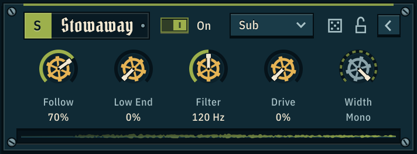 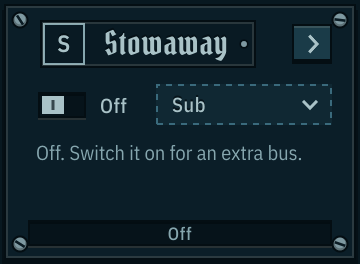

Stowaway is optional, so it starts switched **off**, and its plate sits folded at the bottom left of the window, beside Modulation.

- **On / Off** is the switch beside its name, with the word **On** or **Off** next to it. Off, the whole plate rests: it is darker, the **S** on its nameplate is hollow and the window where its scope runs reads **Off**. Stowaway is then silent and does no work, and tracks sent to it wait unplayed (they do not move to Bus A or Bus B). On, the **S** and the switch light up in kelp green and a lit line runs along the top of the plate. Switching fades Stowaway in or out over 60 ms, so it never clicks. The switch can be automated.
- **Sending a track to Stowaway switches it on.** Choosing Stowaway in a lane's bus menu while it is off turns it on in the same step (one Undo takes back both), so a track is never left waiting by accident.
- **Presets and Randomise.** A preset that uses Stowaway switches it on. No preset, and no roll of the dice, ever switches it off.
- **The chevron** at the right of the plate, or a click on the nameplate, opens and folds it. Folded, it shows the switch, the Mode, a line saying what Stowaway is at the moment, and its scope. Open, it shows the five knobs, its die and its lock as well, and Modulation gives up the room. It opens by itself the first time you switch Stowaway on. Whether it is open is saved with the session, and folding it changes nothing about the sound.
- **A knob that does nothing in the current Mode rests** (hollow), and its tooltip says why: Width in Sub, Low End and Drive in Dry. While Stowaway is off all five rest, and can still be set.
- **The strip** along the bottom of the plate shows the last 3 seconds of what Stowaway sends on.

#### Sub

The mode Stowaway starts in. It is planted in the middle with no doppler, and whatever you send it, only its low end comes through: a full-range roar on Stowaway gives you its rumble and nothing else. In order: a 20 Hz high-pass, the crossover, Low End, Drive, a safety low-pass, then Follow.

| Knob | Starts at | What it does |
|------|-----------|--------------|
| **Follow** | 70% | How much the sub swells with Bus A's passes. At 0% it is a steady sub. At 100% it rises and falls as far as Bus A does, and each 10% takes on a tenth of that swell. The sub is turned up as Follow rises, by as much as the swell it is following takes away (about 4.5 dB at 100% under a typical bed, never more than 6 dB), so on average it stays as loud and only its movement changes. |
| **Low End** | 0% | Adds a note an octave below what came through the crossover, and overtones just above it, which is what lets a small speaker hear the sub. |
| **Filter** | 120 Hz | The crossover, from 40 to 250 Hz. It is steep: 48 dB per octave, and with the low-pass that follows it sound one octave above the crossover is more than 60 dB down (62 to 68 dB, measured with white noise) and two octaves above it is gone (more than 140 dB down). |
| **Drive** | 0% | Thickens the sub and flattens its swell. It works against the sub's own level, so it does the same to a quiet rumble as to a loud one, and it turns the sub up by less than 2 dB over its whole travel (it sounds like more, because the overtones it adds are easier to hear than the sub under them). |
| **Width** | Mono | Not used: a sub is mono, the same in both speakers. |

- **What Follow goes by.** Bus A's level against its own recent peak and, the stiller the faders are, how near Bus A's pass is. While the sub has a bus to follow, its own tracks are not ridden: Bus A is its swell. If no track is playing on Bus A it follows Bus B the same way. If none is playing on either, its tracks are ridden like any others and Follow sets how deep, so the sub is never stuck silent.
- **Low End and Drive cannot brighten it.** They come after the crossover and are followed by a second low-pass at 1.6 times the crossover, so what they add stays within about an octave above it.
- **Mono, before Space.** The sub itself is one signal, the same in both speakers. It then goes through [Space](#output) with the rest of the rig, and Space's echoes and reverb spread a little of it to the sides (about 20 dB under the sub with Space at 30%). With Space at 0% the left and right are identical.
- **Its delay.** A filter this steep holds the low end back by about two cycles of the crossover frequency: 15 ms at 120 Hz, 50 ms at 40 Hz. Follow is applied after the filter, so the swell itself is never late.

#### Wake

A trail behind Bus A. Stowaway is shut while a pass of Bus A's comes in and goes by, opens just behind it as Bus A falls away, and fades as the pass leaves, so every pass drags its own wake. Its tracks are not ridden: the trail is what moves them.

| Knob | Starts at | What it does |
|------|-----------|--------------|
| **Follow** | 70% | How far the trail shuts between passes. At 0% it is a steady layer; at 100% it is silent until Bus A falls away. Each 10% shuts it about as much further. The trail is turned up as Follow rises (never by more than 12 dB), so on average it stays as loud wherever the knob is. |
| **Low End** | 0% | Adds a note an octave under the trail's low band, its overtones, and a low lift of up to 5 dB. |
| **Filter** | Open | A tilt. In the middle it is open. Below the middle it is a low-pass that closes from 18 kHz down to 150 Hz; above the middle it is a high-pass that rises from 20 Hz to 2.5 kHz. The readout says what gets through: **Under 670 Hz**, **Open**, **Over 550 Hz**. |
| **Drive** | 0% | Thickens the trail. It works against the trail's own level, so it does the same to a quiet sound as to a loud one, and it does not turn it up. |
| **Width** | 100% | How far out the trail sits. At 0% it is in the middle. |

- **What it goes by.** Two things. Bus A's level: every drop opens the trail (fully once Bus A is 12 dB down from where it was) and every rise shuts it. And Bus A's passes: the trail blooms over the first quarter of a pass's way out and fades over the rest. The passes count for everything in Fly-By, and in Bed for more the stiller the faders are, since a ridden bed rises and falls with its rides. With no sound on Bus A at all the passes are all there is to go by, so Wake is never stuck silent.
- **Where it sits.** On the side Bus A's outgoing pass is heading, half as far out as the pass has got, so it is always behind it. Width scales that.
- **A throw leaves a trail too**: it blooms behind the throw's peak and is gone with its tail, with the rig playing or from rest.

#### Dry

Riding only. Stowaway's tracks play at their faders and rides and skip everything else: no movement, no Fill echoes, no Space, and the Everything tremolo leaves them alone. They join the mix after Space, straight into the output stage (Loudness, Density and the limiter still act on them). Use it for a layer that must stay exactly what it is: a voice, a production sound, a guide.

| Knob | Starts at | What it does |
|------|-----------|--------------|
| **Follow** | 70% | How much of the ride its tracks keep. At 0% they sit still at their faders; at 100% they are ridden as deep as any other track. They are turned up to match, so on average they stay as loud. |
| **Low End** | 0% | Not used. |
| **Filter** | Open | The same tilt as in Wake: a low-pass below the middle, open in the middle, a high-pass above it. |
| **Drive** | 0% | Not used. |
| **Width** | 100% | How wide a stereo sound plays: 100% is as wide as the file, 0% is mono. A mono file is in the middle whatever the knob says. |

A stereo file keeps its left and right in Dry while the track's **Vari** is on (a track with Vari off plays its mono sum, as on Bus B). In Sub, Wake and Fly a stereo file plays its mono sum.

#### Fly

A third mover. Stowaway's tracks fly their own doppler passes, apart from Bus A's and Bus B's: one pass at a time, each a long approach, a peak as it goes by and a shorter tail, with the pitch bending up on the way in and down on the way out. Its tracks are ridden and take Fill echoes like any track on a bus. The passes have a fixed, medium doppler (there is no Doppler or Bend knob here); how fast they come follows **Rate** and how much they vary follows **Chaos**, as on the buses.

| Knob | Starts at | What it does |
|------|-----------|--------------|
| **Follow** | 70% | How closely its passes are tied to Bus A's. At 0% they keep their own time. At 100% every pass is at its closest at the same moment as one of Bus A's, so the two go by together. In between, each pass is pulled part of the way towards landing on one of Bus A's. |
| **Low End** | 0% | Adds a note an octave under its low band, its overtones, and a low lift of up to 5 dB. |
| **Filter** | Open | The same tilt as in Wake: a low-pass below the middle, open in the middle, a high-pass above it. |
| **Drive** | 0% | Thickens it. It works against the sound's own level, so it does the same to a quiet sound as to a loud one, and it does not turn it up. |
| **Width** | 100% | How far across the stereo field each pass travels. At 0% the passes stay in the middle (they still swell and bend). |

- **Its passes are its own.** How close each one comes and which way it goes are drawn from a random source of Fly's own, started from the same seed as the rest of the rig. So a bounce or a set of [Variations](#render-variations) repeats exactly, and nothing Fly does moves Bus A's or Bus B's passes.
- **The colours come first.** Low End, Filter and Drive act on the sound before it flies, so the pass carries them with it.
- **Aim, Link and Pass Mode leave it alone.** The hits are aimed at Bus A's and Bus B's passes only, Link is between those two buses, and Fly's passes are always Fly-Bys.
- **A throw** is flown here as well: the same pass as on the buses, at the same moment, with Stowaway's Width.
- **A marker** is written where each of its passes is at its closest (see [Markers](#recording)).
- **It sleeps when it has nothing to play.** With no track on Stowaway, a silent one, or the rig stopped and its last passes rung out, Fly does no work at all. Flying, it costs under 1% of one processor core at 48 kHz (0.9% measured), a little less than one of the buses.
- **How loud it is.** Over time, as loud as the other three modes are with the same sound. It is silent between passes and its tracks are ridden, so each pass is louder to make up for both: at the starting settings about 7 dB louder than the same sound flying by on Bus A. Pull the track's fader down if its passes stand too far out.

#### Changing the Mode

A change of Mode never clicks, by hand or under automation: Stowaway fades out over 30 ms, changes over while it is silent, and fades back in over 30 ms. A track that changes bus (by hand, or a Rumble as the Mode enters or leaves Sub) is faded across in the same way, over 10 ms.

The modes are matched in level: with the same sound on Stowaway and everything where it starts, all four come out within about 1.5 dB of each other over a minute and a half (measured on a low drone, a low bed and gappy low bursts: 0.4, 1.2 and 0.8 dB apart). So changing the Mode changes what Stowaway does, not how loud it is.

### Hits

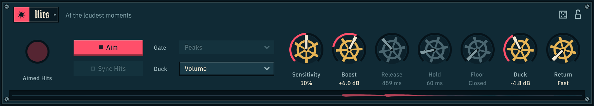

Every Impact track plays here. The Hits jump up and push both buses down out of the way, so each impact punches through the whoosh. There are two ways of timing them:

- **Aim** (on by default): the hits are **aimed at the peaks of the doppler passes** on Bus A and Bus B. Each pass is loudest at its middle, when it's closest to you, and that moment is known as soon as the pass starts. So Swooshbuckler looks ahead: when a peak is coming, it decides whether it earns a hit (closer passes on a louder bus score higher, against **Sensitivity**), picks every hit track's next sound, and starts each one early by that sound's own lead-in, so all the transients land right on the peak. It allows for each track's pitch and Vari, and peaks that land together (with Link, say) fire once. The gate isn't needed, so Gate, Release, Hold, Floor and Sync Hits rest, and the lamp reads Aimed Hits and flashes on each hit.
- **The hit gate** (Aim off): the hits play only when the gate opens. The gate listens to Bus A and Bus B together.

Sessions saved before Aim existed open with it off, so they keep the gate they were made with.

| Control | Range (default) | What it does |
|---|---|---|
| **Gate** box | Peaks / Level / Jumps / Open (Peaks) | What opens the gate. **Peaks**: the loudest moments of the two buses. **Level**: any time they're louder than a level set by Sensitivity. **Jumps**: sudden rises, however loud or quiet. **Open**: no gate, the hits always play. |
| **Duck** box | Volume / Darken / Mids (Volume) | How a ducked bus gets out of the way: turned down, low-passed, or only its crowded middle (250 Hz to 4 kHz) turned down. This also applies to Bus A ducking Bus B. |
| **Sensitivity** | 0–100% (50%) | How easily the hits fire. With Aim: which pass peaks get a hit. With the gate: how easily it opens (Level: within 2 dB of the recent peak at 0%, within 30 dB at 100%). Low: only the biggest moments. High: often. With Gate on Open it is greyed out, as are Release, Hold and Floor. |
| **Boost** | −3 to +12 dB (+6 dB) | How loud the hits come in when they fire, against their own level. |
| **Release** | 60 ms to 1.2 s (459 ms) | How long the hits tail out after the gate shuts. |
| **Hold** | 0–500 ms (60 ms) | How long the gate stays open after the last trigger. Longer stops it chattering, so each hit reads as one event. |
| **Floor** | Closed, or −22 to −3 dB, finer near the top (Closed) | How far the gate closes between hits. |
| **Duck** | Off, or down to −12 dB (−4.8 dB) | How far the hits push Bus A and Bus B down at their peaks. |
| **Return** | Fast, or 20 ms to 1 s (Fast) | How fast ducked buses come back up. This also applies to Bus A ducking Bus B. Slower is smoother, with less pumping. |
| **Hit Gate / Aimed Hits** | light | Glows as the gate opens and fades as it closes; with Aim, flashes on each aimed hit. |
| **Aim** | on / off (on) | Aims the hits at the pass peaks (see above). |
| **Sync Hits** | on / off (off), with Aim off | Every Impact track fires its next hit on one shared beat, so their transients line up into one big hit. Switching it restarts the hit tracks. See the [hit sync view](#tracks). |

The strip along the bottom of the panel shows the last 3 seconds of what got through the gate: each spike is a hit, and the gaps are the gate closed. The gate light, Aim, Sync Hits and the Gate and Duck boxes are at the left of the panel; the seven knobs sit under Bus A's.

### Output

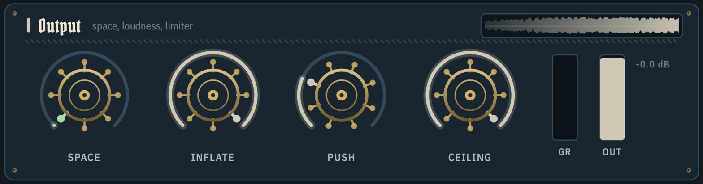

The last stage before your speakers and the tape. At its left is the **Peak Tremolo**, a tremolo that shakes only the loudest moments: as the level climbs towards its recent peak, past **Threshold**, the tremolo deepens (up to **Depth**), and it lets go as the level falls, so the dynamics flutter where the whoosh is biggest. It comes before Space, so the echoes and reverb carry it.

| Control | Range (default) | What it does |
|---|---|---|
| **Peak Tremolo** switch | on / off (off) | Switches the Peak Tremolo. It fades in and out. While it is off its menus and knobs are drawn hollow: they can still be set, ready for when you switch it on. |
| Tremolo Shape | Sine / Square / Flutter (Sine) | **Sine**: a smooth throb. **Square**: hard chops, like a helicopter. **Flutter**: a random wobble, like wings or a loose flap. |
| Tremolo Shakes | Everything / Buses A + B / Hits (Everything) | What it shakes, and whose level drives it. **Everything**: the whole mix. **Buses A + B**: each bus by its own level, dipping together, while the hits stay solid. **Hits**: only the hits. |
| **Depth** | 0 dB to a full chop (−8.3 dB) | How far the level dips at the very peak (the readout is the deepest dip); 100% chops right down to silence. |
| **Rate** | 1.5–30 Hz (6.7 Hz) | From a slow throb to a buzzing flutter. |
| **Threshold** | All, or −17 to −0.2 dB under the peak (−4.7 dB) | How near its recent peak the level has to be before it starts. Low: it shakes most of the time. High: only right at the top. A steady bed sits at its own peak, so it shakes all the time. |
| **Space** | 0–100% (30%) | Echoes and reverb around the whole mix: a ping-pong echo whose repeats drift a little, and a smooth, wide reverb whose tail grows from about 1 to about 5 seconds as you turn it up. The reverb starts a moment after the sound and leaves the low end dry, so the whoosh stays clear in front of it; the dry sound is eased down as the room comes up, so more Space means more room, not more level into the limiter. At 0% it's off (and its echoes and reverb are emptied, so nothing old comes back when you turn it up again); at the top it's a big wash that smooths out the swells. |
| **Inflate** | 0–100% (30%) | Louder and denser without new peaks, so quieter detail comes forward. Up to 70% it blends in; the last 30% makes it harder and grittier. At 0% the sound passes through untouched. It comes before Push, so it does the same wherever Push is. |
| **Push** | 0 to +15 dB (+3 dB) | How hard the mix drives into the limiter, after Inflate. The ceiling stays put, so it can't clip. |
| **Ceiling** | −6 to 0 dB (−0.3 dB) | The limiter's ceiling, finer near the top. It is a true-peak ceiling: the limiter reads the waveform between the samples as well as at them, so a take stays under the ceiling when it is converted to another sample rate or format, or played through a converter. The limiter is always on. |
| **GR** | meter | How much the limiter is turning the sound down (a full bar is 12 dB, with marks at 3, 6 and 12). The bar falls back steadily and a line stays at the deepest recent reduction for a moment, so a short hit is easy to see. The number under the meter is that deepest recent reduction in dB, and turns coral while the limiter is working. |
| **Out** | meter | The peak level going to tape, after the limiter and before Trim, with marks at 0, −6, −12, −24 and −48 dB. The bar is brass above −6 dB and cherry for the last decibel. A line stays at the highest recent peak for a moment, and the number under the meter is that peak in dB. Turning Trim down doesn't move it, because it doesn't change the take. |
| **Trim** | silence to 0 dB (0 dB) | How loud you hear it (and what your DAW gets from the plug-in), after the limiter. The tape and Last 60 s record before it, at full level, so turning it down never makes a quieter take. The fader has marks at 0, −6, −12 and −24 dB, and the number under it is where it is set, in dB. Double-click to reset. |

If the gain reduction number is coral all the time, back off Push or raise Ceiling.

**How the limiter lets go.** A short over, such as a hit, is let go within a few hundredths of a second, so it doesn't leave a dip in the sound behind it. Reduction that lasts, such as a long loud swell or a heavy low end, is held steadily and let go over about a second, so the swell keeps its shape and the bass stays clean.

### Modulation

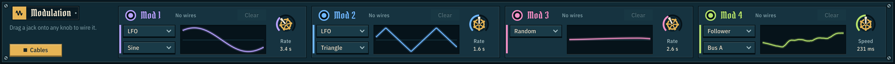

Four modulators run along the bottom, beside Stowaway's plate: **Mod 1** (lilac), **Mod 2** (sky blue), **Mod 3** (rose) and **Mod 4** (lemon). Each can be one of four types, picked from the upper of the two menus at the left of its card:

| Type | What it does | Knob |
|---|---|---|
| **LFO** | A repeating wave that swings each wired knob up and down. The shape menu offers Sine, Triangle, Ramp (rises then drops), Square and Steps (a new random value every cycle). | **Rate**: one cycle every 20 s (0.05 Hz) to 8 Hz |
| **Random** | A smooth random wander up and down, never the same twice. | **Rate**: as above |
| **Follower** | Follows the loudness of **Bus A**, **Bus B**, the **Hits**, **Stowaway** or the whole **Output**, or the [Master track](#the-master-track): **Master** (its loudness), **Master Pitch** or **Master Brightness**, each read where the Master is playing and spread over that sound's own range. Pick which in the menu under the type. It turns its knobs one way only. The Master inputs rest until a track is the Master. | **Speed**: slow and smooth (2 s) to fast and jumpy (15 ms) |
| **Macro** | One knob that turns every knob it's wired to, each by its own depth. It's a host parameter, so you can automate it. | **Amount** |

The defaults are Mod 1: LFO (Sine), Mod 2: LFO (Triangle), Mod 3: Random, Mod 4: Follower (Bus A). Every card is laid out the same way. Along its top are its jack, its name, a line that says what it is wired to ("1 wire - Bus B Swirl", or "No wires") and Clear. Under that are its two menus, a scope of what the modulator has done over the last few seconds, and its knob.

**Wiring**

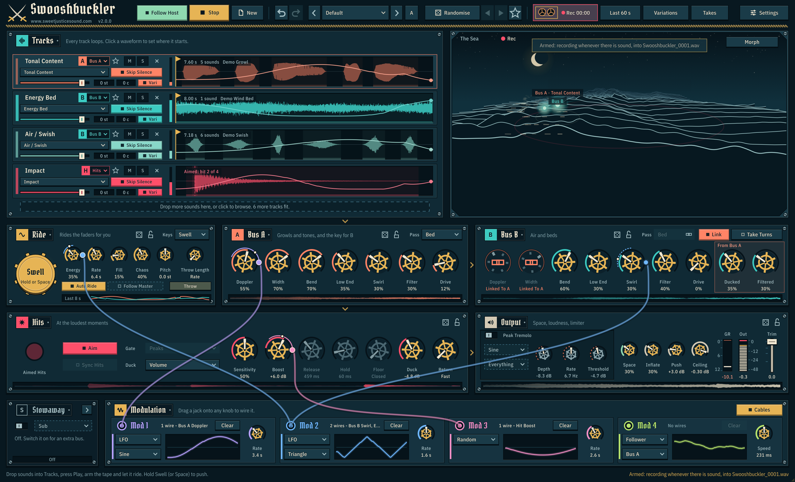

- **Drag from a modulator's jack** (the round socket at its top left) onto a knob. A cable follows the mouse, and the knob under it lights up; drop it there to wire it. Drop it anywhere else to cancel. Drag from the same jack again to wire more knobs.
- You can wire every knob in Ride, Bus A, Bus B, Hits and Output (the Peak Tremolo's included), and each track's **Semitones** box, which modulates that track's pitch smoothly (a 100% wire swings two octaves). You can't wire the morph pad, the track faders, or the modulators' own knobs.
- Each wire leaves a **plug**, a small coloured dot on the right of the knob's rim, and draws a thin ring outside the knob's value ring, in the modulator's colour, showing how far it moves the knob. Several wires on one knob stack their rings outwards, and a dot on the rings shows where the modulation has the value at this moment:
  - **Cmd-drag the control itself** (Ctrl-drag on Windows) to set the depth of its newest wire: up for more, down through zero for negative (the wire then moves the control the other way). A bubble shows the amount. Hold Shift for fine control. **Cmd-double-click** (Ctrl on Windows) sets it back to +50%.
  - Or **drag the plug up or down**, from −100% to +100%. New wires start at +50%. Hold Shift for fine control.
  - A negative depth draws its ring **dashed**, so you can see at a glance which way a wire pushes.
  - **Double-click** a plug to set it to +50%.
  - **Right-click** a plug for a menu: Invert, Depth 25%, 50% or 100%, or Pull Out the Wire.
  - **Alt-click** a plug to pull the wire out straight away.
- **Clear** on a card pulls out all of that modulator's wires.
- **Cables** (at the right of the panel's title bar) shows or hides the cables. A cable leaves its jack straight up, out of the top of its card. The plugs stay on the knobs either way. A cable comes up beside a knob's name and value and turns in to its plug, so it never covers them. Put the mouse on a modulator's card, or on one of its plugs, and its cables stand out while the others fade.
- Several wires on one knob add together. You can have up to 48 wires in all.
- Wires only move the value that reaches the sound. The knob itself never moves, so your DAW automation stays clean.
- Wires and modulator settings are saved with the session. Presets and Randomise don't touch them, and New pulls them all out.

Some ideas: follow **Bus A** with a wire on Bus B's Filter to make B react to A, follow **Hits** with a wire on Space to make every impact open up the room, or put a slow Random on Pitch.

### Settings and recording

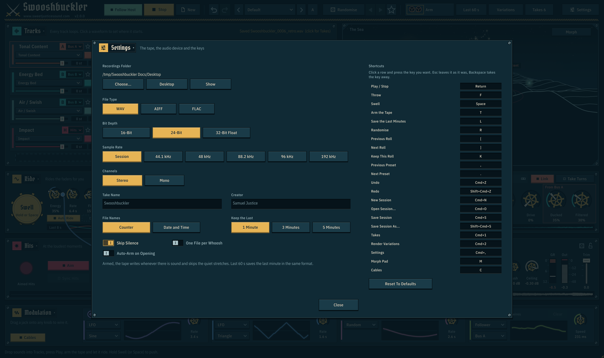

Click **Settings** to open. Close it with Close, Esc, or a click outside the panel. These settings belong to Swooshbuckler itself, not to a session, and are shared by the app and every copy of the plug-in.

| Setting | Options (default) | What it does |
|---|---|---|
| **Recordings Are Saved To** | (your Desktop) | **Choose...** picks a folder, **Desktop** goes back to the default, and **Show** opens the folder. |
| **File Type** | WAV / AIFF / FLAC (WAV) | FLAC is lossless and about half the size. Every type carries a description of how the take was made; WAV files also get markers (see [Recording](#recording)). |
| **Bit Depth** | 16-Bit / 24-Bit / 32-Bit Float (24-Bit) | 32-Bit Float can't clip in the file, and is WAV only. 16-Bit files are dithered, so quiet fades end in a faint steady hiss and not in grit. |
| **Sample Rate** | Session / 44.1 / 48 / 88.2 / 96 / 192 kHz (Session) | Session records at the audio device's or host's rate. Pick a higher rate and the whole rig runs at that rate, so the recording keeps the extra high end, which is good for pitching down later; you still hear it at the device rate, filtered so the extra high end is taken out cleanly and held to the Ceiling again. A note in the panel says which is happening. It can't be changed while the tape is armed. |
| **Channels** | Stereo / Mono (Stereo) | Mono folds the output to one channel, for sounds you'll pan yourself. |
| **Auto-Arm on Opening** | (off) | Arms the tape as soon as Swooshbuckler opens. So you never miss the first good take. |
| **Skip Silence** | (on) | On: the armed tape leaves the quiet stretches out (see [Recording](#recording)). Off: the tape rolls all the time, for one continuous take. You can switch it during a take. |
| **One File per Whoosh** | (off) | On: the armed tape closes its file each time a whoosh has ended and opens the next one for the next whoosh (see [Recording](#recording)). Off: one file for the whole take. Switching it while the tape is armed closes the open take and arms again. |
| **Take Name** | (empty) | The start of every recorded file's name. Empty: the preset's name (Swooshbuckler for the default preset). |
| **Creator** | (empty) | Who made the recording, written into every file. Empty: Samuel Justice. |
| **File Names** | Counter / Date and Time (Counter) | Counter: `Name_0001`, `Name_0002` and so on. Date and Time: `Name_2026-11-07_16-32-10`, good for single long takes. |
| **Keep the Last** | 1 Minute / 3 Minutes / 5 Minutes (1 Minute) | How much the Last button can save after the fact. The sound is held in memory all the time: about 23 MB a minute at a 48 kHz recording rate, 46 MB at 96 kHz and 92 MB at 192 kHz, so 5 minutes at 192 kHz is about 460 MB. Changing it empties what is held. |
| **Audio Device...** | | The app only: the audio output, sample rate and buffer size. |
| **Shortcuts** | | Down the right-hand side: every action with the key it has now. Click a row and press a key to change it. See [Changing the keys](#changing-the-keys). |

#### Recording

- **The tape (Arm).** Click to arm. Everything goes into one file until you click the tape again, press New or close Swooshbuckler. The Rec timer counts only what's been written. A take with no sound in it leaves no file behind.
- **One File per Whoosh** (off by default, in Settings). The armed tape writes a separate file for each whoosh, so a session of riding leaves a folder of numbered whooshes and not one long take to cut up. A whoosh has ended when the output has sat about 25 dB under its recent peaks for three quarters of a second (the same test Skip Silence uses, and the quiet between whooshes is always left out), or when a thrown whoosh has rung out with the rig stopped. Each file keeps the quarter second before its sound and its tail. Sounds with less than a fifth of a second of level in them are not kept, so clicks and blips don't become files. Each file appears in [Takes](#takes) as its whoosh ends. Whooshes that overlap, with no quiet between them, share a file.
- **Markers.** WAV takes carry cue points with labels, so a long take arrives already spotted in Reaper, Soundminer and other tools that read them: **Pass A** and **Pass B** where a doppler pass on that bus goes by at its closest (with Link on the two buses fly the same passes, so only Pass A is written), **Pass S** where one of Stowaway's own passes does (in Fly), **Throw** at the peak of a thrown whoosh, and **Hit** where an aimed or synced hit lands or the hit gate opens. Markers that fall together are one cue, such as "Throw + Hit". They are placed in the file itself, so they stay on their sounds when Skip Silence has left stretches out. AIFF, FLAC and Last 60 s files have no markers.
- **What each file says about itself.** Every file carries a description: the Swooshbuckler version, the preset, and Energy, Rate, Fill, Chaos, Pitch, Space, the Pass Modes, Morph and Aim as they were when the file was started. It also names the Creator from Settings and the software. In a WAV these are the broadcast-wave description and originator and the INFO comment, artist and software; in an AIFF, comments; in a FLAC, the DESCRIPTION, ARTIST and ENCODER tags.
- **Skip Silence** (on by default, in Settings). The tape judges quiet against the recent peaks, not against a fixed level, because a rig with a bed in it never falls truly silent. It stops rolling once the output has sat about 25 dB under the recent peaks (or under about −56 dBFS) for three quarters of a second, and starts again when the sound comes back, keeping the quarter second before it so attacks survive. Each join is faded over 30 ms. The recent peak is remembered for about 10 seconds and then follows the level down, so a quieter passage is recorded once it is the new normal. After Stop the tape keeps the whole tail, and once the rig has come to rest the tape stops rolling until the next Play. How much is left out depends on the sound: deep, slow swells (a high Energy, few layers) leave gaps to skip, while a busy rig with a steady bed is recorded almost whole. Switch Skip Silence off for one continuous take.
- **If the disk can't keep up**, the tape buffers about 3 seconds of audio at any sample rate before anything is lost, and the message that names the saved file says how much is missing.
- **Last 60 s.** Swooshbuckler always keeps the last minute of output while it plays (or the last 3 or 5 minutes: **Keep the Last** in Settings, at the memory cost given there). Click Last 60 s to save it, even if the tape wasn't armed and even while a take is going. Silence at the start is trimmed. It's written the way the tape is set: the same File Type, Bit Depth, Sample Rate and Channels.
- **What's recorded** is the final output, after Space and the limiter: exactly what you hear.
- **File names** look like `Jet Passes_0007.wav`: the Take Name from Settings (or the preset's name), then a four-digit counter. The counter carries on for as long as Swooshbuckler is open and never takes a number that a file in the folder already has. Set **File Names** to Date and Time for names like `Jet Passes_2026-11-07_16-32-10.wav`. Last 60 s files end in `_retro`.
- File Type, Bit Depth, Sample Rate and Channels are fixed when you arm, so changes apply to the next take.

#### Takes

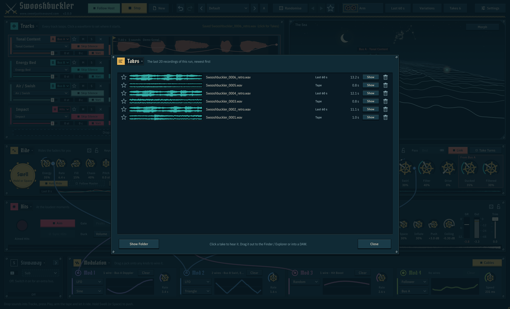

Click **Takes** in the header (or a "Saved ..." message) to open the list of this run's recordings, newest first: tape takes, whoosh files, Last 60 s saves and rendered variations, up to 20. Close it with Close, Esc, or a click outside the panel. The list starts empty each time Swooshbuckler opens; the files themselves stay in the recordings folder.

| Part of a row | What it does |
|---|---|
| Star | Keeps the take in the list. When the list is full the oldest take without a star leaves first. Leaving the list never deletes a file. |
| Waveform and name | Click to hear the take; click again, or another take, to stop. It plays over whatever the rig is doing, after the tape, so it is never recorded. A line shows where it is. Drag the row out to the Finder or Explorer, or straight onto a track in your DAW, to copy the file there. |
| Tag and length | What it is (Tape, Whoosh, Last 60s, Variation, or Variations for one file that holds a whole batch) and how long. A file that has been moved or deleted since reads Missing. |
| **Show** | Shows the file in the Finder or Explorer. |
| Bin | Moves the file to the system trash and takes it off the list. |

**Show Folder** opens the recordings folder.

#### Render Variations

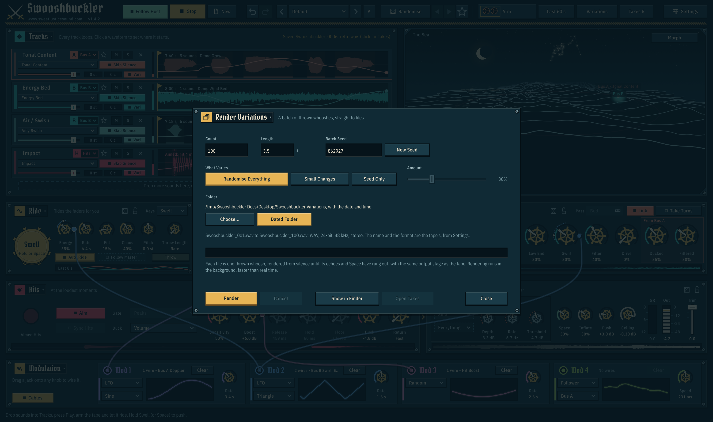

Click **Variations** in the header to make lots of versions of your sound as files, without playing them. Spend twenty minutes dialling in a sound you like, then ask for 100 of it: the same settings, wires and modulation, with different passes each time.

The batch renders in the background, much faster than real time (on the machine this was written on, 100 whooshes of 3 seconds take about 20 seconds), through a second copy of the rig made from your session at the moment you press Render. The rig you hear is never touched: it keeps playing, you can keep working, and nothing you change afterwards reaches the batch. Every file goes through the same output stage as the tape (Inflate, Push, the limiter and its Ceiling, the tremolo, Space) and is not affected by Master Trim.

| Control | What it does |
|---|---|
| **How Many** | How many variations to make, from 1 to 1000. It starts at 100 and remembers what you set. |
| **What Each File Is** | **One Whoosh**: a single pass, like pressing [Throw](#throw): it starts from silence and runs until its echoes and Space have rung out, with the silence in front taken off and a short fade at the very end. **Whole Ride**: a stretch of the rig as you hear it with Play on, with the ride, the passes, the hits and the modulators all running. Two seconds are played first and left out, so a file never opens on the rig starting up from silence, and each end has a short fade so neither clicks. |
| **Length** | One Whoosh: how long each whoosh takes to go by, from 0.3 to 6 seconds (it starts out as the Ride panel's Throw Length); the file runs on until the tail has rung out, so it is longer than this. Whole Ride: how many seconds go into each file, from 1 to 120. |
| **What Varies** | **My Settings, New Passes** (where it starts): every knob, wire and modulator stays exactly as you set it; only the passes differ: how each one flies, how close it comes and which sound of each track it plays. **My Settings, Small Changes**: your settings with every sound-shaping knob moved a little either way, by up to Amount, and each track starting a little further into its sample: a family of sounds around the one you dialled in. **Randomise Everything**: a fresh Randomise for every file, so each is a different sound; your tracks, their levels, the output, every knob Randomise doesn't touch and any section you have locked stay as they are. |
| **Amount** | My Settings, Small Changes: how far each knob may move. At 100%, up to half of its travel either way, and up to four semitones of Pitch. |
| **Batch** | **New Batch Every Time** (where it starts): every Render makes variations you have not had before. **Repeat Last Batch**: the same variations as the last batch again, sample for sample (16-bit files differ only in their dither), as long as your settings and sounds are the same: handy for the same whooshes in another file type, or with one knob changed. **Repeat Batch...** lists the last six batches by name, date and time. Repeating a batch also sets How Many, What Each File Is, Length and What Varies back to what that batch had. |
| **File Names** | What the files are called: **Counter** (`Whoosh_001`, after the Take Name from Settings, or the preset's), **Date And Time** (`Whoosh_2026-11-13_1432_001`), **Preset And Counter** (`Jet Passes_001`) or **Batch Name And Counter** (a name you type in **Batch Name**: `Dragon Wings_001`). A batch that reaches 1000 gets four digits. The line under the folder shows what the first file will be called. Nothing is ever written over: numbers carry on after the files already in the folder. |
| **Files** | **One File Per Variation** (where it starts), **One File With Markers**: every variation in one long file (`<name>_All`, or `<name>_All_2` and so on if that is taken), with a marker at the start of each named after the variation and **Gap** seconds of silence between them (0.5 s to start, up to 10 s), or **Both**. WAV files get cue points with labels and AIFF files markers, which DAWs and editors show; FLAC has no markers, so there the names and times are written into the file's comments. A WAV or AIFF file has no room for markers at 4 GB or more, so a long file that big is not started (FLAC has no such limit). In [Takes](#takes) the long file is one take. |
| **Folder** | Where the files go. **Dated Folder** (the default) gives every batch a new folder of its own inside the recordings folder, named after the take name and the date and time. **Choose...** picks a folder that stays. |
| **Render** | Starts the batch. |
| **Cancel** | Stops it. The files already made are kept, and the long file is closed with the variations it has; the one in hand is dropped, so nothing half-written is left. |
| **Show in Finder** / **Show in Explorer** | Shows the batch's folder. |
| **Open Takes** | Opens [Takes](#takes), where the newest 20 of the rendered files can be heard, starred and dragged out. |

Before you press Render the panel says what you will get: the first file's name and format, then how much it comes to, for example "100 files, one whoosh each: about 5 minutes of sound, ready in about 20 seconds." The time goes by how fast the last batch went on your machine. Under it a sentence says what the chosen What Varies gives.

While a batch renders the panel shows a progress bar with the percentage, which variation it is on ("37 of 100" and its name) and roughly how long is left. You can close the panel; the header button keeps showing the percentage, and the status line says when the batch is done. When it has finished the panel says what was made and where, with the batch's number in small print underneath.

The file type, bit depth, sample rate and mono or stereo are the tape's, from Settings. Every file carries a description: which variation of which batch it is, the batch's number, and the value of every control it was made with, so a favourite can be dialled in again by hand.

If the rig has nothing to play (no samples loaded and every lane muted, say) the batch stops with a message and writes no files.

#### Your session in the app

The app reopens where you left off: the sounds, settings, wires, A / B sets, locks and the session's name are all as they were when you quit. While it runs it also keeps a safety copy: about once a minute when you have changed something (a knob, a wire or how deep it reaches, a track), and a few seconds after a track is loaded, edited or removed. Movement the rig makes by itself, such as the morph dot while Wander is on, doesn't count, so a session that is only playing isn't saved over and over. The copy is written in the background, so the interface never waits for it (with about 20 MB of audio in the session a save takes around a fifth of a second). If the app doesn't get to quit properly (a crash, a power cut), the next launch opens that copy, so you lose a minute at most. In a DAW, the project keeps the plug-in's state as usual.

#### Session files

A session can also be saved as a file of its own, to keep several pieces of work or to move one to another machine or into a DAW. The commands are in the **Session** part of the preset list (click the preset name):

| Command | What it does |
|---|---|
| **Save Session As...** | Writes the whole session to one `.swooshsession` file: every setting, the wires, the A / B sets, the locks and all the audio in the tracks (stored losslessly), so the file needs nothing else. Shift+Cmd+S in the app. |
| **Save Session** | Saves to the session's file again (the list shows its name). The first time, it asks where. Cmd+S in the app. |
| **Open Session...** | Opens a session file in place of what is loaded. Cmd+O in the app. Dropping a `.swooshsession` file on the window does the same. |
| **Recent Sessions** | The last ten session files you saved or opened that still exist, newest first, and **Clear Recent Sessions**. |

In the app the window's title shows the session's name. **New** starts an unnamed session again. Opening a session clears the undo history. The plug-in has the same commands, so a session made in the app opens in a DAW and the other way round; the DAW project still keeps the plug-in's state by itself.

Session files, and the state a DAW project keeps, hold the audio in a compact binary form. Sessions and projects saved by earlier versions still open. If a session's file is no longer where it was when the session is reopened (it was moved, or the project came from another machine), the session comes back unnamed and **Save Session** asks where to save.

### About

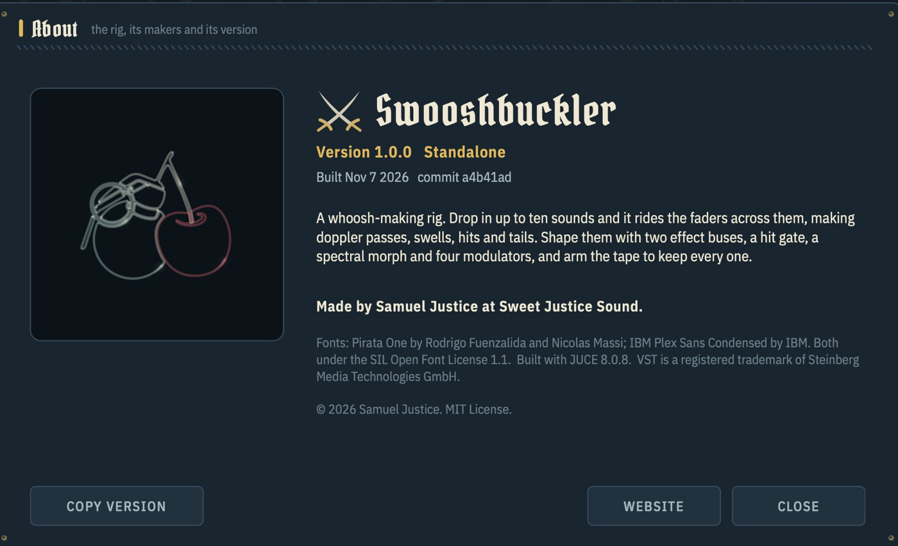

Click the **Swooshbuckler** title or the version number to open it. It shows the version, which format you're running (app, VST3 or AU), the build date and commit, and the credits. **Copy Version** copies the version, build date and commit, plus your operating system, for a bug report. **Website** opens sweetjusticesound.com. **Licences** shows the notices and licences of the software and typefaces Swooshbuckler is built with (the same text as [THIRD-PARTY-NOTICES.md](THIRD-PARTY-NOTICES.md)); click it again to go back.

## In a DAW

- **Put it on an instrument track.** Swooshbuckler is an instrument (a generator): it makes sound from the tracks you load into it, not from the audio of the track it sits on. Use an instrument or software-instrument track (VST3 or AU), then open the window and drop your sounds in.
- **Follow Host** (in the header, on by default) starts and stops the rig with the transport. Every start begins the ride from the same place, so a bounce of the same project is the same every time, including the modulators and the morph's Wander.
- **The tail is bounced too.** Swooshbuckler tells the host its tail can last up to 6.5 seconds, so a bounce or a freeze that respects plug-in tails keeps the ring-out after the transport stops.
- **Play is a parameter.** Automate it to start and stop the rig at exact places, with Follow Host on or off.
- **MIDI notes**: play or draw notes on the instrument track and pick what they do with [Keys](#keys). **Swell**: any held note holds Swell. **Pitch**: the held notes set the pitch of the tracks, a chord dealt out over them. **Throw**: every note throws one whoosh at that note's pitch, its peak half a Throw Length after the note, so you can place whooshes on the timeline note by note.
- **MIDI controllers**: a track's fader, or Energy, can follow a fader or knob on a controller. Right-click it and choose **Learn MIDI CC** (see [MIDI controllers](#midi-controllers)). There is no mapping until you make one.
- **Automation**: every knob, fader and switch is a host parameter and can be automated, Play included. Typing a value into a knob, or moving it by hand, writes automation like any other move; a MIDI controller moves the control without starting a write of its own.
- **Where recordings go**: the tape, Last 60 s and Render Variations write files to the folder set in [Settings](#settings-and-recording) (the Desktop unless you change it), not into the DAW project. Drag a take from **Takes** straight onto a DAW track. The plug-in's output is also just audio on the track: bounce or record it there as you would any instrument.
- **Keys**: the single-key shortcuts work while the Swooshbuckler window has the keyboard (click in it first). Some hosts keep keys such as the space bar and Return for their own transport.
- Follow Host, the play state, Keys and Throw Length are saved with the project. The settings in Settings, and learned MIDI controllers, are shared by every project and the app.

## Presets and Randomise

The factory presets are **Steady Energy**, **Jet Passes**, **Monster Swells**, **Gentle Breeze**, **Fast and Furious**, **Magic Dust** and **Heavy Hits**, and five built around [Stowaway](#stowaway): **Sub Under Jets**, **Deep Quake**, **Debris Wake**, **Three Movers** and **Dry Rider**. Pick one from the preset name, or step through them with **<** and **>**. Every control glides to its new setting while it plays, so you can switch mid-whoosh. Grab a knob during the glide and your move wins.

A preset is a complete look: every control it owns that it doesn't set goes back to its default. The presets set Pass too: **Jet Passes**, **Monster Swells**, **Fast and Furious**, **Sub Under Jets**, **Deep Quake** and **Debris Wake** put Bus A on Fly-By, **Three Movers** puts both buses on Fly-By, and the others use Bed on both buses.

The five Stowaway presets switch Stowaway on and set its Mode and knobs. A preset never moves a track, so in Wake, Fly and Dry there is nothing on Stowaway until you send a track there from its lane's bus tag; in Sub a Rumble track goes by itself. Until then Stowaway is on and silent, and the rest of the preset plays as it is. Choosing one of these presets with nothing on Stowaway says so in the status line (**Stowaway is on with nothing on it: send it a track from a lane's bus tag**), so it is never a mystery.

| Preset | Stowaway | What to put on it |
|--------|----------|-------------------|
| **Sub Under Jets** | **Sub**, crossover 100 Hz, Follow 90%, a little Low End and Drive. Bus A flies fast fly-bys over it. | A rumble, or anything with weight: only its low end is used. |
| **Deep Quake** | **Sub**, crossover 70 Hz, Low End 70%, Drive 45%, under slow, deep swells pitched down. | The same. |
| **Debris Wake** | **Wake**, Follow 100%, Width 85%, the Filter thinning its low end. Bus A on Fly-By, so every pass drags a trail. | Debris, spray, rattle, a tail of air. |
| **Three Movers** | **Fly**, Follow 0% (its own time), Width 100%, with both buses on Fly-By. | A third source to fly: another engine, a voice, a tone. |
| **Dry Rider** | **Dry**, Follow 60%, Width 100%, over buses with plenty of Swirl, Drive and Space. | Whatever must stay itself: a voice, a production sound. |

The other seven leave Stowaway's switch where it is, and put its Mode back to Sub and its knobs back where they start.

**Randomise** rolls Energy, Rate, Fill, Chaos and Pitch (whole semitones from −7 to +7), the bus knobs (Doppler, Width, Bend, Low End, Swirl, Filter and Drive, plus Ducked and Filtered on B), the hit knobs (Sensitivity, Boost, Release and Duck), Space, and Stowaway's five knobs (never its Mode or its switch). Width stays between 35% and 100% and Bend between 30% and 90%, so a roll never leaves a pass stuck in the middle or screaming. Only those knobs move. Everything a roll doesn't name stays exactly where you set it: Hold, Floor, Return, each bus's Pass menu, Throw Length, the morph's dot and mode.

Presets and Randomise set the sound, not your session. They leave these alone:

- your tracks, their levels and each track's pitch and Vari
- Inflate, Push, Ceiling, Trim and the Peak Tremolo
- Auto Ride, Follow Master, Aim, Sync Hits, the Gate and Duck modes, Take Turns and Link
- the Master track, each track's bus and the morph's ropes
- the morph's On switch, wander, shape and speed
- Play, the Keys menu and Throw Length
- the modulators and their wires (unless a preset of your own was saved with them)

**Back to Defaults** in the preset list puts every control a preset owns back to its default, and leaves the same things alone. It's much gentler than New, which also empties the tracks, resets everything else and pulls out the wires.

### Section dice and locks

Each of Ride, Bus A, Bus B, Hits and Output has a small die and a small padlock in its title bar, and so has Stowaway while its plate is open.

- **The die** rolls just that section and leaves everything else where it is. The Output die rolls Space and, gently, Inflate (up to 50%) and Push (up to +6 dB); the header's Randomise never touches those two.
- **The lock** keeps that section out of the header's Randomise, and out of Randomise Everything in [Render Variations](#render-variations). Lock the bus you like and keep rolling the rest. A locked section's own die still rolls it. The locks are saved with the session.

### The roll history

The two triangles beside Randomise step back and forward through the last 20 rolls, the header's and the section dice alike. Past the oldest roll, back ends at the settings you had before the first of them. Each stop comes back as you left it, so a tweak you made on a roll is still there when you return to it. Rolling again from the middle of the history drops the rolls that were ahead. The star beside them keeps the settings you have now as a preset of your own (Roll, Roll 2, ...), ready to rename.

### Your own presets

The preset list has a **Your Presets** section under the factory ones.

| Command | What it does |
|---|---|
| **Save Preset...** | Saves the settings as they are under a name (up to 24 characters). A preset of yours with the same name is replaced; a factory preset's name can't be used. Tick **Include Modulators and Wires** to store the four modulators' settings and every wire as well: loading that preset then replaces yours. Without it, a preset leaves your modulators and wires alone. |
| **Rename Preset...** and **Delete Preset** | Act on the preset of yours that is loaded. Delete moves its file to the system trash. |
| **Show Preset Folder** | Opens the folder the presets are kept in. |

A preset holds the same controls a factory preset does, so it leaves your tracks, their levels and the output stage alone. Each one is a small `.swooshpreset` file in a `Swooshbuckler Presets` folder beside Swooshbuckler's settings file. To share a preset, send the file. To load one you were sent, drop it on the window: it loads and joins your presets (or put it in the folder yourself). Renaming a file in the folder renames the preset.

### A / B

The **A** / **B** button in the header holds two sets of the controls a preset owns, for comparing two versions of a sound. You are always on one of them, and the other waits as you left it. Click the button (or **Switch to B** / **Switch to A** in the preset list) to go to the other; the change is immediate. The first time, B starts as a copy of A. **Copy to Other** in the preset list copies the settings you have now into the other set. Both sets are saved with the session. Your tracks, the output stage and the modulators are not part of a set, so they stay the same on both.

### Undo and redo

The two curved arrows in the header, and Cmd+Z / Shift+Cmd+Z (Ctrl+Z / Ctrl+Shift+Z on Windows; Ctrl+Y also redoes), take back and do again what you changed, in the order you did it:

- a knob, fader, menu or switch you moved (one step per move; quick moves in a row, such as turns of the mouse wheel, are one step)
- a preset, a Randomise roll, a section's die, a step through the roll history, A / B: one step each, however many knobs glided
- New: one step brings back the tracks, every setting, the wires, the mutes and solos and the session's file
- loading, replacing, removing and editing a track

The keys work wherever you last clicked in the window (while you type in a text box, they undo the typing). The message at the bottom right says what was undone. Play and Stop are not steps, and neither is automation from a DAW. Dragging a wire is not a step either: pull the plug out to remove it. Opening a session starts the history afresh.

## Keyboard, mouse and MIDI

Every key below can be changed: **Settings** lists all of them with the key each one has, and a click on a row
lets you press the key you want (see [Changing the keys](#changing-the-keys)). The key an action has is shown
beside it in the menus, at the end of its tooltip, and in the app's menu bar on a Mac, so a key you move reads
the same everywhere.

Every action, with the key it starts out with. Ctrl stands in for Cmd on Windows.

| Action | Key | What it does |
|---|---|---|
| **Play / Stop** | Return | Starts and stops the rig. |
| **Throw** | F | One whoosh now, playing or stopped. See [Throw](#throw). |
| **Swell** | Space bar (hold) | Pushes every fader up. With a track lane selected it gives a short swell instead: click outside Tracks for a held one. |
| **Arm the Tape** | T | Arms the tape; again to stop it and close the file. |
| **Save the Last Minutes** | L | Saves the last minute, or the last 3 or 5 as **Keep the Last** is set. |
| **Randomise** | R | A new roll. |
| **Previous Roll** / **Next Roll** | [ and ] | Back and forward through the last 20 rolls. See [The roll history](#the-roll-history). |
| **Keep This Roll** | K | Keeps the roll you are on as a preset of your own. |
| **Previous Preset** / **Next Preset** | , and . | The preset before and after this one in the list. |
| **Undo** / **Redo** | Cmd+Z and Shift+Cmd+Z | Take back and do again what you changed, wherever you last clicked in the window. Ctrl+Y also redoes. See [Undo and redo](#undo-and-redo). |
| **New Session** | Cmd+N | A new session. |
| **Open Session...** | Cmd+O | Opens a session file. See [Session files](#session-files). |
| **Save Session** / **Save Session As...** | Cmd+S and Shift+Cmd+S | Saves the session to its file, or to a new one. |
| **Takes** | Cmd+1 | Opens [Takes](#takes). |
| **Render Variations** | Cmd+2 | Opens [Render Variations](#render-variations). |
| **Settings** | Cmd+, | Opens [Settings](#settings-and-recording). |
| **Morph Pad** | M | Shows and hides the [morph pad](#morph-pad). |
| **Cables** | C | Shows and hides the modulation cables. |

Esc closes Settings, Takes, Render Variations or About; a batch that is rendering carries on.

**Mouse and MIDI**

| Input | What it does |
|---|---|
| MIDI notes | What the **Keys** menu in the Ride panel says: hold Swell (the default), set the pitch of the tracks, or throw one whoosh per note. See [Keys](#keys). |
| Click the sea | A short swell, and a ripple where you clicked. |
| Double-click a knob | Resets it. |
| Right-click a knob, or Alt-double-click it | Opens a box to type a value. See [Typing a value](#typing-a-value). |
| Right-click a track's fader, or the Energy knob | A menu: **Type a Value** and **Learn MIDI CC**. See [MIDI controllers](#midi-controllers). |
| Cmd-drag a knob (Ctrl on Windows) | Sets the depth of its newest wire. See [Modulation](#modulation). |
| Double-click a track name | Renames it. |
| Double-click a waveform | Puts the start flag back at the top. |
| Click a lane's bus tag | Chooses the track's bus: **Auto**, **Bus A**, **Bus B**, **Hits** or **Stowaway**. See [Choosing the bus](#choosing-the-bus). |
| Click a lane's star | Makes that track the [Master](#the-master-track). |
| Right-click a track lane | The track's menu: **Master Track**, **Match Pitch to Master** and **Plays On**. |
| Drag from the **A** or **B** handle under the morph pad onto a track | Ropes that side of the morph to the track. Double-click the handle to let the rope go. See [Morph pad](#morph-pad). |
| Drop a `.swooshpreset` or `.swooshsession` file on the window | Loads the preset (and adds it to yours), or opens the session. |

The single keys do nothing while you are typing in a text box, and nothing while Settings, Takes, Render Variations or About is open, so a name or a value you type never triggers them.

### Changing the keys

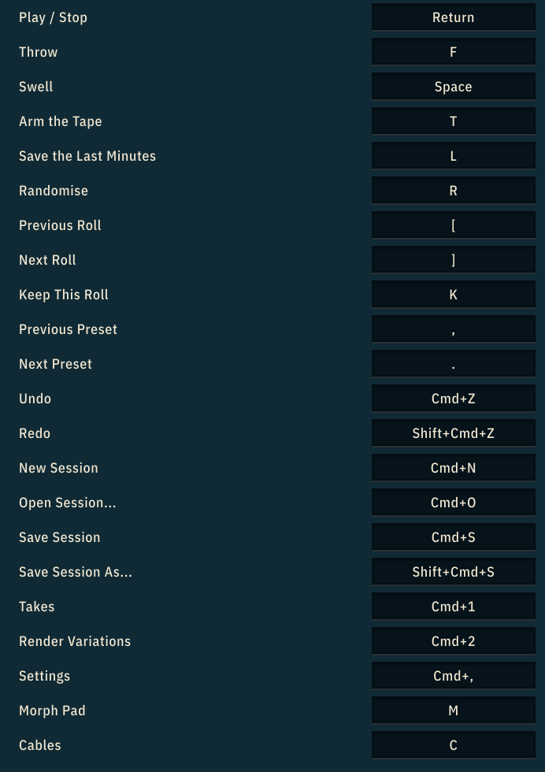

**Settings** has a **Shortcuts** list down its right-hand side: every action Swooshbuckler can do, with the key it
has now. Click a row and press the key you want. Esc leaves the row as it was and Backspace takes the key away
altogether. If another action already has that key, you are asked whether to move it; moving it leaves the other
action with no key until you give it one. **Reset To Defaults** puts every key back.

Your keys are kept with the rest of the settings, so they are still yours the next time you open Swooshbuckler,
in the app and in every DAW. The key an action has is shown beside its item in the menus and at the end of its
tooltip. In the app on a Mac there is also a menu bar - File, Edit, Transport and View - whose items show the
same keys.

### Typing a value

Right-click a knob (or hold Alt and double-click it) and a small box opens on it with the current value. Type a new one in the knob's own units and press Return to keep it; Esc, or a click anywhere else, leaves the knob as it was. A plain double-click still resets the knob.

- Units are optional and are the ones the knob shows: `-12 dB`, `4.2 s`, `35%`, or just `-12`, `4.2`, `35`.
- Milliseconds and seconds are converted, so `0.3 s` on a knob that shows `300 ms` is understood, and a bare number is read in the unit showing at that moment.
- Words the knob shows work too: `Rate` on Throw Length, `Off` on Duck, `-inf` on a fader.
- Stowaway's Filter outside Sub reads which side it is on, and takes the same: `Under 1 kHz`, `Over 300 Hz` or `Open`. A number alone (`1 kHz`) is found on the side the knob is on, or on the other when only that side reaches it.
- A value out of the knob's range goes to the nearest end. Text that isn't a value changes nothing.
- A typed value is one Undo step.

It works on every knob, each track's fader (through its right-click menu), a track's Semitones and Cents boxes, and Master Trim.

### MIDI controllers

A track's fader, and the Energy knob, can follow a fader or knob on a MIDI controller. Nothing is mapped until you do this:

1. Right-click the track's fader (or the Energy knob) and choose **Learn MIDI CC**. The status line asks you to move a control.
2. Move the fader or knob on your controller. The first one that moves is learned (any controller from 0 to 119), on any MIDI channel, and the status line says which ("Track 1 Fader follows MIDI CC 7").

From then on that controller moves the control, whether the rig is playing or stopped. The same menu has **Forget MIDI CC** to let it go and **Cancel Learn MIDI CC** if you change your mind while it waits. One controller can be learned for several things, to move them together. The mappings are kept in the settings, so they are the same in every session, and in the app and the plug-in. Controller moves are not Undo steps.

## Tips

- **Start with beds and a tonal layer.** A couple of Energy Beds on Bus B and one or two growls or tones on Bus A make a whoosh straight away. Add impacts for punctuation.
- **Gappy recordings** (single swishes, takes with pauses) work best with Skip Silence on and a little Fill.
- **For tight synced hits**, put two or three impacts on Hits, turn on Sync Hits and raise Boost.
- **For monster passes**, lower Pitch, raise Low End and Bend, and slow the Rate.
- **Two takes of one sound**: load the same file on two tracks and detune one by 10 to 20 cents with Vari off, for a thicker, chorused layer.
- **Keep a hit's timing but change its size**: pitch an impact down with Vari off and it lands on the same beat, just heavier.
- **For one clean pass instead of two layers flying about**, turn on Link so Bus B follows Bus A's passes. Turn it off when B carries a bed that should keep moving on its own.
- **For a single object going by** (a jet, a car, a creature's call), set that bus's Pass to Fly-By: each sound is heard once, at one pitch. Keep Bed for wind, air and long energy beds.
- **If the buses fight**, turn on Take Turns, or raise Ducked and Filtered on Bus B.
- **To make every layer move like one sound**, make that sound the Master (the star on its lane) and turn on Follow Master. Raise Energy for layers that vanish between its swells.
- **To tune the layers to one sound**, make it the Master, then right-click each pitched track and choose Match Pitch to Master.
- **To morph a growl into a wind**, rope side A to the growl and side B to the wind, switch the morph on and let the dot wander. Everything else keeps playing around them.
- **Record at 96 or 192 kHz** if you plan to pitch the whooshes down later.
- **Leave the tape armed** while you play with the controls. It only writes when there's sound, so you just need to listen back for the good ones.
- **Press Stop and wait for the tail** before you close a take: the echoes and Space ring out onto the tape.

## Building

### Prerequisites
- CMake 3.21 or later
- Xcode command line tools (macOS) or Visual Studio 2022 (Windows)
- JUCE 8.0.8 at `../SDK/JUCE`, relative to this folder

### Build

```bash
cmake -B build -DCMAKE_BUILD_TYPE=Release
cmake --build build --config Release
```

This builds the app, the VST3 and the AU (macOS) into `build/Swooshbuckler_artefacts/Release/`, along with the offline test programs: `SwooshbucklerRig`, `SwooshbucklerCargo`, `SwooshbucklerClassify`, `SwooshbucklerPitch`, `SwooshbucklerMorph`, `SwooshbucklerMaster`, `SwooshbucklerSession`, `SwooshbucklerRender`, `SwooshbucklerKeep`, `SwooshbucklerRouting`, `SwooshbucklerStowaway`, `SwooshbucklerFirstRun` and `SwooshbucklerUi`. Pass `-DSWOOSHBUCKLER_TESTS=OFF` to skip the tests, or `-DSWOOSHBUCKLER_FORMATS="Standalone;VST3"` to choose the formats.

### Version

The version lives in one place, `SWOOSHBUCKLER_VERSION` in [CMakeLists.txt](CMakeLists.txt). Release builds override it from the tag. The copyright year in the About panel is the year it was built.

### Looking at the interface

`SwooshbucklerUiShot` draws the real window offline, with five sounds of its own playing (made in the tool, in [tools/DemoSounds.cpp](tools/DemoSounds.cpp); the app and plug-in have none of them), and writes PNG files: the whole window, one picture per panel, and every panel and menu that opens over it. It also checks every text it draws: that it fits its box, is no smaller than the smallest size, sits on no other text and is capitalised by the one rule (Title Case for control names, sentence case for sentences, capitals only for single letters and acronyms). It exits with an error when a text fails, so run it after changing anything you can see. `SwooshbucklerUi`, one of the test programs, runs the same checks at three window sizes.

```bash
cmake -B build -DSWOOSHBUCKLER_TOOLS=ON
cmake --build build --target SwooshbucklerUiShot
./build/SwooshbucklerUiShot_artefacts/Release/SwooshbucklerUiShot --out ui-shots --scale 1.0 --list
```

`--scale` takes 0.5 to 2.0, `--list` prints every text with its box and every panel with its bounds (a panel that runs into another, or out of the window, is a fault), `--sea` adds a picture of the sea at each of its moments and times a frame of it, and `--state` opens a session file instead of the tool's own sounds. The colours, spacing and type sizes all live in [Source/Theme.h](Source/Theme.h).

### The pictures in this manual

Every picture above is drawn by the same tool, at twice the window's size. To draw them all again after changing anything you can see:

```bash
tools/make-docs-images.sh
```

It builds the tool if it is not there, writes straight into `docs/` and `docs/images/`, and keeps nothing of yours: its own settings and recordings go to a scratch folder. Look at what it wrote before committing. `--docs` on the tool itself does the same into a folder you name.

Each picture is shown at half the width it was drawn at, so it stays sharp on a high-resolution screen: a new picture goes in as `" alt="...">`.

### Icon

The icon is drawn in code, in [tools/IconRender.cpp](tools/IconRender.cpp). After changing it, regenerate `Resources/icon.png` and `Resources/icon.ico` and commit them:

```bash
cmake -B build-icon -DSWOOSHBUCKLER_TOOLS=ON -DSWOOSHBUCKLER_TESTS=OFF -DSWOOSHBUCKLER_FORMATS=Standalone
cmake --build build-icon --target SwooshbucklerIcon
./build-icon/SwooshbucklerIcon_artefacts/SwooshbucklerIcon Resources/icon.png
```

## Releasing

Releases are built by [build-release_swooshbuckler.yml](../.github/workflows/build-release_swooshbuckler.yml). Push a tag and it builds, tests, signs and publishes everything:

```bash
git tag swooshbuckler-v1.0.0
git push origin swooshbuckler-v1.0.0
```

The number in the tag becomes the version everywhere: the About panel, the bundles and both installers.

When the release finishes, the combined Sammy J installer ([build-release_bundle.yml](../.github/workflows/build-release_bundle.yml)) rebuilds itself with the new version, so the "Everything" downloads pick it up. Bump the download button at the top of this README and the root README to the new version.

- **macOS**: uses the same signing secrets as the other plug-ins. The p12 must hold both the Developer ID Application and the Developer ID Installer certificates. `APPLE_ID`, `APPLE_APP_PASSWORD` and `APPLE_TEAM_ID` are for notarisation.
- **Windows**: add `WINDOWS_CERTIFICATE_PFX_BASE64` and `WINDOWS_CERTIFICATE_PASSWORD` (a code-signing certificate as base64 .pfx) to sign the app, the VST3 and the installer. Without them the Windows build is unsigned.

You can also run the workflow by hand (Actions → Build and Release Swooshbuckler → Run workflow) to get the files without publishing a release.

## Credits

- Made by Samuel Justice at [Sweet Justice Sound](https://www.sweetjusticesound.com).
- Fonts: [Pirata One](https://fonts.google.com/specimen/Pirata+One) by Rodrigo Fuenzalida and Nicolas Massi, and [IBM Plex Sans Condensed](https://github.com/IBM/plex) by IBM, both under the SIL Open Font License 1.1.
- Built with [JUCE](https://juce.com).
- VST is a registered trademark of Steinberg Media Technologies GmbH.
- The notices and licences of everything it is built with are in [THIRD-PARTY-NOTICES.md](THIRD-PARTY-NOTICES.md), and under **Licences** in About.

## License

MIT License. See [LICENSE](LICENSE).
