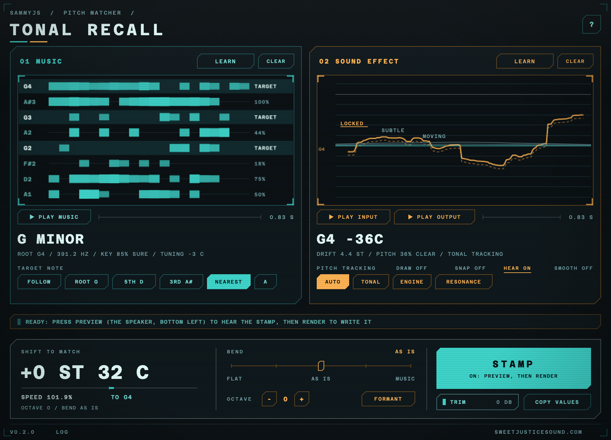
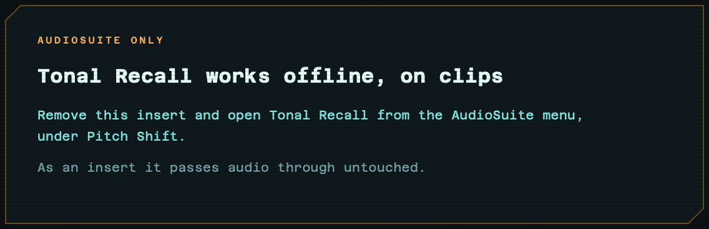
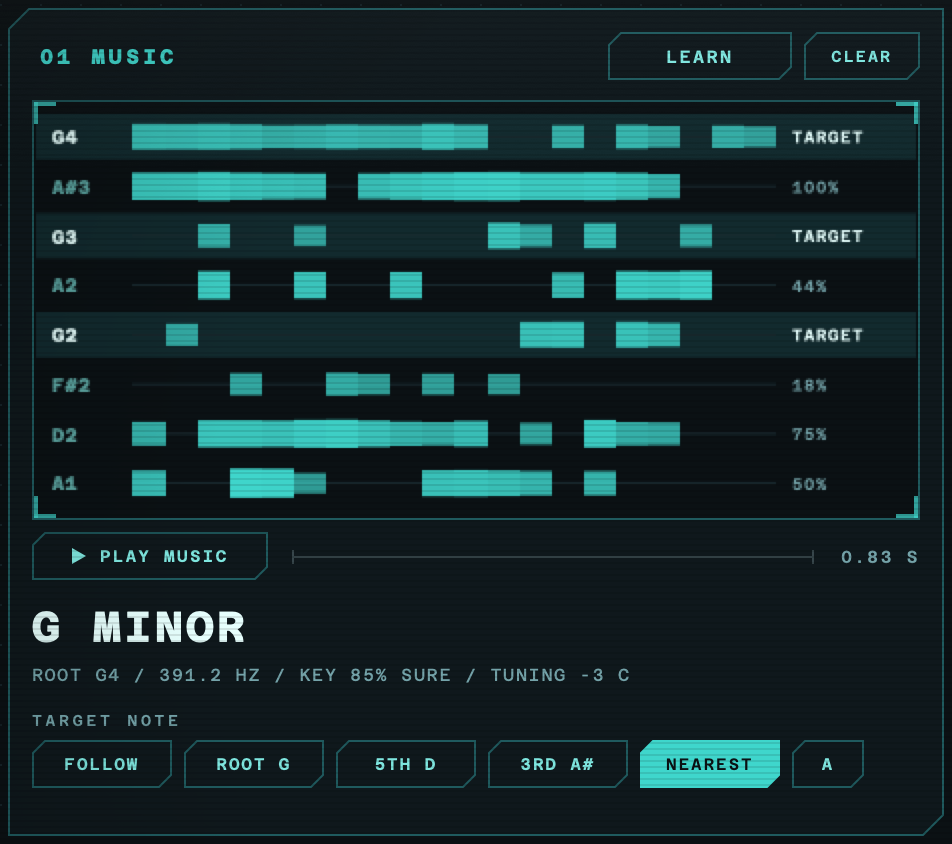
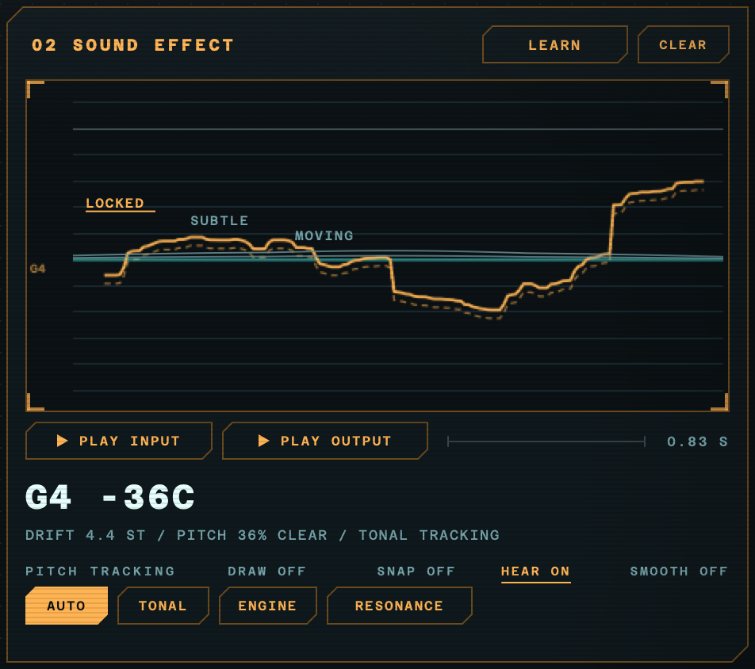
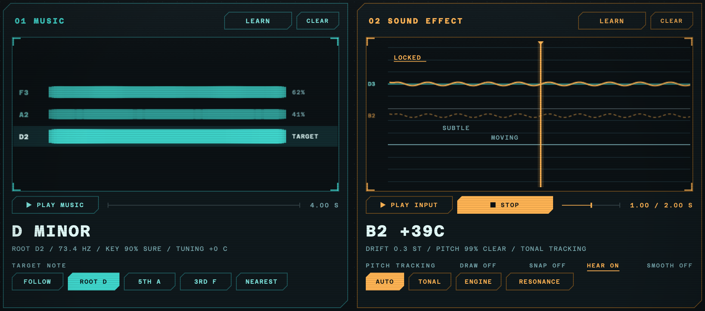
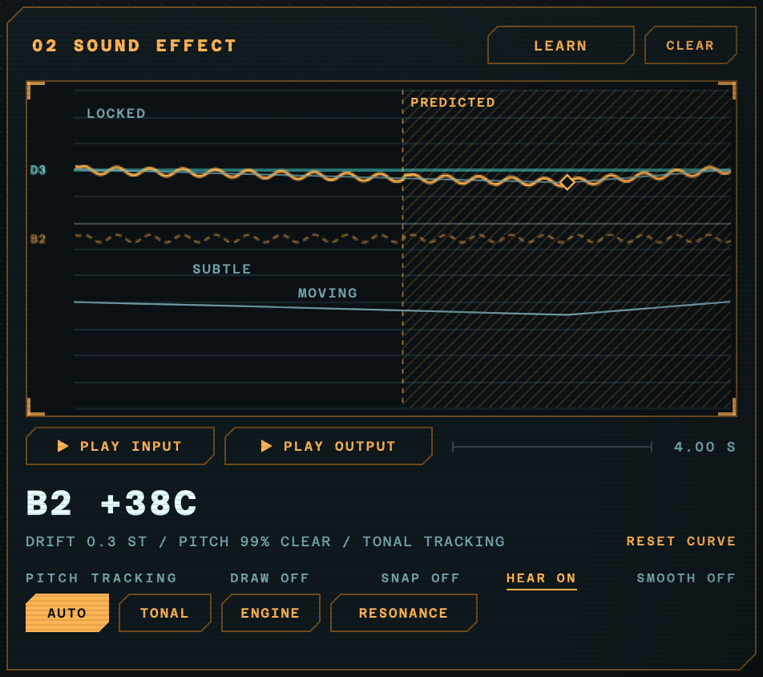
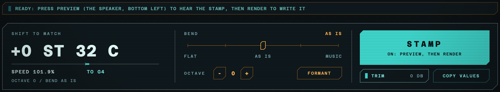
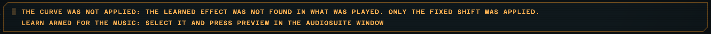
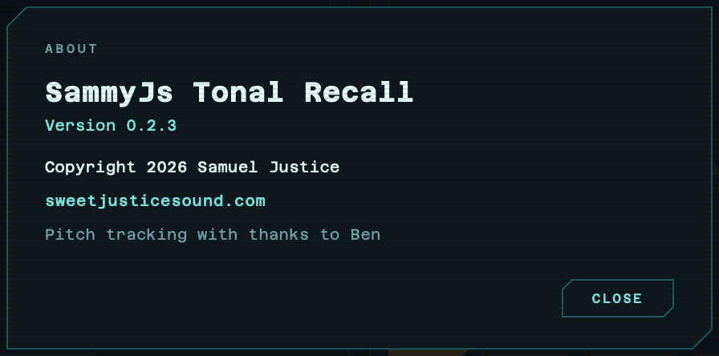
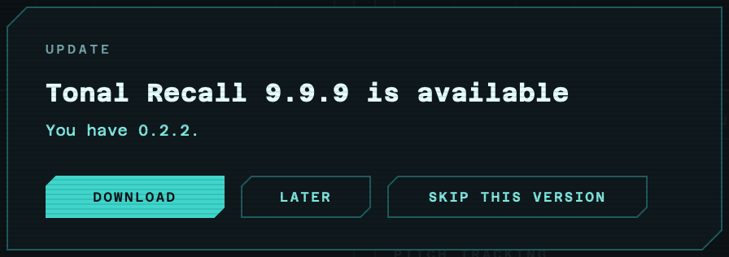

# Tonal Recall


An offline pitch matcher for Pro Tools AudioSuite by **Samuel Justice**, made for trailer sound design. Play it the music, play it a sound effect, and it works out the shift that puts the effect on one of the music's notes, shows it, and stamps it onto the clip when you render. The clip keeps its length and the timing of its hits.

### [Get it with Sammy J's Plugins](https://github.com/samueljustice/plugins/releases/latest), the installer for every Sammy J plug-in



## Features

- **Learn by playing**: arm LEARN, select the clip and press Preview in the AudioSuite window. The selection is learned once as it plays, and Learn switches itself off at the end of the selection.
- **Finds what the music rests on**: the key, the root, the strong notes and how far the music sits from standard tuning, so the effect lands on the music's own tuning and not on a piano's.
- **Tracks the effect's pitch over time**, with three kinds of tracking for voices and tones, engines and drones, and sounds with no clear pitch.
- **A sting, not a tune**: by default the effect takes one fixed shift onto the nearest strong note of the music and keeps every bit of its own movement. Two more ready-made curves, SUBTLE and MOVING, let it lean with the music.
- **Three curves to choose from**, drawn on the effect and named. Click one to use it.
- **Editable**: pull the line, draw it freehand, snap it to the music's notes or scale, undo and redo.
- **Hear it before you commit**: Preview plays the stamped effect, edits are picked up while it loops, and HEAR plays the pitch under the mouse as you drag, like a held key.
- **Play what was learned**: PLAY MUSIC, PLAY INPUT and PLAY OUTPUT play the music and the effect as learned, and the effect as it will be stamped, through Preview, in stereo. Click from one to the next to compare them. A playhead moves across each view as it plays, so you can see where the changes fall.
- **Keeps length and timing**: the shift does not change the clip's length. Hits stay within a millisecond of where they were.
- **Stays under full scale**: shifting pitch can raise a sound's peaks. After each match the stamp is measured, and TRIM turns it down by just enough to keep it under -0.1 dBFS. A limiter catches whatever could not be measured, such as a different clip or the audio around it in a render.
- **Graceful tails**: where the effect runs on past the music you learned, the curve carries on from the music's last movement and eases to a stop, and the window marks that stretch as predicted.
- **Mono and stereo in any mix**: stereo music onto a mono effect, mono music onto a stereo effect, or the same on both.
- **Values for another tool**: COPY VALUES puts the shift, the speed and the target note on the clipboard.

## Where it works

Tonal Recall is an **AudioSuite** plug-in: it works offline, on clips. In Pro Tools, open it from the AudioSuite menu, under Pitch Shift.

Pro Tools also lists it as a track insert. As an insert it passes audio through untouched and the window says where to find it:



The VST3 and AU versions are the same offline tool for other hosts, not a live effect. There, Preview means playing the clip through the plug-in, and Render means bouncing or freezing the track. The top of the window says so in those hosts.

## How to use it

1. **Learn the music.** Click **LEARN** on **01 MUSIC** (it shows ARMED), select the music in the timeline and press **Preview** (the speaker at the bottom left of the AudioSuite window). The button shows LEARNING while the selection plays, and Learn switches itself off at the end of the selection.
2. **Learn the sound effect** the same way on **02 SOUND EFFECT**. Select it roughly where it sits against the music.
3. **Check the match.** The shift appears straight away, with the note it lands on. Choose another target note or another curve if you like, and adjust the line by hand where it needs it.
4. **Listen.** With Preview running, **PLAY MUSIC**, **PLAY INPUT** and **PLAY OUTPUT** play the music, the effect as learned and the effect as it will be stamped. Click from one to the next to compare them while you try targets and curves.
5. **Stamp it.** With **STAMP** on and the effect selected, Preview plays the effect shifted, and **Render** writes the shift into the clip.

The next button to press pulses, and the strip across the middle of the window says what it is for.

What was learned stays for as long as Pro Tools is running: selecting another clip, or closing and reopening the AudioSuite window, does not lose it. While Learn is armed the audio plays through untouched, so Learn and Stamp never mix. Only one Learn can be armed at a time.

A render reaches the plug-in with a little extra audio either side of the selection. Tonal Recall finds the learned effect inside it by itself, so the curve lines up with the effect. If you render a different clip from the one you learned, the fixed shift is applied, and the strip says the curve was not.

## 01 MUSIC



- **LEARN / CLEAR**: arm Learn (click again to disarm), and forget the learned music.
- **The notes**: each row is one note of the music, with blocks where it sounds, brighter where it is stronger. The percentage is how strong the note is against the strongest. Rows marked **TARGET** belong to the note the effect is being matched to.
- **PLAY MUSIC**: plays the learned music from its start, as it was learned, in stereo. A teal playhead runs across the notes, and the time under it counts up to the music's length. Click again (it reads STOP) to stop. See [Playing it back](#playing-it-back).
- **The key**: the key (`G MINOR`), the root note and its frequency, how sure the analysis is, and how far the music sits from standard tuning.
- **TARGET NOTE**: which of the music's notes the effect is put on.

| Target | What it does |
|---|---|
| **NEAREST** | The strong note that needs the smallest move. The default. |
| **ROOT**, **5TH**, **3RD** | The note the music rests on, or the fifth or third above it. |
| **A note name** | Any other strong note of the music. |
| **FOLLOW** | Starts on the nearest note the music is sounding and stays there while the music holds it. When that note has gone for about a third of a second, the effect moves to the nearest note sounding then. It sits in the harmony and moves with it by small steps; it does not play the tune. Where the music does not change, it is the same as NEAREST. |

## 02 SOUND EFFECT



- **LEARN / CLEAR**, as for the music.
- **The scan**: the effect's pitch before the shift (dashed) and after it (solid), against the target note (the teal line, named at the left).
- **The note**: the note the effect sits on and how far from it, in cents (`G4 -36C`), how far its pitch travels (DRIFT), how clear its pitch is, and the tracking used.
- **PLAY INPUT**: plays the effect as it was learned, from its start. A pale playhead runs across the scan.
- **PLAY OUTPUT**: plays the effect as it will be stamped: the shift, the curve, FORMANT and TRIM. An amber playhead runs across the scan. It follows changes as it plays: pick another curve or target, move BEND or OCTAVE, or pull and draw the line, and the next moment you hear has the change. Clicking the scan plays on from there.
- **PITCH TRACKING**: how the effect's pitch is found.

| Tracking | For |
|---|---|
| **AUTO** | Chooses for you: Tonal, or Engine where that fits better, and Resonance when neither finds a pitch. |
| **TONAL** | Voices, single tones and other sounds with one clear pitch. |
| **ENGINE** | Sounds whose overtones all move together, such as engines and rich drones. |
| **RESONANCE** | Sounds with no pitch to follow: it uses the strongest ring in the sound. |

A sound that is pure noise has no pitch to match, and the strip says so.

### The three curves

Three ready-made curves are drawn on the scan, each with its name. The one in use is lit and the others are grey. Click a grey name to switch to it.

| Curve | What the effect does |
|---|---|
| **LOCKED** | One fixed shift onto a note. The effect keeps its own movement and takes none from the music. The default. |
| **SUBTLE** | Rests on the nearest note the music is sounding, glides when the music moves on, and takes on a little of the music's movement. |
| **MOVING** | The same, with most of the music's movement. |

They are shortcuts: each one sets the target note, BEND and SMOOTH, and all three can still be set by hand.

### Editing the curve

- **Pull the line**: drag the solid line up or down anywhere to change the pitch at that moment. Each place you pull stays as a point (a diamond). The adjustment runs in straight lines between points and returns to nothing at the two ends of the effect unless a point sits there. Hold Shift for fine moves. Double-click a point to remove it.
- **DRAW**: freehand. Draw the pitch line with the mouse; what you draw replaces the points under it.
- **SNAP** (off, notes, scale): pulls edits onto the music's notes, or only onto the notes of its scale, on the music's own tuning. Hold Alt while editing to ignore it.
- **SMOOTH** (off, some, full): how gently the effect moves between the notes it rests on when it follows the music. Off, quick steps; some, short slides; full, long ramps from one note to the next. Hand edits are not smoothed: they come out as drawn.
- **UNDO**, **REDO** and **RESET CURVE** appear once there is a hand edit. Undo and Redo step through hand edits (points, drawn lines and Reset Curve); Cmd+Z does the same after clicking the scan, where the host passes the key on. RESET CURVE removes every hand adjustment.
- **HEAR**: with Preview running, the effect sounds while you edit, mixed over the Preview output and through the same engine Stamp renders with, in stereo: held at the pitch you are dragging, then on from there along the curve when you let go. Click the scan without dragging to listen from that point. Edits are also picked up at once by the looping Preview itself. With Preview stopped there is nothing to play into, and the strip says to press it. While PLAY OUTPUT is playing, a drag works the same way and playback carries on from where you let go.

Hand edits belong to the effect that was learned: learning another effect clears them, and they are not saved with the session.

### Playing it back



The three play buttons sit under the scans. They play through the AudioSuite window's Preview, not through an output of their own, so **Preview has to be running** for them to be heard: whatever Preview is playing is replaced while they sound, Stamp on or off. Press a play button before Preview and it waits (it shows ARMED and the strip says to press Preview), then starts from the beginning as Preview starts. Click it again to call it off.

- One plays at a time: starting one hands over from the other with a short cross-fade.
- Each plays once, from its start to its end, then stops by itself. The playhead and the time beside the buttons show where it is, scaled to that clip's own length.
- The music and the effect as learned are played exactly as they were learned. The effect as stamped goes through the same engine as Stamp, and its playhead shows the moment being heard.
- With STAMP on, the amber playhead also runs across the effect's scan while Preview itself plays the learned effect, and comes round again each time Preview loops.
- The buttons are dimmed until their side has been learned (PLAY OUTPUT also needs a match), while Learn is armed or listening, and when the session is not at the sample rate the clip was learned at. A Render never carries any of it.

### Tails



Hatched stretches of the scan lie outside the music you learned. Where the effect is following the music, the curve there is a prediction: it carries on from the music's last movement and eases to a stop. Check it by ear and pull the line where it needs it.

## The strip, the shift and Stamp



**The strip** says what to do next, or what went wrong, in plain words. With more to say than fits, it shows the most important and counts the rest.



| Control | What it does |
|---|---|
| **SHIFT TO MATCH** | The shift in semitones and cents, the same as a playback speed, and the note it lands on. |
| **BEND** | Left flattens the effect's own pitch wobble so it holds its note. Right adds the inflection of the music's lead voice: where the voice slides into a note or drifts, the effect leans the same way, and while the voice holds a note the effect stays on its own. The centre (AS IS) leaves the effect alone. Double-click for the centre. |
| **OCTAVE** | Moves the target up to two octaves either way. |
| **FORMANT** | Keeps the effect's tone colour when it is shifted, so it does not sound smaller or bigger. Best on voices and creature sounds. |
| **STAMP** | On: Preview plays the effect with the shift applied, and Render writes it to the clip. Off: audio passes through untouched. |
| **TRIM** | Shifting pitch can raise a sound's peaks. On (the default): the stamp is turned down by just enough to keep it under full scale, and the figure says how much (`TRIM -1.8 DB`, or `0 DB` when nothing is needed). It reads MEASURING for a moment after each change to the match. Off: the level is left alone and a limiter holds any peaks. |
| **COPY VALUES** | Copies a line such as `Tonal Recall: +2.62 st (+2 st 62 c), speed 116.3%, to D3 (D minor)`, to match by hand in another tool, with the trim added when one is applied (`, trim -1.8 dB`). For a curve that moves, the values are those of its first note. |

In the footer, **LOG** shows the diagnostic log, which records what the host asked of the plug-in. It is the file to send with a bug report.

## About and updates

Click **?** at the top right for the About panel, with the version and the credits.



When the window opens, Tonal Recall asks GitHub, at most once a day, whether a newer version is out. If there is one, it offers it once: DOWNLOAD opens the Sammy J's Plugins installer's page, LATER asks again another day, and SKIP THIS VERSION does not offer that version again. Offline, nothing happens.



## Good to know

- Up to 60 seconds per Learn. If Preview stops before the end of the selection, the strip says how much was heard: play it again to learn the rest.
- Learn uses the selection's length to know when one pass is over. That is exact at a constant tempo.
- Stamp needs the session at the sample rate the effect was learned at, and the play buttons need it at the rate each clip was learned at.
- Whatever TRIM is set to, nothing is stamped above -0.1 dBFS: a limiter at the end of the stamp holds any peak the trim did not cover. The strip says when it had to on the last render, when TRIM is off and the stamp would go over, and when the effect reaches full scale as learned (it may have been clipped before it got here).
- The plug-in reports a latency of about 290 ms at 48 kHz. Pro Tools compensates it in a render, so the result lines up with the original.
- The target, the curve settings, Formant, Stamp and Trim are saved with the session. The learned audio and hand edits are kept in memory only.
- On a stereo effect, use AudioSuite's multichannel mode, so both channels are learned together.

## System requirements

- macOS 11 or later (Apple Silicon and Intel): AAX (Pro Tools AudioSuite), VST3 and AU
- Windows 10 or later (64-bit): AAX (Pro Tools AudioSuite) and VST3

## Building

### Prerequisites

- CMake 3.22 or higher
- Xcode Command Line Tools (macOS) or Visual Studio 2022 (Windows)
- JUCE 8.0.8 at `../SDK/JUCE` and Rubber Band 4.0.0, built as a static library, at `../SDK/rubberband-4.0.0`, relative to this folder
- The UI fonts are read from `../pitchflattener/Resources/Fonts`, and the update check from `../common`

### Build instructions

From the repository root:

```bash
cmake -S tonalrecall -B tonalrecall/build -DCMAKE_BUILD_TYPE=Release -DSAMMYJ_AAX=ON -DTONALRECALL_TESTS=ON
cmake --build tonalrecall/build --config Release
tonalrecall/build/TonalRecallCoreTests
tonalrecall/build/TonalRecallTests
```

The bundles land in `tonalrecall/build/TonalRecall_artefacts/Release/{AAX,AU,VST3}`. Leave out `-DSAMMYJ_AAX=ON` to build only VST3 and AU. An unsigned AAX loads only in a developer build of Pro Tools.

`TonalRecallCoreTests` checks the analysis and the stamp on made-up material with known answers, including how far hits move and how close the pitch lands. `TonalRecallTests` drives real plug-in instances: Learn to Render end to end, the saved options and the window. It takes an optional log file and an optional folder for pictures of the window (the pictures on this page come from it).

## Credits

Created by Samuel Justice, Creative Sound Supervisor at [Sweet Justice](https://www.sweetjusticesound.com).

- Pitch tracking with thanks to Ben.
- Pitch shifting: [Rubber Band Library](https://breakfastquay.com/rubberband/) (GPL / commercial).
- UI font: [Azeret Mono](https://github.com/displaay/Azeret), SIL Open Font License 1.1.

## License

MIT License. See [LICENSE](LICENSE) for details.
