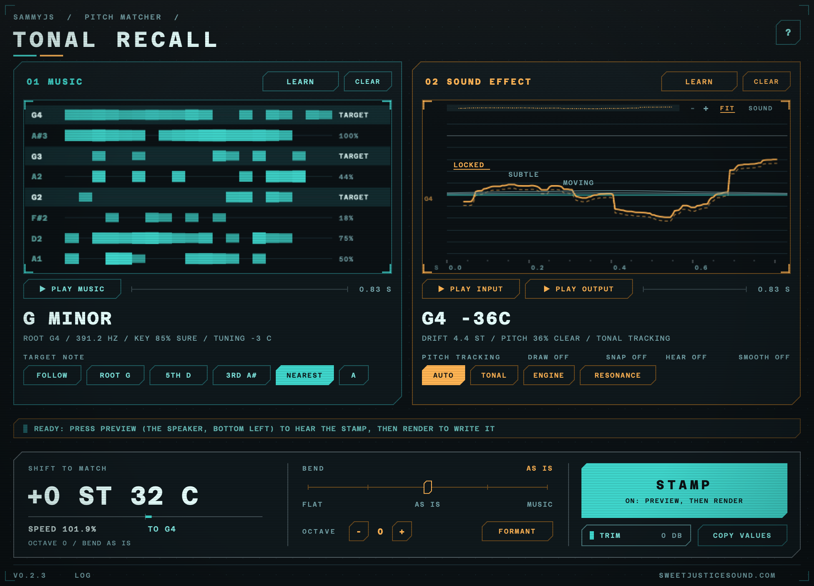

## Tonal Recall 0.2.3

Tonal Recall 0.2.3 never plays or renders the music shifted.

Sessions keep their settings, and the latency is unchanged.

### The music is left alone

The music is what the effect is matched to, so it should never be heard with the effect's shift on it.

- **Tonal Recall recognises the learned music.** Select the music, or any part of it, and press Preview or Render with STAMP on: it comes out exactly as it is, and the strip says that it is the learned music. The effect, and any other clip, is stamped as before.

### Fixed

- **Learning the music with an effect already learned.** When Learn finished at the end of the selection, Preview carried on round the music, and as the match arrived the music was played with the effect's shift on it. A Preview that learns the music is left untouched to its end; the next Preview stamps as usual. A Preview that learns the effect still goes straight on to playing it stamped.

The AAX for Pro Tools is in the [Sammy J's Plugins installer](https://github.com/samueljustice/plugins/releases/latest), which also installs the newest version of every other Sammy J plug-in.

### Downloads

| File | Contents |
|---|---|
| `TonalRecall-0.2.3-macOS-Installer.pkg` | macOS installer (AU + VST3, universal) |
| `TonalRecall-0.2.3-Windows-Installer.exe` | Windows installer (VST3) |
| `TonalRecall-0.2.3-macOS-AU.zip`, `TonalRecall-0.2.3-macOS-VST3.zip`, `TonalRecall-0.2.3-Windows-VST3.zip` | The plug-ins on their own |

The macOS downloads are signed and notarised. Universal (Apple silicon and Intel), macOS 11 or later. Windows: 64-bit Windows 10 or later.

The manual, with a tour of every control: [tonalrecall/README.md](https://github.com/samueljustice/plugins/blob/main/tonalrecall/README.md).
